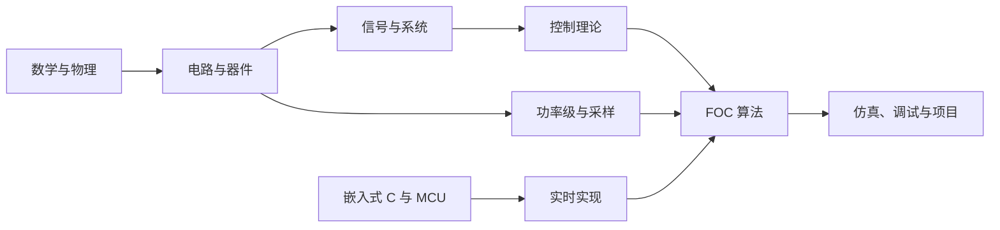
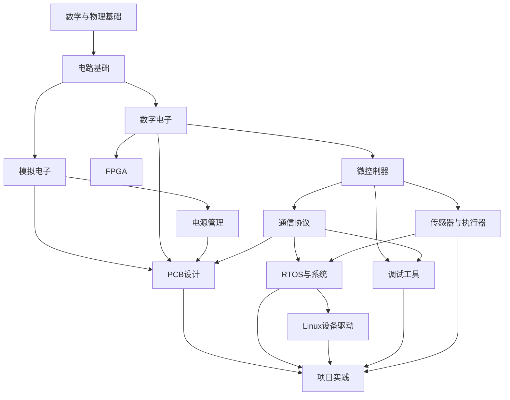
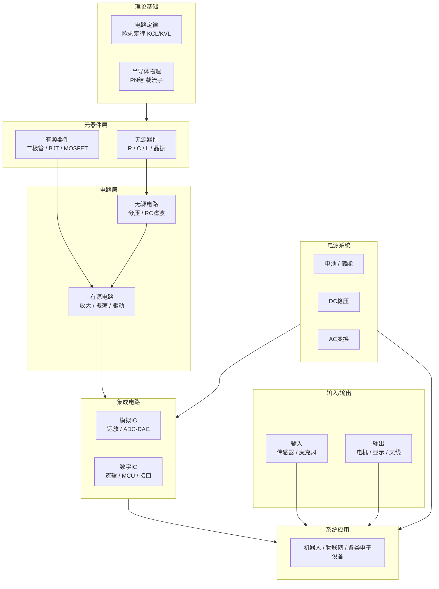
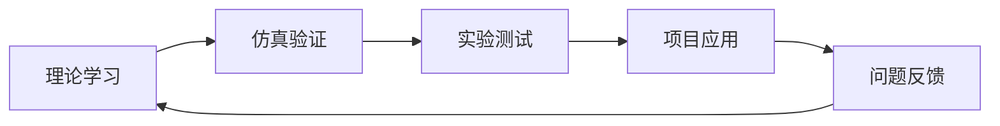

# EE 工程知识库

这套知识库以电子工程和嵌入式开发为基础，重点支撑控制理论与 FOC 电机控制的学习、仿真和工程实现。

## 从这里开始

## 知识领域

| 领域 | 内容 |
|------|------|
| [[01-Foundations/00-README]] | 数学、物理、电路、器件、信号、ADC/DAC、嵌入式 C |
| [[02-Analog-Electronics/00-README]] | 放大器、运放、模拟滤波器 |
| [[03-Digital-Electronics/00-README]] | 数字逻辑、状态机、FPGA、Verilog |
| [[04-Microcontrollers/00-README]] | STM32、ESP32、RISC-V、中断、DMA、启动流程 |
| [[05-Communication/00-README]] | I2C、SPI、UART、CAN、USB、以太网、无线通信 |
| [[06-PCB-Design/00-README]] | 原理图、层叠、阻抗、信号完整性、EMC、制造 |
| [[07-Power-Management/00-README]] | DC-DC、电源架构、电池管理、低功耗 |
| [[08-Sensors-Actuators/00-README]] | 传感器接口、电机驱动、基础控制 |
| [[09-Debugging-Tools/00-README]] | 示波器、逻辑分析仪、日志、JTAG、SWD |
| [[10-RTOS与系统/00-README]] | FreeRTOS、Zephyr、RT-Thread、嵌入式 Linux |
| [[11-Machine-Vision/000-README]] | 图像处理、标定、嵌入式视觉（建设中） |
| [[11-Projects/00-README]] | 从入门项目到系统级项目 |
| [[12-Resources/00-README]] | 课程、书籍、网站、标准与认证 |
| [[13-Appendix/00-README]] | 术语、工具、元器件选型和知识库维护 |
| [[14-FOC-电机控制/00-README]] | 电机模型、坐标变换、SVPWM、观测器、辨识与实现 |
| [[15-双控（控制理论与控制工程）/00-README]] | 经典控制、现代控制、数字控制、辨识、MPC 与实现 |
| [[16-Linux设备驱动开发/00-README]] | Linux 设备模型、设备树、中断、GPIO/pinctrl、外设驱动、调试与工程实战 |

## FOC 学习主线

### 阶段 1：数学、电路与信号

- [[01-Foundations/01-数学与物理基础/000-README|数学与物理基础]]：复数、向量、矩阵、微积分和微分方程。
- [[01-Foundations/02-电路基础理论/000-README|电路基础理论]]：KCL、KVL、RC/RL/RLC 和交流分析。
- [[01-Foundations/04-电子元器件/000-README|电子元器件]]：MOSFET、运放、电阻、电容和电感。
- [[01-Foundations/05-信号与系统/000-信号与系统|信号与系统]]：卷积、傅里叶、拉普拉斯、Z 变换、采样和稳定性。

> 完成标志：能从电路方程得到传递函数，能解释极点、带宽、采样和时域响应之间的关系。

### 阶段 2：嵌入式与功率接口

- [[01-Foundations/08-嵌入式C编程/000-嵌入式C编程|嵌入式 C 编程]]
- [[04-Microcontrollers/00-README|微控制器]]，重点 STM32、ADC、PWM、定时器、中断和 DMA。
- [[07-Power-Management/00-README|电源管理]]与[[08-Sensors-Actuators/00-README|传感器和执行器]]。
- [[09-Debugging-Tools/00-README|调试工具]]，重点示波器、电流探头和逻辑分析仪。

> 完成标志：能设计同步采样与 PWM 更新时序，并说明过流、欠压、死区和采样噪声的处理边界。

### 阶段 3：控制理论

- [[15-双控（控制理论与控制工程）/02-经典控制理论/000-图解入门：从根轨迹到Bode图|经典控制理论]]
- [[15-双控（控制理论与控制工程）/04-PID与工业控制器设计/000-图解入门：PID的物理直觉|PID 与工业控制器]]
- [[15-双控（控制理论与控制工程）/05-数字控制与离散系统/000-图解入门：数字控制与模拟控制的区别|数字控制与离散系统]]

> 完成标志：能根据对象模型、采样周期和带宽目标设计 PI，并检查稳定裕度、饱和与离散化影响。

### 阶段 4：FOC 算法与验证

- [[14-FOC-电机控制/00-README|FOC 电机控制微专业]]
- 顺序建议：电机结构与模型 → Clarke/Park → FOC 电流环 → SVPWM → 采样与重构 → 参数辨识 → 无传感器控制 → 代码实现 → 仿真和调试。

> 完成标志：能在仿真中闭合电流环，并在硬件上验证电流极性、角度方向、PWM 时序、保护链和实时预算。

### 阶段 5：项目闭环

- 从[[11-Projects/00-README|项目实践]]选择一个可以测量、复现和验收的项目。
- 项目记录至少包含需求、原理图、参数、代码版本、测试条件、波形、故障记录和复盘。

## 通用电子工程路线

不以 FOC 为目标时，可从以下分类选择领域。模拟、数字、通信、PCB、电源和 RTOS 之间存在依赖，但不需要按目录编号逐项完成。

### 理论基础

- [[01-Foundations/01-数学与物理基础/000-README|数学与物理基础]]
- [[01-Foundations/02-电路基础理论/000-README|电路基础理论]]
- [[01-Foundations/03-电路分析方法/000-电路分析方法|电路分析方法]]
- [[01-Foundations/04-电子元器件/000-README|电子元器件]]
- [[01-Foundations/05-信号与系统/000-信号与系统|信号与系统]]
- [[01-Foundations/06-ADC与DAC基础/000-ADC与DAC基础|ADC 与 DAC]]
- [[01-Foundations/07-测量与仪器基础/000-测量与仪器基础|测量与仪器]]
- [[01-Foundations/08-嵌入式C编程/000-嵌入式C编程|嵌入式 C 编程]]

### 硬件设计

- [[02-Analog-Electronics/00-README|模拟电子]]
- [[03-Digital-Electronics/00-README|数字电子与 FPGA]]
- [[06-PCB-Design/00-README|PCB、信号完整性与 EMC]]
- [[07-Power-Management/00-README|电源管理]]
- [[08-Sensors-Actuators/00-README|传感器与执行器]]

### 嵌入式系统

- [[04-Microcontrollers/00-README|微控制器]]
- [[05-Communication/00-README|通信协议与接口]]
- [[09-Debugging-Tools/00-README|调试工具]]
- [[10-RTOS与系统/00-README|RTOS 与嵌入式 Linux]]
- [[16-Linux设备驱动开发/00-README|Linux 设备驱动开发]]

### 控制与电机

- [[15-双控（控制理论与控制工程）/00-README|控制理论与控制工程]]
- [[14-FOC-电机控制/00-README|FOC 电机控制]]

### 视觉、项目与参考

- [[11-Machine-Vision/000-README|机器视觉]]（建设中）
- [[11-Projects/00-README|项目实践]]
- [[12-Resources/00-README|学习资源]]
- [[13-Appendix/00-README|附录与速查]]

## 测验题索引

### 基础理论

- [[01-Foundations/10-电路分析测验题|电路分析]]
- [[01-Foundations/11-电子元器件测验题|电子元器件]]
- [[01-Foundations/12-信号与系统测验题|信号与系统]]
- [[01-Foundations/13-嵌入式C编程测验题|嵌入式 C]]

### 模拟与数字

- [[02-Analog-Electronics/04-模拟电路基础测验题|模拟电路基础]]
- [[02-Analog-Electronics/05-运算放大器测验题|运算放大器]]
- [[03-Digital-Electronics/06-数字逻辑测验题|数字逻辑]]
- [[03-Digital-Electronics/07-组合逻辑电路测验题|组合逻辑电路]]

### MCU、通信和 RTOS

- [[04-Microcontrollers/08-STM32测验题|STM32]]
- [[05-Communication/08-I2C-SPI-UART测验题|I2C、SPI 与 UART]]
- [[05-Communication/09-CAN总线测验题|CAN 总线]]
- [[10-RTOS与系统/06-RTOS基础测验题|RTOS 基础]]
- [[10-RTOS与系统/07-FreeRTOS测验题|FreeRTOS]]

### PCB、电源、传感器和调试

- [[06-PCB-Design/07-PCB设计基础测验题|PCB 设计基础]]
- [[06-PCB-Design/08-PCB层叠与阻抗设计测验题|PCB 层叠与阻抗]]
- [[07-Power-Management/06-电源管理基础测验题|电源管理基础]]
- [[07-Power-Management/07-DC-DC测验题|DC-DC]]
- [[08-Sensors-Actuators/05-传感器接口测验题|传感器接口]]
- [[09-Debugging-Tools/06-调试工具综合测验题|调试工具]]

> 控制理论和 FOC 的自测题分布在各主题笔记末尾，尚未形成独立题库。

## 闪卡复习

闪卡用于记忆定义、公式条件、单位、故障现象与排查顺序，不适合代替推导和项目实践。建议范围：

- 电路定律、常用等效模型和单位换算
- 傅里叶、拉普拉斯、Z 变换的适用条件
- 一阶、二阶系统指标及公式边界
- ADC、PWM、定时器和通信协议的关键约束
- FOC 坐标变换符号、采样时序、保护条件和调试顺序

含 `#flashcard` 标签的笔记通过 Dataview 自动汇总。闪卡答案应包含必要条件——比如记录调节时间公式时，需同时写明误差带、系统阶次、阻尼范围和近似条件。

## 知识图谱

### 知识体系总览

### 电子工程全景

### 主题依赖关系

| 主题 | 前置依赖 | 支撑后续 |
|------|----------|----------|
| 数学物理 | 无 | 电路分析、信号与系统 |
| 电路分析 | 数学物理 | 模拟、数字、电源 |
| 信号与系统 | 数学物理、电路分析 | 滤波器、通信、控制 |
| 运算放大器 | 电路分析、信号与系统 | 滤波器、仪器放大 |
| 数字逻辑 | 电路分析 | MCU、FPGA |
| 微控制器 | 数字逻辑、C 语言 | 通信、传感器、RTOS |
| 通信协议 | 微控制器、信号与系统 | 物联网、网络系统 |
| 电源管理 | 电路分析、模拟电子 | PCB、系统供电 |
| 传感器与执行器 | 微控制器、模拟电子 | 机器人、自动化 |
| PCB 设计 | 模拟、数字、电源 | 项目落地 |
| 调试工具 | 各阶段并行 | 问题诊断、故障排查 |
| RTOS | 微控制器、通信 | 复杂系统、项目 |
| 项目实践 | 各主题综合 | 专家深化 |

### 学习闭环

### 信号链：从物理到数字

## 使用说明

- 第一次学习一个主题时，从领域 README 或模块总览进入，不依赖文件名猜测顺序。
- 公式和代码旁的条件、假设与单位属于正文的一部分，复用前需要一起检查。
- 外部资源可能变化，优先使用官方文档、教材和原始论文。
- 学习状态记录在具体主题或项目中，完成一节后做对应测验并记录仍无法解释的问题。
- 发现断链或渲染问题时，运行[[13-Appendix/04-知识库维护/00-README|知识库维护检查]]。
