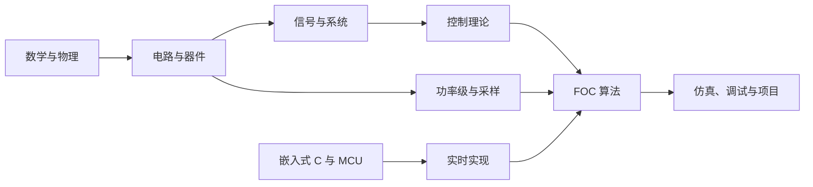

# 学习路线图

> 本页是知识库的学习主线总览，详细索引见 [[00-Index/00-README|知识库首页]] 与 [[02-MOC-主题索引|主题索引]]。

## FOC 学习主线（重点方向）

### 阶段 1：数学、电路与信号

- [[01-Foundations/01-数学与物理基础/000-README|数学与物理基础]]：复数、向量、矩阵、微积分和微分方程。
- [[01-Foundations/02-电路基础理论/000-README|电路基础理论]]：KCL、KVL、RC/RL/RLC 和交流分析。
- [[01-Foundations/04-电子元器件/000-README|电子元器件]]：MOSFET、运放、电阻、电容和电感。
- [[01-Foundations/05-信号与系统/000-信号与系统|信号与系统]]：卷积、傅里叶、拉普拉斯、Z 变换、采样和稳定性。

> 完成标志：能从电路方程得到传递函数，能解释极点、带宽、采样和时域响应之间的关系。

### 阶段 2：嵌入式与功率接口

- [[01-Foundations/08-嵌入式C编程/000-嵌入式C编程|嵌入式 C 编程]]
- [[04-Microcontrollers/00-README|微控制器]]，重点 STM32、ADC、PWM、定时器、中断和 DMA。
- [[07-Power-Management/00-README|电源管理]]与[[08-Sensors-Actuators/00-README|传感器和执行器]]。
- [[09-Debugging-Tools/00-README|调试工具]]，重点示波器、电流探头和逻辑分析仪。

> 完成标志：能设计同步采样与 PWM 更新时序，并说明过流、欠压、死区和采样噪声的处理边界。

### 阶段 3：控制理论

- [[15-双控（控制理论与控制工程）/02-经典控制理论/000-图解入门：从根轨迹到Bode图|经典控制理论]]
- [[15-双控（控制理论与控制工程）/04-PID与工业控制器设计/000-图解入门：PID的物理直觉|PID 与工业控制器]]
- [[15-双控（控制理论与控制工程）/05-数字控制与离散系统/000-图解入门：数字控制与模拟控制的区别|数字控制与离散系统]]

> 完成标志：能根据对象模型、采样周期和带宽目标设计 PI，并检查稳定裕度、饱和与离散化影响。

### 阶段 4：FOC 算法与验证

- [[14-FOC-电机控制/00-README|FOC 电机控制微专业]]
- 顺序建议：电机结构与模型 → Clarke/Park → FOC 电流环 → SVPWM → 采样与重构 → 参数辨识 → 无传感器控制 → 代码实现 → 仿真和调试。

> 完成标志：能在仿真中闭合电流环，并在硬件上验证电流极性、角度方向、PWM 时序、保护链和实时预算。

### 阶段 5：项目闭环

- 从[[11-Projects/00-README|项目实践]]选择一个可以测量、复现和验收的项目。
- 项目记录至少包含需求、原理图、参数、代码版本、测试条件、波形、故障记录和复盘。

## 通用电子工程路线

不以 FOC 为目标时，可从以下分类选择领域。模拟、数字、通信、PCB、电源和 RTOS 之间存在依赖，但不需要按目录编号逐项完成。

### 理论基础

- [[01-Foundations/01-数学与物理基础/000-README|数学与物理基础]]
- [[01-Foundations/02-电路基础理论/000-README|电路基础理论]]
- [[01-Foundations/03-电路分析方法/000-电路分析方法|电路分析方法]]
- [[01-Foundations/04-电子元器件/000-README|电子元器件]]
- [[01-Foundations/05-信号与系统/000-信号与系统|信号与系统]]
- [[01-Foundations/06-ADC与DAC基础/000-ADC与DAC基础|ADC 与 DAC]]
- [[01-Foundations/07-测量与仪器基础/000-测量与仪器基础|测量与仪器]]
- [[01-Foundations/08-嵌入式C编程/000-嵌入式C编程|嵌入式 C 编程]]

### 硬件设计

- [[02-Analog-Electronics/00-README|模拟电子]]
- [[03-Digital-Electronics/00-README|数字电子与 FPGA]]
- [[06-PCB-Design/00-README|PCB、信号完整性与 EMC]]
- [[07-Power-Management/00-README|电源管理]]
- [[08-Sensors-Actuators/00-README|传感器与执行器]]

### 嵌入式系统

- [[04-Microcontrollers/00-README|微控制器]]
- [[05-Communication/00-README|通信协议与接口]]
- [[09-Debugging-Tools/00-README|调试工具]]
- [[10-RTOS与系统/00-README|RTOS 与嵌入式 Linux]]
- [[16-Linux设备驱动开发/00-README|Linux 设备驱动开发]]

### 控制与电机

- [[15-双控（控制理论与控制工程）/00-README|控制理论与控制工程]]
- [[14-FOC-电机控制/00-README|FOC 电机控制]]

### 视觉、项目与参考

- [[11-Machine-Vision/000-README|机器视觉]]（建设中）
- [[11-Projects/00-README|项目实践]]
- [[12-Resources/00-README|学习资源]]
- [[13-Appendix/00-README|附录与速查]]
