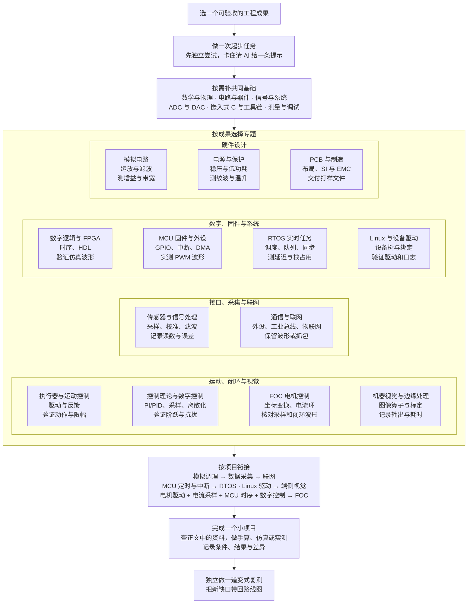

# 学习路线图

[[00-Index/00-README|知识库首页]] · [[00-Index/02-MOC-主题索引|查正文]] · [[00-Index/03-AI自学任务索引|开始一个任务]] · [[00-Index/04-练习与复习|练习与复习]]

## 全局学习路线图

从想交付的成果出发，补齐所选路线的先修。同组路线可独立学习或并行推进，遇到跨方向的项目时再组合。下方的路线表可跳到各专题的起步任务和验收标准。

## 按工程目标选路线

先选一个想交付的成果，再用起步任务检查前置知识。箭头表示推荐次序，同一阶段列出的准备可并行。每条路线都有可以先完成的小成果，后续分支按项目需求选择。

| 想完成的工作 | 对应路线 |
|---|---|
| 设计、制作和验证电路板 | [[#模拟电路与信号调理\|模拟电路]] · [[#电源、保护与低功耗\|电源管理]] · [[#PCB、信号完整性与制造\|PCB 与制造]] |
| 让数字系统和固件运行 | [[#数字逻辑、HDL 与 FPGA\|数字逻辑与 FPGA]] · [[#MCU 固件与外设\|MCU 固件]] · [[#RTOS 与实时任务\|RTOS]] · [[#嵌入式 Linux 与设备驱动\|嵌入式 Linux 与驱动]] |
| 采数据、接设备、组成网络 | [[#传感器、数据采集与信号处理\|传感器与采集]] · [[#通信协议、工业总线与物联网\|通信与联网]] |
| 驱动机构、设计闭环或实现视觉 | [[#执行器驱动与运动控制\|执行器与运动控制]] · [[#控制理论与数字控制\|控制理论]] · [[#FOC 学习主线（重点方向）\|FOC]] · [[#机器视觉与边缘处理\|机器视觉]] |

第一次进库可以先做 [[00-Index/03-AI自学任务索引#基础理论：从 RC 波形回到模型|RC 电路]] 或 [[00-Index/03-AI自学任务索引#基础理论：读懂交叉编译产物|C 构建]]，用一次计算或一次构建找到起点。只有碎片时间时，按 [[01-Foundations/09-学习方法与工具/011-用AI安排碎片时间自学|10、25、60 分钟自学方法]]安排一次任务。

## 共同基础按需补齐

[[01-Foundations/00-README|基础理论]]有完整的学习资料。先检查当前路线用得上的一项，过关后继续应用。

| 能力 | 到哪里补 | 进入专题前做一次什么 |
|---|---|---|
| 工程数学与物理模型 | [[01-Foundations/01-数学与物理基础/000-README#数学与物理基础\|数学与物理基础]] | 从公式读懂单位和量级。用到相量、状态方程、坐标变换或噪声时，再补复数、微分方程、矩阵或概率 |
| 电路与器件 | [[01-Foundations/02-电路基础理论/000-README#电路基础理论\|电路定律]] → [[01-Foundations/03-电路分析方法/000-电路分析方法\|分析方法]]；按需查 [[01-Foundations/04-电子元器件/000-README#电子元器件\|器件特性]] | 列出分压或 RC 方程，标出参考方向、输入和输出，检查负载改变后的结果 |
| 信号与系统 | [[01-Foundations/05-信号与系统/000-信号与系统\|信号与系统]] | 能在时域、频域和离散表示之间选择工具。做控制侧重极点、频响和采样，做频谱侧重卷积、混叠与 FFT |
| ADC 与 DAC | [[01-Foundations/06-ADC与DAC基础/000-ADC与DAC基础\|数据转换与采集]] | 给定输入范围和参考电压，说明采样率、量化、前端带宽和建立时间怎样影响读数 |
| 程序与目标平台 | [[01-Foundations/08-嵌入式C编程/000-嵌入式C编程\|嵌入式 C 与工具链]] | 能看懂从源码到 ELF 的过程，用小程序检查类型宽度、边界和目标架构 |
| 测量与调试 | [[01-Foundations/07-测量与仪器基础/000-测量与仪器基础\|测量基础]] → [[09-Debugging-Tools/00-README#调试工具（09-Debugging-Tools）\|示波器、逻辑分析仪与调试接口]] | 先写预期，再选仪器。留下读数、单位、触发或日志条件，并能说明测量本身带来的影响 |

## 硬件设计

### 模拟电路与信号调理

[[02-Analog-Electronics/00-README|进入模拟电子]] · 起步做 [[00-Index/03-AI自学任务索引#模拟电子：检查运放的增益和摆幅|运放增益与摆幅]]。

1. 先会节点法和负载分析，再看偏置、放大、小信号模型、反馈与稳定性。
2. 从 [[02-Analog-Electronics/02-运算放大器/001-理想运放特性|理想运放]]进入实际器件。先核对供电、共模范围、摆幅和带宽，再设计 [[02-Analog-Electronics/03-滤波器设计/001-滤波器类型|滤波与调理]]。
3. **验收** · 给定输入幅度和通带，做一段放大或低通电路。用计算与仿真或实测对比增益、截止频率和失真边界。做采集系统时，继续验 ADC 前端与检波结果。

### 电源、保护与低功耗

[[07-Power-Management/00-README|进入电源管理]] · 起步做 [[00-Index/03-AI自学任务索引#电源管理：解释 Buck 的开关行为|Buck 开关行为]]。

1. 从输入范围、负载电流和电源树出发，比较 LDO 与 [[07-Power-Management/02-DC-DC转换器/02-DC-DC转换器|Buck、Boost、Buck-Boost]] 的选择。
2. 把原理计算推进到器件选型、纹波、热、保护与布局。有电池或续航要求时，再接 [[07-Power-Management/04-电池管理系统/04-电池管理系统|电池管理]] 和 [[07-Power-Management/05-低功耗设计/05-低功耗设计|低功耗]]。
3. **验收** · 做一条可验证的低压电源轨，记录输入与负载条件，核对输出、纹波和温升。可用 [[11-Projects/03-进阶项目/002-2数控电源Buck|Buck 项目]] 挑一个实现阶段。

### PCB、信号完整性与制造

[[06-PCB-Design/00-README|进入 PCB 设计]] · 起步做 [[00-Index/03-AI自学任务索引#PCB 设计：完成第一块小板的检查|第一块小板]]。

1. 先能解释电路、接口与电源约束，再用 [[06-PCB-Design/05-KiCad教程/002-快速入门流程|KiCad 流程]]完成原理图、封装、布局、布线与 ERC/DRC。
2. 普通低速小板先检查退耦、关键回路和回流路径。有高速边沿、射频或法规要求时，再学 [[06-PCB-Design/03-PCB层叠与阻抗设计/03-PCB层叠与阻抗设计|层叠与阻抗]]、[[06-PCB-Design/04-信号完整性与EMC/04-信号完整性与EMC|SI 与 EMC]]，在布线前形成约束。
3. **验收** · 输出制造和装配文件，核对极性、封装与规则，列出 [[06-PCB-Design/06-PCB制造与打样/06-PCB制造与打样|打样]]后的上电与功能验证计划。

## 数字、固件与系统

### 数字逻辑、HDL 与 FPGA

[[03-Digital-Electronics/00-README|进入数字电子]] · 起步做 [[00-Index/03-AI自学任务索引#数字电子：从真值表到验证|全加器真值表]]。

1. 组合逻辑 → [[03-Digital-Electronics/03-时序逻辑与状态机/001-锁存器与触发器|时序逻辑]]、计数器和状态机，先能手画状态与时序。
2. 用 [[03-Digital-Electronics/05-Verilog与HDL/001-核心思想硬件vs软件|Verilog 或 HDL]] 表达设计，先用测试平台核对边界与复位，再进 [[03-Digital-Electronics/04-FPGA入门/001-FPGA核心概念|FPGA]]，学习引脚约束、综合与时序检查。
3. **验收** · 能从需求得到仿真波形，并解释实际时钟和复位条件。可从 [[11-Projects/04-高级项目/001-1FPGA数字钟与数字系统|FPGA 数字钟]] 的计数与显示起步，再尝试软核或高速数据处理。

### MCU 固件与外设

[[04-Microcontrollers/00-README|进入微控制器]] · 起步做 [[00-Index/03-AI自学任务索引#基础理论：读懂交叉编译产物|构建诊断]] 或 [[00-Index/03-AI自学任务索引#微控制器：生成和验证 PWM|PWM 测量]]。

1. 选一块实际板卡。建立、烧录并单步调试最小工程，理解时钟、复位、GPIO 和引脚复用。选 [[04-Microcontrollers/02-STM32系列/000-STM32系列|STM32]]、[[04-Microcontrollers/03-ESP32系列/001-产品线|ESP32]]、Arduino/Pico 或 [[04-Microcontrollers/05-RISC-V与国产MCU/005-学习路径|RISC-V MCU]] 中最符合项目需求的一条。
2. 由轮询走到中断、[[04-Microcontrollers/02-STM32系列/007-定时器、触发网络与PWM|定时器与触发]]、ADC 和 DMA。出现资源冲突或启动故障时，回查手册、启动流程与链接脚本。
3. **验收** · 保存一个版本明确的固件和一张可与配置对应的波形。入门可选 [[11-Projects/02-入门项目/001-1LED调光与呼吸灯|LED 调光]]。外设运行稳定后，可接通信、采集或 RTOS。

### RTOS 与实时任务

[[10-RTOS与系统/00-README|进入 RTOS 与系统]] · 起步画 [[00-Index/03-AI自学任务索引#实时系统：比较任务的周期与响应|任务调度时序]]。

1. 先会 C、定时与中断。把已有轮询程序拆成任务，标出周期、优先级、阻塞和数据所有权。
2. 选 [[10-RTOS与系统/02-FreeRTOS/005-学习路径|FreeRTOS]]、[[10-RTOS与系统/03-Zephyr/03-Zephyr|Zephyr]] 或 [[10-RTOS与系统/04-RT-Thread/04-RT-Thread|RT-Thread]] 之一，学习队列、同步、中断交接与资源配置。
3. **验收** · 用日志或波形比较周期、响应延迟与栈占用，并验证超时或任务积压时的行为。熟悉一个系统后，再比较其他系统的配置和驱动模型。

### 嵌入式 Linux 与设备驱动

[[16-Linux设备驱动开发/00-README|进入 Linux 驱动]] · 起步做 [[00-Index/03-AI自学任务索引#Linux 驱动：区分匹配和探测|匹配与 probe 诊断]]。

1. 从 [[10-RTOS与系统/05-嵌入式Linux入门/007-学习路径以RK3588为核心平台|嵌入式 Linux 路线]]学启动、交叉构建、用户态和日志，再编译并加载 [[16-Linux设备驱动开发/001-开发环境与内核模块|最小模块]]。已有 MCU 或 RTOS 经验可以帮助理解外设和中断。
2. 理清 [[16-Linux设备驱动开发/003-Linux设备模型|设备模型]] 与 [[16-Linux设备驱动开发/004-设备树开发|设备树]]，再选字符设备、GPIO/pinctrl、中断或总线驱动。先区分系统未枚举、驱动未匹配和 probe 失败。
3. **验收** · 保存内核和设备树版本、构建产物、绑定日志及一条用户态验证记录。板级系统和自定义驱动都跑通后，再选 [[11-Projects/05-专家项目/001-1自定义Linux单板计算机以RK358|自定义 Linux 单板]]等项目。

## 接口、采集与联网

### 通信协议、工业总线与物联网

[[05-Communication/00-README|进入通信协议]] · 起步做 [[00-Index/03-AI自学任务索引#通信协议：读出一帧 UART|UART 帧解码]]。

1. 先理解电气层、时序、帧和应用消息的边界，并用 MCU 外设或 [[09-Debugging-Tools/03-逻辑分析仪/03-逻辑分析仪|逻辑分析仪]]验证 [[05-Communication/02-I2C-SPI-UART/000-I2C-SPI-UART|UART、SPI 或 I2C]] 中的一种。
2. 按场景分流。板间或工业现场选 [[05-Communication/03-CAN总线/000-CAN总线|CAN]] 或 [[05-Communication/04-RS-485与Modbus/000-RS-485与Modbus|RS-485 与 Modbus]]；外设直连看 [[05-Communication/05-USB协议/000-USB协议|USB]]；组网选 [[05-Communication/06-以太网与TCP-IP/000-以太网与TCP-IP|以太网与 TCP/IP]] 或 [[05-Communication/07-无线通信-BLE-WiFi-Matter/000-无线通信|BLE、Wi-Fi、LoRa 与 Matter]]。
3. **验收** · 保留一帧波形或抓包，能区分接线、协议配置和应用解析错误。低功耗方向可做 [[11-Projects/03-进阶项目/006-6蓝牙低功耗传感器节点|BLE 传感器节点]]，工业方向可做 [[11-Projects/03-进阶项目/004-4CAN总线网络|CAN 网络]]。

### 传感器、数据采集与信号处理

[[08-Sensors-Actuators/00-README|进入传感器与执行器]] · 起步做 [[00-Index/03-AI自学任务索引#传感器与执行器：把读数换成物理量|读数换算]]。

1. 选物理量和量程。[[08-Sensors-Actuators/01-传感器接口/01-传感器接口|传感器接口]]分模拟与数字两条。模拟链补前端、ADC 与采样，数字链补总线、寄存器与数据格式。
2. 从读原始数据推进到校准、单位换算、时序和误差分析。需要滤波与频谱时，补 [[01-Foundations/05-信号与系统/010-采样、混叠与重建|混叠]] 与 [[01-Foundations/05-信号与系统/014-DFT与FFT频谱分析|FFT、窗和分辨率]]。
3. **验收** · 做 [[11-Projects/02-入门项目/011-完整项目示例温湿度监测站|温湿度监测站]]的一条采集链，保留原始读数、时间、校准条件和结果。再按需增加本地显示、联网或阈值输出。

## 运动、闭环与视觉

### 执行器驱动与运动控制

从 [[08-Sensors-Actuators/02-执行器控制/02-执行器控制|执行器接口]] 或 [[08-Sensors-Actuators/03-电机驱动/03-电机驱动|电机驱动]] 进入。先做 [[00-Index/03-AI自学任务索引#微控制器：生成和验证 PWM|PWM 验证]]，同时核对供电与驱动电流。

1. 按负载选继电器、舵机、步进或直流电机。理解 PWM、换向、反馈、负载反作用和保护边界。
2. 对直流运动控制，先用 [[08-Sensors-Actuators/04-电机控制与PID/002-H桥驱动|H 桥]]与速度反馈验证驱动，再加入闭环。永磁同步电机的三相矢量控制转 FOC 路线。
3. **验收** · 能解释驱动指令与实际转向、速度或位置的关系，记录限幅与停机表现。可跟做 [[11-Projects/03-进阶项目/008-8电机闭环控制直流伺服|直流伺服]]。

### 控制理论与数字控制

[[15-双控（控制理论与控制工程）/00-README|进入控制理论]] · 起步做 [[00-Index/03-AI自学任务索引#控制理论：预测闭环阶跃|闭环阶跃预测]]。

1. 从静态与动态模型开始，经 [[15-双控（控制理论与控制工程）/02-经典控制理论/000-图解入门：从根轨迹到Bode图|传递函数、稳定性与频响]]，进入 [[15-双控（控制理论与控制工程）/04-PID与工业控制器设计/000-图解入门：PID的物理直觉|PI/PID]]。区分跟踪、抗扰、控制量与约束。
2. 同一对象先验证连续闭环，再用 [[15-双控（控制理论与控制工程）/05-数字控制与离散系统/000-图解入门：数字控制与模拟控制的区别|数字控制]]检查采样、离散化、延迟与限幅。需要多变量、状态估计或约束优化时，再接 [[15-双控（控制理论与控制工程）/03-现代控制理论/000-图解入门：状态空间为什么更强大|状态空间]]、[[15-双控（控制理论与控制工程）/06-系统辨识与模型估计/000-图解入门：如何用数据反推模型|系统辨识]]、[[15-双控（控制理论与控制工程）/08-滤波与信号处理在控制中的应用/001-卡尔曼滤波|卡尔曼滤波]] 或 [[15-双控（控制理论与控制工程）/07-MPC模型预测控制/000-图解入门：MPC就像下棋想三步|MPC]]。
3. **验收** · 交付可复现的对象模型、控制参数、采样周期和阶跃/扰动结果。练习项目可用 [[11-Projects/03-进阶项目/011-完整项目示例PID温控系统|PID 温控]]。

### FOC 学习主线（重点方向）

[[14-FOC-电机控制/00-README|进入 FOC 专题]] · 起步做 [[00-Index/03-AI自学任务索引#FOC：检查坐标变换的方向|坐标变换方向]]。数学模型、功率级与反馈采样、固件时序可并行准备，在闭环实现时合流。

| 阶段 | 学习入口 | 完成标志 |
|---|---|---|
| 电机与坐标 | [[14-FOC-电机控制/00-电机结构与磁路基础/000-电机结构、绕组与磁路基础\|结构、绕组与磁路]] → [[14-FOC-电机控制/01-电机数学模型与坐标变换/002-Clarke变换与等幅值等功率变换\|Clarke 变换]] → [[14-FOC-电机控制/01-电机数学模型与坐标变换/003-Park变换与旋转坐标系\|Park 变换]] | 用基础向量和正逆变换验证相序、角度方向与归一化 |
| 采样与驱动 | [[14-FOC-电机控制/03-电压调制与逆变器/002-SVPWM空间矢量调制\|SVPWM]]、[[14-FOC-电机控制/06-代码实现与平台/002-ADC电流采样与三相重构\|电流采样与重构]] | 画出 PWM 更新、ADC 触发与控制计算的时序，说明采样窗口、反馈极性与保护链 |
| 闭环设计 | [[14-FOC-电机控制/02-FOC控制理论/002-电流环PI控制器设计\|电流环 PI]] → [[14-FOC-电机控制/08-仿真与验证/001-MATLAB-Simulink模型搭建\|闭环仿真]] | 对明确的对象参数和采样周期验证动态响应、限幅和延迟影响 |
| 工程实现 | [[14-FOC-电机控制/07-调试与优化/001-电流环调试与PI整定方法\|电流环调试]]，按需接 [[14-FOC-电机控制/05-电机参数辨识/001-直流电阻离线测量\|参数辨识]] 或 [[14-FOC-电机控制/04-无传感器控制/005-开环启动I-F方法与切换策略\|无传感器启动与切换]] | 从可观测的基础环节逐步接入硬件，记录波形、保护条件、代码版本与实时预算 |

### 机器视觉与边缘处理

[[11-Machine-Vision/000-README|进入机器视觉规划]] · 起步做 [[00-Index/03-AI自学任务索引#机器视觉：验证一个 3×3 图像算子|像素算子验证]]。

1. 补采样、二维卷积、矩阵和坐标变换。用小图像手算再用脚本验证边界策略。
2. 根据应用选择标定与几何、检测与测量，或端侧推理与实时采集。平台可接 [[10-RTOS与系统/05-嵌入式Linux入门/005-RKNN与NPU开发|RKNN 与 NPU]]，资料和代码依实际板卡版本核对。本专题仍在建设，入口页给出了后续范围。
3. **验收** · 保存输入图像、处理参数、输出、失败样例和耗时。有测量需求时再记录标定与误差，嵌入式部署时记录吞吐、内存和延迟。

## 把路线落实成一次可验收的学习

1. **选成果** · 从 [[11-Projects/00-README|项目实践]] 选一个能测的小功能，写一条完成标准。
2. **先独立尝试** · 用 [[00-Index/03-AI自学任务索引|入口题]] 确认自己缺的是先修、计算、实现还是调试。把尝试与约束交给 AI，让它优先给一条提示或一个可区分的检查。
3. **查依据并验证** · 视频放在相关正文。公式与例题回查章节，器件与平台行为回查原始手册。[[12-Resources/00-README|教材与课程资料]]、[[13-Appendix/00-README|术语、工具与选型]]按需使用。
4. **留证据并复测** · 用 [[11-Projects/06-项目笔记模板/009-测试验证|测试验证模板]] 记录条件、预测、结果和差异，再到 [[00-Index/04-练习与复习|练习与复习]] 独立做一次变式。遇到新缺口时，回本页选对应分支。
