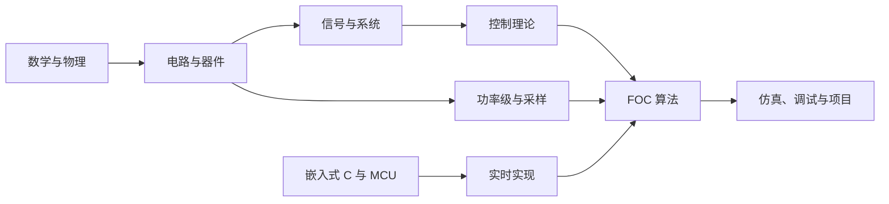

# 学习路线图

[[00-Index/00-README|知识库首页]] · [[00-Index/03-AI自学任务索引|AI 自学任务]] · [[00-Index/04-练习与复习|练习与复习]]

## 按工程目标选路线

每次只推进一个可验收的成果。已有基础时先完成对应的入口题，根据结果决定直接做还是补先修。下表的箭头表示建议次序，实际项目可并行准备硬件和软件。

| 工程目标 | 学习顺序与起步任务 | 完成标志 |
|---|---|---|
| 传感器采集与联网 | [[00-Index/03-AI自学任务索引#微控制器：生成和验证 PWM\|MCU 与定时]] → [[00-Index/03-AI自学任务索引#通信协议：读出一帧 UART\|通信时序]] → [[00-Index/03-AI自学任务索引#传感器与执行器：把读数换成物理量\|传感器换算]] → [[00-Index/03-AI自学任务索引#项目实践：完成一个有证据的小功能\|采集原型]] | 留下一条有单位、可复现的采集记录 |
| 模拟、电源与 PCB | [[00-Index/03-AI自学任务索引#基础理论：从 RC 波形回到模型\|电路建模]] → 选 [[00-Index/03-AI自学任务索引#模拟电子：检查运放的增益和摆幅\|模拟前端]] 或 [[00-Index/03-AI自学任务索引#电源管理：解释 Buck 的开关行为\|电源]] → [[00-Index/03-AI自学任务索引#调试工具：解释一张波形\|测量验证]] → [[00-Index/03-AI自学任务索引#PCB 设计：完成第一块小板的检查\|PCB]] | 计算关键约束，用波形和板级检查验证 |
| 数字逻辑与 FPGA | [[00-Index/03-AI自学任务索引#数字电子：从真值表到验证\|组合逻辑]] → [[03-Digital-Electronics/03-时序逻辑与状态机/001-锁存器与触发器\|时序逻辑]] → [[03-Digital-Electronics/05-Verilog与HDL/001-核心思想硬件vs软件\|HDL]] → [[03-Digital-Electronics/04-FPGA入门/001-FPGA核心概念\|FPGA]] | 从真值表或状态图得到可仿真验证的设计 |
| MCU 固件与实时系统 | [[00-Index/03-AI自学任务索引#基础理论：读懂交叉编译产物\|C 构建]] → [[00-Index/03-AI自学任务索引#微控制器：生成和验证 PWM\|MCU 外设]] → [[00-Index/03-AI自学任务索引#实时系统：比较任务的周期与响应\|RTOS 调度]] | 拿到一次构建和运行记录，解释关键时序 |
| Linux 驱动 | [[00-Index/03-AI自学任务索引#基础理论：读懂交叉编译产物\|C 构建]] → [[10-RTOS与系统/05-嵌入式Linux入门/007-学习路径以RK3588为核心平台\|Linux 基础]] → [[00-Index/03-AI自学任务索引#Linux 驱动：区分匹配和探测\|设备匹配与探测]] | 能独立区分模块构建、加载和设备绑定 |
| 闭环控制与 FOC | [[00-Index/03-AI自学任务索引#基础理论：从 RC 波形回到模型\|对象与频响]] → [[00-Index/03-AI自学任务索引#控制理论：预测闭环阶跃\|闭环]] → [[00-Index/03-AI自学任务索引#FOC：检查坐标变换的方向\|坐标变换]] → [[#FOC 学习主线（重点方向）\|分阶段实现]] | 用模型和仿真解释闭环行为，再验证实际接口 |
| 机器视觉 | [[01-Foundations/05-信号与系统/003-卷积：从冲激响应到输出\|卷积]] → [[00-Index/03-AI自学任务索引#机器视觉：验证一个 3×3 图像算子\|图像算子]] → [[11-Machine-Vision/000-README\|标定或实时采集规划]] | 在小样例上验证像素计算与边界策略 |

## FOC 学习主线（重点方向）

### 阶段 1：数学、电路与信号

- 入口任务 · [[00-Index/03-AI自学任务索引#基础理论：从 RC 波形回到模型|从 RC 波形回到模型]]。

- [[01-Foundations/01-数学与物理基础/000-README|数学与物理基础]]：复数、向量、矩阵、微积分和微分方程。
- [[01-Foundations/02-电路基础理论/000-README|电路基础理论]]：KCL、KVL、RC/RL/RLC 和交流分析。
- [[01-Foundations/04-电子元器件/000-README|电子元器件]]：MOSFET、运放、电阻、电容和电感。
- [[01-Foundations/05-信号与系统/000-信号与系统|信号与系统]]：卷积、傅里叶、拉普拉斯、Z 变换、采样和稳定性。

课内视频可从 [[01-Foundations/02-电路基础理论/001-电路模型、参考方向与功率|电路模型]] 和 [[01-Foundations/05-信号与系统/006-傅里叶变换详解|傅里叶变换]] 开始。

> 完成标志：能从电路方程得到传递函数，能解释极点、带宽、采样和时域响应之间的关系。

### 阶段 2：嵌入式与功率接口

- 入口任务 · [[00-Index/03-AI自学任务索引#微控制器：生成和验证 PWM|生成和验证 PWM]]。

- [[01-Foundations/08-嵌入式C编程/000-嵌入式C编程|嵌入式 C 编程]]
- [[04-Microcontrollers/00-README|微控制器]]，重点 STM32、ADC、PWM、定时器、中断和 DMA。
- [[07-Power-Management/00-README|电源管理]]与[[08-Sensors-Actuators/00-README|传感器和执行器]]。
- [[09-Debugging-Tools/00-README|调试工具]]，重点示波器、电流探头和逻辑分析仪。

跟做过程见 [[04-Microcontrollers/02-STM32系列/007-定时器、触发网络与PWM|STM32 定时器]] 和 [[06-PCB-Design/05-KiCad教程/002-快速入门流程|KiCad 快速入门]] 中的视频。

> 完成标志：能设计同步采样与 PWM 更新时序，并说明过流、欠压、死区和采样噪声的处理边界。

### 阶段 3：控制理论

- 入口任务 · [[00-Index/03-AI自学任务索引#控制理论：预测闭环阶跃|预测闭环阶跃]]。

- [[15-双控（控制理论与控制工程）/02-经典控制理论/000-图解入门：从根轨迹到Bode图|经典控制理论]]
- [[15-双控（控制理论与控制工程）/04-PID与工业控制器设计/000-图解入门：PID的物理直觉|PID 与工业控制器]]
- [[15-双控（控制理论与控制工程）/05-数字控制与离散系统/000-图解入门：数字控制与模拟控制的区别|数字控制与离散系统]]

> 完成标志：能根据对象模型、采样周期和带宽目标设计 PI，并检查稳定裕度、饱和与离散化影响。

### 阶段 4：FOC 算法与验证

- 入口任务 · [[00-Index/03-AI自学任务索引#FOC：检查坐标变换的方向|检查坐标变换的方向]]。

- [[14-FOC-电机控制/00-README|FOC 电机控制微专业]]
- 顺序建议：电机结构与模型 → Clarke/Park → FOC 电流环 → SVPWM → 采样与重构 → 参数辨识 → 无传感器控制 → 代码实现 → 仿真和调试。

> 完成标志：能在仿真中闭合电流环，并在硬件上验证电流极性、角度方向、PWM 时序、保护链和实时预算。

### 阶段 5：项目闭环

- 入口任务 · [[00-Index/03-AI自学任务索引#项目实践：完成一个有证据的小功能|完成一个有证据的小功能]]。

- 从[[11-Projects/00-README|项目实践]]选择一个可以测量、复现和验收的项目。
- 项目记录至少包含需求、原理图、参数、代码版本、测试条件、波形、故障记录和复盘。
