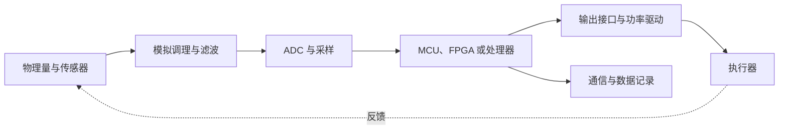

# 主题索引

[[00-Index/00-README|知识库首页]] · [[00-Index/01-学习路线图|查学习顺序]] · [[00-Index/04-练习与复习|查练习和测验]]

从 17 个模块的总览进入正文。知道要查的概念时，优先选下面对应的模块。

## 基础与理论

| 模块 | 内容 |
|---|---|
| [[01-Foundations/00-README\|基础理论]] | 复数、矩阵、微积分、电路理论、信号与系统、ADC/DAC、嵌入式 C |
| [[02-Analog-Electronics/00-README\|模拟电子]] | 放大器、运放、模拟滤波器 |
| [[03-Digital-Electronics/00-README\|数字电子]] | 数字逻辑、状态机、FPGA、Verilog |

## 硬件与嵌入式

| 模块 | 内容 |
|---|---|
| [[04-Microcontrollers/00-README\|微控制器]] | STM32、ESP32、RISC-V、中断、DMA、启动流程 |
| [[05-Communication/00-README\|通信]] | I2C、SPI、UART、CAN、USB、以太网、无线 |
| [[06-PCB-Design/00-README\|PCB 设计]] | 原理图、层叠、阻抗、SI、EMC、制造 |
| [[07-Power-Management/00-README\|电源管理]] | DC-DC、电源架构、电池管理、低功耗 |
| [[08-Sensors-Actuators/00-README\|传感器执行器]] | 传感器接口、电机驱动、基础控制 |
| [[09-Debugging-Tools/00-README\|调试工具]] | 示波器、逻辑分析仪、JTAG、SWD |
| [[10-RTOS与系统/00-README\|RTOS 与系统]] | FreeRTOS、Zephyr、嵌入式 Linux |
| [[16-Linux设备驱动开发/00-README\|Linux 设备驱动]] | 设备模型、设备树、中断体系、GPIO/pinctrl、主流外设驱动、调试与工程实战 |

## 控制与视觉

| 模块 | 内容 |
|---|---|
| [[15-双控（控制理论与控制工程）/00-README\|控制理论与工程]] | 经典/现代控制、数字控制、辨识、MPC |
| [[14-FOC-电机控制/00-README\|FOC 电机控制]] | 电机模型、坐标变换、SVPWM、观测器、辨识 |
| [[11-Machine-Vision/000-README\|机器视觉]] | 图像处理、标定、嵌入式视觉（建设中） |

## 项目与参考

| 模块 | 内容 |
|---|---|
| [[11-Projects/00-README\|项目实践]] | 入门到专家级项目 |
| [[12-Resources/00-README\|学习资源]] | 课程、书籍、网站、标准与认证 |
| [[13-Appendix/00-README\|附录速查]] | 术语、工具、元器件选型、知识库维护 |

## 工程信号链

电源和 PCB 为各环节提供供电与互连，测量和调试用于逐段验证。控制专题着重看反馈路径。信号如何从物理量进入计算，可接着读 [[01-Foundations/06-ADC与DAC基础/001-数据转换器信号链与系统边界|数据转换器信号链]]。
