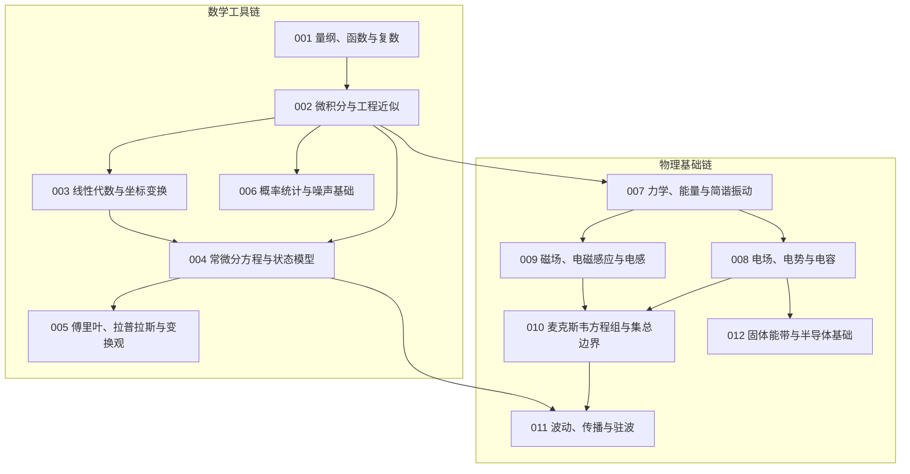

# 数学与物理基础

> [!abstract] 模块定位
> 本模块提供电子工程后续课程反复使用的数学语言和物理模型。
> - 数学部分从量纲、复数和微积分走到线性代数、微分方程、变换与概率；
> - 物理部分从能量和振动走到电磁场、波动及半导体。完整的电路求解、信号变换、采样和器件设计分别进入对应专业模块，本模块不重复展开。

## 1. 学习主线

第一次学习建议先读 001、002，再按目标选择数学或物理路线。变换、概率和半导体可以在后续课程需要时回读。

## 2. 章节职责

| 编号 | 笔记 | 解决的问题 | 主要出口 |
|---|---|---|---|
| 001 | [[001-量纲、函数与复数]] | 单位、函数、复平面和欧拉公式 | 相量、电路计算 |
| 002 | [[002-微积分与工程近似]] | 变化率、累积量、线性化和误差传播 | 动态电路、建模 |
| 003 | [[003-线性代数与坐标变换]] | MIT 18.06 全 35 讲，从消元和向量空间到投影、特征值、SVD 与换基 | 节点法、信号处理、FOC、状态空间 |
| 004 | [[004-常微分方程与状态模型]] | 一阶、二阶线性系统及状态变量 | 暂态、控制系统 |
| 005 | [[005-傅里叶、拉普拉斯与变换观]] | 为什么变换能简化微分和卷积 | 信号与系统 |
| 006 | [[006-概率统计与噪声基础]] | 随机变量、统计量、估计和噪声 | 测量、通信、ADC |
| 007 | [[007-力学、能量与简谐振动]] | 守恒、阻尼、受迫振动和谐振 | MEMS、二阶系统 |
| 008 | [[008-电场、电势与电容]] | 电压、电容和电场储能的场论来源 | 电路、电容器 |
| 009 | [[009-磁场、电磁感应与电感]] | 磁链、电感、互感和磁路边界 | 电源、电机、变压器 |
| 010 | [[010-麦克斯韦方程组与集总边界]] | 场论怎样退化为电路模型 | 高速互连、EMC |
| 011 | [[011-波动、传播与驻波]] | 传播、反射、干涉和驻波 | 传输线、谐振器 |
| 012 | [[012-固体能带与半导体基础]] | 载流子、能带、结区和偏置 | 二极管、晶体管 |

## 3. 三条应用路径

### 3.1 电路与模拟电子

[[001-量纲、函数与复数]] → [[002-微积分与工程近似]] → [[004-常微分方程与状态模型]] → [[008-电场、电势与电容]] → [[009-磁场、电磁感应与电感]] → [[01-Foundations/02-电路基础理论/000-README|电路基础理论]]

### 3.2 FOC 与控制

[[001-量纲、函数与复数]] → [[003-线性代数与坐标变换]] → [[004-常微分方程与状态模型]] → [[009-磁场、电磁感应与电感]] → [[15-双控（控制理论与控制工程）/00-README|控制理论]] → [[14-FOC-电机控制/00-README|FOC 电机控制]]

### 3.3 信号、采样与测量

[[002-微积分与工程近似]] → [[005-傅里叶、拉普拉斯与变换观]] → [[006-概率统计与噪声基础]] → [[01-Foundations/05-信号与系统/000-信号与系统|信号与系统]] → [[01-Foundations/06-ADC与DAC基础/000-ADC与DAC基础|ADC 与 DAC 基础]]

## 4. 与相邻模块的边界

- 本模块介绍变换的数学入口；卷积、频谱、系统函数、采样、Z 变换和数字滤波见 [[01-Foundations/05-信号与系统/000-信号与系统|信号与系统]]。
- 量化、ENOB、采样保持和转换器非理想见 [[01-Foundations/06-ADC与DAC基础/000-ADC与DAC基础|ADC 与 DAC 基础]]。
- R、L、C 的电路模型和网络方程见 [[01-Foundations/02-电路基础理论/000-README|电路基础理论]]。
- 实际元件的材料、额定值、寄生和失效模式见 [[01-Foundations/04-电子元器件/000-README|电子元器件]]。
- 定点数、Q 格式、溢出和 DSP 库实现见 [[01-Foundations/08-嵌入式C编程/000-嵌入式C编程|嵌入式 C 编程]]。

## 5. 使用这组笔记的方法

1. 先确认问题中的物理量、单位和假设；
2. 选取能够保留关键行为的模型；
3. 再选择方程、矩阵、微分方程或变换工具；
4. 求解后检查量纲、极限、符号和数量级；
5. 实际设计再加入材料、寄生、测量带宽和数值精度。

## 6. 推荐资源

- K. A. Stroud, *Engineering Mathematics*；
- Erwin Kreyszig, *Advanced Engineering Mathematics*；
- Gilbert Strang, *Introduction to Linear Algebra*；
- Young and Freedman, *University Physics*；
- David J. Griffiths, *Introduction to Electrodynamics*；
- Donald A. Neamen, *Semiconductor Physics and Devices*。

---

**开始学习**：[[001-量纲、函数与复数]]

**DR_CAN｜工程数学基础与矩阵导数**　[B 站作者合集](https://space.bilibili.com/230105574/lists)。考虑先看卷积、拉普拉斯、特征值与矩阵微分。
