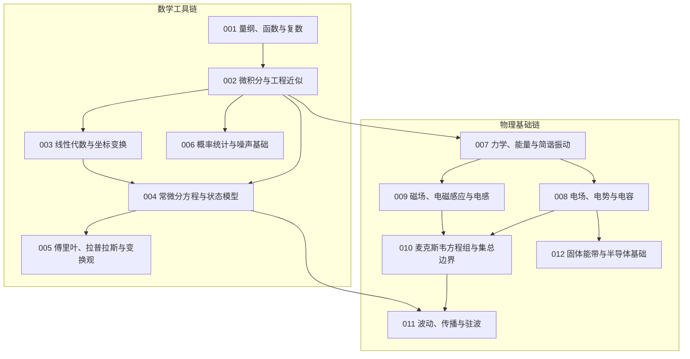

# 数学与物理基础

> [!abstract] 模块定位
> 本模块提供电子工程后续课程反复使用的数学语言和物理模型。
> - 数学部分从量纲、复数和微积分走到线性代数、微分方程、变换与概率；
> - 物理部分从能量和振动走到电磁场、波动及半导体。完整的电路求解、信号变换、采样和器件设计分别进入对应专业模块，本模块不重复展开。

## 1. 学习主线

第一次学习可以从 001、002 各做一道自检题，再按工程目标选下面的路径。每条正文都含学习路线、按章节嵌入的视频、工程案例和自检。只想解决当前问题时，可以直接点到案例，从需要的先修开始补。

## 2. 章节职责

| 编号 | 笔记 | 解决的问题 | 主要出口 |
|---|---|---|---|
| 001 | [[001-量纲、函数与复数]] | 用单位验算 RC，再把阻抗换成相量 | 相量、电路计算 |
| 002 | [[002-微积分与工程近似]] | MIT 单变量与多变量微积分选讲，含导数、积分、线性化和误差传播 | 动态电路、小信号、测量与建模 |
| 003 | [[003-线性代数与坐标变换]] | MIT 18.06 全 35 讲，从消元和向量空间到投影、特征值、SVD 与换基 | 节点法、信号处理、FOC、状态空间 |
| 004 | [[004-常微分方程与状态模型]] | MIT 与 Stanford 视频随案例嵌入，从常微分方程到状态空间、采样和仿真 | RC/RLC 暂态、电机、控制系统 |
| 005 | [[005-傅里叶、拉普拉斯与变换观]] | 同一脉冲的两种频谱，以及带初值的 RC 反变换 | 信号与系统 |
| 006 | [[006-概率统计与噪声基础]] | 用贝叶斯解释告警，再由带宽算热噪声 | 测量、通信、ADC |
| 007 | [[007-力学、能量与简谐振动]] | 从弹簧平衡点预测自由衰减与扫频峰值 | MEMS、二阶系统 |
| 008 | [[008-电场、电势与电容]] | 由平行板的几何与介质算电场和储能 | 电路、电容器 |
| 009 | [[009-磁场、电磁感应与电感]] | 判断感应电压极性，估算气隙电感 | 电源、电机、变压器 |
| 010 | [[010-麦克斯韦方程组与集总边界]] | 用充电电容验证位移电流，用走线时延判断模型 | 高速互连、EMC |
| 011 | [[011-波动、传播与驻波]] | 算走线回波，用边界条件预测谐振 | 传输线、谐振器 |
| 012 | [[012-固体能带与半导体基础]] | 从掺杂估内建电势，从偏置估电流比 | 二极管、晶体管 |

## 3. 按工程目标选路径

### 3.1 电路与模拟电子

[[001-量纲、函数与复数]] → [[002-微积分与工程近似]] → [[004-常微分方程与状态模型]] → [[008-电场、电势与电容]] → [[009-磁场、电磁感应与电感]] → [[01-Foundations/02-电路基础理论/000-README|电路基础理论]]

做一条贯穿练习：从 001 的单位检查起步，按 004 的时域解、005 的拉普拉斯解分别求 RC 暂态，再用 006 的带宽公式估算低通输出噪声。

### 3.2 FOC 与控制

[[001-量纲、函数与复数]] → [[003-线性代数与坐标变换]] → [[004-常微分方程与状态模型]] → [[009-磁场、电磁感应与电感]] → [[15-双控（控制理论与控制工程）/00-README|控制理论]] → [[14-FOC-电机控制/00-README|FOC 电机控制]]

做振动或机械系统时，在 004 后接 [[007-力学、能量与简谐振动]]，用自由衰减和扫频结果分别核对模态与稳态响应。

### 3.3 信号、采样与测量

[[002-微积分与工程近似]] → [[005-傅里叶、拉普拉斯与变换观]] → [[006-概率统计与噪声基础]] → [[01-Foundations/05-信号与系统/000-信号与系统|信号与系统]] → [[01-Foundations/06-ADC与DAC基础/000-ADC与DAC基础|ADC 与 DAC 基础]]

### 3.4 高速互连与场模型

[[008-电场、电势与电容]]、[[009-磁场、电磁感应与电感]] → [[010-麦克斯韦方程组与集总边界]] → [[011-波动、传播与驻波]] → [[06-PCB-Design/02-信号完整性基础/002-高速信号基础|高速信号基础]]

沿 010 和 011 的同一条 50 mm 走线，先比较传播延迟与上升时间，再算负载首次到达电压和源端回波时刻。

### 3.5 半导体与模拟器件

[[008-电场、电势与电容]] → [[012-固体能带与半导体基础]] → [[002-微积分与工程近似#案例 3｜二极管的小信号电阻能用到多大振幅|二极管的小信号近似]] → [[01-Foundations/04-电子元器件/004-二极管|二极管器件模型]]

从掺杂与偏置推到电流，再检查二极管在给定工作点和输入幅度下的线性近似误差。

## 4. 与相邻模块的边界

- 本模块介绍变换的数学入口；卷积、频谱、系统函数、采样、Z 变换和数字滤波见 [[01-Foundations/05-信号与系统/000-信号与系统|信号与系统]]。
- 量化、ENOB、采样保持和转换器非理想见 [[01-Foundations/06-ADC与DAC基础/000-ADC与DAC基础|ADC 与 DAC 基础]]。
- R、L、C 的电路模型和网络方程见 [[01-Foundations/02-电路基础理论/000-README|电路基础理论]]。
- 实际元件的材料、额定值、寄生和失效模式见 [[01-Foundations/04-电子元器件/000-README|电子元器件]]。
- 定点数、Q 格式、溢出和 DSP 库实现见 [[01-Foundations/08-嵌入式C编程/000-嵌入式C编程|嵌入式 C 编程]]。

## 5. 使用这组笔记的方法

1. **10 分钟** · 选一个自检题，先写物理量、单位和预测，再核对答案。
2. **25 分钟** · 手算一道案例，遇到缺口时看片段。也可让 AI 只指出第一处可验证的错误，例如单位、参考方向、初值或假设。
3. **60 分钟** · 改动一个参数，先预测变化，再用手算、仿真或测量核对。把条件、结果与差异记下，隔一天合上笔记做一次变式。

## 6. 推荐资源

- K. A. Stroud, *Engineering Mathematics*；
- Erwin Kreyszig, *Advanced Engineering Mathematics*；
- Gilbert Strang, *Introduction to Linear Algebra*；
- Young and Freedman, *University Physics*；
- David J. Griffiths, *Introduction to Electrodynamics*；
- Donald A. Neamen, *Semiconductor Physics and Devices*。

---

**开始学习**：[[001-量纲、函数与复数]]

**DR_CAN｜工程数学基础与矩阵导数**　[B 站作者合集](https://space.bilibili.com/230105574/lists)。考虑先看卷积、拉普拉斯、特征值与矩阵微分。
