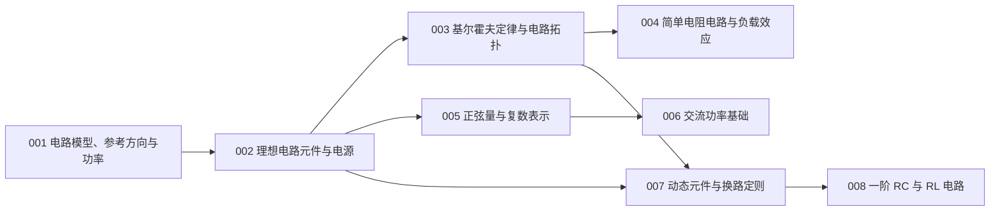

# 电路基础理论

> [!abstract] 模块定位
> 本模块建立电路分析所需的共同语言：怎样把真实装置抽象为集总电路，怎样定义电压、电流和功率，怎样用元件伏安关系与 KCL/KVL 建立方程，以及怎样理解直流、正弦稳态和一阶暂态。系统化的节点法、网孔法、电路定理、相量法和二阶电路留给 [[01-Foundations/03-电路分析方法/000-电路分析方法|电路分析方法]]。

## 1. 主线：模型、约束、求解和动态

推荐第一次学习时按编号阅读。004、006 和 008 分别对应三条应用出口：直流电阻网络、正弦交流与功率、一阶暂态。

## 2. 各章职责与学习出口

| 编号  | 笔记                   | 本章只解决什么                 | 学完后应能做到                |
| --- | -------------------- | ----------------------- | ---------------------- |
| 001 | [[001-电路模型、参考方向与功率]] | 从真实装置得到集总模型，并统一变量符号     | 正确标注参考方向，判断元件吸收或发出功率   |
| 002 | [[002-理想电路元件与电源]]    | 建立 R、L、C、独立源和受控源的端口关系   | 写出元件方程、储能和串并联关系        |
| 003 | [[003-基尔霍夫定律与电路拓扑]]  | 用拓扑和守恒关系约束各支路变量         | 正确列写 KCL、KVL，并识别独立方程数量 |
| 004 | [[004-简单电阻电路与负载效应]]  | 求解可直接化简的线性电阻电路          | 分析分压、分流、负载效应和实际电源模型    |
| 005 | [[005-正弦量与复数表示]]     | 用幅值、频率、相位、有效值和复数描述正弦量   | 统一峰值/有效值约定，完成复数与相位运算   |
| 006 | [[006-交流功率基础]]       | 区分瞬时、有功、无功、视在和复功率       | 计算正弦稳态功率，并说明功率因数的适用边界  |
| 007 | [[007-动态元件与换路定则]]    | 从储能和状态变量理解换路前后          | 求电容电压、电感电流的初值并判断连续条件   |
| 008 | [[008-一阶RC与RL电路]]    | 解释一阶响应、时间常数和常用 RC/RL 拓扑 | 用三要素法写出全响应，并判断典型拓扑用途   |

## 3. 三条学习路径

### 3.1 完整基础路径

[[001-电路模型、参考方向与功率]] → [[002-理想电路元件与电源]] → [[003-基尔霍夫定律与电路拓扑]] → [[004-简单电阻电路与负载效应]] → [[005-正弦量与复数表示]] → [[006-交流功率基础]] → [[007-动态元件与换路定则]] → [[008-一阶RC与RL电路]]

### 3.2 模拟与电源路径

[[001-电路模型、参考方向与功率]] → [[002-理想电路元件与电源]] → [[003-基尔霍夫定律与电路拓扑]] → [[004-简单电阻电路与负载效应]] → [[005-正弦量与复数表示]] → [[007-动态元件与换路定则]] → [[008-一阶RC与RL电路]] → [[01-Foundations/04-电子元器件/000-README|电子元器件]]

### 3.3 FOC 与电机控制路径

[[001-电路模型、参考方向与功率]] → [[002-理想电路元件与电源]] → [[003-基尔霍夫定律与电路拓扑]] → [[005-正弦量与复数表示]] → [[006-交流功率基础]] → [[007-动态元件与换路定则]] → [[008-一阶RC与RL电路]] → [[14-FOC-电机控制/00-README|FOC 电机控制]]

FOC 中的相电压、相电流和功率计算依赖参考方向与正弦量约定；电机绕组的 $L/R$ 时间常数则直接对应一阶 RL 响应。

## 4. 与相邻模块的边界

### 4.1 数学与物理基础

[[01-Foundations/01-数学与物理基础/000-README|数学与物理基础]]提供微积分、复数、微分方程、电磁场和能量守恒。本模块把这些工具用于电路端口模型，不重复展开数学证明和场论推导。

### 4.2 电路分析方法

本模块只处理直接列方程和简单化简。节点电压法、网孔电流法、叠加定理、戴维南/诺顿定理、系统化一阶/二阶电路和完整相量分析进入 [[01-Foundations/03-电路分析方法/000-电路分析方法|电路分析方法]]。

### 4.3 电子元器件

本模块中的 R、L、C 和源是理想模型。实际器件的容差、寄生参数、额定值、温度、损耗和失效模式进入 [[01-Foundations/04-电子元器件/000-README|电子元器件]]。

### 4.4 信号与系统

本模块从具体电路建立微分方程和正弦稳态直觉。卷积、傅里叶、拉普拉斯、极点零点、采样和离散系统进入 [[01-Foundations/05-信号与系统/000-信号与系统|信号与系统]]。

## 5. 一套通用分析流程

1. 画出等效电路，写清理想模型和集总参数假设。
2. 为每条支路定义电流方向和电压极性，过程中保持不变。
3. 写元件伏安关系，再用 KCL/KVL 连接各支路。
4. 判断问题属于直流稳态、正弦稳态还是暂态，选择对应模型。
5. 求解后检查单位、符号、功率守恒、初值和极限情况。
6. 实际设计再回到数据手册、寄生参数和测量条件。

## 6. 学完本模块的检查表

- [ ] 能说明集总参数模型何时适用，何时应考虑传播和电磁耦合；
- [ ] 能用被动符号约定判断功率的正负；
- [ ] 能写出理想 R、L、C 和独立/受控源的端口关系；
- [ ] 能在给定参考方向下正确列写 KCL 与 KVL；
- [ ] 能计算分压、分流、负载效应和简单源变换；
- [ ] 能区分峰值、有效值、平均值、相位和相量约定；
- [ ] 能区分有功、无功、视在功率和正弦位移功率因数；
- [ ] 能根据换路前稳态求 $v_C(0^+)$ 与 $i_L(0^+)$；
- [ ] 能写出一阶 RC/RL 的指数响应并解释时间常数。

## 7. 推荐资源

- Charles K. Alexander, Matthew N. O. Sadiku, *Fundamentals of Electric Circuits*；
- James W. Nilsson, Susan Riedel, *Electric Circuits*；
- Richard C. Dorf, James A. Svoboda, *Introduction to Electric Circuits*；
- MIT OpenCourseWare 6.002, *Circuits and Electronics*；
- Falstad Circuit Simulator，用于观察参考方向、KCL/KVL 和一阶响应；
- LTspice，用于比较理想分析和器件模型。

## 8. 相关内容

- [[01-Foundations/03-电路分析方法/000-电路分析方法|电路分析方法]]
- [[01-Foundations/04-电子元器件/000-README|电子元器件]]
- [[01-Foundations/05-信号与系统/000-信号与系统|信号与系统]]
- [[01-Foundations/07-测量与仪器基础/000-测量与仪器基础|测量与仪器基础]]
- [[01-Foundations/10-电路分析测验题|电路分析测验题]]

---

**开始学习**：[[001-电路模型、参考方向与功率]]
