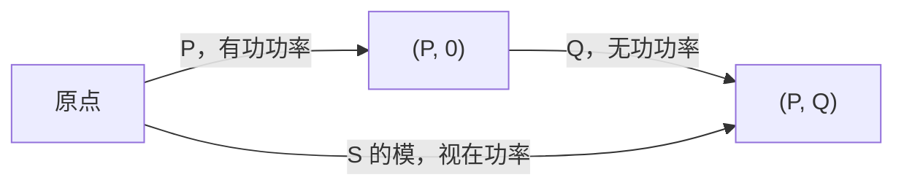

# 交流功率基础

> [!abstract] 本章目标
> 以 [[005-正弦量与复数表示]] 的有效值相量约定为基础，区分瞬时功率、有功功率、无功功率和视在功率，并明确正弦与非正弦条件下功率因数的差异。

## 1. 同一端口的电压与电流

考虑同一端口上的正弦电压和电流：

$$
u(t)=\sqrt2U\cos(\omega t+\varphi_u)
$$

$$
i(t)=\sqrt2I\cos(\omega t+\varphi_i)
$$

$U$、$I$ 为有效值，定义相位差：

$$
\varphi=\varphi_u-\varphi_i
$$

在被动符号约定下，电流进入端口电压参考正端，$p(t)=u(t)i(t)>0$ 表示该端口所连接的元件正在吸收功率。

## 2. 瞬时功率

利用积化和差公式：

$$
p(t)=UI\cos\varphi+UI\cos(2\omega t+\varphi_u+\varphi_i)
$$

瞬时功率包含：

- 一个常量分量 $UI\cos\varphi$；
- 一个频率为电压频率两倍的脉动分量。

因此，即使端口吸收的平均功率恒定，瞬时能量流仍可能随时间往返变化。

## 3. 有功功率、无功功率与视在功率

### 3.1 有功功率

周期平均功率为：

$$
P=UI\cos\varphi
$$

单位为瓦特（W）。有功功率表示一个周期内从电源净传递到负载的能量速率。

### 3.2 无功功率

$$
Q=UI\sin\varphi
$$

单位为乏（var）。在被动符号约定下：

- $Q>0$：电流滞后电压，负载呈感性；
- $Q<0$：电流超前电压，负载呈容性。

无功功率描述电源与储能元件之间周期性交换能量的规模，不表示每周期被永久消耗的能量。

### 3.3 复功率

使用有效值相量：

$$
\underline S=\underline U\underline I^*=P+jQ
$$

复功率的模为视在功率：

$$
|\underline S|=UI=\sqrt{P^2+Q^2}
$$

单位为伏安（VA）。不要把复功率 $\underline S$ 与其标量大小 $|\underline S|$ 混为一谈。

## 4. 功率三角形

当 $Q>0$ 时三角形位于上半平面；当 $Q<0$ 时位于下半平面。相角满足：

$$
\tan\varphi=\frac{Q}{P}
$$

## 5. 功率因数

### 5.1 正弦稳态

当电压和电流都是同频正弦量时：

$$
\mathrm{PF}=\frac{P}{UI}=\cos\varphi
$$

这时功率因数等于位移功率因数。通常还要说明是滞后还是超前，单独给出正数大小不能表达感性或容性。

### 5.2 非正弦波形

当电流含有谐波时，总功率因数应定义为：

$$
\lambda=\frac{P}{U_{\mathrm{rms}}I_{\mathrm{rms}}}
$$

此时一般有：

$$
\lambda\ne\cos\varphi_1
$$

$\varphi_1$ 只表示电压基波与电流基波的相位差。总功率因数同时受基波位移和波形畸变影响，因此仅校正相位差不一定能得到高总功率因数。

## 6. 计算示例

某正弦负载端口 $U=220\ \mathrm V$、$I=5\ \mathrm A$，功率因数为 $0.8$，且电流滞后电压。

$$
|\underline S|=UI=1100\ \mathrm{VA}
$$

$$
P=UI\cos\varphi=880\ \mathrm W
$$

由于 $\sin\varphi=0.6$ 且为感性负载：

$$
Q=UI\sin\varphi=660\ \mathrm{var}
$$

## 7. 功率因数校正的边界

对线性正弦感性负载，并联电容可以提供负的无功功率，从而降低电源侧无功电流。但工程设计不能只按一个理想公式选电容，还需考虑：

- 电网电压和频率范围；
- 负载变化与过补偿；
- 谐波放大和并联谐振；
- 电容纹波电流、耐压、温升和放电要求；
- 投切冲击和适用安全标准。

开关电源中的主动 PFC 主要塑造输入电流，使其更接近与电网电压同相的正弦波；EMI 滤波器主要限制传导电磁干扰。二者目标不同，虽然阻抗和控制环路可能相互影响，但不能把 PFC 等同于 EMI 滤波。

## 8. 常见错误

- 直接用峰值代入 $P=UI\cos\varphi$，却遗漏相应系数；本章公式中的 $U$、$I$ 均为有效值；
- 把 $Q$ 理解为“完全无用且被负载消耗的功率”；
- 不说明参考方向就判断 $Q$ 的正负；
- 在非正弦条件下仍把总功率因数写成 $\cos\varphi$；
- 把视在功率当作复数，或把复功率当作非负标量；
- 把功率因数校正与 EMI 滤波视为同一功能。

## 9. 下一步

- 理解电容、电感为何引入状态和暂态过程：[[007-动态元件与换路定则]]
- 深入计算正弦稳态电路：[[01-Foundations/03-电路分析方法/010-正弦稳态相量分析|正弦稳态相量分析]]
