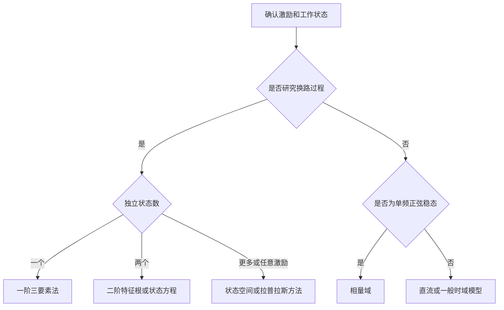

# 方法选择、错误诊断与仿真验证

方法选择取决于三个维度：电路拓扑、激励与工作状态、最终要求的输出量。验证则应使用与原求解路径不同的约束，避免用同一种错误重复证明自己。

## 1. 先判断分析域

相量法不能替代瞬态分析；直流稳态的电容开路、电感短路也不能用于换路刚发生的 $0^+$ 电路。

## 2. 再根据拓扑和目标选方程

| 电路特征或目标 | 优先方法 | 需要警惕 |
|---|---|---|
| 节点少、电流源多 | 节点电压法 | 非接地电压源形成超节点 |
| 平面网络、网孔少、电压源多 | 网孔电流法 | 公共电流源形成超网孔 |
| 需要全部支路量且网络很小 | 支路法 | 未知量多、符号负担大 |
| 只关心一个负载端口 | 戴维南或诺顿 | 端口等效不保留内部量 |
| 多独立源且需分辨贡献 | 叠加 | 功率不能直接叠加 |
| 桥式电阻网络 | $Y$-$\Delta$ 或节点法 | 变换次数过多反而易错 |
| 受控源较多、需要程序建模 | MNA | 受控源不能置零 |
| 负载变化或功率优化 | 端口等效后优化 | 区分最大功率与高效率 |

若两种方法方程数量接近，选参考方向更直观、特殊源更少的一种。

## 3. 建立最小完备方程组

一个好的方程组应同时满足：

- 每个未知量都有明确物理定义；
- 方程彼此独立；
- 所有源和控制关系都进入模型；
- 不为了“保险”重复加入等价的 KCL 或 KVL；
- 求解目标之外的量只在校验时再计算。

矩阵奇异往往不是计算器问题，而是模型问题。常见原因包括：

- 未设置参考地；
- 存在悬浮子网络；
- 理想电压源回路约束矛盾或冗余；
- 理想电流源割集约束矛盾；
- 漏写控制关系；
- 两个节点其实被理想导线短接，却仍当成独立节点。

## 4. 按症状定位错误

### 4.1 所有结果都差同一倍数

优先检查：

- k、m、$\mu$、n 等单位前缀；
- RMS 与峰值；
- 角频率 $\omega$ 与频率 $f$，两者相差 $2\pi$；
- 受控源增益单位。

### 4.2 只有符号或相位相反

检查电流箭头、电压极性、相量参考余弦、受控源方向和互感同名端。负值可以表示实际方向与参考方向相反，不应自动取绝对值。

### 4.3 初值正确但终值错误

检查 $t>0$ 拓扑、独立源状态和终态等效。终值必须由换路后电路求出。

### 4.4 终值正确但时间过程错误

检查时间常数、自然极点、初始斜率和阻尼类型。含受控源时尤其要检查求等效电阻是否保留了受控源。

### 4.5 仿真出现极大电流或不收敛

检查理想电压源并联、理想电流源串联、无损 LC、悬浮节点、开关瞬间冲激、缺少寄生电阻以及非线性器件初始工作点。必要时加入有物理依据的 ESR、绕组电阻或泄漏路径，并说明这些参数属于模型，而不是为求解器随意添加。

## 5. 分层验证比重复计算更有效

### 5.1 局部约束

- 任取节点检查 KCL；
- 任取回路检查 KVL；
- 检查每个元件伏安关系和参考方向。

### 5.2 全局约束

$$
\sum_k p_k=0.
$$

动态电路还应检查输入功率、储能变化率和电阻耗散：

$$
p_{\text{in}}=\frac{dW}{dt}+p_{\text{loss}}.
$$

### 5.3 边界与退化

- $R\to0$、$R\to\infty$ 后拓扑是否正确；
- $t=0^+$ 是否满足状态连续性；
- $t\to\infty$ 是否回到稳态；
- $\omega\to0$、$\omega\to\infty$ 时阻抗趋势是否合理；
- 对称结构是否产生符合对称性的结果。

极限结论必须绑定具体拓扑。例如 $C\to\infty$ 只说明固定非零频率下 $|Z_C|\to0$，不能直接推导任意电路都“通过低频”。

## 6. 仿真验证流程

### 6.1 选择正确分析类型

| 目标 | 仿真类型 |
|---|---|
| 直流节点电压和工作点 | `.op` |
| 参数或电源缓慢扫描 | `.dc` |
| 小信号频率响应 | `.ac` |
| 换路和大信号时间波形 | `.tran` |

`.ac` 是工作点附近的线性小信号分析，不会显示开关饱和、限幅或启动过程；`.tran` 使用实际时间波形，不等同于相量计算。

### 6.2 保持参考定义一致

手算与仿真应使用相同的节点命名、电流方向和电源极性。SPICE 常把器件电流定义为从网表第一个节点流向第二个节点，具体软件可能不同，应查看探针定义后再比较符号。

### 6.3 用参数扫描检查趋势

单个数值相同可能只是巧合。对关键电阻、频率或负载做小范围扫描，比较手算公式与仿真曲线的趋势、拐点和极限。若趋势不同，通常是模型或公式适用条件不一致。

## 7. 最终检查清单

- [ ] 工作状态和理想化假设已经写明；
- [ ] 所有电压、电流都有参考方向；
- [ ] 方法与拓扑、激励、目标相匹配；
- [ ] 受控源和初始储能处理正确；
- [ ] 方程数量与未知量数量匹配；
- [ ] 单位、RMS/峰值、$f/\omega$ 没有混用；
- [ ] 至少完成一项独立的 KCL、KVL 或功率校验；
- [ ] 极限、初值、终值或数量级合理；
- [ ] 仿真模型与手算模型使用相同假设；
- [ ] 差异已经解释，而不是只调整参数让曲线吻合。

需要回到具体方法时，从 [[000-电路分析方法]] 的学习路线选择对应笔记。
