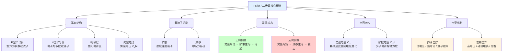

# 二极管（Diode）

> [!abstract] 本章定位
> **前置知识**：[[001-电阻]]、[[002-电容]]、[[003-电感]]，以及负载线和正弦稳态的基本概念。
>
> **本章回答**：PN 结为什么呈现非线性和方向性？直流、小信号和开关过程应分别使用什么模型？整流、续流、稳压和浪涌保护怎样选器件？
>
> **本章边界**：讲清二极管本身及基础应用，不展开完整电源、EMC 和功能安全设计。
>
> **下一步**：[[005-BJT晶体管]]，从单个 PN 结进入三端放大与开关器件。

## 1. 核心特性

### 1.1 伏安特性（I-V 曲线）
二极管是非线性器件。未进入击穿、串联电阻和高注入效应可忽略时，PN 结的正向电流可用肖克利方程作一阶描述：

$$ I_D = I_S \left( e^{V_D / (n V_T)} - 1 \right) $$
- $I_S$：反向饱和电流，与结面积、工艺和温度强相关，可跨越多个数量级
- $V_T$：热电压，室温 300K 时 $V_T \approx 26$ mV
- $n$：理想因子（1～2，典型硅管 $n \approx 1$）

![[01-Foundations/assets/diode-iv-models-comparison.jpg|1500]]
*来源：AllAboutCircuits — Forward-Conducting Diodes: Exponential and Piecewise-Linear Analysis*

**曲线三段解读**：

| 区域        | 电压条件                | 电流特征                                | 物理意义           |
| --------- | ------------------- | ----------------------------------- | -------------- |
| **正向导通区** | $V_D > V_f$         | 指数增长 $I_D \approx I_S e^{V_D/nV_T}$ | 势垒降低，大量载流子扩散   |
| **反向截止区** | $-V_{BR} < V_D < 0$ | 几乎为零 $I_D \approx -I_S$             | 势垒增宽，仅有少数载流子漂移 |
| **反向击穿区** | $V_D < -V_{BR}$     | 急剧上升                                | 雪崩击穿或齐纳击穿      |

---



**正向偏置**（$V_D > 0$）：电流随电压指数增长，实际应用中常认为 $V_D$ 达到**正向压降** $V_f$ 后二极管"导通"：
- 硅管 $V_f \approx 0.6$ ~ $0.7$ V
- 肖特基管 $V_f \approx 0.2$ ~ $0.4$ V
- 发光二极管（LED）$V_f$ 约 1.2 V（红外）~ 3.6 V（蓝/白）

**反向偏置**（$V_D < 0$）：电流几乎为零（仅 $I_S$ 漏电），直到超过**击穿电压** $V_{BR}$ 时电流急剧上升。

---

## 2. 直流等效分析（大信号模型）

在直流或大信号开关电路中，真实二极管的指数特性（肖克利方程）不便于手算，因此工程上常用三种由简到精的等效模型。

![[01-Foundations/assets/diode-iv-models-comparison.jpg|1500]]
*来源：AllAboutCircuits — Forward-Conducting Diodes: Exponential and Piecewise-Linear Analysis*

### 2.1 理想二极管模型

- 正向导通：视为理想短路，$V_D = 0$，电流任意正方向流动。
- 反向截止：视为理想开路，$I_D = 0$，电压任意负方向承受。
- **适用场景**：用于判断整流和钳位拓扑的导通状态，或在系统电压远大于正向压降时做初步手算；它不能用于器件耐压、损耗和热选型。

### 2.2 恒压降模型（最常用）

- 正向导通：等效为理想二极管串联一个固定电压源 $V_f$（硅管常用 $0.7$ V，肖特基约 $0.3$ V）。
- 反向截止：开路。
- **适用场景**：大多数手算估算、整流、限幅、钳位电路。

**直流分析步骤**（判断二极管是否导通）：
1. **假设截止**：将二极管从电路中移除，计算阳极与阴极之间的开路电压 $V_{OC}$。
2. **判断条件**：若 $V_{OC} > V_f$（通常取 0.7 V），则二极管实际导通；否则保持截止。
3. **重新计算**：导通时把二极管替换为 $V_f$ 电压源，按线性直流电路求解 $I_D$ 和节点电压。

### 2.3 折线模型（更精确）

当电流范围较宽、或需要更精确估计二极管压降时，用折线模型：理想二极管串联一个阈值电压 $V_{T0}$ 和一个正向动态电阻 $r_f$。

![[01-Foundations/assets/diode-piecewise-linear-model-circuit.jpg|1500]]
*来源：AllAboutCircuits — Forward-Conducting Diodes: Exponential and Piecewise-Linear Analysis*

$$ V_D = V_{T0} + I_D \cdot r_f $$

- $V_{T0}$：折线模型的开启电压（如 0.5 V）。
- $r_f$：正向动态电阻，通常几欧姆到几十欧姆，由二极管特性和工作电流决定。
- **适用场景**：大电流整流管、低压降精密估算、SPICE 简化建模。

### 2.4 负载线分析（图解法求静态工作点）

对简单串联电路 $V_S \rightarrow R \rightarrow$ 二极管，KVL 给出：

$$ V_D = V_S - I_D \cdot R $$

这是一条直线（负载线），与二极管 I-V 曲线的交点即为静态工作点 $Q = (I_{DQ}, V_{DQ})$。

![[01-Foundations/assets/diode-load-line-analysis.jpg|1500]]
*来源：AllAboutCircuits — Forward-Conducting Diodes: Exponential and Piecewise-Linear Analysis*

**负载线特点**
- 横轴截距：$V_D = V_S$（二极管开路时）。
- 纵轴截距：$I_D = V_S / R$（二极管短路时）。
- 斜率：$-1/R$。
- 与二极管特性曲线交点：实际工作点；若使用恒压降模型，可近似认为 $V_{DQ} \approx V_f$，从而 $I_{DQ} \approx (V_S - V_f)/R$。

---

## 3. 微变等效分析（小信号模型）

当二极管在直流工作点 $Q = (I_{DQ}, V_{DQ})$ 上叠加微小交流信号时，其行为可用**动态电阻**（小信号电阻）$r_d$ 描述：

$$ r_d = \frac{n V_T}{I_{DQ}} $$

**推导**：对肖克利方程求导，得 $g_d = \frac{1}{r_d} = \frac{d i_D}{d v_D} \bigg|_{Q} \approx \frac{I_{DQ}}{n V_T}$。

- 室温 300K 下：$r_d \approx \frac{26\ \text{mV}}{I_{DQ}}$（$n=1$ 时）
- 例：$I_{DQ} = 1$ mA → $r_d \approx 26\ \Omega$
- $I_{DQ} = 10$ mA → $r_d \approx 2.6\ \Omega$

小信号分析先用直流电路求工作点，再在线性化后的增量电路中用 $r_d$ 替换二极管。独立直流源在增量电路中置零，叠加的小信号源保留。

**用途**：
- 分析二极管在射极跟随器、对数放大器、检波器中的交流行为。
- 估算工作点附近的增量电导；温度变化还会显著改变 $I_S$ 和正向压降，不能只看 $V_T$。

---

## 4. 动态特性和极限参数

直流压降只能描述稳态工作点。二极管用于开关、整流和保护时，还要检查电荷存储、结电容、浪涌和热条件。

### 4.1 反向恢复

普通 PN 结二极管从正向导通切换到反向截止时，结区和中性区中的存储电荷需要先被清除。在这段时间内会出现反向恢复电流。数据手册常用反向恢复时间 $t_{rr}$ 或反向恢复电荷 $Q_{rr}$ 描述这一过程。

反向恢复会增加开关损耗、器件电流应力和 EMI。工频整流管不能因为耐压和电流合适就直接用于高频变换器。肖特基二极管没有少数载流子存储导致的传统反向恢复，但结电容、漏电和换向电流仍然存在。

### 4.2 结电容

反向偏置 PN 结具有耗尽层电容，正向导通时还会出现扩散电容。结电容随偏置电压变化，会影响高速信号的带宽、钳位波形和开关节点损耗。高速接口保护器件应同时检查钳位性能和结电容。

### 4.3 浪涌、功耗和结温

导通损耗可按工作波形估算：

$$P_D\approx V_F I_{avg}$$

精确计算应对瞬时乘积 $v_D(t)i_D(t)$ 求周期平均，并加入反向恢复和漏电损耗。结温一阶估算为：

$$T_J\approx T_A+P_D\theta_{JA}$$

$\theta_{JA}$ 只在数据手册规定的 PCB 和环境条件下有效。脉冲和浪涌应查峰值正向浪涌电流、脉冲功率曲线和瞬态热阻，不能用连续额定电流代替。

### 4.4 选型先匹配器件类别

| 类别 | 主要特点 | 常见用途 | 主要限制 |
|---|---|---|---|
| 通用整流二极管 | 耐压和浪涌能力较好 | 工频整流、低速续流 | 反向恢复慢 |
| 快恢复/超快恢复二极管 | 恢复时间短 | 高频整流、钳位 | 压降和恢复损耗仍需评估 |
| 肖特基二极管 | 压降低、恢复快 | 低压高频整流 | 反向耐压和高温漏电受限 |
| 小信号开关二极管 | 结电容小、速度快 | 信号钳位、逻辑和检测 | 电流与浪涌能力较小 |
| 齐纳二极管 | 在规定反向电流下稳压 | 基准、钳位 | 动态电阻、温漂和功耗 |
| TVS | 承受短时浪涌能量 | ESD、浪涌保护 | 工作电压、钳位电压、寄生电容 |
| LED/光电二极管 | 电能与光能转换 | 指示、照明、检测 | 驱动、电流、温度和光学条件 |

## 5. 稳压二极管（齐纳二极管）

### 5.1 工作原理
- 专门工作在**反向击穿区**，且击穿电压 $V_Z$ 可精确控制（几伏到几百伏）。
- 当反向电流在 $I_{ZK}$（膝点电流）与 $I_{ZM}$（最大工作电流）之间时，二极管两端电压几乎恒定。

![[01-Foundations/assets/zener-diode-characteristics-curve.png|1500]]
*来源：LearningAboutElectronics — Zener Diode I-V Characteristics Curve*

### 5.2 等效电路
直流等效为一个恒压源 $V_Z$ 串联动态电阻 $r_Z$（典型值数欧姆至数十欧姆）。

### 5.3 典型应用电路：并联稳压器
V_in ──R_S──┬──V_out（= V_Z）
            │
           D_Z (阴极接 V_out，阳极接地)
            │
           GND
- 限流电阻 $R_S = \frac{V_{in} - V_Z}{I_Z + I_L}$。最坏输入和负载组合下的 $I_Z$ 应落在能够满足目标稳压精度的范围内，并低于功耗和电流上限。
- 输出稳压值 $V_{out} = V_Z$。

### 5.4 选型要点
- **稳压值 $V_Z$**：温度系数与稳压电压、工作电流和器件结构有关，约 5～6 V 的器件常能获得较小的综合温漂，精确值应查数据手册曲线。
- **耗散功率**：工作点近似为 $P_Z=V_ZI_Z$。允许功耗和降额曲线由封装、环境温度和散热条件决定，据此反推可用的最大稳压电流。
- **动态电阻 $r_Z$**：越小稳压效果越好。

---

## 6. 典型应用

> 以下电路均来自常见教材、数据手册应用电路和实际工程验证过的典型设计。图片为从公开技术资源下载的实际工程/教学原理图，参数与文字说明可直接在面包板、Falstad 或 LTspice 中复现验证。

---

### 6.1 桥式整流与电容滤波

实际 AC/DC 线性电源的典型结构：变压器降压 → 二极管整流 → 电容滤波 → 稳压器。

![[01-Foundations/assets/acdc-power-supply-block-diagram.png|1500]]
*来源：AllAboutCircuits — Troubleshooting a Diode Bridge Rectifier*

全桥整流使用 4 只二极管，使交流正、负半周都能向负载提供同一方向的电流。

![[01-Foundations/assets/bridge-rectifier-ltspice.jpg|1500]]
*来源：AllAboutCircuits — Introduction to the Full-Bridge Rectifier（LTspice 仿真图）*

![[01-Foundations/assets/bridge-rectifier-current-flow.jpg|1500]]
*来源：AllAboutCircuits — Introduction to the Full-Bridge Rectifier*

**典型参数（5 V/1 A 电源前端）**

| 位号 | 器件 | 参数 |
|------|------|------|
| D1~D4 | 1N4007 或 MB6S 桥堆 | 1 A / 1000 V |
| C1 | 电解电容 | 1000 µF / 25 V（滤波） |
| T1 | 电源变压器 | 次级 6~9 V AC（根据负载调整） |

**实测要点**
- 空载时 $V_{out} \approx 1.414 \times V_{AC(rms)}$；带 1 A 负载时约 $V_{AC(rms)} \times 1.2 - 2V_{f}$。
- 1N4007 在 1 A 时正向压降约 1 V，桥式整流有两个二极管串联导通，因此压降约 2 V。
- 滤波电容按 $C \geq \frac{I_{load}}{2 f V_{ripple}}$ 估算，50 Hz 全波整流、1 A、1 V 纹波时 $C \approx 10$ mF。

---

### 6.2 反接保护

实际工程中，电池供电产品常在电源正极路径加入反接保护。最基础方案是串联一只二极管；对大电流或低压差场景，常用 P 沟道 MOSFET 实现“理想二极管”功能，降低导通损耗。

![[01-Foundations/assets/reverse-polarity-pmos-protection.png|1500]]
*来源：TI — Basics of Ideal Diodes（反向电池保护应用图）*

**典型参数**

| 方案 | 器件 | 特点 |
|------|------|------|
| 低成本方案 | 1N4007 串联 | 0.7 V@1 A 压降 |
| 低压降方案 | 1N5819 肖特基 | 0.3 V@1 A |
| 大电流/低损耗方案 | AO3401 / IRLML6402 PMOS | 导通电阻仅数十 mΩ |

**实测要点**
- 串联二极管方案：电源正接时导通，$V_{CC} = V_{BAT} - V_f$；反接时截止，保护后端。
- PMOS 方案：正确极性下体二极管先导通，随后 $V_{GS}$ 变负，MOSFET 沟道导通，压降仅 $I \cdot R_{DS(on)}$；反接时 MOSFET 关断，无电流。

---

### 6.3 感性负载的续流与钳位

感性负载（继电器线圈、电机、螺线管）在开关关断瞬间会产生高压反向电动势，续流二极管为线圈电流提供泄放回路，保护开关管。

![[01-Foundations/assets/inductive-load-without-freewheeling-diode.png|1500]]
*来源：InstrumentationTools — Freewheeling Diode*

![[01-Foundations/assets/inductive-load-with-freewheeling-diode.png|1500]]
*来源：InstrumentationTools — Freewheeling Diode*

**典型参数（MCU 驱动继电器）**

| 位号 | 器件 | 参数 |
|------|------|------|
| Q1 | S8050 | NPN，$I_C = 500$ mA |
| R_b | 基极电阻 | 470 Ω（按 $V_{BE}=0.7$ V 估算，$I_B\approx5.5$ mA） |
| D1 | 1N4148 或 1N4007 | 反向并联在线圈两端 |
| 继电器线圈 | 5 V / 70 Ω | 工作电流约 70 mA |

**实测要点**
- 关断瞬间线圈产生反向电动势，D1 提供泄放回路，保护 Q1。
- 采用普通二极管低压钳位时，D1 反向并联在线圈两端，阴极接电源正极；若需要更快释放，可改用齐纳、TVS 或其他受控钳位。
- 改用低侧 MOSFET 驱动时，普通续流二极管仍跨接在线圈两端。低侧 MOSFET 的体二极管方向通常不能代替这条续流路径。

---

### 6.4 齐纳并联稳压器（12 V → 5.1 V 基准）

齐纳二极管工作在反向击穿区时，两端电压几乎恒定，可作为简易并联稳压器，为低压小电流负载提供稳定电压。

![[01-Foundations/assets/zener-regulator-12v-to-5v1.png|1500]]
*来源：LearningAboutElectronics — Zener Diode Voltage Regulator Circuit*

**典型参数**

| 位号 | 器件 | 参数 |
|------|------|------|
| R_S | 限流电阻 | 1 kΩ |
| D_Z | 齐纳二极管 | 5.1 V / 1 W（如 1N4733A） |
| V_in | 输入电压 | 12 V |
| V_out | 输出电压 | ≈ 5.1 V |

**计算示例**
$$ R_S = \frac{V_{in} - V_Z}{I_Z + I_L} = \frac{12 - 5.1}{I_Z + I_L} $$
若取 $I_Z = 5$ mA、$I_L = 2$ mA，则 $R_S \approx 986$ Ω，取标准值 1 kΩ。

**实测要点**
- 负载变化时，齐纳管吸收多余电流，维持 $V_{out} \approx V_Z$。
- $R_S$ 应保证最坏情况下仍有足够的齐纳电流达到目标动态电阻和稳压精度，同时在最高输入、最小负载时不超过功耗上限。
- 并联稳压适合小电流基准或钳位。负载电流较大时，应根据压差、效率、噪声和热条件选择线性或开关稳压器。

---

### 6.5 LED 限流驱动

LED 的伏安特性很陡，不能直接接到低阻电压源。简单指示灯可串联电阻限流，照明或宽电压范围应用通常使用恒流驱动器。

![[01-Foundations/assets/led-current-limiting-resistor.png|1500]]
*来源：SparkFun — LED Current Limiting Resistors*

**典型参数**

| 参数 | 数值 |
|------|------|
| $V_{CC}$ | 5 V |
| LED 正向压降 $V_F$ | 1.8 V（红色） |
| 目标电流 $I_F$ | 约 18 mA |
| 限流电阻 $R$ | $R = \frac{5-1.8}{0.018}\approx178\ \Omega$，取 180 Ω |

**实测要点**
- 使用串联电阻、恒流源或恒流驱动器限制电流。
- 同一串联支路中的 LED 可共享一个限流元件；多个并联支路通常应分别限流，避免正向压降差异导致电流不均。
- 红色 LED $V_f$ 约 1.6~2.0 V，蓝色/白色 LED $V_f$ 约 2.8~3.6 V。

---

### 6.6 TVS 保护信号线

TVS（Transient Voltage Suppressor）二极管并联在被保护信号线与地之间，正常工作时呈高阻；当 ESD 或浪涌使信号电压超过击穿阈值时，TVS 迅速导通并将过压能量泄放到地，从而保护后级敏感 IC。

![[01-Foundations/assets/tvs-diode-symbols.png|1500]]
*来源：Littelfuse / AllAboutCircuits — TVS Diode Symbols*

![[01-Foundations/assets/tvs-diode-array-5-line.png|1500]]
*来源：Littelfuse / AllAboutCircuits — Intelligent Circuit Protection for Smart Home Locks*

**典型参数（5 V 节点保护）**

| 位号 | 器件 | 参数 |
|------|------|------|
| 电源或低速控制线 | SMBJ5.0CA 等 | 重点检查浪涌波形、钳位电压和峰值脉冲功率 |
| 高速信号线 | 低电容 TVS 阵列 | 重点检查结电容、通道数、布局和信号完整性 |

**实测要点**
- TVS 并联在被保护信号与地之间，正常工作时呈高阻。
- ESD/浪涌到来时 TVS 击穿钳位，把过压能量泄放到地。
- $V_{RWM}$ 不应低于节点的最高正常工作电压；目标脉冲电流下的钳位电压还应低于后级能够承受的瞬态边界。
- SMBJ 等大功率器件的结电容通常不适合作为高速数据线的默认保护，应使用与接口带宽匹配的低电容阵列。

---

### 6.7 二极管或门

```text
A ──|>|──┬── Y
         │
B ──|>|──┤
         │
R ───────┴── GND

R = 10 kΩ（上拉）
D = 1N4148
逻辑：Y = A OR B（正逻辑，高电平有效）
```

**实测要点**
- 当 A 或 B 为高电平时，对应二极管导通，Y 被拉高到 $V_{in} - V_f$。
- 现代数字电路已被 74 系列 / CMOS 取代，但在分析老设备或理解逻辑电平冲突时仍有价值。

---

## 7. 常见型号速查

| 类型 | 常见型号 | 正向压降/稳压 | 特点 |
|------|----------|----------------|------|
| 整流二极管 | 1N4007 | 0.7 V @ 1 A | 耐压 1000 V，1 A，低频 |
| 肖特基二极管 | 1N5819 | 0.3 V @ 1 A | 快速开关，耐压低（40V） |
| 信号二极管 | 1N4148 | 0.7 V @ 10 mA | 小信号，高速开关 |
| 齐纳二极管 | BZX55C3v3 | Vz=3.3 V | 500 mW 玻璃封装 |
| TVS 管 | P6KE6.8A | 钳位 6.8 V | 600 W 瞬态吸收 |
| LED | 红色 5mm | ~1.8 V | 正向电流 20 mA |

---

## 8. 选型与排查清单

1. 根据整流、续流、钳位、稳压或发光功能选择器件类别。
2. 用最坏工作点核对重复反向电压、平均电流、峰值电流和浪涌能量。
3. 高频开关检查 $Q_{rr}$、$t_{rr}$、结电容和布局换向回路，不只看额定电流。
4. 根据瞬时功耗、封装热阻、PCB 铜面积和环境温度估算结温。
5. TVS 同时检查反向工作电压、击穿电压、目标脉冲下的钳位电压、峰值脉冲功率和结电容。
6. 齐纳稳压检查最小工作电流、最大功耗、动态电阻和温度系数。
7. 示波器观察高速二极管波形时缩短探头接地回路，区分真实过冲与测量环路振铃。

> [!warning] 常见误区
> - “二极管反向时完全无电流”忽略了漏电、结电容和反向恢复。<br>
> - “肖特基没有恢复损耗”忽略了结电容和换向过程。<br>
> - “TVS 的标称电压就是钳位电压”混淆了工作电压、击穿电压和指定脉冲电流下的钳位电压。<br>
> - “体二极管可以替代所有外部续流器件”忽略了恢复、损耗、回路和工作象限。

## 9. 章节导航

- 上一篇：[[003-电感]]
- 下一篇：[[005-BJT晶体管]]
- 相关基础：[[000-电路分析方法]]、[[01-Foundations/03-电路分析方法/010-正弦稳态相量分析|正弦稳态相量分析]]
- 相关应用：[[006-MOSFET]]、[[008-稳压器]]、[[009-继电器与机电元件]]、[[13-Appendix/03-元器件选型指南/004-二极管选型|二极管选型]]、[[13-Appendix/03-元器件选型指南/011-保护器件选型|保护器件选型]]
