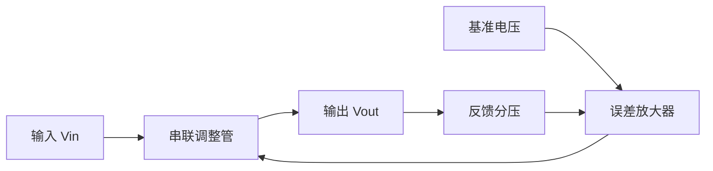

# 线性稳压器（Linear Regulator）

> [!abstract] 本章定位
> **前置知识**：[[001-电阻]]、[[002-电容]]、[[005-BJT晶体管]]、[[006-MOSFET]] 和 [[007-运算放大器]]。
>
> **本章回答**：线性稳压器怎样用基准和负反馈稳定输出？LDO 与传统三端稳压器有什么区别？压差、输出电容、PSRR、瞬态和结温怎样决定能否使用？
>
> **本章边界**：讲器件原理和应用入口，不展开完整电源树、开关电源拓扑、控制环路补偿和认证设计。
>
> **下一步**：[[009-继电器与机电元件]]，进入电气控制与机械接口。

## 1. LDO 是线性稳压器的一类

线性稳压器通过串联调整管消耗输入与输出之间的多余电压。传统 78xx、LM317 和低压差线性稳压器（LDO）都属于这一类。LDO 使用能够在较小输入输出压差下工作的调整结构，但“低压差”没有统一的绝对数值，必须查看目标电流和温度下的数据手册条件。

典型内部环路包含：

误差放大器比较反馈电压与内部基准，并调节串联调整管，使输出在输入、负载和温度变化时保持在规定范围。环路带宽有限，因此快速负载阶跃仍需输出电容提供或吸收瞬态电流。

## 2. 压差决定稳压环路是否还有调节余量

压差定义为维持规定输出精度所需的最小 $V_{in}-V_{out}$。输入接近该边界时，调整管已接近完全导通，输出开始随输入下降，器件进入掉压状态。

检查输入条件时应使用：

$$V_{in,min}\ge V_{out,max}+V_{dropout,max}+V_{ripple}+V_{margin}$$

其中各项要与负载电流、温度和频率条件对应。电池内阻、线缆压降、整流纹波和启动浪涌都可能降低稳压器引脚处的实际输入电压。

## 3. 功耗和结温往往先于额定电流成为限制

线性稳压器的主要功耗近似为：

$$P_D\approx(V_{in}-V_{out})I_{out}+V_{in}I_q$$

静态电流 $I_q$ 很小时第二项可忽略，但低功耗和电池系统不能默认忽略。结温一阶估算为：

$$T_J\approx T_A+P_D\theta_{JA}$$

以 5 V 输入、3.3 V 输出、800 mA 为例，仅调整管损耗就约为：

$$P_D=(5-3.3)\times0.8=1.36\ \text{W}$$

这对许多小封装和普通 PCB 已经很高。即使器件标称“1 A”，也可能因结温触发限流或热关断。应按实际铜面积、层数、气流和最高环境温度读取热数据，必要时降低输入电压、负载电流或改用开关稳压器。

## 4. 输出电容是控制环路的一部分

![[01-Foundations/assets/AMS1117-1A-LDO-Voltage-Adjustable-Regulator-Circuits.png|1500]]
*图中的容值只能对应特定器件与版本，不能作为所有 LDO 的统一接法。来源：ElecCircuit，AMS1117 Regulator Circuit。*

不同稳压器对输出电容有不同要求：

- 最小和最大容值；
- ESR 允许范围；
- 陶瓷、钽、聚合物或电解等电容类型；
- 直流偏压、温度和容差后的有效容值；
- 电容离引脚的距离和回流路径。

早期器件可能依赖输出电容 ESR 提供稳定所需的零点，某些现代 LDO 则针对低 ESR 陶瓷电容设计。把推荐钽电容直接换成更低 ESR 的 MLCC，或只按标称容量替换，都可能改变相位裕度和瞬态响应。应以准确料号的数据手册和参考布局为准。

输入电容负责降低输入源阻抗和吸收引线电感引起的瞬态。稳压器远离主电源、输入走线较长或输入源阻抗较高时，输入电容尤其重要。

## 5. 线性稳压器仍会传递噪声和纹波

电源抑制比（PSRR）描述输入纹波传到输出的衰减：

$$PSRR=20\log_{10}\left|\frac{V_{ripple,in}}{V_{ripple,out}}\right|$$

PSRR 随频率、负载、输入输出压差和旁路配置变化。首页的低频或单点数据不能代表开关电源基频及其谐波处的抑制能力。低噪声模拟和射频供电还要检查：

- 输出噪声的积分频段；
- 基准旁路或降噪引脚电容；
- 线路调整率与负载调整率；
- 负载阶跃过冲、欠冲和恢复时间；
- 上电斜率、软启动和使能时序。

LDO 不能自动消除所有上游开关纹波。必要时应结合前级滤波、足够压差、低噪声型号和布局实测。

## 6. 反向电流和时序可能损伤器件

输出端存在大电容、多个电源轨或外部电压时，输入掉电后可能出现 $V_{out}>V_{in}$。部分稳压器允许有限反向电流，部分需要外部保护二极管或负载放电路径。使能脚、调整脚和输入输出端的绝对最大额定值都要检查。

MCU、FPGA、传感器和模拟前端还可能有电源排序要求。线性稳压器输出正确不代表整个系统时序正确。

## 7. 78xx 固定稳压器适合较高压差的传统电源

![[01-Foundations/assets/lm7805-pinout.png|1500]]
*不同厂商和封装的引脚定义可能不同，装配前应核对具体数据手册。来源：ElectronicsForU，7805 Voltage Regulator IC。*

![[01-Foundations/assets/lm7805-internal-block-diagram.png|1500]]
*固定基准、误差放大、串联调整和保护构成基本闭环。来源：ElectronicsForU，7805 Voltage Regulator IC。*

78xx 系列提供固定正输出，79xx 系列提供固定负输出。它们通常需要比 LDO 更高的输入输出压差。旁路电容、最小负载、保护和热条件随具体厂商与型号而异，不能只凭“7805”通用名称确定。

9 V 转 5 V、1 A 时理想损耗为 4 W，普通无散热 TO-220 封装通常无法长期承受。散热器设计还要计算结到壳、壳到散热器和散热器到环境的完整热阻链。

## 8. LM317 用外部分压设置输出

![[01-Foundations/assets/LM317-circuit.png|1500]]
*调整电阻、输入/输出电容和保护器件应按具体数据手册配置。来源：LearningAboutElectronics，LM317 Voltage Regulator。*

输出近似为：

$$V_{out}=V_{ref}\left(1+\frac{R_2}{R_1}\right)+I_{ADJ}R_2$$

其中 $V_{ref}$ 约为 1.25 V，精确值和调整端电流范围以具体器件为准。$R_1$ 还承担建立最小负载电流的作用，不能只为得到方便的电阻比任意增大。LM317 不是 LDO，输入应保留足够压差和纹波裕量。

## 9. 选型顺序

1. 明确输入范围、输出电压、负载平均值/峰值、环境温度和允许纹波。
2. 在最大负载和最高温度下检查最坏压差，确认输入谷值仍有调节余量。
3. 计算最坏功耗和结温，再判断封装、PCB 或散热器是否可行。
4. 按待机功耗选择静态电流和关断电流，按启动需求检查浪涌和软启动。
5. 根据上游噪声频谱和负载敏感度检查 PSRR、输出噪声与瞬态响应。
6. 严格核对输入/输出电容的有效容值、ESR、位置和稳定性要求。
7. 检查限流、短路、热关断、反向电流、放电、使能逻辑和电源排序。
8. 在实际 PCB 上做输入范围、负载阶跃、启动、短路和最高环境温度测试。

> [!warning] 常见误区
> - 标称输出电流是电气上限之一，不代表热设计允许长期输出该电流。 
> - LDO 进入掉压后不再保持正常稳压精度，输出会受输入和负载影响。 
> - 输出电容不是“越大越稳定”，容值、ESR 和环路要求必须同时满足。 
> - 热关断是故障保护，不是正常工作温控方式，反复进入热关断会造成系统复位和可靠性问题。

## 10. 章节导航

- 上一篇：[[007-运算放大器]]
- 下一篇：[[009-继电器与机电元件]]
- 相关基础：[[002-电容]]、[[006-MOSFET]]、[[009-频率响应与Bode图]]
- 相关应用：[[13-Appendix/03-元器件选型指南/007-电源IC选型|电源 IC 选型]]、[[14-FOC-电机控制/00-README|FOC 电机控制]]
