# 信号与系统

> [!abstract] 模块定位
> 本模块建立一条从“观察波形”到“分析系统”、再到“连续系统与离散系统设计”的主线。推荐按编号学习；已有基础时，也可以按控制、DSP 或 FOC 路径选读。

## 1. 主线：先理解系统，再选择分析域

```mermaid
flowchart LR
    A["001 信号、系统与 LTI 基础"] --> B["002 时域响应与微分方程"]
    B --> C["003 卷积：从冲激响应到输出"]
    C --> D["004 为什么需要变换域"]
    D --> E["005 频域表示与傅里叶级数"]
    E --> F["006 傅里叶变换详解"]
    F --> G["007 拉普拉斯变换与系统函数"]
    G --> H["008 极点零点与系统稳定性"]
    H --> I["009 频率响应与 Bode 图"]
    I --> J["010 采样、混叠与重建"]
    J --> K["011 Z 变换与离散时间系统"]
    K --> L["012 信号与系统综合工程案例"]
```

这条顺序遵循四个递进关系：

1. 先建立信号、系统和 LTI 的共同语言；
2. 先在时域看清响应如何产生，再学习卷积；
3. 先理解变换的目的，再分别学习傅里叶、拉普拉斯和 Z 变换；
4. 先掌握连续系统，再通过采样进入离散系统。

## 2. 章节职责与学习出口

| 编号 | 笔记 | 本章只解决什么 | 学完后应能做到 |
|---|---|---|---|
| 001 | [[001-信号、系统与LTI基础]] | 信号分类、系统性质、LTI 条件 | 判断一个系统是否适合使用卷积和变换域方法 |
| 002 | [[002-时域响应与微分方程]] | 时域响应、微分方程、零输入与零状态响应 | 从方程和初始条件解释暂态响应 |
| 003 | [[003-卷积：从冲激响应到输出]] | 卷积的直觉、图解、解析与离散计算 | 由 $x$ 和 $h$ 求 LTI 系统的零状态响应 |
| 004 | [[004-为什么需要变换域]] | 变换的共同思想和选型 | 根据问题选择时域、傅里叶域、拉普拉斯域或 Z 域 |
| 005 | [[005-频域表示与傅里叶级数]] | 周期信号的谐波分解和频谱读法 | 从线谱判断基波、谐波、带宽和对称性 |
| 006 | [[006-傅里叶变换详解]] | 非周期信号的连续频谱、性质和能量关系 | 使用常见变换对与性质求频谱 |
| 007 | [[007-拉普拉斯变换与系统函数]] | ROC、逆变换、微分方程和 $H(s)$ | 从系统方程建立传递函数并求响应 |
| 008 | [[008-极点零点与系统稳定性]] | 零极点、响应模式、因果性和稳定性 | 从极点位置判断连续系统的主要动态特征 |
| 009 | [[009-频率响应与Bode图]] | $H(j\omega)$、Bode 图、带宽和稳定裕度 | 从传递函数估算幅相响应并解释工程指标 |
| 010 | [[010-采样、混叠与重建]] | 采样定理、混叠、抗混叠与重建 | 选择采样率并识别不可逆的频谱混叠 |
| 011 | [[011-Z变换与离散时间系统]] | 差分方程、$H(z)$、ROC 和离散稳定性 | 建立并分析离散 LTI 系统 |
| 012 | [[012-信号与系统综合工程案例]] | 将前述工具串成完整分析链 | 为实际问题选择模型、分析域、指标和验证方法 |

## 3. 按目标选择路径

### 3.1 完整基础路径

适合第一次系统学习：

[[001-信号、系统与LTI基础]] → [[002-时域响应与微分方程]] → [[003-卷积：从冲激响应到输出]] → [[004-为什么需要变换域]] → [[005-频域表示与傅里叶级数]] → [[006-傅里叶变换详解]] → [[007-拉普拉斯变换与系统函数]] → [[008-极点零点与系统稳定性]] → [[009-频率响应与Bode图]] → [[010-采样、混叠与重建]] → [[011-Z变换与离散时间系统]] → [[012-信号与系统综合工程案例]]

### 3.2 控制与电力电子路径

重点是模型、稳定性和频率设计：

[[001-信号、系统与LTI基础]] → [[002-时域响应与微分方程]] → [[004-为什么需要变换域]] → [[007-拉普拉斯变换与系统函数]] → [[008-极点零点与系统稳定性]] → [[009-频率响应与Bode图]] → [[010-采样、混叠与重建]] → [[011-Z变换与离散时间系统]]

傅里叶部分不是可有可无：至少应掌握 [[005-频域表示与傅里叶级数]] 中的正弦稳态和频谱概念，再进入 Bode 图。

### 3.3 DSP 与频谱分析路径

重点是卷积、频谱、采样和离散系统：

[[001-信号、系统与LTI基础]] → [[003-卷积：从冲激响应到输出]] → [[004-为什么需要变换域]] → [[005-频域表示与傅里叶级数]] → [[006-傅里叶变换详解]] → [[010-采样、混叠与重建]] → [[011-Z变换与离散时间系统]]

### 3.4 FOC 学习路径

FOC 同时依赖连续控制与离散实现：

[[001-信号、系统与LTI基础]] → [[002-时域响应与微分方程]] → [[007-拉普拉斯变换与系统函数]] → [[008-极点零点与系统稳定性]] → [[009-频率响应与Bode图]] → [[010-采样、混叠与重建]] → [[011-Z变换与离散时间系统]] → [[14-FOC-电机控制/00-README|FOC 电机控制]]

## 4. 三组容易混淆的边界

### 4.1 时域响应与卷积

- [[002-时域响应与微分方程]] 回答“系统为什么出现这种暂态”；
- [[003-卷积：从冲激响应到输出]] 回答“已知输入和冲激响应时如何计算输出”。

### 4.2 傅里叶表示与频率响应

- [[005-频域表示与傅里叶级数]]、[[006-傅里叶变换详解]] 关注信号包含哪些频率；
- [[009-频率响应与Bode图]] 关注系统如何改变每个频率的幅值和相位。

### 4.3 拉普拉斯变换与极点稳定性

- [[007-拉普拉斯变换与系统函数]] 建立 $H(s)$；
- [[008-极点零点与系统稳定性]] 解释 $H(s)$ 的结构意味着什么；
- [[009-频率响应与Bode图]] 再沿 $s=j\omega$ 观察系统的正弦稳态响应。

## 5. 建议的学习循环

每篇笔记按同一流程使用：

1. 先读“本章定位”和“前置知识”，确认自己是否具备入口条件；
2. 跟随一个完整推导，不在第一次阅读时追求记住全部公式；
3. 完成自测题，并能解释公式的适用条件；
4. 用 Python、MATLAB、LTspice 或示波器验证一个结论；
5. 根据“下一步”进入后续笔记。

## 6. 相关模块

- [[01-Foundations/01-数学与物理基础/000-README|数学与物理基础]]
- [[01-Foundations/03-电路分析方法/008-一阶动态电路分析|一阶动态电路分析]]
- [[01-Foundations/03-电路分析方法/010-正弦稳态相量分析|正弦稳态与相量分析]]
- [[02-Analog-Electronics/03-滤波器设计/001-滤波器类型|滤波器设计]]
- [[14-FOC-电机控制/00-README|FOC 电机控制]]
- [[15-双控（控制理论与控制工程）/00-README|控制理论与控制工程]]
