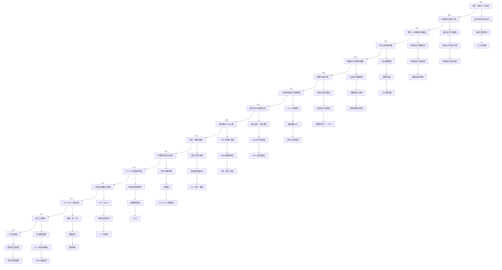

# 信号与系统

> [!abstract] 模块定位
> 从信号表示与系统建模出发，学习同一系统的时域、频域与复频域描述，再连接采样与数字实现。

## 1. 数学入口与学习方法

> - 进入 001 前，掌握 [[001-量纲、函数与复数]] 的复数、欧拉公式和单位，以及 [[002-微积分与工程近似]] 的积分与导数。
> - 进入 002 前补 [[004-常微分方程与状态模型]]；
> - 进入 005 前补 [[003-线性代数与坐标变换]] 的内积、正交和投影。
> - [[005-傅里叶、拉普拉斯与变换观]] 可作为预览，不要求先掌握全部变换再来学本模块。概率统计在随机信号专题使用，不是确定性信号主线的硬性入口。

每章遵循“定义与条件 → 完整推导 → 手算例题 → 数值或实验验证 → 自测”。文中的工程预览提供动机；标为拓展的内容可在第二遍阅读。

## 2. 完整主线与章节职责

主线按四段推进：**001–003 时域基础 → 004–009 变换域 → 010–014 采样与离散世界 → 015–016 综合与收拢**。下图主脊是阅读顺序，每篇向右延展的分支是该篇的重点内容（目录式导览）：

> 交互版（可缩放、搜索、主题切换）：[signals-mainline.html](../../Assets/archify/signals-mainline.html)

编号即推荐阅读顺序；硬性依赖以各篇前置知识为准。例如采样理论直接依赖 006，抗混叠设计再调用 009；DFT 直接依赖 DTFT，不以 Z 变换为数学前提。各篇的详细验收出口在篇末自测与 [[01-Foundations/12-信号与系统测验题|阶段测验]]（见 §5）。

学完全部章节后，用 [[016-信号与系统全景大图谱|016 全景大图谱]] 收拢全局：它把 001—015 钉在一张端到端工程总链（概念长在哪里）和一张四个世界的变换地图（工具之间什么关系）上。

## 3. 按目标分流：保留先修知识点

### 3.1 控制、电力电子与 FOC

先完成 001—010 的必修部分，再读 011—013 和 015 的电流环案例。003 的连续卷积、004 的本征函数、005 的谐波概念和 006 的卷积定理必须保留；循环卷积、STFT 可略读。需要分析 PWM 频谱时，先完成 014。

009 的反馈裕度属于拓展：先区分对象、环路和闭环传递函数，结合闭环极点验证。进一步设计进入 [[15-双控（控制理论与控制工程）/00-README|控制理论]] 与 [[14-FOC-电机控制/00-README|FOC 电机控制]]。

### 3.2 DSP 与频谱分析

001 → 002 的零状态、冲激与阶跃响应 → 003 的离散卷积与性质 → 004 → 005 → 006 → 010 → 011 → 012 → 014 → 015 的采集与频谱案例。

此路径可略过 002 的二阶微分方程详细求解；不能略过响应分解。进入 IIR 极点分析和 013 前，先补 007 的 ROC 与逆变换、008 的因果性和稳定性；设计实际抗混叠滤波器前补 009 的幅频响应与带宽。

### 3.3 完整基础学习

按 001—015 顺序完成必修，再回读 003 的循环卷积、006 的时频分析、008 的最小相位与隐藏模式、009 的反馈裕度、013 的离散化设计。不要用应用路径代替完整基础验收。

## 4. 两个贯穿模型

| 模型 | 时域 | 频域/复频域 | 工程验证 |
|---|---|---|---|
| RC 低通 | 002 微分方程；003 卷积 | 007 系统函数；008 极点；009 幅相 | 阶跃时间常数与截止频率对应 |
| 一阶递归滤波器 | 011 递推与卷积和 | 012 DTFT；013 Z 域 | 014 用有限记录验证幅值，注意暂态与窗 |

每次换工具，都写明输入、初始条件、参数与时间约定；检查不同方法给出的结果是否一致。RC 采样模型中的保持方式和延迟须单独说明。

## 5. 阶段验收

完成 [[01-Foundations/12-信号与系统测验题|信号与系统阶段测验]]：A 信号与系统，B 时域，C 傅里叶，D 拉普拉斯与频响，E 离散系统，F 采样与频谱，G 综合应用。

通过标准是能独立说明条件、完成计算、解释物理意义并验证结果。核心条件错误应回读对应章节，不能用其他术语题得分抵消。

## 6. 相邻模块与参考

- 电路建模：[[01-Foundations/03-电路分析方法/008-一阶动态电路分析|一阶动态电路分析]]。
- 转换器参数与非理想：[[01-Foundations/06-ADC与DAC基础/000-ADC与DAC基础|ADC 与 DAC 基础]]。
- 滤波器指标设计：[[02-Analog-Electronics/03-滤波器设计/001-滤波器类型|滤波器设计]]。
- [MIT 信号与系统：DTFT](https://ocw.mit.edu/courses/res-6-007-signals-and-systems-spring-2011/resources/lecture-11-discrete-time-fourier-transform/)：对照连续与离散傅里叶分析的覆盖范围。
