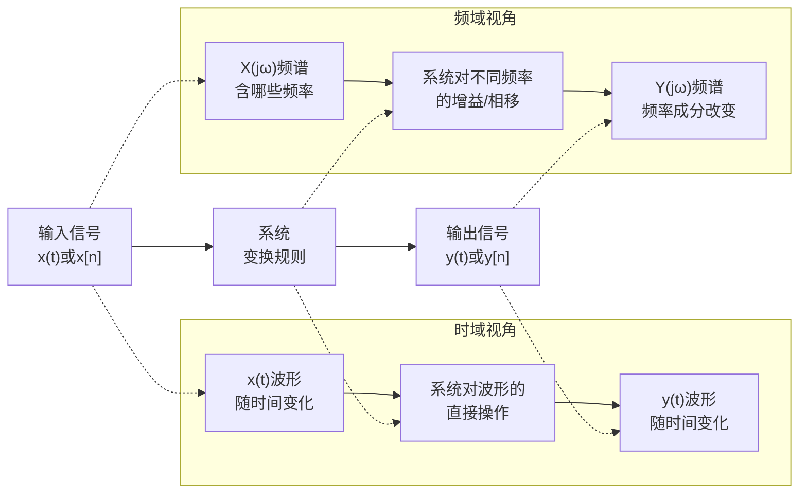
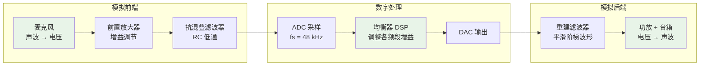
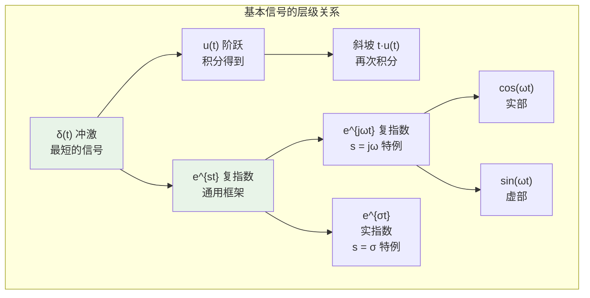
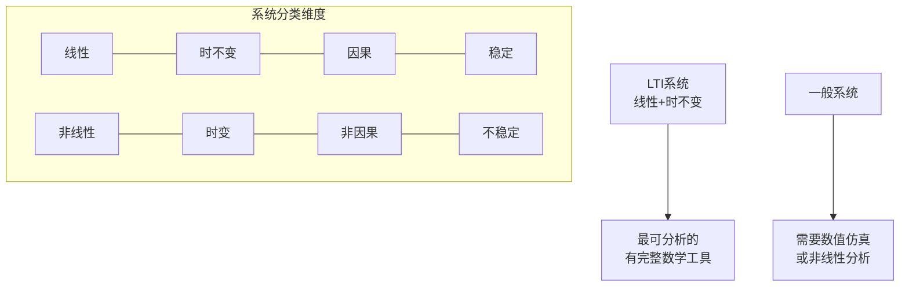

# 001-信号、系统与 LTI 基础

> [!abstract] 本章定位
> **前置知识**：函数、复数和基础微积分。
>
> **本章回答**：什么是信号和系统？怎样判断系统是否线性、时不变、因果、稳定？为什么后续课程以 LTI 系统为主线？
>
> **本章边界**：只建立术语和判定方法，不展开卷积、变换和稳定性设计。
>
> **下一步**：进入 [[002-时域响应与微分方程]]，观察系统动态如何随时间展开。

---

## 1. 信号与系统：电子工程的通用语言

### 1.1 为什么这门课如此重要？

如果你打开任何一个电子工程的分支——通信、控制、音频处理、图像处理、电力电子——你会发现它们都在用同一套语言说话：

| 领域   | 信号          | 系统          | 核心问题          |
| ---- | ----------- | ----------- | ------------- |
| 通信   | 调制载波、数据包    | 信道、滤波器、调制器  | 如何在噪声中可靠传输信息  |
| 控制   | 传感器反馈、参考输入  | 控制器、被控对象    | 如何让系统按期望行为运行  |
| 音频   | 声波、数字音频流    | 均衡器、混响器、压缩器 | 如何修改声音的频谱特性   |
| 电力电子 | PWM 波形、电流采样 | 变换器、滤波器、负载  | 如何高效变换电能并稳定输出 |
| 电机控制 | 三相电流、编码器脉冲  | FOC 算法、逆变器  | 如何实现精确转矩控制    |

> **工程直觉**：信号与系统不是一门"纯数学"课，而是把工程问题翻译成数学、解决后再翻译回工程的桥梁。RC 电路的充放电、电机的速度响应、通信的带宽限制——本质上都是同一个故事：信号经过系统后发生了什么变化。

### 1.2 核心问题：信号经过系统后发生了什么？

**信号与系统给出两个互补的分析视角：**
- **时域**：观察波形随时间如何变化（卷积、微分方程）
- **频域**：观察信号包含哪些频率成分，系统如何改变这些成分（傅里叶、拉普拉斯、Z 变换）

### 1.3 工程预览（首读可略）：时域 vs 频域——以数字音频均衡器为例

时域和频域不是"二选一"的关系，而是**同一信号的两副眼镜**。以下用一个完整的数字音频均衡器（EQ）信号链，展示两副眼镜分别看到了什么：

#### 系统框架：完整信号流向

> **工程背景**：歌手的声音经麦克风拾取后，需要通过 EQ 调整音色——例如削减 200Hz 的"鼻音浑浊感"，提升 5kHz 的"空气感"。整个信号链串联了模拟电路、ADC、DSP、DAC 和功率放大，是一个典型的跨域信号处理系统。

#### 两副眼镜看同一个信号

| 环节 | 时域视角（示波器看到的） | 频域视角（频谱分析仪看到的） |
|------|-----------------------|--------------------------|
| **麦克风输出** | 复杂的电压波形，声带振动和口腔共鸣叠加成一团"乱线" | 清晰的频谱：基频（~200Hz）+ 谐波 + 齿音（~6kHz），成分一目了然 |
| **抗混叠滤波** | 波形边沿被 RC 充放电"磨圆"，陡峭跳变消失 | 20kHz 以上的高频分量被衰减 → 为采样做准备 |
| **ADC 采样** | 连续信号取值形成离散序列；保持电路的阶梯电压另行描述 | 频谱中出现镜像（images），位于 $f_s \pm f_{in}$ 处 |
| **EQ 调整** | 波形看起来只是"变了一点"，人眼几乎无法判断改了哪个频段 | 各频段增益清晰可见：200Hz -6dB，5kHz +3dB |
| **DAC 输出** | 阶梯波形，每 $T_s = 1/f_s \approx 20.8\mu s$ 更新一次 | 残留高频镜像 → 需要重建滤波器消除 |

**各阶段实测波形与解读（每张图上方为时域波形，下方为频谱）：**

| 阶段                      | 波形图与详细解读                                                                                                                                                                                                                                                                       |
| ----------------------- | ------------------------------------------------------------------------------------------------------------------------------------------------------------------------------------------------------------------------------------------------------------------------------ |
| **Stage 1** — 麦克风输出     | ![[Assets/signals_systems/eq_stage1_mic.png]]  **时域**：200Hz 基频 + 800Hz 谐波 + 5kHz"齿音"三条正弦叠加，波形杂乱。 **频域**：三条谱线与频率成分一一对应，幅度成正比（200Hz 最高、5kHz 最低）——"时域一团乱麻，频域一目了然"的第一次直观体验。                                                                                               |
| **Stage 2** — 抗混叠滤波     | ![[Assets/signals_systems/eq_stage2_antialias.png]]  **时域**：灰色为滤波前（叠加了 22kHz 高频干扰，呈细密毛刺），蓝色为滤波后毛刺被磨平。 **频域**：22kHz 谱线衰减约 -3.4dB，而 200Hz/800Hz/5kHz 人声成分几乎不受影响（都在 $f_c=20\text{kHz}$ 通带内）——**抗混叠滤波器只"动"需要滤除的高频，不影响有用信号**。                                              |
| **Stage 3** — ADC 采样    | ![[Assets/signals_systems/eq_stage3_adc.png]]  **时域**：灰色连续波形被离散为红色采样点，蓝色阶梯为零阶保持（ZOH）输出——采样保持器把电压"冻结"在上一次采样值。 **频域**：出现以 $f_s=8\text{kHz}$ 为间隔的镜像，5kHz 信号在 $f_s-5\text{kHz}=3\text{kHz}$ 处混叠（$f_s/2=4\text{kHz}$ 红线为奈奎斯特频率）——**这正是抗混叠滤波器存在的根本原因**（演示用低采样率，实际系统 48kHz）。 |
| **Stage 4** — EQ 均衡处理   | ![[Assets/signals_systems/eq_stage4_eq.png]]  **时域**：灰色（EQ 前）与蓝色（EQ 后）几乎重合，人眼无法判断改了哪个频段。 **频域**：蓝色阴影区（50–300Hz）衰减 6dB（-6dB ≈ ×0.5），绿色阴影区（4–6kHz）提升 3dB（+3dB ≈ ×1.41）——**EQ 在时域是卷积运算，在频域只是一次逐频率乘法**。                                                                   |
| **Stage 5** — DAC 输出+重建 | ![[Assets/signals_systems/eq_stage5_dac.png]]  **时域**：蓝色曲线是重建滤波器输出，把灰色 ZOH 阶梯平滑回连续波形，消除台阶"棱角"。 **频域**：红色区域（$f_s/2\sim f_s$）为残留高频镜像，必须由重建滤波器（模拟低通）滤除，否则进入功放和音箱产生超声噪声与失真——**时域"平滑"与频域"滤镜像"描述的是同一件事**。                                                                   |

> **关键洞见**：EQ 的"调整各频段增益"这一操作，在**时域**中体现为复杂的卷积运算（输入信号与 EQ 冲激响应做卷积），但在**频域**中只是一次简单的乘法（每个频率分量乘一个增益值）。**这就是傅里叶变换的核心价值——把卷积变成乘法。**

#### 为什么工程师必须有两副眼镜

|           | 时域眼镜                 | 频域眼镜                 |
| --------- | -------------------- | -------------------- |
| **适合什么**  | 调试电路板、看示波器、检查过冲和振铃   | 设计滤波器、分析噪声频谱、评估 EMC  |
| **擅长的判断** | "这个信号有没有毛刺？响应快不快？"   | "哪个频率分量太强？滤波器够不够陡？"  |
| **典型工具**  | 示波器、逻辑分析仪            | 频谱分析仪、Bode 图、网络分析仪   |
| **工程场景**  | 排查 I²C 时序违例、PWM 死区时间 | 设计 ADC 抗混叠滤波器、电源环路补偿 |

> **一句话总结**：**时域是"现场排查的第一语言"，频域是"系统设计的核心工具"。** 优秀的工程师在两个视角之间自由切换——用时域定位问题，用频域设计解决方案。

---

## 2. 信号的分类

### 2.1 按时间连续性

| 类型 | 数学表示 | 定义 | 示例 | 物理可实现性 |
|------|----------|------|------|-------------|
| **连续时间信号** | $x(t), t \in \mathbb{R}$ | 时间连续，幅值可连续或离散 | 模拟电压、麦克风拾音、温度传感器输出 | 自然界中普遍存在 |
| **离散时间信号** | $x[n], n \in \mathbb{Z}$ | 时间离散，幅值可连续 | 理想采样序列、算法产生的序列 | 可由采样或计算产生 |
| **数字信号** | $x[n], n \in \mathbb{Z}$ | 时间和幅值都离散 | 计算机内存中的音频数据、MCU 的 ADC 结果 | 需要采样+量化 |

![[Assets/signals_systems/27_time_continuity.png|1500]]

> **如何读这张图**：三个子图展示的是**同一个 50Hz 正弦信号**——上图为连续时间信号 $x(t)$（每个时刻都有值）；中图为以 400Hz 采样后的离散时间信号 $x[n]$（蓝色细线仅为参照，红色圆点才是真实数据）；下图为再经 4-bit 量化的数字信号（绿色阶梯，幅值只能落在 16 个量化电平上）。**连续 → 离散 → 数字，正是 ADC 完成的两次"离散化"：先离散时间，再离散幅值。**

> **工程直觉**：连续时间信号是"物理世界的原生语言"，离散时间信号是"采样后的中间态"，数字信号是"计算机能处理的语言"。在嵌入式系统中，ADC 先把连续信号变成离散时间信号，再经量化变成数字信号。理解这个三阶段的区别，对后续 [[010-采样、混叠与重建]] 至关重要。

### 2.2 按周期性

**周期信号**：存在最小正数 $T$（或 $N$），使得对所有 $t$（或 $n$）都有：
$$x(t + T) = x(t) \quad \text{或} \quad x[n + N] = x[n]$$

- **连续周期信号**：正弦波 $A\cos(\omega_0 t + \phi)$，周期 $T = \frac{2\pi}{\omega_0}$；方波、三角波
- **离散周期信号**：$x[n] = \cos(\Omega_0 n)$，仅当 $\frac{2\pi}{\Omega_0}$ 为有理数时才周期

**非周期信号**：不满足周期性条件的信号。如单个脉冲、指数衰减、噪声。

> **工程直觉**：周期信号是频域分析的"基石"——傅里叶级数告诉我们，任何周期信号都可以分解成一系列正弦波的叠加。这也是为什么正弦波被称为"本征信号"（eigenfunction）的原因。

> **常见错误**：离散正弦信号 $\cos(\Omega_0 n)$ 并不总是周期的！例如 $\cos(0.1 n)$，因为 $2\pi/0.1 = 20\pi$ 不是有理数，所以不是周期信号。注意判据是 $\frac{2\pi}{\Omega_0}$ 为**有理数**而非整数——例如 $\Omega_0 = \frac{4\pi}{3}$ 时 $\frac{2\pi}{\Omega_0} = \frac{3}{2}$，不是整数但 $\cos(\frac{4\pi}{3}n)$ 仍是周期信号（$N=3$）。这是从连续世界过渡到离散世界时最容易踩的坑。

### 2.3 按确定性

| 类型 | 定义 | 示例 | 分析方法 |
|------|------|------|----------|
| **确定性信号** | 可用明确的数学表达式或规则描述 | $A\cos(\omega t)$、$e^{-at}u(t)$、方波 | 精确的时域/频域分析 |
| **随机信号** | 无法用确定函数描述，只能用统计特性描述 | 热噪声、量化噪声、通信信道干扰 | 概率论、功率谱密度、统计平均 |

> **工程直觉**：在嵌入式系统中，ADC 的量化噪声、运放的热噪声、电机电流采样中的 EMI 干扰都是随机信号。设计系统时，我们关心的是噪声的"平均功率"和"频谱分布"，而不是它某一时刻的确切值。随机信号分析将在后续专题中深入。

### 2.4 按能量与功率

对于信号 $x(t)$（连续）或 $x[n]$（离散）：

**能量**：
$$E = \int_{-\infty}^{+\infty} |x(t)|^2 \, dt \quad \text{或} \quad E = \sum_{n=-\infty}^{+\infty} |x[n]|^2$$

**平均功率**：
$$P = \lim_{T \to \infty} \frac{1}{T} \int_{-T/2}^{T/2} |x(t)|^2 \, dt \quad \text{或} \quad P = \lim_{N \to \infty} \frac{1}{2N+1} \sum_{n=-N}^{N} |x[n]|^2$$

| 类型 | 定义 | 能量 | 功率 | 示例 |
|------|------|------|------|------|
| **能量信号** | $0 < E < \infty$ | 有限 | $P = 0$ | 单个矩形脉冲、指数衰减信号、有限长序列 |
| **功率信号** | $0 < P < \infty$ | $E = \infty$ | 有限 | 正弦波、周期信号、随机噪声、无限长直流信号 |
| **既不是能量也不是功率** | — | $E = \infty$ | $P = \infty$ | $x(t) = t$（发散信号）|

> **工程直觉**：
> - 能量信号是"一次性事件"——比如一个脉冲，它只在有限时间内有值，总能量有限。
> - 功率信号是"持续存在"——比如正弦波，从 $t = -\infty$ 到 $t = +\infty$ 一直在振荡，总能量无穷大，但单位时间内的平均功率有限。
> - 在通信中，发射一个脉冲（能量信号） vs 持续发送载波（功率信号），功率预算的计算方式完全不同。

> **与后续知识的关联**：帕塞瓦尔定理（Parseval's theorem）建立了时域能量与频域能量的等价关系。后续 [[006-傅里叶变换详解]] 将证明：信号在时域的总能量等于其频谱在各频率分量上的能量之和。

---

## 3. 基本信号详解：电子工程的"字母表"

如果把信号分析比作一门语言，以下五种信号就是"字母"——所有复杂信号都可以由它们组合或变换得到。

![[Assets/basic_signals/00_basic_signals_overview.png|1500]]

> 六种基本信号的波形总览。从上到下、从左到右依次为：冲激 $\delta(t)$、阶跃 $u(t)$、衰减指数 $e^{-t}u(t)$、正弦 $\cos(\omega t)$、复指数 $e^{j\omega t}$（复平面旋转）、门函数 $\mathrm{rect}(t)$。

### 3.1 单位冲激信号 $\delta(t)$（Dirac Delta）

**定义**：
$$\delta(t) = 0, \quad t \neq 0$$
$$\int_{-\infty}^{+\infty} \delta(t) \, dt = 1$$

**筛选性质（Sifting Property）**：
$$\int_{-\infty}^{+\infty} x(t) \delta(t - t_0) \, dt = x(t_0)$$

**离散对应**：单位脉冲序列（Kronecker Delta）
$$\delta[n] = \begin{cases} 1, & n = 0 \\ 0, & n \neq 0 \end{cases}$$

![[Assets/basic_signals/01_delta_impulse.png|1500]]

> 单位冲激信号 $\delta(t)$ 的波形：在 $t = 0$ 处有一个面积为 1 的"箭头"，其余时刻为 0。**冲激不是普通函数，而是广义函数（分布），只在积分下有意义**。
> - 用锤子敲击钟的极短瞬间
> - 电容瞬间放电的电流脉冲
> - 对系统"快速试探"以观察其响应
>
> **筛选性质的本质**：冲激像一个"探测器"——它把信号 $x(t)$ 在 $t_0$ 处的值"筛选"出来。这是后续卷积定义的核心。

**冲激的物理近似**：
$$\delta(t) = \lim_{\Delta \to 0} \frac{1}{\Delta} \text{rect}\left(\frac{t}{\Delta}\right)$$

其中 $\text{rect}(t)$ 是宽度为 1、高度为 1 的矩形脉冲。当 $\Delta \to 0$ 时，矩形变得越来越窄、越来越高，但面积保持为 1。

> **常见错误**：
> - ❌ 错误：$\delta(0) = \infty$（严格说，$\delta(0)$ 没有定义，它是一个广义函数）
> - ❌ 错误：$\delta(t)$ 是一个普通函数（它是一个**分布**distribution，或广义函数）
> - ✅ 正确：$\delta(t)$ 只有在积分下才有意义；$\delta(t) = \frac{d}{dt}u(t)$（在广义函数意义下）

### 3.2 单位阶跃信号 $u(t)$

**定义**：
$$u(t) = \begin{cases} 1, & t > 0 \\ 0, & t < 0 \end{cases}$$

在 $t = 0$ 处的取值有多种约定（0、1、1/2），不影响积分结果。

**离散对应**：
$$u[n] = \begin{cases} 1, & n \geq 0 \\ 0, & n < 0 \end{cases}$$

![[Assets/basic_signals/02_unit_step.png|1500]]

> 单位阶跃信号 $u(t)$ 的波形：在 $t = 0$ 处从 0 跳变到 1。空心圆表示 $t = 0^-$ 时刻的值为 0，实心圆表示 $t = 0^+$ 时刻的值为 1。阶跃是"最自然的开关动作"——电路在 $t = 0$ 时刻接通电源。
>
> **关键关系**：$u(t) = \int_{-\infty}^{t} \delta(\tau) \, d\tau$，$\delta(t) = \frac{d}{dt}u(t)$。冲激是阶跃的"导数"，阶跃是冲激的"积分"。

> **与后续知识的关联**：
> - 控制理论中，**单位阶跃响应** $s(t)$ 是衡量系统性能的核心指标（超调量、调节时间、稳态误差）
> - [[01-Foundations/05-信号与系统/002-时域响应与微分方程|002-时域响应与微分方程]] 将证明：$h(t) = \frac{ds(t)}{dt}$，即冲激响应是阶跃响应的导数

### 3.3 指数信号 $e^{st}$

**定义**：$x(t) = e^{st}$，其中 $s = \sigma + j\omega$ 是复频率。

**按 $s$ 的取值分类**：

| $s$ 的类型 | 信号形式 | 波形特征 | 物理意义 |
|-----------|----------|----------|----------|
| $s = 0$ | $e^{0} = 1$ | 直流 | 恒定电压/电流 |
| $s = \sigma$（实数） | $e^{\sigma t}$ | $\sigma > 0$：指数增长；$\sigma < 0$：指数衰减 | RC/RL 电路的瞬态响应 |
| $s = j\omega$（纯虚数） | $e^{j\omega t}$ | 等幅振荡 | 正弦信号的基础（欧拉公式） |
| $s = \sigma + j\omega$ | $e^{\sigma t} e^{j\omega t}$ | 振幅按指数增长或衰减的振荡 | 二阶系统的阻尼振荡 |

![[Assets/basic_signals/03_real_exponential.png|1500]]

> 实指数信号的波形：$\sigma < 0$ 时衰减（如 RC 放电），$\sigma > 0$ 时增长（如正反馈），$\sigma = 0$ 时为直流。指数信号是 LTI 系统的本征函数——输入 $e^{st}$，输出仍是 $e^{st}$，只乘一个复常数 $H(s)$。
> - $s = -\frac{1}{RC}$：RC 电路放电，电压按指数衰减
> - $s = j\omega$：LC 振荡器的无阻尼振荡
> - $s = -\zeta\omega_n + j\omega_n\sqrt{1-\zeta^2}$：RLC 电路的阻尼振荡（$\zeta$ 为阻尼比）

![[Assets/basic_signals/03b_damped_oscillation.png|1500]]

> 复指数（阻尼振荡）信号 $e^{\sigma t}\cos(\omega t)u(t)$ 的波形（$\sigma<0,\;\omega\neq0$）：振荡幅度按指数包络 $\pm e^{\sigma t}$（虚线）衰减，包络之间为 $\cos(\omega t)$ 振荡。$\sigma$ 控制衰减速度，$\omega$ 控制振荡频率。对应二阶系统欠阻尼响应：$\sigma = -\zeta\omega_n$，$\omega = \omega_d = \omega_n\sqrt{1-\zeta^2}$。
> - 当 $\sigma \to 0^-$（$\zeta \to 0^+$）时，包络趋于水平，趋近等幅振荡
> - 当 $\sigma \ll 0$（$\zeta \to 1^-$）时，包络快速衰减，趋近临界阻尼
>
> **为什么指数信号如此重要？** 因为指数信号是 LTI 系统的**本征函数**（eigenfunction）：当 $e^{st}$ 输入 LTI 系统时，输出仍然是 $e^{st}$，只是乘了一个复数常数 $H(s)$。这意味着系统对指数信号的"响应模式"不变，只改变幅度和相位。这是拉普拉斯变换和傅里叶变换的物理基础。

### 3.4 正弦信号 $A\cos(\omega t + \phi)$

**定义**：
$$x(t) = A\cos(\omega t + \phi)$$

其中：
- $A$：振幅（Amplitude）
- $\omega$：角频率（rad/s），$\omega = 2\pi f$
- $f$：频率（Hz）
- $\phi$：初始相位（rad）
- $T = \frac{2\pi}{\omega} = \frac{1}{f}$：周期

![[Assets/basic_signals/04_sinusoidal.png|1500]]

> 正弦信号 $A\cos(\omega t + \phi)$ 的波形：振幅 $A$ 决定峰峰值的一半，周期 $T = 2\pi/\omega$ 决定重复间隔，初始相位 $\phi$ 决定 $t = 0$ 时刻的起始位置。正弦是自然界最普遍的振荡形式——弹簧振子、LC 电路、声波、电磁波在小幅振荡下都近似为正弦。

### 3.5 复指数信号 $e^{j\omega t}$：桥梁信号

**欧拉公式**：
$$e^{j\omega t} = \cos(\omega t) + j\sin(\omega t)$$
$$\cos(\omega t) = \frac{e^{j\omega t} + e^{-j\omega t}}{2}$$
$$\sin(\omega t) = \frac{e^{j\omega t} - e^{-j\omega t}}{2j}$$

![[Assets/basic_signals/05_complex_exponential.png|1500]]

> 复指数信号 $e^{j\omega t}$ 的双视角可视化：
> - **左图（3D 螺旋）**：蓝色曲线为 $e^{j\omega t}$ 在 $(t, \mathrm{Re}, \mathrm{Im})$ 空间中的螺旋轨迹。绿色投影为实部 $\cos(\omega t)$ 的波形，橙色投影为虚部 $\sin(\omega t)$ 的波形。红色箭头为某一时刻的旋转向量，其末端到实轴和虚轴的投影线给出该时刻的 $\cos$ 和 $\sin$ 值。
> - **右图（复平面投影）**：螺旋投影到 Re-Im 平面得到一系列旋转向量。彩色箭头（紫→黄，时间推进）展示单位向量在不同 $\omega t$ 时刻的位置——所有箭头末端落在单位圆上，体现 $|e^{j\omega t}| = 1$ 的恒模性质。
>
> **一句话理解**：$e^{j\omega t}$ 就是复平面上一个**以角速度 $\omega$ 匀速逆时针旋转的单位向量**——它的实部是 $\cos(\omega t)$，虚部是 $\sin(\omega t)$。欧拉公式把"桥的两端"精确地连接起来。

#### 为什么称 $e^{j\omega t}$ 为"桥梁信号"？

复指数信号串联了信号分析中三组核心概念，每一组都是一座"桥"：

| 桥梁 | 从 | 到 | 本质 |
|------|----|----|------|
| **桥一：三角 ↔ 指数** | $\cos$/$\sin$ 三角函数 | $e^{j\omega t}$ | 欧拉公式把三角函数的乘除、相位偏移，全部转化为指数的简单加减——**运算降维** |
| **桥二：时域 ↔ 频域** | 时间波形 $x(t)$ | 频谱 $X(j\omega)$ | $e^{j\omega t}$ 是 LTI 系统的**本征函数**——输入 $e^{j\omega t}$，输出只乘复数常数 $H(j\omega)$。傅里叶变换的本质：把任意信号分解为不同频率 $e^{j\omega t}$ 的加权叠加 |
| **桥三：微分 ↔ 代数** | 微分方程 | 代数方程 | $\frac{d}{dt}e^{j\omega t} = j\omega \cdot e^{j\omega t}$，微分退化为乘 $j\omega$。这是拉普拉斯变换和相量法的核心思想 |

> **一句话总结**：$e^{j\omega t}$ 把物理世界真实的三角函数（$\sin$/$\cos$），翻译成数学世界好算的指数形式，算完再翻译回物理世界。桥的两端是"真实信号"和"数学工具"。

> **物理意义**：$e^{j\omega t}$ 在复平面上是一个以角速度 $\omega$ 逆时针旋转的单位向量。它的实部是 $\cos(\omega t)$，虚部是 $\sin(\omega t)$。当我们说"正弦信号通过系统后幅度衰减、相位偏移"，在复指数表示下就是乘了一个复数增益 $H(j\omega) = |H(j\omega)|e^{j\angle H(j\omega)}$。

> **与后续知识的关联**：
> - [[007-拉普拉斯变换与系统函数]] 的核心就是将任意信号分解为 $e^{st}$ 的连续叠加
> - [[009-频率响应与Bode图]] 分析的就是 $H(j\omega)$，即系统对 $e^{j\omega t}$ 的复数增益

---

## 4. 信号基本运算：进入卷积前的必修练习

对波形先确定自变量映射，再确定非零区间，最后画图。

| 运算 | 表达式 | 读法 |
|---|---|---|
| 延迟 | $x(t-t_0)$，$t_0>0$ | 整体右移 $t_0$ |
| 反转 | $x(-t)$ | 关于时间原点镜像 |
| 缩放 | $x(at)$ | $|a|>1$ 压缩；$a<0$ 还包含反转 |
| 离散延迟 | $x[n-n_0]$ | $n_0$ 必须为整数 |
| 奇偶分解 | $x_e(t)=[x(t)+x(-t)]/2$；$x_o(t)=[x(t)-x(-t)]/2$ | $x=x_e+x_o$；序列同理 |

**完整例题**：设 $x(t)=u(t)-u(t-2)$，非零区间取 $0\le t<2$。对 $y(t)=x(2t-1)$，解 $0\le2t-1<2$，得 $1/2\le t<3/2$。因此 $y(t)=u(t-1/2)-u(t-3/2)$，幅值不变，宽度减半。

再求 $x(1-t)$：由 $0\le1-t<2$ 得 $-1<t\le1$。端点取值依阶跃约定处理，不影响普通积分。不要凭“先平移还是先缩放”的口令猜位置。

**离散边界**：$x[2n]$ 只取原序列偶数索引；$x[n/2]$ 在奇数 $n$ 处没有天然定义。上采样应显式规定插零等规则，不能照搬连续时间伸缩。

**自测**：画出 $x(t+1)$、$x(-2t)$，分别写出非零区间；对 $x[n]=\delta[n]+2\delta[n-1]$ 求 $x[n-2]$ 与奇偶分量。

**核对**：前两者区间为 $[-1,1)$、$(-1,0]$；离散延迟结果为 $\delta[n-2]+2\delta[n-3]$。奇分量为 $\delta[n-1]-\delta[n+1]$，偶分量为 $\delta[n]+\delta[n-1]+\delta[n+1]$。

## 5. 系统的分类

### 5.1 线性 vs 非线性

**线性系统**满足**叠加原理**（Principle of Superposition）：

若 $x_1(t) \to y_1(t)$ 且 $x_2(t) \to y_2(t)$，则：
$$a \cdot x_1(t) + b \cdot x_2(t) \to a \cdot y_1(t) + b \cdot y_2(t)$$

这包含两个子性质：
- **齐次性**（Homogeneity）：$a \cdot x(t) \to a \cdot y(t)$
- **叠加性**（Additivity）：$x_1(t) + x_2(t) \to y_1(t) + y_2(t)$

> **工程直觉**：线性系统就像一个"没有饱和的放大器"——你把两个信号加起来输入，输出等于分别输入后再相加；你把信号放大 2 倍输入，输出也放大 2 倍。如果放大器进入饱和区（削顶），齐次性就破坏了，系统变成非线性。

**非线性系统的典型表现**：
- 饱和：$y(t) = \tanh(x(t))$（如运放饱和、磁性材料饱和）
- 死区：$y(t) = 0$ 当 $|x(t)| < \Delta$（如电机静摩擦、继电器）
- 乘法：$y(t) = x_1(t) \cdot x_2(t)$（如调制器、混频器）

> **常见错误**：很多实际系统在小信号范围内是近似线性的，但大信号下是非线性的。例如，音频功放在小音量下线性好，大音量下削波失真。在 [[14-FOC-电机控制/00-README|14-FOC-电机控制]] 中，电机的磁链-电流关系在大电流下可能饱和，这就是非线性效应。

### 5.2 时变 vs 时不变

**时不变系统**（Time-Invariant）：
若 $x(t) \to y(t)$，则 $x(t - t_0) \to y(t - t_0)$

即：输入延迟，输出也延迟相同的时间，波形形状不变。

> **工程直觉**：时不变系统就像一个"不记时间的机器"——它今天对某个输入的响应，和明天对同样输入的响应一模一样。如果系统的参数随时间变化（如温度漂移导致 RC 常数变化、电路元件老化），它就变成时变系统。

**时变系统的典型例子**：
- 调幅收音机的中频滤波器（中心频率随调谐改变）
- 自适应滤波器（系数随时间更新）
- 加速中的车辆（质量不变但动力学参数变化）

### 5.3 因果 vs 非因果

| 特性 | 定义 | 数学条件 | 物理可实现性 |
|------|------|----------|-------------|
| **因果系统** | 输出只依赖当前和过去的输入 | $h(t) = 0, \quad t < 0$ | 物理可实时实现 |
| **非因果系统** | 输出依赖未来的输入 | $h(t) \neq 0$ 对某些 $t < 0$ | 物理不可实时实现，但可离线实现 |

> **工程直觉**：因果性是"物理世界的时间箭头"——你不可能在现在听到未来的声音。所有实时系统（如实时滤波器、电机控制器）必须是因果的。但在离线处理中（如图像处理、非实时音频编辑），可以使用非因果滤波器（如零相位滤波器）。

### 5.4 稳定 vs 不稳定

**BIBO 稳定性**（Bounded Input Bounded Output）：
若 $|x(t)| \leq M_x < \infty$ 对所有 $t$ 成立，则存在 $M_y$ 使得 $|y(t)| \leq M_y < \infty$ 对所有 $t$ 成立。

**LTI 系统的稳定判据**：
$$\int_{-\infty}^{+\infty} |h(t)| \, dt < \infty$$

即：冲激响应的绝对值积分有限。

> **工程直觉**：稳定系统就是"不会自己爆炸的系统"——给一个有限的输入，输出不会无限增长。RC 电路是稳定的（电容充电到电源电压就停了），但带有正反馈的放大器可能不稳定（输出越来越大直到饱和）。
>
> **与后续知识的关联**：在 [[15-双控（控制理论与控制工程）/00-README|15-双控（控制理论与控制工程）]] 中，稳定性是控制系统设计的首要目标。闭环系统如果极点在右半平面，就是不稳定的，需要重新设计控制器。在 [[14-FOC-电机控制/00-README|14-FOC-电机控制]] 中，电流环 PI 参数整定不当可能导致电流振荡甚至发散。

### 5.5 记忆 vs 无记忆

| 特性 | 定义 | 示例 | 数学特征 |
|------|------|------|----------|
| **无记忆系统** | 输出只依赖当前输入 | 电阻 $v(t) = R \cdot i(t)$、理想放大器 | 代数关系，无微分/积分 |
| **记忆系统** | 输出依赖当前和过去的输入 | 含电容/电感的电路、积分器、延迟线 | 含微分/积分/延迟运算 |

> **工程直觉**：电容是"记忆元件"——它两端的电压取决于过去流过的电流的积分（$v(t) = \frac{1}{C}\int i(t) dt$）。因此，含电容的系统是有记忆的。这也解释了为什么 RC 电路的阶跃响应不是瞬时跳变，而是有一个"记忆过去的充电过程"。

### 5.6 系统分类汇总表

| 维度  | 类型 1    | 类型 2    | 判断方法                               |
| --- | ------- | ------- | ---------------------------------- |
| 线性  | 满足叠加原理  | 不满足叠加原理 | 检查齐次性+叠加性                          |
| 时不变 | 参数不随时间变 | 参数随时间变  | 输入延迟，输出是否延迟相同                      |
| 因果  | 输出不依赖未来 | 输出依赖未来  | $h(t) = 0$ for $t < 0$             |
| 稳定  | BIBO 稳定 | 不稳定     | $\int \vert h(t)\vert dt < \infty$ |
| 记忆  | 含储能元件   | 纯阻性/即时  | 有微分/积分/延迟                          |

---

## 6. LTI 系统为什么重要？

### 6.1 叠加原理的威力

LTI（Linear Time-Invariant）系统同时满足线性和时不变性。这两个性质的组合产生了极其强大的分析工具：

1. **复杂输入分解**：任何输入可以分解为简单信号（如冲激、指数）的叠加
2. **分别求解再叠加**：对每种简单信号求响应，然后叠加得到总响应
3. **频域分析**：复指数 $e^{j\omega t}$ 是 LTI 系统的本征函数，系统只对其乘一个复数增益

> **工程直觉**：LTI 系统就像一组"调音旋钮"——你输入一个复杂的声音（由多个频率组成），系统对每个频率单独施加增益和相移，然后混合输出。你可以精确预测每个频率会发生什么，因为频率之间不会"互相干扰"（这是线性性质的直接后果）。

### 6.2 本征函数：$e^{st}$ 的特权地位

**定理**：若 LTI 系统的输入为 $x(t) = e^{st}$，则输出为 $y(t) = H(s) \cdot e^{st}$，其中 $H(s)$ 是系统函数（与输入无关的复常数）。

**证明思路**：
由时不变性，$e^{st}$ 的延迟版本 $e^{s(t-\tau)} = e^{-s\tau}e^{st}$ 的响应也应延迟相同；由线性，响应必须正比于 $e^{st}$。因此输出只能是 $H(s)e^{st}$。

> **与后续知识的关联**：
> - $s = j\omega$ 时，$H(j\omega)$ 就是**频率响应**，是 [[009-频率响应与Bode图]] 的核心
> - $H(s)$ 的一般形式是 **传递函数**，是 [[15-双控（控制理论与控制工程）/00-README|15-双控（控制理论与控制工程）]] 和 [[007-拉普拉斯变换与系统函数]] 的核心工具
> - 在 [[14-FOC-电机控制/00-README|14-FOC-电机控制]] 中，电流环的传递函数 $H(s)$ 决定了 PI 参数如何整定

### 6.3 为什么实际系统可以近似为 LTI？

没有任何实际系统是严格 LTI 的，但在以下条件下近似成立：
- **小信号工作**：半导体器件在偏置点附近线性化（如小信号等效电路）
- **参数缓变**：温度漂移等缓慢变化在分析时间窗口内可忽略
- **忽略非线性失真**：如音频功放在额定功率内工作

### 6.4 响应分解：零输入响应与零状态响应

系统输出 $y(t)$ 有两个来源：**系统内部"记得"的能量**（初始储能）和**外部输入 $x(t)$**。线性系统可以把总响应拆成两部分：

$$y(t) = \underbrace{y_{zi}(t)}_{\text{零输入响应}} + \underbrace{y_{zs}(t)}_{\text{零状态响应}}$$

| 分量 | 条件 | 来源 | 数学对应 |
|------|------|------|---------|
| **零输入响应** $y_{zi}(t)$ | 输入为零 $x(t)=0$ | 仅初始储能（电容电压、电感电流初值） | 齐次方程的解 |
| **零状态响应** $y_{zs}(t)$ | 初始储能为零 | 仅输入信号 | 特解 + 齐次解（零初始条件） |

> **为什么能这样拆？** 因为线性系统满足叠加性：输入为零时的响应与初始状态为零时的响应各自独立产生，相加即得总响应。非线性系统不能这样分解。

> **物理直觉**：总响应 = "旧记忆"（系统还记得什么）+ "新反应"（系统听到了什么）。嵌入式系统上电瞬间的零输入响应，就是上次关机时电容的残余电荷。

> **与后续知识的关联**：零输入响应 $y_{zi}$ 是齐次方程的解，对应系统"自然模态"，由特征根决定；零状态响应 $y_{zs}$ 在 LTI 下等于卷积 $x(t)*h(t)$。详细求解方法见 [[002-时域响应与微分方程]] 第 3 节。

---

## 7. 典型系统示例

### 7.1 RC 低通电路

![[Assets/signals_systems/26a_rc_circuit.png|1500]]

> RC 低通滤波器：输入电压 $x(t)$ 经电阻 $R$ 对电容 $C$ 充电，输出 $y(t)$ 为电容两端电压。时间常数 $\tau = RC$ 决定响应速度，截止频率 $f_c = 1/(2\pi RC)$。

**电路方程**（KVL）：
$$RC \frac{dy(t)}{dt} + y(t) = x(t)$$

其中 $x(t)$ 为输入电压，$y(t)$ 为电容电压。

**系统特性**：
- 一阶系统，时间常数 $\tau = RC$
- 冲激响应：$h(t) = \frac{1}{RC} e^{-t/RC} u(t)$
- 阶跃响应：$s(t) = (1 - e^{-t/RC}) u(t)$
- 截止频率：$f_c = \frac{1}{2\pi RC}$

> **工程直觉**：RC 电路是"最简单的记忆系统"——电容"记住"过去的电压，通过电阻缓慢释放。时间常数 $\tau = RC$ 越大，"记忆"越长，系统对快速变化的信号（高频）越不敏感。这就是为什么它是"低通滤波器"。

> **与后续知识的关联**：在 [[14-FOC-电机控制/00-README|14-FOC-电机控制]] 中，电流采样电路前通常有 RC 抗混叠滤波器，其截止频率 $f_c$ 需要远低于采样频率的一半（满足奈奎斯特采样定理）。RC 参数的选择直接影响电流采样精度。

### 7.2 RLC 串联电路

![[Assets/signals_systems/26b_rlc_circuit.png|1500]]

> RLC 串联电路：电阻 $R$、电感 $L$、电容 $C$ 串联，输出取电容两端电压。这是二阶系统的物理原型，阻尼比 $\zeta = \frac{R}{2}\sqrt{C/L}$ 决定响应形态。

**电路方程**：
$$LC \frac{d^2y(t)}{dt^2} + RC \frac{dy(t)}{dt} + y(t) = x(t)$$

或写成标准形式：
$$\frac{d^2y}{dt^2} + 2\zeta\omega_n \frac{dy}{dt} + \omega_n^2 y = \omega_n^2 x$$

其中：
- $\omega_n = \frac{1}{\sqrt{LC}}$：固有频率（无阻尼振荡频率）
- $\zeta = \frac{R}{2}\sqrt{\frac{C}{L}}$：阻尼比

**按阻尼比分类**：

| 阻尼类型 | 条件 | 阶跃响应特征 | 极点位置 |
|----------|------|-------------|----------|
| 过阻尼 | $\zeta > 1$ | 缓慢爬升，无振荡 | 两个负实极点 |
| 临界阻尼 | $\zeta = 1$ | 最快无振荡响应 | 重实极点 $-\omega_n$ |
| 欠阻尼 | $0 < \zeta < 1$ | 振荡衰减，有超调 | 共轭复极点 |
| 无阻尼 | $\zeta = 0$ | 持续等幅振荡 | 纯虚极点 $\pm j\omega_n$ |
| 不稳定 | $\zeta < 0$（负阻） | 振荡发散 | 右半平面极点 |

> **工程直觉**：RLC 电路是"最丰富的二阶系统原型"——它包含了电子工程中所有典型的动态行为：衰减、振荡、超调。理解 RLC 就是理解二阶系统的全部。在电源设计中，LC 滤波器的阻尼比决定了输出电压对负载跳变的响应是否会出现振铃（ringing）。

> **与后续知识的关联**：在 [[15-双控（控制理论与控制工程）/00-README|15-双控（控制理论与控制工程）]] 中，标准的二阶系统模型与 RLC 电路完全对应。控制系统的超调量、调节时间、峰值时间等性能指标，都可以从 $\zeta$ 和 $\omega_n$ 直接读出。

### 7.3 理想延迟线

![[Assets/signals_systems/26c_delay_line.png|1500]]

> 理想延迟线：输出是输入经过固定时间 $T_d$ 后的复制品，$y(t) = x(t-T_d)$。幅度响应恒为 1，相位线性偏移。

$$y(t) = x(t - T_d)$$

其中 $T_d$ 为延迟时间。

**系统特性**：
- 线性、时不变、因果（$T_d > 0$）、稳定
- 冲激响应：$h(t) = \delta(t - T_d)$
- 频率响应：$H(j\omega) = e^{-j\omega T_d}$（幅度为 1，相位线性偏移）

> **工程直觉**：延迟线是"最纯粹的记忆系统"——它把信号原封不动地保存一段时间再输出。在数字电路中，FIFO 就是离散延迟线；在通信中，回声可以建模为延迟线。

### 7.4 理想积分器与微分器

![[Assets/signals_systems/26d_integrator.png|1500]]

> 运放积分器：反相输入端经电阻 $R$ 接输入，反馈支路用电容 $C$。输出 $y(t) = -\frac{1}{RC}\int x(t)dt$，形式上的传递函数虚轴取值 $H(j\omega) = -\frac{1}{j\omega RC}$（$\omega\ne0$）（低频增益大，高频衰减）。

**理想积分器**：
$$y(t) = \int_{-\infty}^{t} x(\tau) \, d\tau$$

- 冲激响应：$h(t) = u(t)$（单位阶跃）
- 频率响应：$H(j\omega) = \frac{1}{j\omega}$（幅度按 $1/\omega$ 衰减，相位 -90°）

![[Assets/signals_systems/26e_differentiator.png|1500]]

> 运放微分器：反相输入端经电容 $C$ 接输入，反馈支路用电阻 $R$。输出 $y(t) = -RC \frac{dx}{dt}$，形式上的传递函数虚轴取值 $H(j\omega) = -j\omega RC$（高频增益大，对噪声敏感）。

**理想微分器**：
$$y(t) = \frac{dx(t)}{dt}$$

- 冲激响应：$h(t) = \delta'(t)$（冲激的导数，双冲激）
- 频率响应：$H(j\omega) = j\omega$（幅度按 $\omega$ 增长，相位 +90°）

> **工程直觉**：
> - 积分器是"低频增强器"——它把缓慢变化的信号（低频）积累成大输出，而快速变化的信号（高频）在积分中相互抵消。实际运放积分器需要直流反馈电阻防止饱和。
> - 微分器是"高频增强器"——它放大信号的快速变化，对噪声极其敏感。实际中很少使用理想微分器，而是使用近似微分（如 PID 中的 D 项带有低通滤波）。

> **与后续知识的关联**：在 [[15-双控（控制理论与控制工程）/00-README|15-双控（控制理论与控制工程）]] 中，PI 控制器的积分项消除稳态误差（利用积分器对直流增益无穷大的特性），D 项提供超前补偿（利用微分器的相位超前特性）。

## 8. 常见错误与陷阱

### 8.1 概念性错误

| 错误 | 正确理解 |
|------|----------|
| ❌ $\delta(t)$ 是一个"在 $t=0$ 处值为无穷大"的普通函数 | ✅ $\delta(t)$ 是广义函数（分布），只在积分下有意义 |
| ❌ $u(0) = 1$（认为阶跃在 $t=0$ 已跳变完成） | ✅ $u(0)$ 的取值取决于约定；在信号与系统中，$u(0)$ 的值通常不重要 |
| ❌ 离散信号 $\cos(\Omega_0 n)$ 总是周期的 | ✅ 仅当 $\frac{2\pi}{\Omega_0}$ 为有理数时才周期 |
| ❌ 能量信号和功率信号可以同时成立 | ✅ 一个信号要么是能量信号，要么是功率信号（或两者都不是），不能同时是两者 |
| ❌ 因果系统一定是稳定的 | ✅ 因果性与稳定性是独立维度。因果系统可以稳定也可以不稳定（如 $h(t) = e^{t}u(t)$） |
| ❌ 线性系统一定是时不变的 | ✅ 线性和时不变是独立维度。例如 $y(t) = t \cdot x(t)$ 是线性但时变的 |

### 8.2 数学计算错误

| 错误 | 正确做法 |
|------|----------|
| ❌ $\delta(2t) = \delta(t)$ | ✅ $\delta(at) = \frac{1}{\lvert a \rvert}\delta(t)$（尺度变换性质） |
| ❌ $\int_{-\infty}^{t} \delta(\tau) d\tau = 1$（对所有 $t$） | ✅ 结果应为 $u(t)$，当 $t < 0$ 时积分为 0 |
| ❌ 把 $u(t)$ 的导数当作 0（除 $t=0$ 外） | ✅ 在广义函数意义下，$\frac{du(t)}{dt} = \delta(t)$ |
| ❌ 认为 $e^{j\omega t}$ 是"不存在的信号"所以不重要 | ✅ 虽然物理上不可直接产生，但它是 LTI 系统分析和频域理论的数学基石 |

### 8.3 工程应用错误

| 错误 | 正确理解 |
|------|----------|
| ❌ 用理想微分器直接处理传感器信号 | ✅ 实际微分器会放大高频噪声，必须加低通滤波 |
| ❌ 忽略 ADC 采样前的抗混叠滤波 | ✅ 根据采样定理，高于 $f_s/2$ 的频率会混叠，必须在采样前滤除 |
| ❌ 认为小信号线性化模型在大信号下也成立 | ✅ 半导体器件、磁性材料的非线性在接近饱和时显著，需要大信号模型 |

---

## 9. 自测习题

### 9.1 基础概念

1. **判断信号类型**：对以下信号，判断其是连续/离散/数字、周期/非周期、能量/功率/两者皆非：
   - $x(t) = e^{-2t} u(t)$
   - $x[n] = \cos(0.1\pi n)$
   - $x(t) = \cos(2\pi t) + \cos(3\pi t)$
   - $x(t) = t$

2. **验证线性/时不变性**：判断以下系统是否为 LTI，说明理由：
   - $y(t) = 2x(t) + 1$（直流偏置）
   - $y(t) = x(t - 2)$（延迟）
   - $y(t) = x^2(t)$（平方）
   - $y(t) = t \cdot x(t)$（时变增益）
   - $y[n] = x[n] + 2x[n-1]$（离散滤波器）

3. **冲激与阶跃的性质**：计算以下表达式：
   - $\int_{-\infty}^{+\infty} \delta(t-3) \cos(\pi t) \, dt$
   - $\int_{-\infty}^{+\infty} e^{-t} \delta(t+1) \, dt$
   - $\frac{d}{dt}[u(t) \cdot e^{-2t}]$（使用乘积法则和 $\delta(t) = \frac{du}{dt}$）

### 9.2 系统分析

4. **RC 电路分析**：RC 低通电路中，$R = 10\,\text{k}\Omega$，$C = 1\,\mu\text{F}$：
   - 时间常数 $\tau$ 是多少？
   - 若输入为单位阶跃，输出达到稳态值的 95% 需要多长时间？
   - 3dB 截止频率是多少？

5. **RLC 电路分类**：RLC 串联电路，$L = 1\,\text{mH}$，$C = 10\,\mu\text{F}$：
   - 计算使系统临界阻尼的电阻 $R$ 值
   - 若 $R = 5\,\Omega$，系统是欠阻尼、过阻尼还是临界阻尼？
   - 计算欠阻尼情况下的振荡频率

### 9.3 思考题

6. **为什么指数信号是 LTI 系统的本征函数？** 在输入属于系统定义域、相应积分或求和收敛的前提下，用线性和时不变性说明 $e^{st}$ 输入后为何得到 $H(s)e^{st}$ 形式的输出。

7. **因果性与物理实现**：从信息论的角度解释，为什么实时系统必须是因果的？离线处理（如事后分析录制的数据）是否可以是完全非因果的？

8. **能量与功率的物理意义**：在通信系统中，发射功率（单位时间的能量）是受限的。为什么功率受限意味着带宽和传输速率之间存在权衡？（提示：考虑香农定理）

---

## 10. 本章出口：从分类进入分析

完成本章后，应当能够在开始计算前先做系统检查：

1. 输入和输出是连续时间还是离散时间信号？
2. 系统是否线性、时不变、因果？
3. 稳定性讨论采用的是 BIBO、渐近稳定，还是其他定义？
4. 当前问题是否满足 LTI 假设？
5. 初始状态能否视为零？

这些问题决定后续工具是否适用：

| 已知条件或目标 | 下一步 |
|---|---|
| 已知微分方程和初始条件，关心暂态 | [[002-时域响应与微分方程]] |
| 已知输入和冲激响应，需要求输出 | [[003-卷积：从冲激响应到输出]] |
| 不知道该选择哪一种分析域 | [[004-为什么需要变换域]] |
| 关心周期波形的基波与谐波 | [[005-频域表示与傅里叶级数]] |
| 关心非周期信号的连续频谱 | [[006-傅里叶变换详解]] |

> [!summary] 本章结论
> 信号分类说明“研究对象是什么”，系统性质说明“哪些数学工具可以使用”。其中，线性和时不变性使冲激响应、卷积、系统函数和频率响应能够构成同一套分析链。

> **模块导航**：[[000-信号与系统]]
>
> **下一章**：[[002-时域响应与微分方程]]
