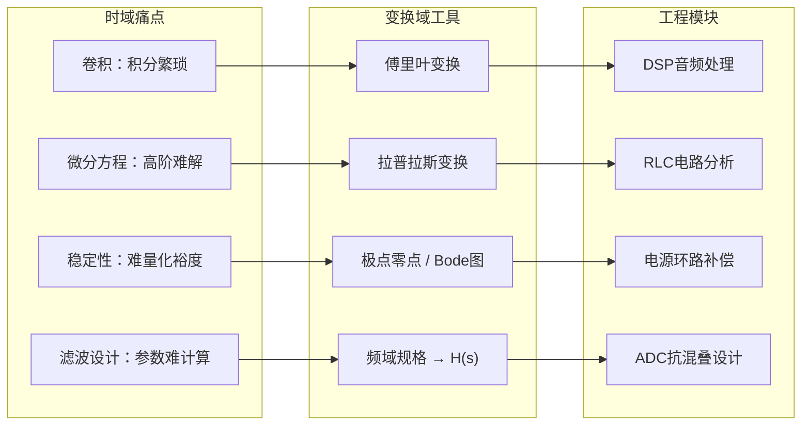
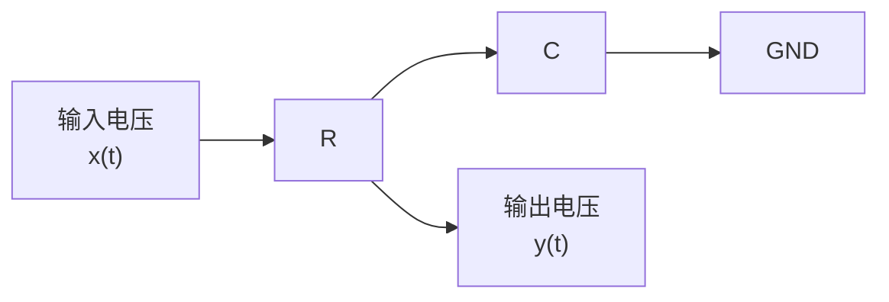
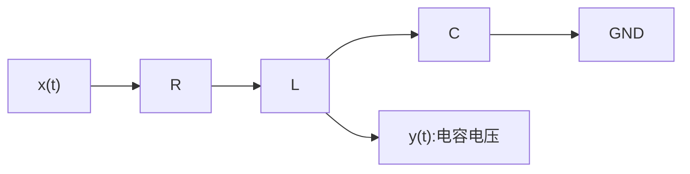
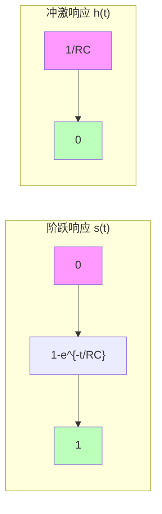
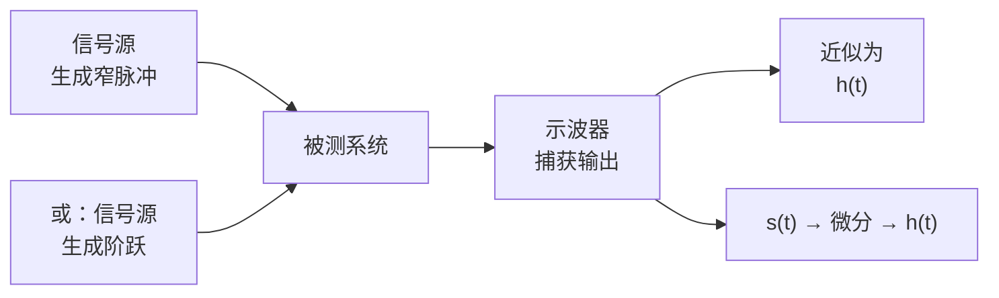
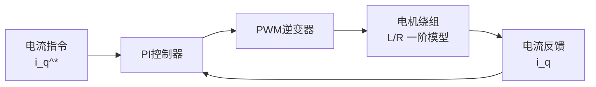
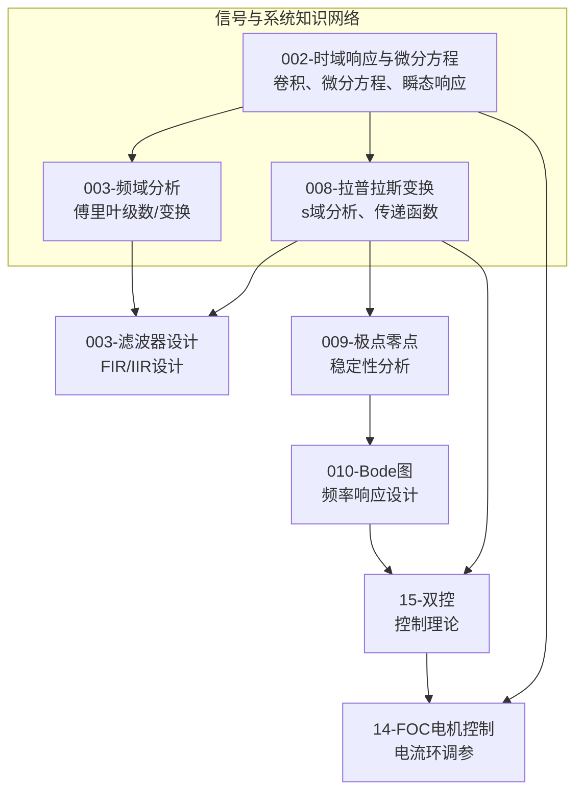

# 002-时域响应与微分方程

> [!abstract] 本章定位
> **前置知识**：[[001-信号、系统与LTI基础]]，常系数微分方程。
>
> **本章回答**：系统的自然响应与受迫响应从何而来？初始储能和外部输入分别贡献什么？一阶、二阶系统的暂态由哪些参数决定？
>
> **本章边界**：本章只建立卷积与冲激响应的连接；图解法、分段积分和离散计算集中在 [[003-卷积：从冲激响应到输出]]。
>
> **下一步**：用 [[003-卷积：从冲激响应到输出]] 计算 LTI 系统的零状态响应。

---

## 1. 时域分析核心框架：输入 → 系统 → 输出

### 1.1 适用范围与核心关系

时域分析始终围绕一个核心问题：**给定输入信号，系统的输出长什么样？**

![[Assets/time_domain/01_framework.png|1500]]

> **输入 $x(t)$** 经过系统产生**输出 $y(t)$**。只有在线性时不变（LTI）且采用零初始状态时，系统的输入—输出算子才能由单变量冲激响应 $h(t)$ 完全描述，并写成 $y_{zs}(t)=x(t)*h(t)$。若系统具有非零初始储能，还必须叠加零输入响应；非线性或时变系统通常不能使用这一简单卷积式。

LTI 的两个条件是：

- **线性**：若 $T\{x_1\}=y_1$、$T\{x_2\}=y_2$，则 $T\{a x_1+b x_2\}=a y_1+b y_2$。
- **时不变**：若 $T\{x(t)\}=y(t)$，则 $T\{x(t-t_0)\}=y(t-t_0)$。

时变线性系统仍可用二元核描述：$y(t)=\int_{-\infty}^{+\infty} h(t,\tau)x(\tau)d\tau$，但此时 $h$ 同时依赖观测时刻 $t$ 和激励时刻 $\tau$，不再是普通卷积。

> **工程直觉**：调试电机驱动时，你首先观察的是电流波形、PWM占空比变化——这些都是时域现象。频域分析是后处理工具，时域是现场调试的第一语言。

### 1.2 时域分析的局限

时域方法也有天然的"天花板"。下表从**实际工程模块**的角度，展示四个典型场景中时域方法的痛点及对应的变换域解决方案：

| 场景 | 时域困境 | 频域/变换域的优势 | 工程实例 |
|------|---------|----------------|----------|
| **卷积计算** | 积分/求和运算繁琐，无限长信号无法手动计算 | **傅里叶变换**：卷积变乘法，配合FFT大幅加速 | DSP音频均衡器：时域逐点FIR卷积成本高，频域FFT卷积实现实时处理 |
| **微分方程** | 二阶以上手工求解困难，初始条件易出错 | **拉普拉斯变换**：微分变代数 → 一步得到传递函数 $H(s)$ | RLC电路/电机绕组建模：s域直接写出 $H(s)=\frac{1}{LCs^2+RCs+1}$ |
| **系统分析** | 可测上升时间、超调和振铃，但难直接得到增益/相位裕度 | **极点零点图 + Bode图**：量化稳定裕度与带宽 | 开关电源环路 / 电机电流环：相位裕度目标由应用、模型和鲁棒性要求确定，并非固定为某个数值 |
| **滤波器设计** | 时域指标（上升时间、超调）难直接反推 $R,C,L$ | **频域规格** → 传递函数 → 元件参数计算 | ADC 抗混叠需根据输入频谱及奈奎斯特频率附近所需衰减设计，不能只检查 $f_c<f_s/2$ |

> **与后续知识的关联**：本章的时域方法是[[005-频域表示与傅里叶级数]]中傅里叶分析、[[007-拉普拉斯变换与系统函数]]中拉普拉斯方法的物理基础。理解时域的"痛"，才能理解为什么需要变换域。

---

## 2. 用微分方程描述连续时间系统

### 2.1 一般形式

连续时间LTI系统用常系数线性微分方程描述：

$$\sum_{k=0}^{N} a_k \frac{d^k y}{dt^k} = \sum_{k=0}^{M} b_k \frac{d^k x}{dt^k}$$

标准形式（首一化）：

$$\frac{d^N y}{dt^N} + a_{N-1}\frac{d^{N-1}y}{dt^{N-1}} + \cdots + a_0 y = b_M \frac{d^M x}{dt^M} + \cdots + b_0 x$$

> **工程直觉**：$N$ 称为微分方程的阶数。在非退化网络中，系统阶数通常等于独立储能状态的数量；受拓扑约束、代数约束或不可观/不可控模态影响时，元件数量不一定等于最小输入—输出模型阶数。

> **前置知识：线性微分方程的解结构**。$N$ 阶常系数线性微分方程的通解 = **齐次解**（令右端为 0 的齐次方程之解，含 $N$ 个待定常数，由初始条件确定）+ **特解**（满足原方程的一个解，形式由输入决定）。这个分解将在第 3 节“零输入响应与零状态响应”中反复使用：零输入响应就是齐次解，零状态响应则是特解与满足零初始条件的齐次解之和。

### 2.2 从电路到微分方程：RC低通示例

KCL在电容节点：

$$\frac{x(t) - y(t)}{R} = C \frac{dy}{dt}$$

整理得：

$$RC \frac{dy}{dt} + y(t) = x(t)$$

或：

$$\frac{dy}{dt} + \frac{1}{RC} y = \frac{1}{RC} x$$

> **与后续知识的关联**：在零初始条件下，这个一阶微分方程经拉普拉斯变换得到 $(RCs+1)Y(s)=X(s)$，因此传递函数 $H(s)=\frac{1}{RCs+1}$。非零初始条件会在变换后的方程中产生额外项，不能直接并入传递函数。

### 2.3 从电路到微分方程：RLC串联示例

KVL：

由 $i=C\frac{dy}{dt}$ 得：

$$LC\frac{d^2y}{dt^2}+RC\frac{dy}{dt}+y(t)=x(t)$$

标准形式：

$$\frac{d^2y}{dt^2} + 2\zeta\omega_n\frac{dy}{dt} + \omega_n^2 y = \omega_n^2 x(t)$$

其中：
- $\omega_n = \frac{1}{\sqrt{LC}}$：自然频率（无阻尼振荡频率）
- $\zeta = \frac{R}{2}\sqrt{\frac{C}{L}}$：阻尼比

> **工程直觉**：对该标准二阶 RLC 模型，其零输入自然响应的根型由阻尼比 $\zeta$ 决定：
> - $\zeta > 1$：过阻尼（缓慢回到平衡，无振荡）
> - $\zeta = 1$：临界阻尼（最快回到平衡，无振荡）
> - $0 < \zeta < 1$：欠阻尼（衰减振荡，$\zeta$ 越小振荡越多）
> - $\zeta = 0$：无阻尼（等幅振荡）
>
> 在电机控制中，期望阻尼由噪声、采样/PWM 延迟、参数不确定性和允许超调共同决定。某些 PI 整定会近似抵消电机电气极点，使名义闭环接近一阶，不能一概而论为临界阻尼或欠阻尼二阶系统。

### 2.4 离散时间差分方程

数字滤波器和数字控制器通常用常系数线性差分方程描述：

$$\sum_{k=0}^{N}a_k y[n-k]=\sum_{k=0}^{M}b_k x[n-k]$$

当 $a_0\neq0$ 时可递推为：

$$y[n]=\frac{1}{a_0}\left(\sum_{k=0}^{M}b_kx[n-k]-\sum_{k=1}^{N}a_ky[n-k]\right)$$

初始静止时，零状态响应仍可写为 $y[n]=x[n]*h[n]$。实际实现需要说明采样周期、初始历史样值、定点量化、溢出和计算延迟。

### 2.5 状态空间形式（拓展选读）

高阶、多输入多输出系统用状态变量表达更清晰：

$$\dot{\mathbf{x}}(t)=A\mathbf{x}(t)+B\mathbf{u}(t),\qquad \mathbf{y}(t)=C\mathbf{x}(t)+D\mathbf{u}(t)$$

状态 $\mathbf{x}(t_0)$ 显式保存系统记忆。对 LTI 系统：

$$\mathbf{x}(t)=e^{A(t-t_0)}\mathbf{x}(t_0)+\int_{t_0}^{t}e^{A(t-\tau)}B\mathbf{u}(\tau)d\tau$$

第一项是初始状态引起的自然响应，第二项是输入引起的受迫响应；这与零输入/零状态分解直接对应。

---

## 3. 零输入响应与零状态响应

> **前置知识**：[[001-信号、系统与LTI基础]] 6.4 节的响应分解概念（零输入/零状态的定义、物理直觉与线性系统限定），以及本章第 2 节的微分方程与齐次解/特解结构。

### 3.1 核心概念

总响应可以分解为两个独立部分：

$$y(t) = y_{zi}(t) + y_{zs}(t)$$

| 分量 | 定义 | 来源 | 数学形式 |
|------|------|------|---------|
| **零输入响应 $y_{zi}(t)$** | 输入为零，仅由初始储能产生 | 电容电压、电感电流的初始值 | 齐次方程的解：$y^{(h)}(t)$ |
| **零状态响应 $y_{zs}(t)$** | 初始储能为零，仅由输入产生 | 输入信号通过系统 | 特解 + 齐次解（满足零初始条件） |

> **关键认知**：$y_{zi}$ 和 $y_{zs}$ 的划分基于**线性系统的叠加性**。对于非线性系统，这种分解不成立。

![[Assets/time_domain/05_zero_input_zero_state.png|1500]]

> RC 电路中，$V_{C0}=2\text{ V}$ 时零输入响应按指数衰减；$V_0=5\text{ V}$ 时零状态响应从零充电；总响应等于两者之和。只有当系统渐近稳定时，初始条件的影响才会消失，长期稳态才与初始条件无关。

### 3.2 零输入响应的求解

令输入 $x(t) = 0$，求解齐次方程：

$$\sum_{k=0}^{N} a_k \frac{d^k y}{dt^k} = 0$$

设解形式为 $y = e^{st}$，得到**特征方程**：

$$a_N s^N + a_{N-1} s^{N-1} + \cdots + a_0 = 0$$

特征根 $s_1, s_2, \ldots, s_N$ 决定零输入响应的形式：

| 特征根类型 | 对应的响应分量 | 稳定性贡献 |
|-----------|-------------|----------|
| 单实根 $s = \sigma$ | $e^{\sigma t}$ | $\sigma < 0$ 衰减 |
| 共轭复根 $s = \sigma \pm j\omega$ | $e^{\sigma t}\cos(\omega t + \phi)$ | $\sigma < 0$ 衰减振荡 |
| $k$ 重根 | $(C_0+C_1t+\cdots+C_{k-1}t^{k-1})e^{\sigma t}$ | $\sigma < 0$ 时各项最终衰减 |

> **与后续知识的关联**：特征根是内部自然模态；在最小实现、没有不可控/不可观模态及精确极零抵消时，它们对应传递函数极点。仅凭约简后的传递函数可能看不到被抵消或隐藏的内部不稳定模态。

### 3.3 零状态响应的求解

零状态响应 = 齐次解（满足零初始条件）+ 特解

后续将学习另一种方法：**卷积**

$$y_{zs}(t) = x(t) * h(t)$$

或利用[[007-拉普拉斯变换与系统函数]]：

$$Y_{zs}(s) = H(s) X(s)$$

> **工程直觉**：零输入响应描述系统的"记忆"（电容电压、电感电流不会突变）；零状态响应描述系统对"新刺激"的反应。总响应 = 旧记忆 + 新反应。在嵌入式系统中，上电瞬间的"初始条件"就是上次关机时电容的残余电荷——这会导致零输入响应分量。

### 3.4 完整求解示例：一阶RC电路

**问题**：RC电路，$x(t) = V_0 u(t)$，初始电容电压 $y(0^-) = V_{C0}$，求 $y(t)$。

**微分方程**：$RC \frac{dy}{dt} + y = V_0 u(t)$

**步骤1：零输入响应**

齐次方程：$RC \frac{dy_{zi}}{dt} + y_{zi} = 0$

特征根：$s = -\frac{1}{RC}$

$$y_{zi}(t) = A e^{-t/RC}, \quad t \geq 0$$

由 $y_{zi}(0^+) = V_{C0}$（电容电压连续）：$A = V_{C0}$

$$y_{zi}(t) = V_{C0} e^{-t/RC} u(t)$$

**步骤2：零状态响应**

设特解为常数 $y_p = K$，代入得 $K = V_0$

齐次解：$y_h = B e^{-t/RC}$

零状态响应：$y_{zs}(t) = V_0 + B e^{-t/RC}$

由零初始条件 $y_{zs}(0^+) = 0$：$V_0 + B = 0 \Rightarrow B = -V_0$

$$y_{zs}(t) = V_0(1 - e^{-t/RC}) u(t)$$

**步骤3：总响应**

$$y(t) = V_{C0} e^{-t/RC} + V_0(1 - e^{-t/RC})$$

$$= V_0 + (V_{C0} - V_0) e^{-t/RC}, \quad t \geq 0$$

> **工程直觉**：
> - 稳态值 = $V_0$（与初始条件无关）
> - 若 $V_{C0} = V_0$：无瞬态，直接进入稳态（"无冲击切换"）
> - 若 $V_{C0} = 0$：经典充电曲线，从零上升到 $V_0$
> - 若 $V_{C0} = 2V_0$：过冲，先放电到 $V_0$

### 3.5 三组常见分解不要混淆

| 分解 | 判据 | 说明 |
|---|---|---|
| 零输入 + 零状态 | 是否由初始状态或外部输入引起 | 线性系统严格可叠加 |
| 自然 + 受迫 | 齐次方程模态 + 某个特解 | 受迫响应中的齐次项需由边界条件共同确定 |
| 暂态 + 稳态 | 是否随时间消失 | 只有稳定系统才保证暂态衰减；周期输入的稳态可以仍随时间变化 |

“零输入响应”等于自然响应通常成立；但“零状态响应”等于稳态响应并不成立，因为零状态响应一般同时包含由零初始条件引入的暂态项和输入决定的稳态项。

---

## 4. 单位冲激响应 $h(t)$：系统的完整零状态描述

### 4.1 物理定义

单位冲激响应是系统对**单位冲激 $\delta(t)$** 的零状态响应：

$$h(t) = T[\delta(t)] \quad \text{(零状态)}$$

> **关键区分**：$h(t)$ 必须是**零状态**响应——系统在 $t=0^-$ 时刻没有储能。如果系统有初始储能，输出会包含零输入响应分量。

RC 低通从输入电压到电容电压的单位冲激响应为：

$$h(t)=\frac{1}{RC}e^{-t/RC}u(t)$$

在 $t=RC$ 时，$h(RC)=\frac{e^{-1}}{RC}$；只有归一化为 $RC=1$ 时数值才是 0.368。$h(t)$ 是零状态输入—输出算子的“指纹”，不能单独编码非零初始储能。

![[Assets/time_domain/03_impulse_response.png|1500]]

> 理想冲激无法直接画成有限高度的普通函数。左侧用面积为 1、宽度逐渐缩小的窄脉冲说明冲激近似；右侧画的是 RC 低通的归一化响应 $RC\,h(t)=e^{-t/RC}$。冲激输入和冲激响应分开画，纵轴数值不能直接比较。

### 4.2 冲激响应为什么有用

线性和时不变性允许将输入分解后的各个响应叠加。完整推导见 [[003-卷积：从冲激响应到输出]]；这里先把 $h(t)$ 看成零状态输入—输出行为的描述。

### 4.3 从 $h(t)$ 判断系统性质

| 系统性质 | $h(t)$ 的特征 | 示例 |
|----------|-------------|------|
| **因果性** | $h(t) = 0, \; t < 0$ | RC电路：$h(t) = \frac{1}{RC}e^{-t/RC}u(t)$ |
| **稳定性** | $\int_{-\infty}^{+\infty} \lvert h(t) \rvert \, dt < \infty$ | $h(t)=e^{-t}u(t)$ 稳定；$h(t)=u(t)$ 不稳定 |
| **记忆性** | 无记忆当且仅当 $h(t)=K\delta(t)$ | 纯增益：$y(t)=Kx(t)$；其他形式的 $h(t)$ 一般具有记忆 |
| **可逆性** | 存在 $h_{inv}(t)$ 使 $h * h_{inv} = \delta(t)$ | 逆系统还可能是非因果或不稳定；理想微分/积分的互逆关系需结合初值和信号空间理解 |

> **与后续知识的关联**：因果性条件 $h(t)=0, t<0$ 是实时物理系统的基本要求。在[[008-极点零点与系统稳定性]]中，因果性与收敛域（ROC）的选择相关；对有理因果 LTI 系统，BIBO 稳定要求全部极点位于左半平面。

---

## 5. 单位阶跃响应与冲激响应的关系

### 5.1 定义与基本关系

单位阶跃响应是系统对单位阶跃 $u(t)$ 的零状态响应：

$$s(t) = T[u(t)] = u(t) * h(t) = \int_{-\infty}^{t} h(\tau) d\tau$$

反之：

$$h(t) = \frac{ds(t)}{dt}$$

该式应在广义函数意义下理解。若系统存在直接通道 $D$，阶跃响应会在 $t=0$ 跳变，冲激响应相应包含 $D\delta(t)$。

![[Assets/time_domain/04_step_impulse_relation.png|1500]]

> 这张图使用无量纲时间 $\theta=t/RC$。左侧画单位阶跃响应 $s(t)$，右侧画归一化冲激响应 $RC\,h(t)$，避免把 $h(0^+)=1/RC$ 误读为恒等于 1。阶跃响应是冲激响应的积分，冲激响应在广义函数意义下是阶跃响应的导数。

> **工程直觉**：实验中产生理想冲激很难，但阶跃较容易生成。直接对含噪阶跃响应做数值微分会强烈放大高频噪声，因此实际提取 $h(t)$ 时应先做带宽限制、平滑或参数辨识，并记录信号源和测量链路的有限上升时间。

### 5.2 一阶RC系统的阶跃响应

对于单位直流增益 RC 低通，**单位阶跃响应**为：

$$s(t)=\left(1-e^{-t/RC}\right)u(t)$$

$$h(t)=\frac{ds}{dt}=\frac{1}{RC}e^{-t/RC}u(t)$$

若输入是幅值为 $V_0$ 的阶跃，则实际输出为：

$$y(t)=V_0s(t)=V_0\left(1-e^{-t/RC}\right)u(t)$$

> **工程直觉**：阶跃响应的"上升时间"（10%→90%）约为 $2.2RC$。这是评估系统响应速度的标准指标。在电机驱动中，电流环的阶跃响应直接决定了转矩建立的快慢。

### 5.3 测量 $h(t)$ 的实验方法

---

## 6. 从冲激响应进入卷积

零初始状态下，LTI 系统的输出满足 $y_{zs}=x*h$。下一章从冲激分解推导这个结论，并训练连续积分与离散求和。本章只需记住：非零初始状态时还要加上零输入响应。

## 7. 一阶与二阶系统的典型响应

### 7.1 一阶系统

标准形式：

$$\tau \frac{dy}{dt} + y = K x(t)$$

参数：
- $K$：直流增益（稳态输出/输入比）
- $\tau$：时间常数（系统响应速度的量度）

对零初始状态和单位阶跃输入，**阶跃响应**为：

$$s(t) = K(1 - e^{-t/\tau}) u(t)$$

| 时间点 | $s(t)$ | 意义 |
|-------|--------|------|
| $t = \tau$ | $K(1 - e^{-1}) \approx 0.63K$ | 达到63%稳态值 |
| $t = 2\tau$ | $K(1 - e^{-2}) \approx 0.86K$ | 达到86% |
| $t = 3\tau$ | $K(1 - e^{-3}) \approx 0.95K$ | 约进入最终值的 ±5% 误差带 |
| $t = 4\tau$ | $K(1 - e^{-4}) \approx 0.98K$ | 达到98% |
| $t = 5\tau$ | $K(1 - e^{-5}) \approx 0.993K$ | 达到99.3% |

**上升时间**（10%→90%）：$t_r \approx 2.2\tau$

> **工程直觉**：标准一阶系统由直流增益 $K$ 和时间常数 $\tau$ 表征。电机绕组的开环电气模型具有 $\tau_e=L/R$，但闭环电流带宽还受母线电压、反电动势解耦、采样/PWM 延迟、噪声和稳定裕度限制，不能只由 $L/R$ 判断。

![[Assets/time_domain/06_first_order_response.png|1500]]

> 一阶系统阶跃响应：时间常数 $\tau$ 决定响应速度。$\tau = 0.3s$（红色）最快达到稳态，$\tau = 2.0s$（蓝色）最慢。所有曲线在 $t = \tau$ 时刻都达到稳态值的 63%。

### 7.2 二阶系统

标准形式：

$$\frac{d^2y}{dt^2} + 2\zeta\omega_n\frac{dy}{dt} + \omega_n^2 y = K\omega_n^2 x(t)$$

#### 阶跃响应（$\zeta$ 的影响）

![[Assets/time_domain/07_second_order_response.png|1500]]

> 过阻尼和临界阻尼响应不振荡；欠阻尼响应会超调并逐渐衰减；无阻尼响应持续等幅振荡。图中以 $\omega_n t$ 为横轴，并在 $\zeta=0.5$ 曲线上标出峰值时间和超调量。±2% 阴影带用于观察调节时间。

#### 欠阻尼情况（$0 < \zeta < 1$）——最重要

阶跃响应：

$$s(t) = K\left[1 - \frac{e^{-\zeta\omega_n t}}{\sqrt{1-\zeta^2}} \sin\left(\omega_d t + \phi\right)\right] u(t)$$

其中：
- $\omega_d = \omega_n\sqrt{1-\zeta^2}$：阻尼振荡频率
- $\phi = \arctan\frac{\sqrt{1-\zeta^2}}{\zeta}$

**关键指标**：

| 指标 | 公式 | 工程意义 |
|------|------|---------|
| **超调量** $M_p$ | $e^{-\pi\zeta/\sqrt{1-\zeta^2}} \times 100\%$ | 首次峰值超过稳态值的比例 |
| **峰值时间** $t_p$ | $\frac{\pi}{\omega_d}$ | 到达第一个峰值的时间 |
| **调节时间** $t_s$（2%准则） | $\approx\frac{4}{\zeta\omega_n}$ | 欠阻尼、标准二阶且包络近似成立时 |
| **上升时间** $t_r$ | $\approx\frac{1.8}{\omega_n}$ | 仅是 $\zeta$ 约为 0.5～0.8 时的粗略 10%→90% 估算 |

> **工程直觉**：
> - $\zeta=1/\sqrt{2}\approx0.707$ 对无零点标准二阶低通给出最大平坦幅频响应，阶跃超调约 4.3%，是常见折中点之一，并非所有系统的统一最优值。
> - 在[[15-双控（控制理论与控制工程）/00-README|控制理论与控制工程]]中，位置/速度环可根据应用选择阻尼和带宽，$\zeta\approx0.5\sim0.7$ 只是常见范围之一。
> - 在[[14-FOC-电机控制/00-README|FOC 电机控制]]中，电流环若欠阻尼会导致电流振荡，进而产生转矩脉动和噪声。

#### 过阻尼情况（$\zeta > 1$）

响应是两个指数衰减的叠加：

$$s(t) = K\left[1 + \frac{s_2}{s_1-s_2}e^{s_1 t} - \frac{s_1}{s_1-s_2}e^{s_2 t}\right] u(t)$$

其中 $s_{1,2} = -\zeta\omega_n \pm \omega_n\sqrt{\zeta^2-1}$（两个负实根）。

> **工程直觉**：过阻尼响应慢但平稳。当 $\zeta \gg 1$ 时，慢的那个极点主导响应，系统近似为一阶。

### 7.3 公式的适用边界

上述 $M_p$、$t_p$ 和 $t_s$ 公式针对无零点的标准二阶系统。附加零点、高阶极点、饱和、限速、采样延迟或非线性都会改变时域指标；过阻尼系统的调节时间应由最慢极点及其残差估算，不能套用欠阻尼包络公式 $4/(\zeta\omega_n)$。

---

## 8. 工程应用

### 8.1 电机驱动中的电流环瞬态响应

在[[14-FOC-电机控制/00-README|FOC 电机控制]]中，电流环是内环，直接控制电机转矩：

- 在转速近似不变、交叉耦合和反电动势已作为扰动或得到解耦时，单轴电机绕组可近似为 $L/R$ 一阶对象：$\tau_e=L/R$
- 电流环的阶跃响应 = 转矩建立的瞬态
- 若PI参数设计不当，可能产生欠阻尼响应 → 电流振荡 → 转矩脉动 → 机械振动和噪声

> **工程直觉**：理想 PI 与一阶电气对象组合后，未约消的名义闭环特征方程通常为二阶；若 PI 零点精确抵消对象极点，名义指令响应可近似一阶。实际系统还包含延迟、交叉耦合、限幅和参数误差，因此应结合模型、频域裕度和阶跃实测验证，而不是只依赖试凑。

### 8.2 电源系统的负载瞬态响应

DC-DC变换器对负载跳变的响应：

- 负载电流突增时，电容 ESR 产生近似瞬时台阶 $\Delta V_{ESR}\approx\Delta I\cdot ESR$，ESL 产生 $L\,di/dt$ 尖峰，随后在控制环响应前产生约 $\Delta V_C\approx\Delta I\,\Delta t/C$ 的电容放电跌落
- 恢复过程是从负载扰动到输出电压的**扰动阶跃响应**，不同于从电压参考到输出的指令阶跃响应
- 过冲或振铃可能来自闭环欠阻尼、输出网络寄生谐振、负载动态或测量回路；持续增大的振荡才是明显失稳迹象

> **与后续知识的关联**：在[[15-双控（控制理论与控制工程）/00-README|控制理论与控制工程]]中，电源环路补偿通常结合 Bode 图与负载瞬态测试，使频域鲁棒性和时域指标同时满足要求。

### 8.3 示波器探头与信号完整性

示波器探头+电缆构成一个RC或RLC系统：

- 探头补偿：调整探头的RC时间常数，使与示波器输入匹配
- 探头时间常数小于示波器输入等效时间常数时通常表现为欠补偿、方波圆角；反之表现为过补偿、顶部尖峰
- 这种波形首先反映探头分压网络的零极点失配；探头接地引线电感还可能叠加额外 RLC 振铃，不能全部归因于标准二阶阻尼

### 8.4 音频系统中的混响与均衡

- 混响效果 = 音频信号与房间冲激响应 $h(t)$ 的卷积
- 均衡器（EQ）= 设计特定的 $h(t)$，增强或削弱某些频率分量
- 实时卷积计算量大，通常通过FFT加速（见 [[014-DFT与FFT频谱分析]]）

### 8.5 与后续知识模块的连接图

---

## 9. 常见错误与误区

### 9.1 错误1：混淆零输入与零状态

**错误**：求冲激响应时，没有令初始条件为零，导致总响应包含零输入分量。

**正确**：$h(t)$ 严格定义为**零状态**响应。理论计算时直接令全部初始状态为零；实验时应通过复位、充分等待或主动放电等方法把系统准备到已知零状态，而不是把残余自然响应混入测量结果。

### 9.2 错误2：卷积积分限错误

**错误**：对所有 $t$ 使用同一个积分限，忽略了信号的非零区间限制。

**正确**：必须根据两个信号的非零区间，确定重叠区域，**分段**计算。

> **记忆口诀**："翻、滑、乘、积"——翻转后，每滑到一个新位置，先看有没有重叠，有重叠才积分。

### 9.3 错误3：因果性判断错误

**错误**：认为 $h(t) = e^{-t/\tau}$ 是因果的，忘记乘以 $u(t)$。

**正确**：因果系统必须 $h(t) = 0$ for $t < 0$。$e^{-t/\tau}$ 在 $t < 0$ 时趋于无穷大，不是因果信号；$e^{-t/\tau}u(t)$ 才是。

### 9.4 错误4：微分方程求解时忽略初始条件

**错误**：求零输入响应时，直接用 $y(0^-)$ 代入通解，而不验证 $t=0$ 处的连续性。

**正确**：
- 电容电压 $v_C$ 和电感电流 $i_L$ 在 $t=0$ 处**连续**（除非有冲激电流/电压）
- 其他变量（如电阻电压、电容电流）可能不连续
- 用 $v_C(0^+) = v_C(0^-)$ 和 $i_L(0^+) = i_L(0^-)$ 作为初始条件

### 9.5 错误5：稳定性与因果性混淆

**错误**：认为因果系统一定稳定，或稳定系统一定因果。

**正确**：
- 因果 $\nRightarrow$ 稳定（$h(t) = u(t)$ 因果但不稳定）
- 稳定 $\nRightarrow$ 不一定因果，例如 $h(t)=e^{-|t|}$ 非因果但绝对可积，因此对应 BIBO 稳定的非因果 LTI 系统
- 对连续时间因果 LTI 系统，BIBO 稳定 $\Leftrightarrow\int_0^\infty|h(t)|dt<\infty$；理想砖墙低通的 sinc 冲激响应并不绝对可积，不能作为 BIBO 稳定反例

### 9.6 错误6：超调量公式误用

**错误**：对一阶系统或高阶系统使用二阶欠阻尼的超调量公式。

**正确**：$M_p = e^{-\pi\zeta/\sqrt{1-\zeta^2}}$ 仅适用于**标准二阶欠阻尼**系统。实际系统若有零点或高阶极点，超调会不同。

### 9.7 错误7：时间常数单位混淆

**错误**：$\tau = RC$ 时忘记单位一致性（R用Ω，C用F，τ得秒）。

**正确**：$[\tau] = [R][C] = \Omega \cdot F = \frac{V}{A} \cdot \frac{C}{V} = \frac{C}{A} = \frac{A \cdot s}{A} = s$ ✓

---

## 10. 自测习题

### 10.1 基础概念

**1.** 判断以下系统是否为LTI：
- (a) $y(t) = 2x(t) + 3$
- (b) $y(t) = x(t-1)$
- (c) $y(t) = x^2(t)$
- (d) $y(t) = t \cdot x(t)$

**2.** 已知 $h(t) = e^{-2t}u(t)$，判断系统是否因果、是否稳定。

### 10.2 卷积计算

**3.** 计算 $y(t) = u(t) * e^{-t}u(t)$，并画出 $y(t)$ 的波形示意图。

**4.** 设 $x(t) = u(t) - u(t-1)$（矩形脉冲），$h(t) = u(t) - u(t-2)$，用图解法求 $y(t) = x(t) * h(t)$，并给出分段表达式。

**5.** 利用卷积性质快速计算：$\delta(t-1) * \delta(t-2) * e^{-t}u(t)$

### 10.3 微分方程与响应

**6.** 求解微分方程 $\frac{dy}{dt} + 3y = 6u(t)$，$y(0^-) = 2$。分别求零输入响应、零状态响应和总响应。

**7.** 对于RLC串联电路（R=10Ω, L=1mH, C=100μF），计算：
- (a) 自然频率 $\omega_n$ 和阻尼比 $\zeta$
- (b) 判断响应类型（过阻尼/欠阻尼/临界阻尼）
- (c) 若输入为5V阶跃，初始条件为零，求稳态输出和调节时间（2%准则）

**8.** 一阶系统 $\tau = 10ms$，$K=2$。输入为 $x(t) = 5u(t) - 5u(t-20ms)$（20ms宽脉冲），求输出表达式并画出波形。

### 10.4 工程应用

**9.** 电机绕组参数 $L=2mH$, $R=0.5\Omega$，忽略反电动势并把开环电气响应视为一阶系统：
- (a) 计算绕组时间常数 $\tau$
- (b) 若某电压阶跃使电流最终值为 10 A，电流从 0 达到 9.5 A 需要多少时间？
- (c) 若PI控制器将闭环时间常数缩短到1ms，估算闭环带宽（Hz）

**10.** 设计一个由二阶系统阶跃响应判断系统参数的练习：给定示波器捕获的阶跃响应波形（有超调、有振荡衰减），估算阻尼比 $\zeta$ 和自然频率 $\omega_n$。

---

> **参考答案提示**：
> - 1: (a)非线性（有偏移） (b)LTI (c)非线性 (d)线性时变
> - 2: 因果（$h(t)=0, t<0$）；稳定（$\int_0^\infty e^{-2t}dt = 1/2 < \infty$）
> - 3: $y(t) = (1-e^{-t})u(t)$
> - 4: $y(t)=0$（$t<0$）；$y(t)=t$（$0\le t<1$）；$y(t)=1$（$1\le t<2$）；$y(t)=3-t$（$2\le t<3$）；$y(t)=0$（$t\ge3$）
> - 5: $e^{-(t-3)}u(t-3)$
> - 6: $y_{zi} = 2e^{-3t}$, $y_{zs} = 2(1-e^{-3t})$, $y(t) = 2$
> - 7: $\omega_n\approx3162\ \text{rad/s}$，$\zeta\approx1.58$（过阻尼），两极点约为 $-1127$ 与 $-8873\ \text{s}^{-1}$；按主导极点及残差估算 2% 调节时间约 $3.6\ \text{ms}$，稳态电容电压为 5 V
> - 8: $y(t)=10(1-e^{-t/10\text{ms}})u(t)-10(1-e^{-(t-20\text{ms})/10\text{ms}})u(t-20\text{ms})$；在 $t=20\text{ms}$ 前充电，之后从 $10(1-e^{-2})\approx8.65$ 衰减到 0
> - 9: (a) $\tau=4ms$ (b) $t = -\tau\ln(0.05) \approx 12ms$ (c) 带宽 $\approx 1/(2\pi\tau_{cl}) \approx 159$ Hz
> - 10: 从波形读取 $M_p=(y_{peak}-y_{ss})/y_{ss}$，再算 $\zeta=-\ln M_p/\sqrt{\pi^2+(\ln M_p)^2}$；由相邻峰值间隔 $T_d$ 得 $\omega_d=2\pi/T_d$，最后用 $\omega_n=\omega_d/\sqrt{1-\zeta^2}$ 求自然频率

---

> **学习建议**：先用 LTspice 或 Python 验证 RC/RLC 的阶跃响应，再进入 [[003-卷积：从冲激响应到输出]]。本章练习 4、5 可作为两篇笔记之间的联动练习。
>
> **上一章**：[[001-信号、系统与LTI基础]]
>
> **下一章**：[[003-卷积：从冲激响应到输出]]

**DR_CAN｜动态系统的建模与分析**　[B 站作者合集](https://space.bilibili.com/230105574/lists)。选与当前电路或机械对象最接近的一例，画出状态和输入输出。
