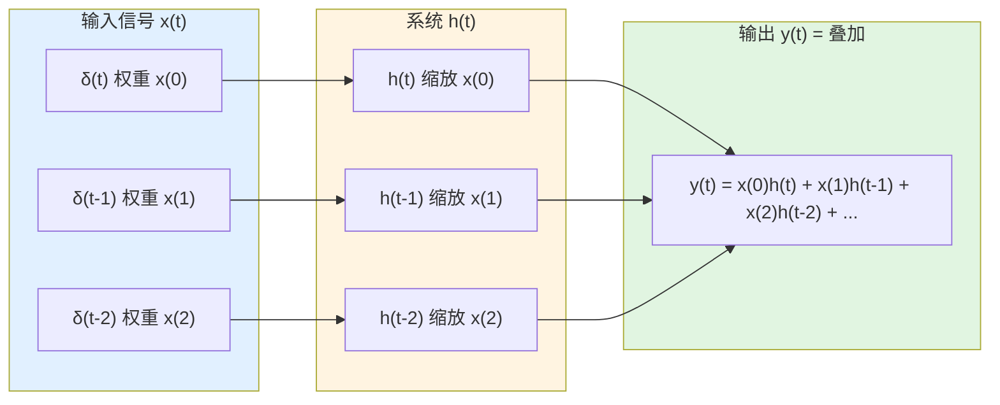
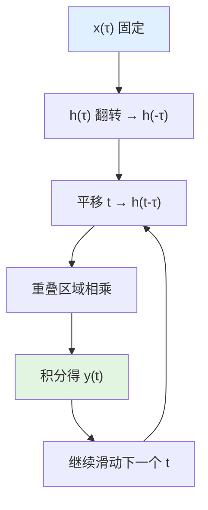
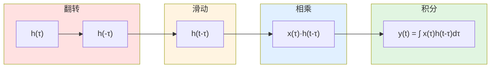

# 003-卷积：从冲激响应到输出

> [!abstract] 本章定位
> **前置知识**：[[001-信号、系统与LTI基础]]、[[002-时域响应与微分方程]] 中的冲激响应和零状态响应。
>
> **本章回答**：为什么任意输入都能分解为移位冲激？翻转、平移、相乘、积分分别代表什么？怎样可靠确定分段积分区间？
>
> **本章边界**：本章负责卷积的直觉与计算；微分方程和自然响应留在上一章，变换域的乘法性质留到后续章节。
>
> **下一步**：进入 [[004-为什么需要变换域]]，理解为什么工程上经常把卷积换成乘法。

---

## MIT 课程讲解

**MIT RES.6-007 第 4 讲：卷积**

看翻转、平移和取重叠部分的顺序，读完再从冲激响应求 RC 阶跃响应。

<iframe src="https://www.youtube.com/embed/_vyke3vF4Nk" title="MIT RES.6-007 第 4 讲：卷积" width="100%" height="360" loading="lazy" referrerpolicy="strict-origin-when-cross-origin" allow="encrypted-media; picture-in-picture; fullscreen" allowfullscreen></iframe>

[打开原页](https://ocw.mit.edu/courses/res-6-007-signals-and-systems-spring-2011/resources/lecture-4-convolution/)

## 1. 卷积的直觉：四种视角

### 1.1 视角一：滑动平均（系统对局部的加权叠加）

想象你用一个**滑动窗口**扫描输入信号，窗口内的值按照某种权重（即冲激响应）加权求和，得到输出信号在每一时刻的值。

> **类比**：测量噪声电压时，不做单次采样，而是连续取 10 个样本做滑动平均。这个"平均权重"就是系统的冲激响应 $h(t)$，输入信号 $x(t)$ 滑过这个权重窗口，产出的平滑结果就是输出 $y(t)$。

$$y(t) = \int_{-\infty}^{\infty} x(\tau) h(t - \tau) d\tau$$

- $x(\tau)$：在时刻 $\tau$ 的输入值
- $h(t-\tau)$：系统对发生在 $(t-\tau)$ 时间前的输入的记忆权重
- 积分：把所有过去输入对当前输出的贡献叠加起来

> **工程直觉**：移动平均和 RC 的指数加权累积是理解低通的例子。一般卷积是加权叠加，权重不一定为正或单调；一般低通也不能直接等同于移动平均器。

### 1.2 视角二：回声与系统记忆（时间延迟叠加）

将输入信号 $x(t)$ 看作一连串瞬时脉冲的集合。每个脉冲进入系统后，都会激发出一段按 $h(t)$ 规律衰减的响应。输出是**所有这些响应的叠加**。

> **类比**：在山谷中大喊一声，你会听到原声，接着是延迟的回声，再是更弱的多次回声。山谷的"回声模式"就是 $h(t)$，你的喊声是 $x(t)$，耳中听到的全部声音就是 $y(t) = x(t) * h(t)$。

![[Assets/signals_systems/25_convolution_superposition.png|1500]]

> 卷积的本质：输入信号中的每个点都会激发出一个按 $h(t)$ 规律衰减的响应，系统的总输出是所有这些响应的叠加。上图中，三个不同时刻的输入分别产生三个冲激响应，它们的叠加就是总输出 $y(t)$。



> **工程直觉**：RC 电路对脉冲输入的响应是指数衰减 $h(t) = \frac{1}{RC}e^{-t/RC}$。这意味着系统对过去输入有"记忆"，但越久的输入记忆越模糊。

### 1.3 视角三：加权叠加（冲激分解）

从数学上，任何信号都可以分解为冲激函数的加权叠加：

$$x(t) = \int_{-\infty}^{\infty} x(\tau) \delta(t - \tau) d\tau$$

LTI 系统的线性性和时不变性告诉我们：
- 输入 $\delta(t)$ → 输出 $h(t)$
- 输入 $x(\tau)\delta(t-\tau)$ → 输出 $x(\tau)h(t-\tau)$（齐次性 + 时不变性）
- 输入 $x(t)$（积分叠加） → 输出 $y(t)$（积分叠加）

> **工程直觉**：卷积的本质是**将输入分解为冲激，分别求响应，再叠加**。这是 LTI 系统时域分析的基石。

### 1.4 视角四：翻转-滑动-乘积（图解法的直觉）

从 $y(t) = \int x(\tau) h(t-\tau) d\tau$ 看：
- 固定 $x(\tau)$ 不动
- 将 $h(\tau)$ **翻转**得到 $h(-\tau)$
- 再**平移** $t$ 得到 $h(t-\tau)$
- 两函数**重叠区域相乘**，积分得到 $y(t)$

> **类比**：想象你有一张印有权重的透明胶片 $h$，你把它翻转过来，从左到右滑过信号 $x$，每滑动到一个位置，就把重叠部分逐点相乘再求和。这就是卷积的图解法。



---

## 2. 卷积的数学定义

### 2.1 连续时间卷积

$$y(t) = x(t) * h(t) = \int_{-\infty}^{\infty} x(\tau) h(t - \tau) d\tau$$

**变量说明**：
- $\tau$：积分变量（哑变量），代表"过去的时刻"
- $t$：输出观察时刻
- $x(\tau)$：过去时刻的输入值
- $h(t-\tau)$：系统对过去 $(t-\tau)$ 时间前输入的响应权重

> **与后续知识的关联**：[[006-傅里叶变换详解]]中的卷积定理把时域卷积变为频域乘积 $Y(j\omega)=X(j\omega)H(j\omega)$。

### 2.2 离散时间卷积

$$y[n] = x[n] * h[n] = \sum_{k=-\infty}^{\infty} x[k] h[n - k]$$

**变量说明**：
- $k$：求和索引，代表"过去的采样点"
- $n$：输出采样点序号
- $x[k]$：过去采样点的输入值
- $h[n-k]$：系统对 $(n-k)$ 步前输入的响应权重

> **工程直觉**：在嵌入式系统中，数字滤波器就是离散卷积的硬件实现。FIR 滤波器的系数就是 $h[n]$，每采样一个新点，就与 $h[n]$ 做加权求和。

---

## 3. 卷积性质与系统互联（必修）

在卷积存在、交换积分或求和合法的条件下，连续与离散卷积都满足：

- 交换律：$x*h=h*x$。
- 结合律：$(x*h_1)*h_2=x*(h_1*h_2)$，对应零状态 LTI 系统级联。
- 分配律：$x*(h_1+h_2)=x*h_1+x*h_2$，对应并联输出相加。
- 单位元：$x*\delta=x$。

**例题**：两个离散两点平均器级联，各自 $h[n]=[1/2,1/2]$（起点 $n=0$），等效响应为 $[1/4,1/2,1/4]$。先合成响应再计算，与逐级计算应相同。理想 LTI 输入—输出模型的可交换性不代表实际电路可忽略级间负载。

**贯穿案例：RC 的第二种解法**。令 $\tau=RC$，$h(t)=e^{-t/\tau}u(t)/\tau$，输入 $V_0u(t)$。则

$$y_{zs}(t)=\int_0^t V_0\frac1\tau e^{-(t-\lambda)/\tau}\,d\lambda=V_0(1-e^{-t/\tau}),\quad t\ge0.$$

与上一章微分方程解相同；非零初始电压 $V_{C0}$ 时再加 $V_{C0}e^{-t/\tau}$。


## 4. 图解法卷积：四步操作

图解法是理解卷积最有力的工具，尤其适合分段函数。

### 4.1 四步流程

| 步骤 | 操作 | 说明 |
|------|------|------|
| **Step 1** | **翻转** | $h(\tau) \rightarrow h(-\tau)$，将冲激响应关于纵轴翻转 |
| **Step 2** | **滑动** | $h(-\tau) \rightarrow h(t-\tau)$，将翻转后的响应向右平移 $t$ |
| **Step 3** | **相乘** | 在重叠区间计算 $x(\tau) \cdot h(t-\tau)$ |
| **Step 4** | **积分** | 对重叠区间积分，得到该 $t$ 下的输出值 $y(t)$ |

不要只凭动态图判断积分上下限。更可靠的方法是把两个非零区间写成关于积分变量 $\tau$ 的不等式。

若

$$
x(\tau)\neq0\quad\text{仅当}\quad \tau\in[a,b]
$$

且

$$
h(\lambda)\neq0\quad\text{仅当}\quad \lambda\in[c,d]
$$

代入 $\lambda=t-\tau$：

$$
c\le t-\tau\le d
\quad\Longrightarrow\quad
t-d\le\tau\le t-c
$$

因此真正的重叠区间是：

$$
\tau\in
\left[
\max(a,t-d),\;
\min(b,t-c)
\right]
$$

仅当下限不大于上限时才有重叠。临界时刻来自端点相等：

$$
t=a+c,\quad a+d,\quad b+c,\quad b+d
$$

> [!tip] 图解法的稳定做法
> 图负责建立“翻转和平移”的直觉；区间交集公式负责给出积分上下限。两者互相校验，可以避免把 $h(t-\tau)$ 错写成 $h(\tau-t)$。



### 4.2 图解法示例：矩形脉冲与指数衰减

设 $x(t) = u(t) - u(t-1)$（宽度为 1 的矩形脉冲），$h(t) = e^{-t}u(t)$（指数衰减）。

**分析重叠区间**：

| $t$ 的范围 | 重叠情况 | $y(t)$ 表达式 |
|-----------|---------|-------------|
| $t < 0$ | 无重叠 | $y(t) = 0$ |
| $0 \leq t < 1$ | 部分重叠（左侧） | $y(t) = \int_0^t 1 \cdot e^{-(t-\tau)} d\tau = 1 - e^{-t}$ |
| $t \geq 1$ | 完全重叠（中间） | $y(t) = \int_0^1 1 \cdot e^{-(t-\tau)} d\tau = e^{-(t-1)} - e^{-t}$ |

> **工程直觉**：矩形脉冲通过 RC 低通电路（指数响应）后，输出不再是锐利的方波，而是"圆角"的波形——前沿按 $(1-e^{-t})$ 上升，后沿按指数衰减。这正是示波器探头有限带宽看到的现象。

---

## 5. 解析法卷积：分段积分技巧

### 5.1 核心策略

解析法的关键是**确定 $x(\tau)$ 与 $h(t-\tau)$ 的重叠区间**，这取决于：
- $x(\tau)$ 的非零区间 $[a, b]$
- $h(t-\tau)$ 的非零区间（即 $h(\tau)$ 的非零区间经翻转平移后）

**通用步骤**：
1. 画出 $x(\tau)$ 和 $h(\tau)$ 的波形，标出非零区间
2. 确定 $h(t-\tau)$ 的非零区间（随 $t$ 移动）
3. 找出 $t$ 的临界值（两个函数开始接触、完全重叠、分离的时刻）
4. 在每个区间内建立积分上下限并计算

### 5.2 常见信号对的卷积结果

| 信号 $x(t)$ | 信号 $h(t)$ | 卷积结果 $y(t)$ | 典型场景 |
|------------|------------|----------------|---------|
| 矩形脉冲 | 矩形脉冲 | 三角形（三角脉冲） | 门电路级联 |
| 矩形脉冲 | 指数 $e^{-at}u(t)$ | 上升+指数衰减 | RC 低通响应 |
| 阶跃 $u(t)$ | 指数 $e^{-at}u(t)$ | $(1-e^{-at})/a$ | RC 充电曲线 |
| 冲激 $\delta(t)$ | 任意 $h(t)$ | $h(t)$ | 系统辨识 |
| 冲激串 $\sum\delta(t-nT)$ | 任意 $h(t)$ | 周期重复的 $h(t)$ | 采样保持 |

> **工程直觉**：两个等宽矩形脉冲卷积得到三角形，是因为滑动时的重叠长度先线性增加、再线性减少。它常用于理解有限积分窗口、脉冲整形和两个移动平均环节级联；不能仅由三角形宽度直接推出实际滤波器的过渡带。

---

## 6. 离散卷积与循环卷积（循环部分第二遍学习）

### 6.1 离散卷积（线性卷积）

$$y[n] = \sum_{k=-\infty}^{\infty} x[k] h[n-k]$$

对于长度为 $N$ 的序列 $x[n]$ 和长度为 $M$ 的序列 $h[n]$：
- 输出长度：$N + M - 1$
- 非零区间：$[0, N+M-2]$

### 6.2 循环卷积（学完 014 后回读）

$$y_{circ}[n] = \sum_{k=0}^{L-1} x[k] h[(n-k) \mod L]$$

**与离散卷积的区别**：

| 特性 | 线性卷积 | 循环卷积 |
|------|---------|---------|
| 求和范围 | $k$ 从 $-\infty$ 到 $\infty$ | $k$ 从 $0$ 到 $L-1$（周期循环） |
| 输出长度 | $N+M-1$ | $L$（由补零决定） |
| 物理意义 | 真实系统响应 | DFT/FFT 中的数学运算 |
| 与 DFT 关系 | 无直接对应 | DFT 相乘等价于循环卷积 |

> **关键结论**：若要利用 FFT 计算线性卷积，必须对两个序列**补零至长度至少 $N+M-1$**，使循环卷积退化为线性卷积。

> **与后续知识的关联**：[[013-Z变换与离散时间系统]]中，数字滤波器的实现本质上就是离散卷积。FIR 滤波器直接计算 $y[n] = \sum h[k]x[n-k]$，IIR 滤波器则通过递归方程实现。

### 6.3 离散卷积计算示例

设 $x[n] = [1, 2, 3]$（$n=0,1,2$），$h[n] = [1, -1]$（$n=0,1$）。

手动计算（翻转滑动法）：

按索引计算更容易核对翻转方向：

$$y[n]=x[n]-x[n-1],$$

其中区间外 $x[n]=0$，依次得到 $1-0=1$、$2-1=1$、$3-2=1$、$0-3=-3$。沿递增的 $k$ 轴，$h[-k]$ 的非零值为 $k=-1$ 处的 $-1$、$k=0$ 处的 $1$。


结果：$y[n] = [1, 1, 1, -3]$，长度 $3+2-1=4$。

---

## 7. 卷积与相关的区别（选读，以下限实信号）

两者形式相似，但物理意义截然不同：

| 运算 | 数学表达式 | 翻转？ | 物理意义 |
|------|-----------|--------|---------|
| **卷积** | $(x*h)(t) = \int x(\tau)h(t-\tau)d\tau$ | **有**（$h$ 翻转） | 系统对输入的响应 |
| **互相关** | $R_{xy}(t) = \int x(\tau)y(\tau+t)d\tau$ | **无** | 衡量两个信号的相似性随时间偏移的变化 |
| **自相关** | $R_{xx}(t) = \int x(\tau)x(\tau+t)d\tau$ | **无** | 衡量信号自身的周期性/记忆性 |

**关键关系**：
采用表中相关定义时，$R_{x,h(-\cdot)}(-t)=(x*h)(t)$；若扩展到复信号，相关定义还须包含复共轭。

（其中 $\star$ 表示相关运算）

> **工程直觉**：卷积回答"系统对这个输入的响应是什么？"；相关回答"这两个信号有多像？如果错开一段时间，还像吗？"

> **与后续知识的关联**：在[[14-FOC-电机控制/00-README|14-FOC-电机控制]]中，电流观测器和锁相环（PLL）中广泛使用了相关运算来同步参考信号与实际信号。在[[02-Analog-Electronics/03-滤波器设计/001-滤波器类型|滤波器设计]]中，匹配滤波器就是基于互相关原理最大化信噪比。

---

## 8. 计算技巧：与特殊信号的卷积

### 8.1 与冲激函数卷积

$$x(t) * \delta(t) = x(t)$$

$$x(t) * \delta(t - t_0) = x(t - t_0)$$

**物理意义**：冲激是卷积的"恒等元"。与延迟冲激卷积，等于将信号延迟。

### 8.2 与阶跃函数卷积

$$x(t) * u(t) = \int_{-\infty}^{t} x(\tau) d\tau$$

**物理意义**：与阶跃卷积等于对信号做**积分（累积）**。反之，与 $\delta'(t)$（冲激微分）卷积等于对信号做**微分**。

### 8.3 与冲激串卷积

$$x(t) * \sum_{n=-\infty}^{\infty} \delta(t - nT) = \sum_{n=-\infty}^{\infty} x(t - nT)$$

**物理意义**：在求和收敛或适当广义函数意义下，与冲激串卷积使信号周期重复。

令 $p_T(t)=\sum_n\delta(t-nT)$，必须区分两条链：

| 时域操作 | 时域结果 | 频域结果（角频率约定） |
|---|---|---|
| $x*p_T$ | $\sum_n x(t-nT)$：周期重复 | $X(j\omega)P_T(j\omega)$：形成线谱 |
| $x\,p_T$ | $\sum_n x(nT)\delta(t-nT)$：理想采样 | $\frac1T\sum_kX(j(\omega-k\omega_s))$：频谱复制 |

这里 $\omega_s=2\pi/T$。采样是时域相乘；频谱复制和混叠在 [[010-采样、混叠与重建]] 中推导。

---

## 9. 数值计算：Python 实现

### 9.1 连续卷积的数值近似

连续卷积可用数值积分近似。对于采样后的信号，可用 `scipy.signal.convolve` 或 `numpy.convolve`：

```python
import numpy as np
import matplotlib.pyplot as plt

# 采样参数
dt = 0.01  # 采样间隔
t = np.arange(0, 5, dt)

# 定义信号：矩形脉冲 x(t) = u(t) - u(t-1)
x = np.where((t >= 0) & (t < 1), 1.0, 0.0)

# 定义冲激响应：h(t) = e^{-t} u(t)（RC低通，时间常数1）
h = np.exp(-t) * (t >= 0)

# 离散卷积（近似连续卷积）
y = np.convolve(x, h, mode='full') * dt

# 对应的时间轴
t_y = np.arange(0, len(y)*dt, dt)

# 可视化
fig, axes = plt.subplots(3, 1, figsize=(8, 6))
axes[0].plot(t, x); axes[0].set_title('x(t): Rectangular Pulse')
axes[0].set_xlim([0, 5]); axes[0].grid(True)
axes[1].plot(t, h); axes[1].set_title('h(t): Exponential Decay (RC Lowpass)')
axes[1].set_xlim([0, 5]); axes[1].grid(True)
axes[2].plot(t_y, y); axes[2].set_title('y(t) = x(t) * h(t)')
axes[2].set_xlim([0, 5]); axes[2].grid(True)
plt.tight_layout(); plt.show()
```

> **工程直觉**：`np.convolve` 计算的是**线性卷积**，输出长度为 `len(x) + len(h) - 1`。乘以 $dt$ 是因为数值积分需要乘以采样间隔，以近似连续积分 $\int x(\tau)h(t-\tau)d\tau$。

### 9.2 离散 FIR 滤波器卷积

```python
import numpy as np

# 输入信号：含噪声的正弦波
np.random.seed(0)
n = np.arange(0, 100)
x = np.sin(2 * np.pi * 0.05 * n) + 0.5 * np.random.randn(100)

# 3点滑动平均滤波器（FIR）
h = np.ones(3) / 3  # h = [1/3, 1/3, 1/3]

# 线性卷积
y = np.convolve(x, h, mode='valid')  # 只返回有效输出（无边界效应）

# 也可用 FFT 加速（长序列时更高效）
from scipy.signal import fftconvolve
y_fft = fftconvolve(x, h, mode='valid')
```

> **工程直觉**：`mode='valid'` 只输出两个信号完全重叠的部分，丢弃边界效应。在嵌入式实时系统中，FIR 滤波器通常按 `mode='same'` 或逐点滑动实现，确保输出与输入长度一致。

### 9.3 用 FFT 实现快速卷积

```python
from scipy.fft import fft, ifft

N = len(x) + len(h) - 1  # 线性卷积输出长度
X = fft(x, n=N)
H = fft(h, n=N)
Y = X * H  # 频域相乘！
y_ifft = ifft(Y).real     # 时域结果
```

> **关键原理**：**卷积定理**——时域卷积等价于频域乘积。FFT 将 $O(N^2)$ 的卷积运算加速到 $O(N \log N)$。这是数字信号处理（FFT 频谱分析、快速滤波）的核心算法基础。

---

## 10. 常见错误与辨析

### 10.1 错误一：积分变量与观察时刻混淆

**错误**：把 $y(t) = \int x(t) h(t-\tau) d\tau$ 写成 $y(t) = \int x(t) h(t-\tau) dt$。

**纠正**：
- 积分变量是 $\tau$（哑变量），不是 $t$
- $x$ 的参量是 $\tau$（过去时刻），不是 $t$（当前时刻）
- 正确写法：$y(t) = \int x(\tau) h(t-\tau) d\tau$

### 10.2 错误二：分段积分区间错误

**错误**：在图解法中，$h(t-\tau)$ 的平移方向搞反，或积分上下限写错。

**纠正技巧**：
- 固定 $x(\tau)$，翻转的是 $h(\tau)$
- $h(t-\tau)$ 表示：把 $h(-\tau)$ 向右平移 $t$
- 当 $t$ 增大时，$h(t-\tau)$ 向右移动

### 10.3 错误三：循环卷积与线性卷积混淆

**错误**：直接用 DFT 相乘做滤波，结果出现"时域混叠"（循环卷积效应）。

**纠正**：
- 利用 FFT 做线性卷积时，必须将两个序列**补零到长度 $\geq N+M-1$**
- 不做补零时，DFT 相乘等价于循环卷积，不是线性卷积

### 10.4 错误四：卷积与相关的符号混淆

**错误**：把相关运算当成卷积，漏掉了翻转。

**纠正**：
- 卷积有翻转：$h(t-\tau)$
- 相关无翻转：$h(\tau+t)$ 或 $h(t+\tau)$
- 对于实偶核，按一致的延迟符号约定，卷积与相关可以对应；有限长对称 FIR 通常关于序列中点而非零点对称，还需处理索引平移

### 10.5 错误五：数值卷积忘记乘 $dt$

**错误**：用 `np.convolve` 后直接当连续卷积结果，忘记乘以采样间隔 $dt$。

**纠正**：
- 连续卷积：$y(t) = \int x(\tau)h(t-\tau)d\tau \approx \sum x[n]h[k-n] \cdot \Delta t$
- `np.convolve` 只做了求和，必须乘以 $\Delta t$ 才是连续卷积的近似

---

## 11. 自测习题

### 11.1 基础题

1. **直觉理解**：为什么 LTI 系统可以用一个冲激响应 $h(t)$ 完全表征？从线性和时不变性解释。

2. **图解法练习**：设 $x(t) = u(t) - u(t-2)$，$h(t) = u(t) - u(t-1)$，用图解法求 $y(t) = x(t) * h(t)$，并分段写出表达式。

3. **计算技巧**：证明 $x(t) * \delta'(t) = \frac{dx(t)}{dt}$，即与冲激微分卷积等于微分。

4. **离散卷积**：计算 $x[n] = [1, 2, 1]$ 与 $h[n] = [1, -1]$ 的线性卷积，并指出输出长度。

### 11.2 进阶题

5. **频域联系**：已知矩形脉冲 $x(t) = rect(t/T)$ 的傅里叶变换是 $T \cdot sinc(\omega T/2)$，利用卷积定理，求两个相同矩形脉冲卷积后的频谱。

6. **系统辨识**：若未知系统的冲激响应为 $h(t)$，输入 $x(t) = \delta(t)$ 时测得输出为 $y(t) = e^{-2t}u(t)$，问系统函数 $h(t)$ 是什么？若输入改为 $x(t) = u(t)$，输出是什么？

7. **FFT 实现**：设 $x[n]$ 长度为 1000，$h[n]$ 长度为 50，若用 FFT 计算线性卷积，FFT 的最小长度应取多少？

---

## 12. 工程应用

### 12.1 数字滤波器 = 离散卷积的硬件实现

在嵌入式 DSP 和 FPGA 中，FIR 滤波器直接实现了离散卷积：

$$y[n] = \sum_{k=0}^{N-1} h[k] \cdot x[n-k]$$

- 每个时钟周期，采样一个 $x[n]$，与预存的 $N$ 个系数 $h[k]$ 相乘累加
- 系数 $h[k]$ 由滤波器设计工具（如 MATLAB `fir1` / Python `scipy.signal.firwin`）根据频域指标生成

> **与[[02-Analog-Electronics/03-滤波器设计/001-滤波器类型|滤波器设计]]的关联**：FIR 滤波器的设计，本质上是在离散频域指定 $H(e^{j\Omega})$ 后，通过逆变换求得时域系数 $h[n]$，再由卷积实现滤波。

### 12.2 FOC 电机控制中的信号平滑

在[[14-FOC-电机控制/00-README|14-FOC-电机控制]]中：
- **电流采样**：相电流经 ADC 采样后含有开关噪声，需通过滑动平均（低通 FIR）卷积平滑
- **Clarke/Park 变换**：将三相电流变换到旋转坐标系，变换矩阵本身是一种线性运算
- **速度观测器**：编码器或霍尔信号通过差分（与微分核卷积）估计速度，再通过低通滤波抑制噪声

> **工程直觉**：FOC 电流环的带宽设计，直接对应了低通滤波器的冲激响应 $h(t)$ 的衰减速度。带宽越宽，$h(t)$ 越窄，响应越快，但抗噪声能力越弱。

### 12.3 控制系统中的冲激响应测试

在[[15-双控（控制理论与控制工程）/00-README|15-双控（控制理论与控制工程）]]中，系统辨识常用方法：
- 向系统输入一个近似冲激的窄脉冲，测量输出，即得 $h(t)$
- 对 $h(t)$ 做拉普拉斯变换，即得传递函数 $H(s)$
- 在频域中，输入扫频正弦信号，测量幅值和相位变化，即得频率响应 $H(j\omega)$

### 12.4 图像处理中的二维卷积

二维卷积是信号与系统概念在图像处理中的直接推广：

$$y[m,n] = \sum_{i=-N}^{N} \sum_{j=-N}^{N} h[i,j] \cdot x[m-i, n-j]$$

- 边缘检测核（如 Sobel、Prewitt）是二维冲激响应
- 高斯模糊核是二维高斯函数的采样
- CNN 中的卷积层本质上就是学习最优的 $h[i,j]$

> **工程直觉**：嵌入式视觉系统中，图像卷积通常由硬件加速器（如 DSP、NPU、OpenCL/GPU）实现，因为逐像素滑动窗口的乘累加运算量巨大。

---

## 13. 章节衔接

- [[01-Foundations/05-信号与系统/002-时域响应与微分方程|002-时域响应与微分方程]] — LTI 系统时域分析框架，零输入/零状态响应
- [[005-频域表示与傅里叶级数]] — 周期信号、谐波和线谱语言
- [[006-傅里叶变换详解]] — 卷积定理的完整数学推导与频域理解
- [[007-拉普拉斯变换与系统函数]] — 用 $H(s)$ 替代卷积，简化系统分析
- [[013-Z变换与离散时间系统]] — 数字滤波器的 Z 域实现与卷积关系
- [[02-Analog-Electronics/03-滤波器设计/001-滤波器类型|滤波器设计]] — 从频域指标设计 FIR/IIR 滤波器系数
- [[14-FOC-电机控制/00-README|14-FOC-电机控制]] — 电流采样、滤波与信号处理的实际应用
- [[15-双控（控制理论与控制工程）/00-README|15-双控（控制理论与控制工程）]] — 传递函数、系统辨识与卷积的关联

> **上一章**：[[002-时域响应与微分方程]]
>
> **下一章**：[[004-为什么需要变换域]]
