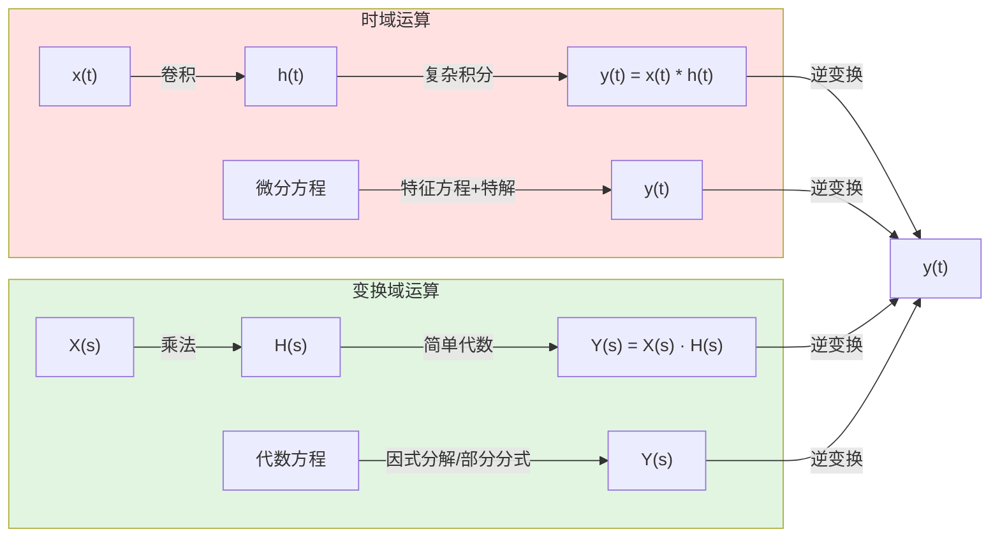

# 004-为什么需要变换域

> [!abstract] 本章定位
> **前置知识**：[[002-时域响应与微分方程]]、[[003-卷积：从冲激响应到输出]]。
>
> **本章回答**：变换为什么能简化卷积与微分方程？傅里叶、拉普拉斯和 Z 变换分别适合什么问题？
>
> **本章边界**：本章只讲共同思想和选型，不重复三种变换的定义、性质与计算。
>
> **下一步**：先从周期信号进入 [[005-频域表示与傅里叶级数]]。

![[Assets/signals_systems/24_time_vs_freq.png|1500]]

> 时域分析（左）需要计算复杂的卷积积分，频域分析（右）只需逐点乘法。这就是变换的核心价值：把困难的操作变成简单的操作。

---

## 1. 时域方法为什么会变得困难

### 1.1 卷积的"滑动平均"直觉，计算却很复杂

在[[01-Foundations/05-信号与系统/002-时域响应与微分方程|002-时域响应与微分方程]]中，我们知道 LTI 系统的输出由**卷积**给出：

$$y(t) = x(t) * h(t) = \int_{-\infty}^{+\infty} x(\tau) h(t - \tau) \, d\tau$$

这个公式物理意义很清楚：
- 把 $h(t)$ 翻转 → 滑动到位置 $t$ → 与 $x(t)$ 逐点相乘 → 积分求和

> **工程直觉**：卷积就像用一把「刷子」$h(t)$ 去刷信号 $x(t)$，刷过的痕迹叠加起来就是输出。刷子的形状就是系统的"记忆特性"。

**但问题是**：哪怕是最简单的信号——比如矩形脉冲与指数衰减的卷积——也需要分段积分，过程繁琐且容易出错。

对于离散信号，卷积求和稍微友好一些：

$$y[n] = \sum_{k=-\infty}^{+\infty} x[k] \, h[n-k]$$

但面对长序列或反馈系统，直接卷积仍然效率低下。

### 1.2 微分方程：物理直观，数学难缠

实际电路（RC、RLC、运算放大器）通常用**常微分方程**描述：

$$\frac{d^2y}{dt^2} + a_1 \frac{dy}{dt} + a_0 y = b_0 x(t)$$

求解步骤：
1. 求齐次解（特征方程根）
2. 求特解（根据输入形式猜测）
3. 用初始条件确定系数

对于高阶系统（三阶、四阶），特征方程的解析求解几乎不可能，而且**每次输入变化都要重新求解**。

> **工程直觉**：微分方程是系统的"本地语言"，它描述电容电压怎么变、电感电流怎么变。但用它求系统的全局响应，就像用方言写全国公告——不是不能用，是太费劲。

### 1.3 时域分析的三座大山

| 困难 | 时域的表现 | 带来的问题 |
|------|-----------|-----------|
| **卷积计算** | 积分/求和，分段处理 | 计算复杂，易出错 |
| **微分方程** | 特征方程、特解、待定系数 | 高阶系统几乎不可解析 |
| **系统互联** | 级联系统的冲激响应需多重卷积 | 复杂度随级数指数增长 |
| **频率特性** | 看不出系统对不同频率的响应 | 设计滤波器、控制器无直接依据 |

> **与后续知识的关联**：在[[14-FOC-电机控制/00-README|14-FOC-电机控制]]中，电流环 PI 控制器的参数整定需要知道电机的频率响应。如果在时域分析，你面对的是复杂的电机微分方程；切换到频域，PI 参数整定变得直观可控。

---

## 2. 变换的共同目标：简化运算

### 2.1 核心思想：换个坐标系，问题变简单

想象你在解一道几何题：
- 在直角坐标系里，圆的方程是 $x^2 + y^2 = R^2$，求切线很复杂
- 换到极坐标系，圆的方程是 $r = R$，求切线变得 trivial

**变换就是这个"换坐标系"的操作**。

信号 $x(t)$ 在时域里是一串时间-幅值对。在变换域里，我们把它投影到一组**正交基函数**上：

- 傅里叶变换：用 $e^{j\omega t}$（正弦/余弦）作为基函数
- 拉普拉斯变换：用 $e^{st}$（复指数）作为基函数
- Z 变换：用 $z^n$（复指数序列）作为基函数

> **工程直觉**：如果把时域信号比作一道菜，变换就是列出它的"ingredient list"（配料表）。时域告诉你菜长什么样，频域告诉你用了什么料、各放了多少。——这个类比来自 3Blue1Brown，但极其贴切。

### 2.2 运算简化表

变换的核心价值在于它把**时域的复杂运算**映射为**变换域的简单运算**：

| 时域运算 | 变换域对应 | 复杂度变化 |
|---------|-----------|-----------|
| 卷积 $x(t) * h(t)$ | 乘法 $X(f) \cdot H(f)$ | 积分 → 乘法 ✓ |
| 微分 $\frac{dx}{dt}$ | 乘法 $j\omega \cdot X(j\omega)$ | 微分 → 乘法 ✓ |
| 积分 $\int x(t) dt$ | 除法 $\frac{1}{j\omega} X(j\omega)$ | 积分 → 除法 ✓ |
| 时移 $x(t - t_0)$ | 相位旋转 $e^{-j\omega t_0} X(j\omega)$ | 时移 → 复数乘法 ✓ |
| 差分 $x[n] - x[n-1]$ | 乘法 $(1 - z^{-1}) X(z)$ | 差分 → 乘法 ✓ |
| 累加 $\sum x[n]$ | 除法 $\frac{1}{1-z^{-1}} X(z)$ | 累加 → 除法 ✓ |
| 微分方程 | 代数方程 | 解方程 → 代数 ✓ |
| 系统互联（级联） | 函数相乘 | 多重卷积 → 连乘 ✓ |

> **工程直觉**：变换不是"魔法"，它之所以有效，是因为 $e^{j\omega t}$ 是 LTI 系统的**特征函数**。输入一个复指数，LTI 系统输出的只是同一个复指数乘以一个复数增益。这就像一个向量空间中的线性变换，找到特征向量后，所有运算都变成对角矩阵上的标量运算。

### 2.3 为什么复指数这么"特殊"？

验证一下：如果输入 $x(t) = e^{st}$，通过冲激响应为 $h(t)$ 的 LTI 系统：

$$y(t) = \int_{-\infty}^{+\infty} h(\tau) e^{s(t - \tau)} d\tau = e^{st} \underbrace{\int_{-\infty}^{+\infty} h(\tau) e^{-s\tau} d\tau}_{H(s)} = H(s) \cdot e^{st}$$

**输出 = 输入 × 一个复数常数 $H(s)$**。

这正是我们想要的：复指数穿过 LTI 系统后"不变形"，只是被缩放和旋转。所以用复指数作为基函数，就能把任意信号分解为 LTI 系统"最擅长处理"的基本单元。

> **与后续知识的关联**：在[[15-双控（控制理论与控制工程）/00-README|15-双控（控制理论与控制工程）]]中，传递函数 $G(s)$ 就是拉普拉斯变换的 $H(s)$。系统框图里串联的 $G_1(s) \cdot G_2(s)$、并联的 $G_1(s) + G_2(s)$，这些在时域里对应极其复杂的卷积运算，在变换域里就是简单的代数操作。

---

## 3. 工具地图：它们不是简单的替代关系

### 3.1 连续时间信号的频率表示

| 工具 | 主要对象 | 主要问题 | 输出形态 |
|---|---|---|---|
| 傅里叶级数 | 周期连续信号 | 基波、谐波和线谱 | 离散系数 \(C_k\) |
| 傅里叶变换 | 非周期连续信号 | 连续频谱、卷积和能量分布 | 连续函数 \(X(j\omega)\) |
| 拉普拉斯变换 | 连续信号和连续 LTI 系统 | 收敛域、初始条件、暂态和系统函数 | 复变量函数 \(X(s)\)、\(H(s)\) |

傅里叶变换与拉普拉斯变换存在联系，但不能只把二者理解为“基础版”和“升级版”：

- 当拉普拉斯变换的 ROC 包含虚轴时，可在 \(s=j\omega\) 上得到傅里叶变换；
- 傅里叶变换关注虚轴上的频率组成和正弦稳态；
- 拉普拉斯变换通过整个 \(s\) 平面的零极点和 ROC 描述更广泛的动态行为；
- 是否存在变换必须结合收敛条件；绝对可积只是傅里叶变换存在的充分条件，不是处理所有工程信号的唯一边界，冲激和周期信号常用广义函数表示。

### 3.2 离散时间信号的变换

| 工具 | 主要对象 | 主要问题 |
|---|---|---|
| DTFT | 无限长离散序列 | 连续且以 \(2\pi\) 为周期的频谱 |
| Z 变换 | 离散序列和离散 LTI 系统 | ROC、差分方程、\(H(z)\) 和稳定性 |
| DFT | 有限长度数据块 | 在有限个频点上计算频谱样本 |
| FFT | DFT 的快速算法 | 降低数值计算量，不是新的数学变换 |

Z 变换在单位圆 \(z=e^{j\Omega}\) 上的取值与 DTFT 相关，前提是 ROC 包含单位圆。连续系统与离散系统之间常用 \(z=e^{sT}\) 描述指数模式的映射，但具体离散化方法不能仅靠直接代入完成。

### 3.3 一条更准确的关系链

$$
\text{周期连续信号}
\xrightarrow{\text{傅里叶级数}}
\text{离散线谱}
$$

$$
\text{非周期连续信号}
\xrightarrow{\text{傅里叶变换}}
\text{连续频谱}
$$

$$
\text{连续系统微分方程}
\xrightarrow{\text{拉普拉斯变换}}
H(s)
\xrightarrow{\text{零极点与 }s=j\omega}
\text{动态与频率响应}
$$

$$
\text{采样}
\longrightarrow
\text{离散序列}
\xrightarrow{\text{Z 变换}}
H(z)
$$

这四条关系会在后续笔记分别展开，本章不提前推导。

## 4. 怎样选择分析域

### 4.1 决策顺序

先判断对象，再判断目标：

1. 对象是连续信号、离散序列，还是一个系统？
2. 是否关心初始条件和暂态？
3. 是否只关心稳态频率组成？
4. 是否需要判断极点、因果性或稳定性？
5. 数据是理论上的无限序列，还是实际采集的有限记录？

### 4.2 场景速查

| 场景 | 首选方法 | 不应忽略 |
|---|---|---|
| 求 RC/RL 阶跃暂态 | 时域或拉普拉斯 | 初始储能 |
| 已知 \(x(t)\) 与 \(h(t)\) 求输出 | 卷积；复杂时可用变换域 | LTI 和零初始状态条件 |
| 分析周期方波的谐波 | 傅里叶级数 | 单边谱与双边谱约定 |
| 分析单个脉冲的频谱 | 傅里叶变换 | 频率变量与归一化 |
| 从微分方程得到传递函数 | 拉普拉斯变换 | 单边/双边定义和初始条件 |
| 判断连续系统稳定性 | \(H(s)\) 的极点与 ROC | BIBO 与内部稳定的区别 |
| 画系统 Bode 图 | \(H(j\omega)\) | 频率响应存在条件和相位 |
| 设计 ADC 前端 | 傅里叶 + Bode + 采样理论 | 模拟滤波器过渡带 |
| 分析差分方程 | Z 变换 | ROC 与单位圆 |
| 对有限采样记录做频谱估计 | DFT/FFT | 窗、泄漏、混叠和频率分辨率 |

### 4.3 同一问题可能需要多个域

实际工程通常不是“选中一个域后永不返回”：

- 在时域定义上升时间和超调；
- 在 \(s\) 域建立模型并分析极点；
- 在频域检查带宽和稳定裕度；
- 采样后在 \(z\) 域检查离散实现；
- 最后回到时域仿真和实测波形验证。

变换域用于简化分析，时域用于解释真实行为和验证结果。

## 5. 使用变换前必须写明的条件

### 5.1 模型条件

- 系统是否线性、时不变？
- 分析范围是否避开饱和、死区和参数显著变化？
- 输入、输出和扰动的系统边界是否明确？
- 初始状态是零、已知，还是未知？

### 5.2 数学约定

- 使用 \(f\) 还是 \(\omega\)，二者是否通过 \(\omega=2\pi f\) 换算？
- 傅里叶变换的 \(2\pi\) 系数放在哪一侧？
- 拉普拉斯和 Z 变换是单边还是双边？
- 是否给出 ROC？
- 使用单边谱还是双边谱？

### 5.3 连续到离散的接口

- 采样率是否为模拟滤波器留下过渡带？
- 采样、计算和保持引入了多少延迟？
- 离散化方法是否改变高频增益和相位？
- 数值实现是否受到量化、溢出和限幅影响？

> [!warning] 两个常见误区
> “卷积变乘法”并不自动保证问题更简单：仍要先求变换并满足存在条件。
>
> “连续模型稳定”也不自动保证数字实现稳定：采样、延迟和离散化都会改变闭环极点与裕度。

## 6. 自测与下一步

1. 为什么周期信号优先使用傅里叶级数，而不是把它当成普通连续频谱？
2. 傅里叶变换与拉普拉斯变换的关系为什么必须带上 ROC 条件？
3. DTFT、DFT 和 FFT 分别是什么，为什么不能互换概念？
4. 一个问题同时关心阶跃超调和稳态谐波，应使用一个域还是多个域？
5. 为什么设计数字控制器时不能在 \(s\) 域完成后直接照抄参数？
6. 列出做有限长度 FFT 时至少需要说明的四个条件。

> **上一章**：[[003-卷积：从冲激响应到输出]]
>
> **下一章**：[[005-频域表示与傅里叶级数]]
>
> **后续工具**：[[006-傅里叶变换详解]] · [[007-拉普拉斯变换与系统函数]] · [[011-Z变换与离散时间系统]]
