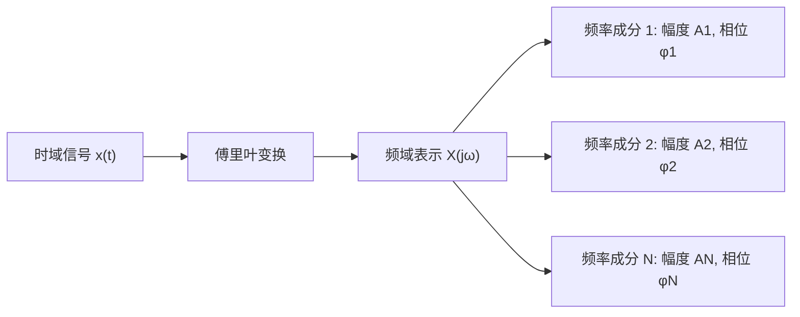
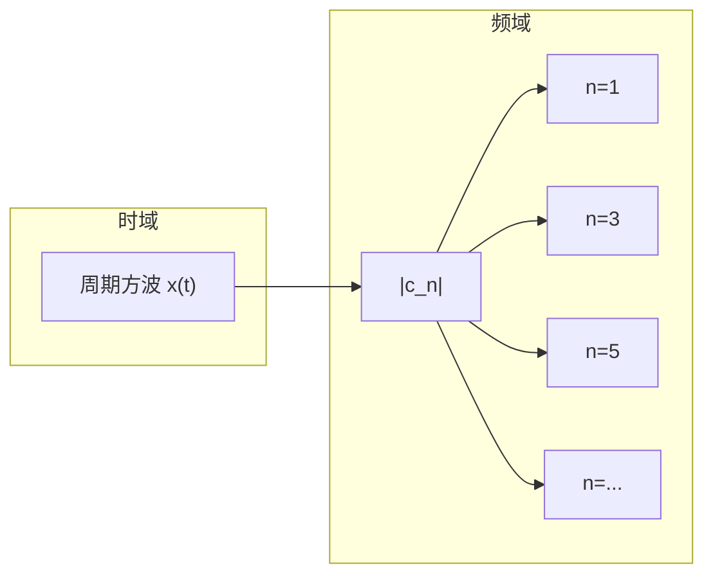

# 005-频域表示与傅里叶级数

> [!abstract] 本章定位
> **前置知识**：[[004-为什么需要变换域]]，复指数和正交函数。
>
> **本章回答**：周期信号怎样分解为离散谐波？幅度谱、相位谱、基波和谐波应当怎样读取？
>
> **本章边界**：本章以傅里叶级数和线谱为主；非周期信号的连续频谱、变换性质和变换对集中在 [[006-傅里叶变换详解]]。
>
> **下一步**：把周期趋于无穷的极限交给 [[006-傅里叶变换详解]]。

---

## 1. 为什么需要频域分析

### 1.1 时域的困境

假设你有一个LTI系统，输入信号 $x(t)$ 通过冲激响应 $h(t)$ 得到输出：

$$y(t) = x(t) * h(t) = \int_{-\infty}^{\infty} x(\tau) h(t-\tau) d\tau$$

对于任意信号，这个卷积积分都需要复杂的分段计算。更糟的是，如果系统用微分方程描述：

$$a_2 \frac{d^2y}{dt^2} + a_1 \frac{dy}{dt} + a_0 y = b_1 \frac{dx}{dt} + b_0 x$$

求解这个微分方程需要找齐次解、特解，再根据初始条件确定系数——**繁琐且缺乏直觉**。

> **工程直觉**：时域波形直接展示每个时刻的变化，频域表示则把变化拆成不同频率的分量。两种表示包含同一信号的信息，但突出的问题不同。

### 1.2 频域的优雅：三个核心洞见

| 时域运算 | 频域运算 | 优雅之处 |
|---------|---------|---------|
| 卷积 $x(t) * h(t)$ | 乘法 $X(j\omega) \cdot H(j\omega)$ | 积分变乘法 |
| 微分 $\frac{dx}{dt}$ | 乘法 $j\omega X(j\omega)$ | 微分方程变代数方程 |
| 时移 $x(t-t_0)$ | 相位旋转 $e^{-j\omega t_0} X(j\omega)$ | 延迟变相位 |

> **与后续知识的关联**：在 [[15-双控（控制理论与控制工程）/00-README|15-双控（控制理论与控制工程）]] 中，传递函数 $H(s)$ 正是基于这个思想——将微分方程转化为代数方程，用零极点分析系统行为。

### 1.3 从厨房到频谱：一个类比

想象你要分析一道菜的味道。时域方法：记录每一毫秒的味道变化；频域方法：分析"盐味"、"甜味"、"辣味"各有多少。傅里叶变换就是**把信号分解成"成分清单"**，告诉你信号里"含有多少 Hz 的成分"。

---

## 2. 傅里叶级数：周期信号的谐波分解

### 2.1 核心思想

任何**周期信号** $x(t)$（周期 $T$，基频 $\omega_0 = \frac{2\pi}{T}$）都可以表示为不同频率正弦/余弦的加权和：

$$x(t) = a_0 + \sum_{n=1}^{\infty} \left[ a_n \cos(n\omega_0 t) + b_n \sin(n\omega_0 t) \right]$$

或者更紧凑的复指数形式（工程师更常用）：

$$x(t) = \sum_{n=-\infty}^{\infty} c_n e^{jn\omega_0 t}$$

其中系数：

$$c_n = \frac{1}{T} \int_{T} x(t) e^{-jn\omega_0 t} dt$$

> **工程直觉**：周期信号的频谱是**离散的**——只有基频整数倍的频率成分。就像吉他弦的泛音，只有特定频率能稳定存在。

### 2.2 频谱可视化

**方波示例**：理想方波的频谱只含奇次谐波，幅度按 $\frac{1}{n}$ 衰减。这就是为什么方波经过低通滤波后，边缘会变圆滑——高频谐波被滤掉了。

### 2.3 从级数到变换：极限过渡

当周期 $T \to \infty$ 时，周期信号变成非周期信号。此时：
- 基频 $\omega_0 = \frac{2\pi}{T} \to d\omega$（无限小）
- 谐波频率 $n\omega_0$ 变成连续变量 $\omega$
- 离散谱系数 $c_n$ 变成连续谱密度 $X(j\omega)$

这就是傅里叶变换的**物理起源**。

![[Assets/signals_systems/04_line_to_continuous.png|1500]]

> 随着周期 $T_0$ 增大，线谱间距逐渐缩小；当 $T_0 \to \infty$ 时，离散线谱过渡为连续频谱。

---

## 3. 从离散线谱到连续频谱：建立接口

傅里叶级数适用于周期信号。若把一个非周期信号截取在长度为 $T$ 的区间内并周期延拓，它的基频为：

$$
\omega_0=\frac{2\pi}{T}
$$

当 $T\to\infty$ 时，谐波间隔 $\omega_0\to 0$，离散谱线逐渐变密。傅里叶级数系数在适当缩放后形成连续频谱 $X(j\omega)$。这个极限过程说明：

- 周期信号对应离散线谱；
- 非周期信号通常对应连续频谱；
- 二者使用同一组复指数基函数，只是频率变量从离散的 $k\omega_0$ 变为连续的 $\omega$。

本章到此只建立概念接口。傅里叶变换的定义、存在条件、性质、常用变换对和 Parseval 关系见 [[006-傅里叶变换详解]]。

## 4. 怎样读取周期信号的频谱

### 4.1 先确认横轴和纵轴

读取频谱前先回答四个问题：

1. 横轴是 $f$（Hz）、$\omega$（rad/s），还是谐波序号 $k$？
2. 纵轴画的是复系数 $C_k$、幅值 $|C_k|$、相位 $\angle C_k$，还是功率？
3. 图是双边谱还是单边谱？
4. 使用的傅里叶级数约定是什么？

若横轴采用角频率，则 $\omega=2\pi f$。单边幅度谱通常会把正频率处的非直流分量乘以 2，因此不能直接与双边谱的 $|C_k|$ 混用。

### 4.2 依次读取直流、基波、谐波和包络

- $k=0$：直流分量，等于一个周期内的平均值；
- $k=\pm1$：基波，决定重复节奏；
- $|k|\ge2$：高次谐波，决定边沿、尖峰和波形细节；
- 谱线包络：反映谐波衰减速度，也反映信号的光滑程度。

一般而言，波形越不光滑，频谱衰减越慢。例如方波含跳变，其奇次谐波幅值按 $1/k$ 衰减；三角波连续但斜率跳变，其奇次谐波按 $1/k^2$ 衰减。

### 4.3 实信号的共轭对称性

若 $x(t)$ 为实信号，则：

$$
C_{-k}=C_k^*
$$

因此：

$$
|C_{-k}|=|C_k|,\qquad \angle C_{-k}=-\angle C_k
$$

幅度谱关于零频率偶对称，相位谱在不考虑相位跳变时呈奇对称。负频率不是额外的物理振荡，而是实正弦和余弦的复指数表示所必需的另一半。

## 5. 三个典型频谱

### 5.1 单一余弦

$$
x(t)=A\cos(\omega_0t+\varphi)
$$

复指数形式为：

$$
x(t)=\frac{A}{2}e^{j\varphi}e^{j\omega_0t}
    +\frac{A}{2}e^{-j\varphi}e^{-j\omega_0t}
$$

所以双边谱在 $\pm\omega_0$ 各有一条谱线，幅值均为 $A/2$，相位分别为 $\pm\varphi$。这个例子是理解正、负频率和幅相表示的最小模型。

### 5.2 对称方波

零均值、50% 占空比的对称方波只含奇次谐波：

$$
x(t)=\frac{4A}{\pi}\left(
\sin\omega_0t+\frac{1}{3}\sin3\omega_0t
+\frac{1}{5}\sin5\omega_0t+\cdots
\right)
$$

它说明高次谐波不是附加噪声，而是重建陡峭边沿所必需的成分。有限带宽系统削弱高次谐波后，方波边沿会变缓。

### 5.3 脉冲列与 PWM

周期脉冲列的谱线间隔由重复频率决定，包络由单个脉冲的宽度决定。改变占空比会同时改变直流分量和各次谐波系数。

在 PWM 中，应区分：

- 希望保留的平均值或基波；
- 开关频率附近的载波分量；
- 载波整数倍附近的谐波与边带。

这为后续滤波器、采样率和电磁兼容分析提供频谱入口，但具体系统如何衰减这些分量由 [[009-频率响应与Bode图]] 讨论。

## 6. 常见错误

| 错误 | 正确理解 |
|---|---|
| 把傅里叶级数直接用于非周期信号 | 傅里叶级数要求周期表示；非周期信号通常使用傅里叶变换 |
| 只画正频率却仍使用双边谱幅值 | 单边谱和双边谱的幅值约定不同，必须说明规范 |
| 把基波频率当成最高频率 | 基波只描述重复周期；波形可能含无限多次谐波 |
| 认为高次谐波一定是噪声 | 对方波和脉冲而言，高次谐波是波形结构的一部分 |
| 只看幅度谱，不看相位谱 | 相同幅度谱配合不同相位可以得到明显不同的时域波形 |
| 混用 Hz 与 rad/s | 始终通过 $\omega=2\pi f$ 检查单位 |
| 由谱线间隔推断脉冲宽度 | 谱线间隔对应周期，包络零点和形状才与脉冲宽度相关 |

## 7. 自测与章节衔接

### 7.1 自测

1. 周期为 $2\,\mathrm{ms}$ 的信号，其基频 $f_0$ 和角频率 $\omega_0$ 分别是多少？
2. 为什么实信号的负频率谱线不能随意删除？
3. 方波经过低通系统后边沿变缓，怎样用谐波衰减解释？
4. 一个频谱只在奇数倍基频处有谱线，能否仅凭这一点断定它是方波？为什么？
5. PWM 占空比变化时，直流分量为什么会变化？
6. 如何从频谱图判断它画的是单边谱还是双边谱？

### 7.2 本章结论

本章建立的是“周期信号 → 离散谐波 → 线谱”的链条。下一章 [[006-傅里叶变换详解]] 把周期趋于无穷的极限写成积分，并系统讨论连续频谱的计算与性质。

> **上一章**：[[004-为什么需要变换域]]
>
> **下一章**：[[006-傅里叶变换详解]]
