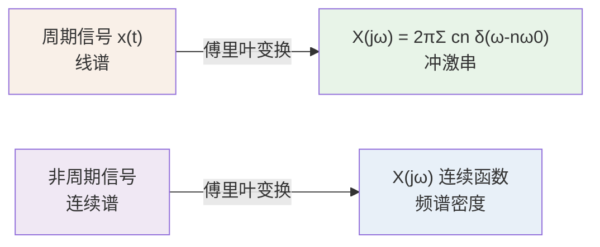
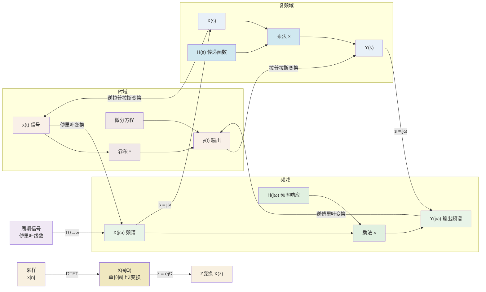

# 006-傅里叶变换详解

> [!abstract] 本章定位
> **前置知识**：[[005-频域表示与傅里叶级数]] 中的复指数傅里叶级数和线谱。
>
> **本章回答**：非周期信号怎样得到连续频谱？如何利用对偶、时移、尺度变换和卷积性质避免重复积分？
>
> **本章边界**：本章分析“信号包含什么频率”；系统稳定性和 Bode 图分别放在 [[008-极点零点与系统稳定性]] 与 [[009-频率响应与Bode图]]。
>
> **下一步**：进入 [[007-拉普拉斯变换与系统函数]]，把频谱分析扩展到动态系统与初始条件。

---

## 1. 从傅里叶级数进入傅里叶变换

上一章 [[005-频域表示与傅里叶级数]] 已经建立：

$$
x_T(t)=\sum_{k=-\infty}^{+\infty}C_k e^{jk\omega_0t},
\qquad \omega_0=\frac{2\pi}{T}
$$

周期增大时，谱线间隔 $\omega_0$ 变小。当 $T\to\infty$，离散频率 $k\omega_0$ 过渡为连续变量 $\omega$，求和过渡为积分。经过规范化，得到傅里叶变换对：

$$
X(j\omega)=\int_{-\infty}^{+\infty}x(t)e^{-j\omega t}\,dt
$$

$$
x(t)=\frac{1}{2\pi}\int_{-\infty}^{+\infty}X(j\omega)e^{j\omega t}\,d\omega
$$

两篇笔记的分工是：

- 傅里叶级数解释周期信号的基波、谐波和离散线谱；
- 傅里叶变换处理非周期信号的连续频谱、变换性质与能量关系；
- 周期信号的傅里叶变换仍是冲激线谱，不应把“周期”简单等同于“没有傅里叶变换”。

> [!note] 规范约定
> 本章使用角频率 $\omega$，正变换不带系数，逆变换带 $1/(2\pi)$。查表或使用软件前必须确认其采用的归一化约定。
## 2. 傅里叶变换的定义与存在条件

### 3.1 正变换（分析公式）

$$\boxed{X(j\omega) = \mathcal{F}\{x(t)\} = \int_{-\infty}^{+\infty} x(t) \, e^{-j\omega t} \, dt}$$

把时域信号 $x(t)$ 分解为各频率分量的"密度" $X(j\omega)$。

### 3.2 逆变换（合成公式）

$$\boxed{x(t) = \mathcal{F}^{-1}\{X(j\omega)\} = \frac{1}{2\pi} \int_{-\infty}^{+\infty} X(j\omega) \, e^{j\omega t} \, d\omega}$$

把频域的"密度"加权叠加，恢复时域信号。

> **工程直觉**：正变换像是"分析"（analysis），拆开看成分；逆变换像是"合成"（synthesis），把成分加起来。注意逆变换前有 $\frac{1}{2\pi}$，因为 $\omega$（角频率）和 $f$（Hz）的关系是 $\omega = 2\pi f$。如果用 $f$ 表示频率，则变换对变为：
>
> $$X(f) = \int_{-\infty}^{+\infty} x(t) \, e^{-j2\pi f t} \, dt, \quad x(t) = \int_{-\infty}^{+\infty} X(f) \, e^{j2\pi f t} \, df$$
>
> 此时逆变换没有 $\frac{1}{2\pi}$ 因子，更对称。工程上两种形式都有人用，注意区分。

### 3.3 记号约定

本文统一使用 $\omega$（角频率，单位 rad/s）形式，记法：

$$x(t) \xleftrightarrow{\mathcal{F}} X(j\omega)$$

> **注意**：有些教材用 $X(\omega)$ 或 $X(j\omega)$，本质一样。$X(j\omega)$ 强调这是把 $s=j\omega$ 代入拉普拉斯变换 $X(s)$ 的结果，暗示两者联系。

---

## 3. 连续频谱的幅值、相位与单位

### 4.1 幅度谱与相位谱

$X(j\omega)$ 一般是复数，可写成极坐标形式：

$$X(j\omega) = |X(j\omega)| \, e^{j\angle X(j\omega)}$$

| 名称 | 定义 | 物理意义 |
|------|------|----------|
| 幅度谱 $\|X(j\omega)\|$ | $\|X(j\omega)\| = \sqrt{\text{Re}^2 + \text{Im}^2}$ | 每个频率分量的"强度"密度 |
| 相位谱 $\angle X(j\omega)$ | $\arctan\frac{\text{Im}}{\text{Re}}$ | 每个频率分量的初始相位 |

> **工程直觉**：幅度谱告诉你"系统/信号里有哪些频率、各占多少"；相位谱告诉你"这些频率分量是同时到还是先后到"。对于音频，人耳主要听幅度谱；对于图像或通信，相位谱往往更重要（相位决定波形形状）。

### 4.2 频谱密度的单位

$X(j\omega)$ 的单位是 **[信号单位]/[频率单位]**，即它是一个密度：

- 若 $x(t)$ 是电压（V），则 $X(j\omega)$ 的单位是 $\text{V}/(\text{rad/s})$ 或 $\text{V}\cdot\text{s}$
- 若用频率 $f$（Hz），则 $X(f)$ 的单位是 $\text{V}/\text{Hz}$ 或 $\text{V}\cdot\text{s}$

> **常见错误**：把 $|X(j\omega)|$ 直接当成"某频率点的幅度"。实际上，真正的频率分量幅度需要乘以 $d\omega$（无穷小带宽），即 $|X(j\omega)| \, d\omega$。只有对**周期信号**（傅里叶级数），$|c_n|$ 才是直接可比的离散幅度。

---

## 4. 傅里叶变换的重要性质

下表列出所有核心性质，含证明思路和应用说明。假设 $x(t) \xleftrightarrow{\mathcal{F}} X(j\omega)$，$y(t) \xleftrightarrow{\mathcal{F}} Y(j\omega)$。

| 性质 | 时域 | 频域 | 证明思路 | 工程意义 |
|------|------|------|----------|----------|
| **线性** | $a x(t) + b y(t)$ | $a X(j\omega) + b Y(j\omega)$ | 积分线性性 | 叠加原理的频域体现 |
| **时移** | $x(t-t_0)$ | $e^{-j\omega t_0} X(j\omega)$ | 变量替换 $u = t-t_0$ | 时域延迟 = 频域加线性相位 |
| **频移** | $e^{j\omega_0 t} x(t)$ | $X(j(\omega-\omega_0))$ | 指数合并 | 调制的基础：搬移频谱 |
| **尺度（缩放）** | $x(at)$ | $\frac{1}{\verta\vert} X\left(j\frac{\omega}{a}\right)$ | 变量替换 $u = at$ | 时域压缩 $\to$ 频域扩展（反比关系） |
| **时间反转** | $x(-t)$ | $X(-j\omega)$ | 变量替换 $u = -t$ | 时域反转 = 频域反转 |
| **共轭对称** | $x(t)$ 为实信号 | $X(-j\omega) = X^*(j\omega)$ | 取共轭后比较 | 实信号的幅度谱偶对称、相位谱奇对称 |
| **微分** | $\frac{d^n x(t)}{dt^n}$ | $(j\omega)^n X(j\omega)$ | 分部积分 | 微分变乘法！这是变换的核心价值 |
| **积分** | $\int_{-\infty}^{t} x(\tau) d\tau$ | $\frac{1}{j\omega} X(j\omega) + \pi X(0)\delta(\omega)$ | 利用阶跃的变换 | 积分变除法（注意冲激项） |
| **卷积定理** | $x(t) * y(t)$ | $X(j\omega) \cdot Y(j\omega)$ | 交换积分次序 | 卷积变乘法！LTI 分析的核心 |
| **乘法定理** | $x(t) \cdot y(t)$ | $\frac{1}{2\pi} X(j\omega) * Y(j\omega)$ | 对偶性推导 | 时域乘法 = 频域卷积（调制） |
| **Parseval定理** | $\int_{-\infty}^{+\infty} \|x(t)\|^2 dt$ | $\frac{1}{2\pi} \int_{-\infty}^{+\infty} \|X(j\omega)\|^2 d\omega$ | 交换积分次序 | 能量守恒：时域总能量 = 频域总能量 |
| **对偶性** | $X(t)$ | $2\pi x(-\omega)$ | 正逆变换形式对称 | 时域和频域的"角色互换" |

### 5.1 关键性质的证明思路详解

#### 5.1.1 时移性质的推导

$$\mathcal{F}\{x(t-t_0)\} = \int_{-\infty}^{+\infty} x(t-t_0) e^{-j\omega t} dt$$

令 $u = t - t_0$，则 $t = u + t_0$，$dt = du$：

$$= \int_{-\infty}^{+\infty} x(u) e^{-j\omega(u+t_0)} du = e^{-j\omega t_0} \int_{-\infty}^{+\infty} x(u) e^{-j\omega u} du = e^{-j\omega t_0} X(j\omega)$$

> **工程直觉**：信号延迟 $t_0$ 不改变其频率内容（幅度谱不变），只给每个频率分量加了一个与频率成正比的相位延迟 $-\omega t_0$。这也是为什么电缆/传输线的延迟会导致相位失真。

#### 5.1.2 卷积定理的推导

$$\mathcal{F}\{x(t) * y(t)\} = \int_{-\infty}^{+\infty} \left[\int_{-\infty}^{+\infty} x(\tau) y(t-\tau) d\tau \right] e^{-j\omega t} dt$$

交换积分次序：

$$= \int_{-\infty}^{+\infty} x(\tau) \left[\int_{-\infty}^{+\infty} y(t-\tau) e^{-j\omega t} dt \right] d\tau$$

内层积分用时移性质：$\int_{-\infty}^{+\infty} y(t-\tau) e^{-j\omega t} dt = e^{-j\omega\tau} Y(j\omega)$

所以：

$$= \int_{-\infty}^{+\infty} x(\tau) e^{-j\omega\tau} Y(j\omega) d\tau = Y(j\omega) \int_{-\infty}^{+\infty} x(\tau) e^{-j\omega\tau} d\tau = X(j\omega) Y(j\omega)$$

> **工程直觉**：在时域里，LTI 系统的零状态输出是输入与冲激响应的卷积；在频域里，它变为输入频谱与系统频率响应的乘积。计算是否真正简化，还取决于变换是否存在以及是否容易求得。

![[Assets/signals_systems/13_convolution_theorem.png|1500]]
> 卷积定理的核心直觉：时域中复杂的卷积积分（左）等价于频域中简单的逐点乘法（右）。这是LTI系统频域分析效率的根本来源。

> **与后续知识的关联**：在[[15-双控（控制理论与控制工程）/00-README|15-双控（控制理论与控制工程）]]中，传递函数 $H(s)$ 让输出 $Y(s) = H(s)X(s)$，正是这个思想的 $s$ 域推广。在[[14-FOC-电机控制/00-README|14-FOC-电机控制]]中，电流环的频率响应分析直接依赖这个性质。

#### 5.1.3 微分性质的推导

$$\mathcal{F}\left\{\frac{dx}{dt}\right\} = \int_{-\infty}^{+\infty} \frac{dx}{dt} e^{-j\omega t} dt$$

分部积分：$u = e^{-j\omega t}$，$dv = \frac{dx}{dt} dt$，则 $du = -j\omega e^{-j\omega t} dt$，$v = x(t)$

$$= \left[x(t) e^{-j\omega t}\right]_{-\infty}^{+\infty} + j\omega \int_{-\infty}^{+\infty} x(t) e^{-j\omega t} dt$$

对于能量信号（$x(t) \to 0$ 当 $|t| \to \infty$），边界项为零：

$$= j\omega X(j\omega)$$

> **工程直觉**：微分运算在频域里变成乘以 $j\omega$。$j$ 表示 $90°$ 相位超前，$\omega$ 表示幅度随频率成正比放大。这解释了为什么微分器会放大高频噪声（高频噪声的 $\omega$ 大，微分后更大）。这也是 PID 控制器中 D 项需要低通滤波的原因。

#### 5.1.4 尺度（缩放）性质的推导

$$\mathcal{F}\{x(at)\} = \int_{-\infty}^{+\infty} x(at) e^{-j\omega t} dt$$

令 $u = at$，则 $t = u/a$，$dt = du/a$。当 $a < 0$ 时积分上下限反转，需要 $|a|$：

$$= \frac{1}{|a|} \int_{-\infty}^{+\infty} x(u) e^{-j\omega \frac{u}{a}} du = \frac{1}{|a|} X\left(j\frac{\omega}{a}\right)$$

> **工程直觉**：**时域和频域存在反比关系**。信号在时域压缩（$a > 1$，变窄变快），频域就扩展（频谱变宽）；反之，时域扩展（$a < 1$，变宽变慢），频域就压缩。这是**不确定性原理**的数学来源：你不可能同时让信号在时域和频域都很"窄"。
>
> 嵌入式实例：示波器采样率不足时（时域采样稀疏），频谱会混叠扩展（频域泄漏），参见 [[010-采样、混叠与重建]]。

![[Assets/signals_systems/11_time_freq_scaling.png|1500]]
> 时频尺度反比关系：时域压缩（$a=2$）导致频域展宽，时域扩展（$a=0.5$）导致频域压缩。两者乘积 $\Delta t \cdot \Delta\omega$ 保持常数约束。

---

## 5. 常见信号的傅里叶变换对

### 6.1 变换对速查表

| 信号 $x(t)$ | 变换 $X(j\omega)$ | 备注 |
|-------------|-------------------|------|
| $\delta(t)$ | $1$ | 冲激含所有频率，且幅度相等（白谱） |
| $1$ | $2\pi \delta(\omega)$ | 直流信号只有零频分量 |
| $u(t)$（单位阶跃） | $\frac{1}{j\omega} + \pi\delta(\omega)$ | 含直流 + 所有频率衰减分量 |
| $e^{-at} u(t)$, $a > 0$ | $\frac{1}{a + j\omega}$ | 单边指数，低通型谱 |
| $te^{-at} u(t)$, $a > 0$ | $\frac{1}{(a + j\omega)^2}$ | 可用微分性质推导 |
| $\text{rect}\left(\frac{t}{\tau}\right)$ | $\tau \, \text{sinc}\left(\frac{\omega\tau}{2\right)$ | 矩形 $\leftrightarrow$ sinc 函数，对偶性典型 |
| $\text{sinc}(Bt)$ | $\frac{1}{B} \text{rect}\left(\frac{\omega}{2\pi B}\right)$ | 对偶性：sinc $\leftrightarrow$ 矩形 |
| $e^{-at^2}$（高斯） | $\sqrt{\frac{\pi}{a}} e^{-\frac{\omega^2}{4a}}$ | 高斯 $\leftrightarrow$ 高斯，唯一自对偶函数 |
| $\cos(\omega_0 t)$ | $\pi\left[\delta(\omega-\omega_0) + \delta(\omega+\omega_0)\right]$ | 只有 $\pm\omega_0$ 两个频率 |
| $\sin(\omega_0 t)$ | $\frac{\pi}{j}\left[\delta(\omega-\omega_0) - \delta(\omega+\omega_0)\right]$ | 同上，相位差 $90°$ |
| $e^{j\omega_0 t}$ | $2\pi \delta(\omega - \omega_0)$ | 单频复指数，频谱为单根冲激 |

> **sinc 函数定义**：本文采用工程常用定义 $\text{sinc}(x) = \frac{\sin(x)}{x}$（有些数学教材用 $\frac{\sin(\pi x)}{\pi x}$，注意区分）。

### 6.2 关键变换对的推导与直觉

#### 6.2.1 冲激函数 $\delta(t) \xleftrightarrow{\mathcal{F}} 1$

$$X(j\omega) = \int_{-\infty}^{+\infty} \delta(t) e^{-j\omega t} dt = e^{-j\omega \cdot 0} = 1$$

> **工程直觉**：冲激信号在 $t=0$ 处"无限窄、无限高"，包含**所有频率**且每个频率幅度相等。这是理想的白噪声（white noise）频谱特征。在系统测试中，用冲激激励可以"一次性"测出系统的全频段响应。

#### 6.2.2 直流信号 $1 \xleftrightarrow{\mathcal{F}} 2\pi\delta(\omega)$

这是上一对的**对偶性**应用：若 $\delta(t) \leftrightarrow 1$，则 $1 \leftrightarrow 2\pi\delta(\omega)$。

直接验证：

$$x(t) = \frac{1}{2\pi} \int_{-\infty}^{+\infty} 2\pi\delta(\omega) e^{j\omega t} d\omega = \int_{-\infty}^{+\infty} \delta(\omega) e^{j\omega t} d\omega = e^{j\cdot 0 \cdot t} = 1$$

> **工程直觉**：直流信号频率为零，所以频谱只在 $\omega=0$ 处有一根冲激（强度 $2\pi$）。这很合理：它"只含一个频率"——零频。

#### 6.2.3 矩形脉冲 $\text{rect}(t/\tau) \xleftrightarrow{\mathcal{F}} \tau \, \text{sinc}(\frac{\omega\tau}{2})$

定义矩形脉冲：

$$x(t) = \begin{cases} 1, & |t| < \tau/2 \\ 0, & |t| > \tau/2 \end{cases}$$

$$X(j\omega) = \int_{-\tau/2}^{\tau/2} e^{-j\omega t} dt = \left[\frac{e^{-j\omega t}}{-j\omega}\right]_{-\tau/2}^{\tau/2} = \frac{e^{j\omega\tau/2} - e^{-j\omega\tau/2}}{j\omega} = \frac{2\sin(\omega\tau/2)}{\omega} = \tau \frac{\sin(\omega\tau/2)}{\omega\tau/2} = \tau \, \text{sinc}\left(\frac{\omega\tau}{2}\right)$$

> **工程直觉**：矩形脉冲的频谱是 sinc 函数。主瓣宽度为 $\Delta\omega = \frac{4\pi}{\tau}$（即 $\Delta f = \frac{2}{\tau}$）。**脉冲越窄（$\tau$ 越小），频谱越宽**。这是雷达/通信中脉冲压缩技术的数学基础：窄脉冲有宽频谱，可以测距精确；但宽频谱需要大带宽。
>
> sinc 函数的主瓣承载大部分能量，旁瓣是"泄漏"到邻频的能量。在[[03-滤波器设计]]的窗函数设计中，会利用不同窗函数抑制旁瓣。

![[Assets/signals_systems/03_rect_sinc.png|1500]]
> 矩形脉冲与 sinc 函数的对偶关系：时域宽度为 $\tau$ 的矩形脉冲，频域主瓣宽度为 $4\pi/\tau$。时域越窄，频域越宽——这是不确定性原理在矩形窗上的直接体现。旁瓣高度约 -13.5 dB，是频谱泄漏的主要来源。

#### 6.2.4 单边指数 $e^{-at}u(t) \xleftrightarrow{\mathcal{F}} \frac{1}{a+j\omega}$

$$X(j\omega) = \int_{0}^{\infty} e^{-at} e^{-j\omega t} dt = \int_{0}^{\infty} e^{-(a+j\omega)t} dt = \left[\frac{e^{-(a+j\omega)t}}{-(a+j\omega)}\right]_0^{\infty} = \frac{1}{a+j\omega}$$

幅度谱：$|X(j\omega)| = \frac{1}{\sqrt{a^2 + \omega^2}}$，相位谱：$\angle X(j\omega) = -\arctan\frac{\omega}{a}$

> **工程直觉**：这是 RC 电路的零输入响应频谱。当 $\omega = a$ 时，幅度下降到最大值的 $1/\sqrt{2}$（即 $-3\text{dB}$ 点）。$a$ 越大（衰减越快），频谱越宽（$-3\text{dB}$ 频率越高）；$a$ 越小（衰减越慢），频谱越窄。RC 时间常数 $\tau = RC = 1/a$，所以 **大时间常数 = 窄带宽 = 低通特性强**。
>
> **与后续知识的关联**：在[[007-拉普拉斯变换与系统函数]]中，$e^{-at}u(t)$ 的拉普拉斯变换是 $\frac{1}{s+a}$，令 $s=j\omega$ 即得傅里叶变换。这体现了傅里叶是拉普拉斯在 $s$ 平面虚轴上的特例。

#### 6.2.5 高斯函数 $e^{-at^2} \xleftrightarrow{\mathcal{F}} \sqrt{\frac{\pi}{a}} e^{-\frac{\omega^2}{4a}}$

推导需配方法完成平方，略。关键是结论：

> **工程直觉**：高斯函数是唯一一个傅里叶变换后**形状不变**（仍是高斯）的函数。它的时域宽度和频域宽度满足 $\Delta t \cdot \Delta\omega = \text{常数}$，这是**不确定性原理**的等号成立情况（最小不确定性）。在 Gabor 变换和小波分析中，高斯窗是最优的时频分析窗。

---

## 6. 周期信号的傅里叶变换

### 7.1 从傅里叶级数到变换

周期信号的傅里叶级数：

$$x(t) = \sum_{n=-\infty}^{+\infty} c_n e^{jn\omega_0 t}$$

两边取傅里叶变换，利用线性性质和 $e^{j\omega_0 t} \leftrightarrow 2\pi\delta(\omega - \omega_0)$：

$$X(j\omega) = \sum_{n=-\infty}^{+\infty} 2\pi c_n \, \delta(\omega - n\omega_0)$$

> **结论**：周期信号的傅里叶变换是**冲激串**，冲激位于谐波频率 $n\omega_0$ 处，强度为 $2\pi c_n$。

![[Assets/signals_systems/12_periodic_impulse_spectrum.png|1500]]
> 周期信号的两种频谱表示：傅里叶级数的线谱（左，离散系数 $c_n$）与傅里叶变换的冲激串（右，$2\pi c_n \, \delta(\omega-n\omega_0)$）。两者本质等价，但后者统一了周期与非周期信号的变换框架。

### 7.2 冲激串的傅里叶变换（泊松求和公式）

周期冲激串（采样函数）定义为：

$$p(t) = \sum_{n=-\infty}^{+\infty} \delta(t - nT_s)$$

其傅里叶级数系数 $c_n = \frac{1}{T_s}$，所以：

$$P(j\omega) = \frac{2\pi}{T_s} \sum_{n=-\infty}^{+\infty} \delta\left(\omega - n\frac{2\pi}{T_s}\right) = \omega_s \sum_{n=-\infty}^{+\infty} \delta(\omega - n\omega_s)$$

其中 $\omega_s = \frac{2\pi}{T_s}$ 是采样角频率。

> **关键结论**：**时域的冲激串 $\leftrightarrow$ 频域的冲激串**。时域间隔 $T_s$ 对应频域间隔 $\omega_s = \frac{2\pi}{T_s}$。时域越疏，频域越密；时域越密，频域越疏。这是[[010-采样、混叠与重建]]中采样定理的数学核心：采样在频域产生频谱的周期复制。

### 7.3 正弦/余弦的变换

$$\cos(\omega_0 t) = \frac{e^{j\omega_0 t} + e^{-j\omega_0 t}}{2} \xleftrightarrow{\mathcal{F}} \pi\delta(\omega - \omega_0) + \pi\delta(\omega + \omega_0)$$

> **工程直觉**：正弦波只含一个频率 $\omega_0$，但数学上需要两个冲激（正频率和负频率）来表示，因为实信号的频谱必须共轭对称。负频率是数学上的对称产物，不是"真实的反向旋转波"（虽然在 I/Q 调制中，正/负频率确实有物理意义）。

---

## 7. 帕塞瓦尔定理与能量守恒

### 8.1 定理表述

$$\int_{-\infty}^{+\infty} |x(t)|^2 dt = \frac{1}{2\pi} \int_{-\infty}^{+\infty} |X(j\omega)|^2 d\omega$$

左边是信号的**总能量**（时域），右边是**频域能量密度**的积分。

### 8.2 能量谱密度

定义 **能量谱密度（Energy Spectral Density, ESD）**：

$$S_{xx}(\omega) = |X(j\omega)|^2$$

$|X(j\omega)|^2 d\omega$ 表示信号在 $[\omega, \omega+d\omega]$ 频带内的能量贡献。

> **工程直觉**：Parseval 定理是能量守恒的频域表述。时域中你把信号平方积分，等于在频域中把幅度谱平方积分（注意除以 $2\pi$）。这意味着：信号的能量既不会凭空产生，也不会凭空消失，只是换了种计算方式。
>
> 在滤波器设计中，Parseval 定理可用来验证：信号经过滤波器后，通带内保留的能量 + 阻带内衰减的能量 = 原始能量。若滤波器有损耗，输出能量会小于输入能量。

### 8.3 功率信号的帕塞瓦尔定理

对于功率信号（如周期信号、随机信号），定义**功率谱密度（Power Spectral Density, PSD）**：

$$P_{xx}(\omega) = \lim_{T\to\infty} \frac{|X_T(j\omega)|^2}{T}$$

其中 $X_T(j\omega)$ 是截断到 $[-T/2, T/2]$ 的傅里叶变换。周期信号的 PSD 是离散线谱：

$$P_{xx}(\omega) = 2\pi \sum_{n=-\infty}^{+\infty} |c_n|^2 \delta(\omega - n\omega_0)$$

> **与后续知识的关联**：在[[14-FOC-电机控制/00-README|14-FOC-电机控制]]中，电流的谐波分析用功率谱密度评估 PWM 谐波含量；在通信系统中，PSD 决定信道带宽需求。

---

## 8. 时频分析初步：窗函数与时频权衡

### 9.1 为什么需要时频分析？

傅里叶变换假设信号在**整个时间轴**上存在，给出的是"全局"频谱。但现实中：
- 语音信号在不同时间说不同的话（频率内容随时间变化）
- 电机启动时的电流频谱与稳态时完全不同
- 雷达回波只在某个时刻到达

我们需要知道"**在某一时刻，信号有哪些频率**"——这就是时频分析。

### 9.2 短时傅里叶变换（STFT）

方法：用窗函数 $w(t)$ 截取信号的一段，再做傅里叶变换：

$$X(\tau, \omega) = \int_{-\infty}^{+\infty} x(t) w(t-\tau) e^{-j\omega t} dt$$

窗 $w(t)$ 在 $t=\tau$ 处打开，截取局部信号。滑动 $\tau$ 得到不同时间的频谱。

### 9.3 不确定性原理

不可能同时精确知道一个信号的**时间位置**和**频率内容**。

数学表述：定义时域宽度和频域宽度（标准差）：

$$\Delta t = \sqrt{\int_{-\infty}^{+\infty} t^2 |x(t)|^2 dt}, \quad \Delta\omega = \sqrt{\frac{1}{2\pi} \int_{-\infty}^{+\infty} \omega^2 |X(j\omega)|^2 d\omega}$$

则：

$$\boxed{\Delta t \cdot \Delta\omega \geq \frac{1}{2}}$$

等号当且仅当 $x(t)$ 为高斯函数时成立。

> **工程直觉**：这是信号处理中的"海森堡不确定性原理"（虽然数学上独立，但形式相似）。
> - 窄时域脉冲（$\Delta t$ 小）必有宽频谱（$\Delta\omega$ 大）——如雷达脉冲。
> - 窄带信号（$\Delta\omega$ 小）必在时域很长（$\Delta t$ 大）——如 CW（连续波）信号。
>
> 在窗函数设计中，矩形窗时域最窄但频域旁瓣高（主瓣宽），汉宁窗/Hamming 窗牺牲时域分辨率换取频域低旁瓣。在[[03-滤波器设计]]中有详细讨论。

### 9.4 从傅里叶到更先进的时频分析

> **工程应用**：嵌入式系统中，FFT 频谱分析（如电机振动监测）通常用 STFT 或 Welch 方法（加窗+平均），在 DSP 芯片上实现。更高级的小波变换用于暂态故障检测（如电网谐波突变、轴承故障冲击）。

---

## 9. 工程应用

### 10.1 滤波器设计（[[03-滤波器设计]]）

滤波器的频率响应 $H(j\omega)$ 直接由傅里叶变换得到。设计步骤：
1. 确定所需的 $|H(j\omega)|$（通带、阻带、过渡带）
2. 用傅里叶方法（窗函数法、频率采样法）求 $h(t)$ 或 $h[n]$
3. 实现为电路（模拟）或 DSP 代码（数字）

> **实例**：音频均衡器就是一组并联的带通滤波器，每个频段一个滑块控制增益。傅里叶变换告诉你每个滑块对应哪些频率分量。

### 10.2 通信系统的调制与解调

调制（Modulation）的本质是**频谱搬移**：

$$x_{AM}(t) = A_c[1 + m x(t)]\cos(\omega_c t)$$

利用频移性质，$x(t)$ 的频谱被搬到载波频率 $\pm\omega_c$ 处：

$$X_{AM}(j\omega) = \pi A_c[\delta(\omega-\omega_c) + \delta(\omega+\omega_c)] + \frac{mA_c}{2}[X(j(\omega-\omega_c)) + X(j(\omega+\omega_c))]$$

> **工程直觉**：调制就是"把基带信号装进载波这个货车"，解调就是"卸货"。傅里叶变换清楚地显示了频谱如何被搬移，以及为什么需要带宽（搬移后的频谱占 $2\times$ 基带带宽）。

### 10.3 电机控制中的频域分析（[[14-FOC-电机控制/00-README|14-FOC-电机控制]]）

- **电流采样**：ADC 采样率决定可分析的最高频率（奈奎斯特定理，[[010-采样、混叠与重建]]）
- **Clarke/Park 变换**：把三相交流信号变成直流量，本质是在旋转坐标系下的"频移"
- **PI 控制器**：频域中，PI 控制器 $K_p + \frac{K_i}{s}$ 在低频段提供高增益（消除稳态误差），在高频段衰减（抑制噪声）。傅里叶/Bode 分析用于选择 $K_p, K_i$。
- **谐波分析**：PWM 产生的高频谐波通过傅里叶分析评估其对电机损耗和 EMI 的影响。

### 10.4 控制系统中的频率响应（[[15-双控（控制理论与控制工程）/00-README|15-双控（控制理论与控制工程）]]）

- **Bode 图**：$H(j\omega)$ 的幅度和相位随频率变化，是控制系统设计的主要工具
- **奈奎斯特判据**：通过开环频率响应判断闭环稳定性
- **相位裕度/增益裕度**：直接在 Bode 图上读出，决定系统的稳定性和动态响应

---

## 10. 常见错误与注意事项

### 11.1 错误清单

| 错误 | 正确理解 |
|------|----------|
| "$X(j\omega)$ 是频率 $\omega$ 处的幅度" | $X(j\omega)$ 是**频谱密度**，单位幅度/频率。真正的频率分量需要乘 $d\omega$ |
| "正频率和负频率是物理上不同的方向" | 对于实信号，负频率是数学共轭对称的要求，不是物理实体。但在复信号（I/Q）中，正/负频率代表不同的旋向 |
| "傅里叶变换要求信号绝对可积" | 这是**充分条件**不是必要条件。通过广义函数（冲激），许多不满足绝对可积的信号（如正弦、阶跃）也有傅里叶变换 |
| "时域和频域宽度独立" | 受不确定性原理约束，$\Delta t \cdot \Delta\omega \geq 1/2$ |
| "Parseval 定理中 $2\pi$ 放哪边都行" | 注意定义！用 $\omega$ 时右边有 $1/2\pi$；用 $f$ 时右边没有 $1/2\pi$ |
| "矩形窗是最好的时频分析窗" | 矩形窗主瓣最窄但旁瓣最高（-13dB），频谱泄漏严重。工程上常用 Hanning/Hamming/Blackman 窗 |
| "周期信号和非周期信号用同一个傅里叶变换公式" | 周期信号用傅里叶**级数**（离散谱），非周期信号用傅里叶**变换**（连续谱）。周期信号也可通过冲激串表示为傅里叶变换 |

### 11.2 符号与约定陷阱

- **$\omega$ vs $f$**：$\omega = 2\pi f$。文献混用，注意公式中的 $2\pi$ 因子。
- **$j$ vs $i$**：电气工程用 $j$（避免与电流 $i$ 混淆），数学用 $i$。
- **sinc 定义**：工程 $\text{sinc}(x) = \sin(x)/x$ vs 数学 $\text{sinc}(x) = \sin(\pi x)/(\pi x)$。注意区分！
- **单边 vs 双边变换**：本文用双边变换（积分从 $-\infty$ 到 $+\infty$）。有些工程教材用单边变换（$0$ 到 $+\infty$），只适用于因果信号。

---

## 11. 自测习题

### 基础题

1. **概念题**：为什么非周期信号的傅里叶变换是连续函数，而周期信号的傅里叶级数是离散系数？用"周期趋于无穷"的极限过程解释。

2. **计算题**：求 $x(t) = e^{-2t}u(t)$ 的傅里叶变换，并画出幅度谱 $|X(j\omega)|$ 的示意图。指出 $-3\text{dB}$ 频率。

3. **性质应用**：已知 $x(t) \xleftrightarrow{\mathcal{F}} X(j\omega)$，求 $x(2t-3)$ 的傅里叶变换（用时移+尺度性质）。

4. **物理理解**：解释为什么理想微分器会放大高频噪声。用傅里叶变换的微分性质说明。

5. **Parseval 应用**：信号 $x(t) = \text{rect}(t/2)$（宽度为 2 的矩形脉冲），用时域和频域分别计算其能量，验证 Parseval 定理。

### 进阶题

6. **系统分析**：一个 LTI 系统的冲激响应为 $h(t) = e^{-t}u(t)$，输入 $x(t) = \cos(2t)$。用傅里叶变换方法求输出 $y(t)$（提示：用卷积定理 + 余弦的变换）。

7. **调制分析**：信号 $x(t)$ 的频谱 $X(j\omega)$ 限制在 $[-W, W]$。被 $\cos(\omega_c t)$ 调制后，画出调制信号 $y(t) = x(t)\cos(\omega_c t)$ 的频谱 $Y(j\omega)$，并说明频谱搬移和带宽变化。

8. **周期信号**：求周期方波（幅度 $A$，周期 $T_0$，占空比 $50\%$）的傅里叶变换（用冲激串表示）。

9. **不确定性原理**：高斯脉冲 $x(t) = e^{-t^2}$ 的时域宽度和频域宽度满足 $\Delta t \cdot \Delta\omega = 1/2$。验证这个结论（可用积分表）。

10. **工程综合**：一个音频信号包含 0~20kHz 的频率成分。你需要设计一个低通滤波器，只保留 0~4kHz 用于电话传输。
    - 电话采样率至少应为多少？（根据采样定理）
    - 若用矩形窗设计 FIR 滤波器，窗长为 $N$ 个采样点，频率分辨率约为多少？
    - 权衡：窗长增加 $\to$ 频率分辨率提高，但时域延迟增加。这种权衡的数学根源是什么？

---

## 12. 总结与知识图谱

### 核心要点回顾

1. **傅里叶变换建立频率坐标**：把时域信号表示为复指数分量的连续叠加
2. **正变换分析、逆变换合成**：$X(j\omega)$ 是密度，$x(t)$ 是叠加
3. **卷积变乘法**：$y(t) = x(t) * h(t) \xleftrightarrow{\mathcal{F}} Y(j\omega) = X(j\omega) H(j\omega)$——这是 LTI 分析的核心
4. **微分变乘法**：$\frac{d}{dt} \xleftrightarrow{\mathcal{F}} j\omega$——把微分方程变成代数方程
5. **时频反比**：不确定性原理 $\Delta t \cdot \Delta\omega \geq 1/2$，时域和频域不能同时很窄
6. **周期 $\to$ 冲激串**：周期信号的频谱是离散的冲激串，非周期信号是连续谱
7. **能量守恒**：Parseval 定理保证时域和频域计算的能量一致

### 与后续笔记的关联路径

- [[007-拉普拉斯变换与系统函数]]：当拉普拉斯变换的 ROC 包含虚轴时，在 $s=j\omega$ 上可得到傅里叶变换
- [[009-频率响应与Bode图]]：$H(j\omega)$ 的幅度和相位随频率变化，是控制系统设计的核心工具
- [[011-Z变换与离散时间系统]]：采样后信号的傅里叶变换是周期谱，Z 变换是离散时间版的"拉普拉斯"
- [[15-双控（控制理论与控制工程）/00-README|15-双控（控制理论与控制工程）]]：传递函数、稳定性判据、频率响应设计全部建立在傅里叶/拉普拉斯基础上
- [[14-FOC-电机控制/00-README|14-FOC-电机控制]]：电流环 PI 设计、PWM 谐波分析、ADC 采样都需要频域思维
- [[03-滤波器设计]]：FIR/IIR 滤波器设计的数学基础就是傅里叶变换和频率响应

---

> [!summary] 本章出口
> 读完本章应能区分线谱与连续谱，按统一约定使用常见变换对和性质，并说明卷积、能量与时频权衡在两域中的对应关系。
>
> **上一章**：[[005-频域表示与傅里叶级数]]
>
> **下一章**：[[007-拉普拉斯变换与系统函数]]
