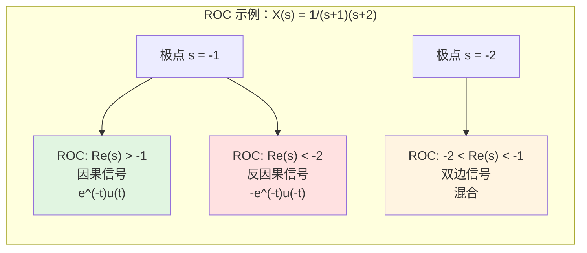
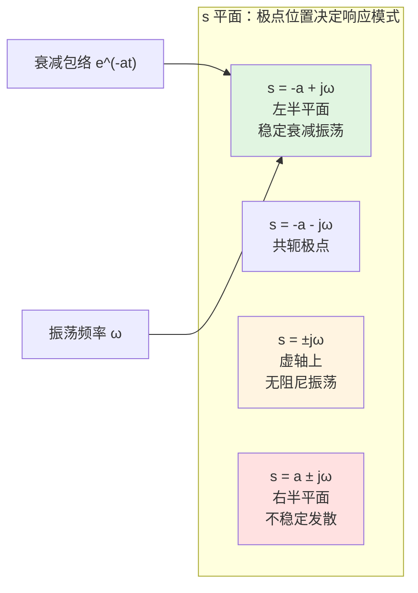
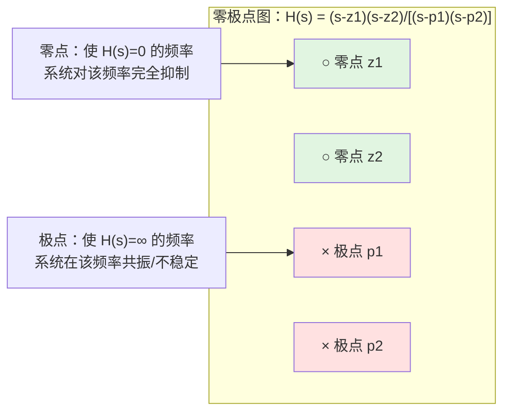
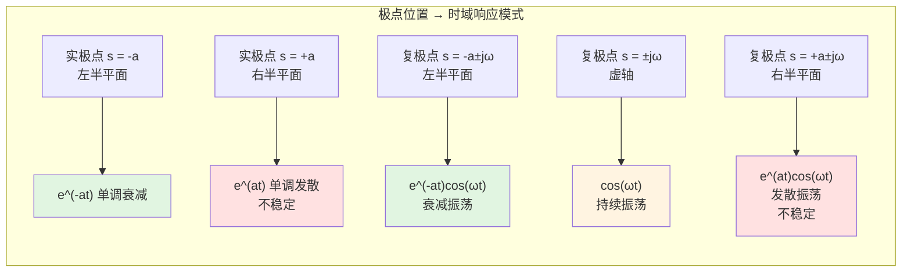
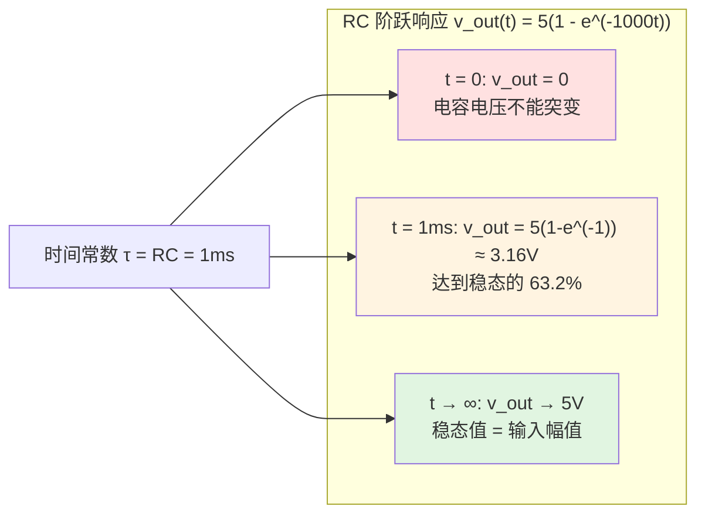
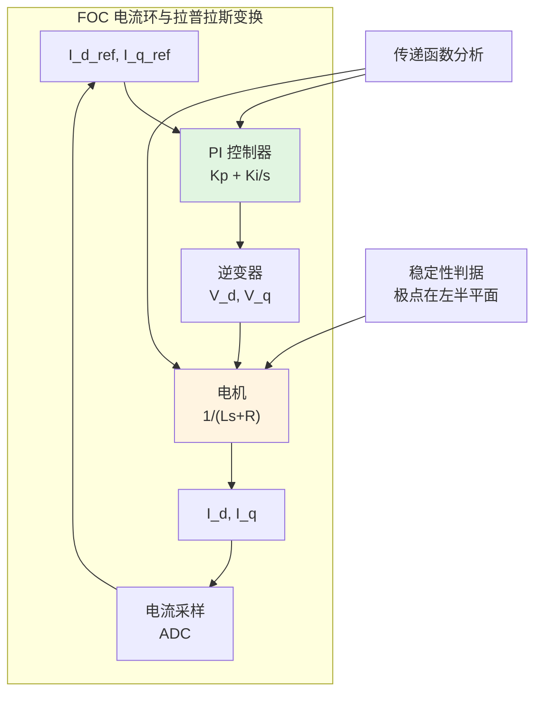

# 007-拉普拉斯变换与系统函数

> [!abstract] 本章定位
> **前置知识**：[[002-时域响应与微分方程]]、[[006-傅里叶变换详解]]。
>
> **本章回答**：怎样用指数加权扩大变换的收敛范围？怎样把微分方程变为代数方程并建立系统函数 $H(s)$？
>
> **本章边界**：本章负责建立和求解 $H(s)$；极点位置如何决定动态与稳定性由 [[008-极点零点与系统稳定性]] 展开。
>
> **下一步**：从代数表达转向 [[008-极点零点与系统稳定性]] 的几何解释。

---

## 1. 从傅里叶到拉普拉斯：增加实部与收敛域

### 1.1 傅里叶变换的边界应怎样表述

[[006-傅里叶变换详解]] 使用：

$$
X(j\omega)=\int_{-\infty}^{+\infty}x(t)e^{-j\omega t}\,dt
$$

若 $x(t)$ 绝对可积，上式一定存在，因此绝对可积是一个方便的充分条件。但它不是普通工程信号拥有频域表示的唯一条件：

- 有限能量信号可在均方意义下讨论傅里叶变换；
- 周期信号、正弦和冲激通常使用广义函数表示；
- 某些信号的傅里叶积分不按普通函数收敛，却仍可通过分布或极限方法处理。

拉普拉斯变换的优势不是简单地“让所有傅里叶变换不存在的信号都存在”，而是引入实指数权重和 ROC，使收敛性、信号左右性与系统模式能够在同一复平面中描述。

### 1.2 双边拉普拉斯变换

定义：

$$
X(s)=\int_{-\infty}^{+\infty}x(t)e^{-st}\,dt,
\qquad s=\sigma+j\omega
$$

可以把核函数拆成：

$$
e^{-st}=e^{-\sigma t}e^{-j\omega t}
$$

对给定的 $\sigma$，它等价于先用 $e^{-\sigma t}$ 对信号加权，再对加权后的信号做傅里叶变换。所有使积分收敛的 $s$ 构成 ROC。

以右边信号 $x(t)=e^{at}u(t)$ 为例：

$$
X(s)=\int_0^\infty e^{-(s-a)t}\,dt=\frac{1}{s-a},
\qquad \operatorname{Re}(s)>a
$$

代数式 $1/(s-a)$ 不能脱离 ROC 单独确定时域信号。若 ROC 在极点左侧，同一代数式会对应左边信号。

### 1.3 傅里叶变换何时是虚轴取值

若双边拉普拉斯变换的 ROC 包含虚轴，则：

$$
X(j\omega)=X(s)\big|_{s=j\omega}
$$

此时才能把傅里叶变换看作拉普拉斯变换沿虚轴的取值。若 ROC 不包含虚轴，直接令 $s=j\omega$ 通常会遇到发散，不能把代数代入当作存在性证明。

### 1.4 单边拉普拉斯与初始条件

工程中的微分方程求解常使用单边拉普拉斯变换：

$$
X^+(s)=\int_{0^-}^{+\infty}x(t)e^{-st}\,dt
$$

它能把初始条件带入导数性质，例如：

$$
\mathcal{L}^+\left\{\frac{dx}{dt}\right\}
=sX^+(s)-x(0^-)
$$

因此要区分：

- 双边变换更适合讨论信号、ROC、因果性和频率响应；
- 单边变换更适合求解含初始条件的因果系统；
- 两者的符号可能相同，但解释和性质条件并不完全相同。

> [!warning] 复变量的两种角色
> 变换核中的 $s=\sigma+j\omega$ 是复频率变量；系统自然模式 $e^{pt}$ 的指数 $p$ 则对应 $H(s)$ 的极点位置。不要把“在右半平面取一个变换点”误解为“系统具有右半平面极点”。
## 2. 拉普拉斯变换的定义与收敛域（ROC）

### 2.1 双边与单边定义

**双边拉普拉斯变换**（适用于所有信号）：

$$X(s) = \int_{-\infty}^{+\infty} x(t) e^{-st} dt$$

**单边拉普拉斯变换**（适用于因果信号，工程中最常用）：

$$X(s) = \int_{0^-}^{+\infty} x(t) e^{-st} dt$$

> **工程直觉**：嵌入式系统中，信号总是在某个时刻"开始"（上电、触发、中断）。单边拉普拉斯变换默认 $t < 0$ 时信号为零，**完美匹配因果系统**。本书若无特别说明，均指单边变换。

### 2.2 收敛域（ROC）的定义

**ROC（Region of Convergence）** 是使积分收敛的所有 $s$ 值集合：

$$\text{ROC} = \{ s \in \mathbb{C} : \int_{-\infty}^{+\infty} |x(t)e^{-st}| dt < \infty \}$$

ROC 不是装饰，而是**决定逆变换结果的唯一性**。两个完全不同的信号可以有完全相同的 $X(s)$ 表达式，但不同的 ROC 对应不同的原信号！

### 2.3 ROC 的几何形状

对于**有理拉普拉斯变换**（即 $X(s)$ 为两个多项式之比），ROC 具有以下性质：

1. **ROC 是平行于虚轴的带状区域**（或半平面）
2. **ROC 的边界是极点**（使 $X(s) \to \infty$ 的 $s$ 值）
3. **ROC 内不含任何极点**

### 2.4 因果性、稳定性与 ROC

| 信号特性 | ROC 条件 | 工程含义 |
|----------|----------|----------|
| **因果** | ROC 位于最右极点右侧 | 物理可实现（响应不能先于激励） |
| **反因果** | ROC 位于最左极点左侧 | 非物理可实现（理论上存在） |
| **稳定** | ROC 包含虚轴 | 有界输入有界输出（BIBO） |
| **因果且稳定** | 所有极点位于左半平面 | 最常见的良好系统 |

![[Assets/signals_systems/18_roc_regions.png|1500]]
> s 平面 ROC 收敛域：因果信号 ROC 位于最右极点右侧，反因果信号 ROC 位于最左极点左侧，双边信号 ROC 为带状区域；稳定系统要求 ROC 包含虚轴。

> **工程直觉**：一个因果且稳定的系统，其 ROC 就像一把向右打开的扇子：从最右侧极点开始向右无限延伸，必然覆盖虚轴。这就是为什么**稳定系统的所有极点必须在左半平面**。

---

## 3. 拉普拉斯变换的性质

### 3.1 与傅里叶变换性质对比

| 性质 | 时域 | 拉普拉斯域 | 傅里叶域（对应） |
|------|------|-----------|-----------------|
| **线性** | $ax_1(t) + bx_2(t)$ | $aX_1(s) + bX_2(s)$ | $aX_1(j\omega) + bX_2(j\omega)$ |
| **时移** | $x(t - t_0)$ | $e^{-st_0}X(s)$ | $e^{-j\omega t_0}X(j\omega)$ |
| **频移（s域平移）** | $e^{s_0 t}x(t)$ | $X(s - s_0)$ | $X(j(\omega - \omega_0))$ |
| **尺度变换** | $x(at)$ | $\frac{1}{\verta\vert}X(\frac{s}{a})$ | $\frac{1}{\verta\vert}X(j\frac{\omega}{a})$ |
| **时间反转** | $x(-t)$ | $X(-s)$ | $X(-j\omega)$ |
| **时域微分** | $\frac{dx(t)}{dt}$ | $sX(s) - x(0^-)$ | $j\omega X(j\omega)$ |
| **时域积分** | $\int_{0^-}^{t} x(\tau) d\tau$ | $\frac{1}{s}X(s)$ | $\frac{1}{j\omega}X(j\omega)$ |
| **卷积定理** | $x_1(t) * x_2(t)$ | $X_1(s) \cdot X_2(s)$ | $X_1(j\omega) \cdot X_2(j\omega)$ |
| **时域相乘** | $x_1(t) \cdot x_2(t)$ | $\frac{1}{2\pi j}X_1(s) * X_2(s)$ | $\frac{1}{2\pi}X_1(j\omega) * X_2(j\omega)$ |
| **初值定理** | $x(0^+)$ | $\lim_{s \to \infty} sX(s)$ | — |
| **终值定理** | $x(\infty)$ | $\lim_{s \to 0} sX(s)$ | — |

> **关键区别**：拉普拉斯变换的**微分性质**多了 $-x(0^-)$ 项。这就是它能自动处理**初始条件**的秘密！傅里叶变换假设信号从 $t = -\infty$ 开始，没有"初始状态"的概念；而拉普拉斯变换从 $t = 0^-$ 开始，天然兼容电容电压、电感电流等初始储能。

### 3.2 微分性质的推导直觉

$$\mathcal{L}\{ \frac{dx}{dt} \} = sX(s) - x(0^-)$$

**为什么多一项？**

用分部积分：

$$\int_{0^-}^{\infty} \frac{dx}{dt} e^{-st} dt = [x(t)e^{-st}]_{0^-}^{\infty} - \int_{0^-}^{\infty} x(t) (-s)e^{-st} dt$$

$$= 0 - x(0^-) + sX(s) = sX(s) - x(0^-)$$

> **工程直觉**：$sX(s)$ 是"动态响应"（系统对变化的反应），$x(0^-)$ 是"初始储能的释放"。拉普拉斯变换把两者自动分开了，**不用手动解齐次解和特解**。

### 3.3 卷积定理：时域卷积 = s域乘积

$$\mathcal{L}\{x(t) * h(t)\} = X(s) \cdot H(s)$$

这是拉普拉斯变换最优雅的性质之一。时域的卷积积分（复杂）变成 s 域的代数乘法（简单）。

> **与后续知识的关联**：在 [[15-双控（控制理论与控制工程）/00-README|15-双控（控制理论与控制工程）]] 中，闭环传递函数 $H_{cl}(s) = \frac{G(s)}{1 + G(s)H(s)}$ 就是 s 域代数运算。如果没有拉普拉斯变换，分析反馈系统需要解复杂的时域积分方程。

---

## 4. 常见信号的拉普拉斯变换对

### 4.1 基本信号表

| 信号 $x(t)$ | 拉普拉斯变换 $X(s)$ | ROC | 备注 |
|-------------|---------------------|-----|------|
| $\delta(t)$（单位冲激） | $1$ | 全 $s$ 平面 | 所有频率成分均等 |
| $\delta(t - t_0)$ | $e^{-st_0}$ | 全 $s$ 平面 | 时移冲激 |
| $u(t)$（单位阶跃） | $\frac{1}{s}$ | $\text{Re}(s) > 0$ | 最常用 |
| $t \cdot u(t)$（斜坡） | $\frac{1}{s^2}$ | $\text{Re}(s) > 0$ | 积分器级联 |
| $t^n \cdot u(t)$ | $\frac{n!}{s^{n+1}}$ | $\text{Re}(s) > 0$ | 高阶斜坡 |
| $e^{-at}u(t)$ | $\frac{1}{s+a}$ | $\text{Re}(s) > -a$ | 一阶衰减 |
| $t e^{-at}u(t)$ | $\frac{1}{(s+a)^2}$ | $\text{Re}(s) > -a$ | 临界阻尼响应 |
| $\sin(\omega t) u(t)$ | $\frac{\omega}{s^2 + \omega^2}$ | $\text{Re}(s) > 0$ | 无阻尼振荡 |
| $\cos(\omega t) u(t)$ | $\frac{s}{s^2 + \omega^2}$ | $\text{Re}(s) > 0$ | 同上 |
| $e^{-at}\sin(\omega t) u(t)$ | $\frac{\omega}{(s+a)^2 + \omega^2}$ | $\text{Re}(s) > -a$ | **阻尼振荡** |
| $e^{-at}\cos(\omega t) u(t)$ | $\frac{s+a}{(s+a)^2 + \omega^2}$ | $\text{Re}(s) > -a$ | **阻尼振荡** |

### 4.2 从欧拉公式推导正弦变换

$$e^{j\omega t} = \cos(\omega t) + j\sin(\omega t)$$

$$\mathcal{L}\{e^{j\omega t}u(t)\} = \frac{1}{s - j\omega} = \frac{s + j\omega}{s^2 + \omega^2}$$

取实部：$\mathcal{L}\{\cos(\omega t)u(t)\} = \frac{s}{s^2 + \omega^2}$

取虚部：$\mathcal{L}\{\sin(\omega t)u(t)\} = \frac{\omega}{s^2 + \omega^2}$

> **工程直觉**：$\sin$ 和 $\cos$ 的变换分母都是 $s^2 + \omega^2$，这意味着它们的**极点在虚轴上**（$s = \pm j\omega$）。极点在虚轴 = 持续振荡，不衰减也不增长。这就是物理上"理想无阻尼振荡"的数学表达。

### 4.3 阻尼振荡：工程中最常见的形式

$$x(t) = e^{-at}\sin(\omega t) u(t)$$

$$X(s) = \frac{\omega}{(s+a)^2 + \omega^2}$$

**极点位置**：$s = -a \pm j\omega$

> **工程直觉**：
> - $a$ 是**衰减系数**：越大衰减越快。在机械系统中是阻尼；在电路中是 $R/2L$。
> - $\omega$ 是**阻尼振荡频率**：实际振荡频率，略低于无阻尼自然频率 $\omega_0 = \sqrt{a^2 + \omega^2}$。
> - 极点离虚轴越近（$a$ 越小），振荡衰减越慢；极点离实轴越近（$\omega$ 越小），振荡越不明显。

---

## 5. 部分分式展开与逆拉普拉斯变换

### 5.1 核心策略

工程中遇到的 $X(s)$ 几乎都是**有理函数**：

$$X(s) = \frac{N(s)}{D(s)} = \frac{b_m s^m + ... + b_0}{s^n + a_{n-1}s^{n-1} + ... + a_0}$$

**逆变换的策略**：把复杂的 $X(s)$ 拆成**简单分式之和**，每个简单分式对应一个已知时域信号。

### 5.2 单实极点（一阶因子）

$$X(s) = \frac{N(s)}{(s+p_1)(s+p_2)...(s+p_n)} = \frac{A_1}{s+p_1} + \frac{A_2}{s+p_2} + ... + \frac{A_n}{s+p_n}$$

**求留数 $A_k$**：

$$A_k = (s + p_k) X(s) \big|_{s = -p_k} = \frac{N(-p_k)}{\prod_{j \neq k}(-p_k + p_j)}$$

**对应时域**：

$$x(t) = A_1 e^{-p_1 t} + A_2 e^{-p_2 t} + ... + A_n e^{-p_n t}$$

> **工程直觉**：每个实极点对应一个**指数衰减（或增长）模式**。极点越靠左（$|p_k|$ 越大），对应项衰减越快。系统在长时间后的行为由**最靠近虚轴的极点**主导（主导极点原理）。

### 5.3 复共轭极点（二阶振荡因子）

$$X(s) = \frac{N(s)}{(s+a)^2 + \omega^2} = \frac{A(s+a) + B\omega}{(s+a)^2 + \omega^2}$$

**对应时域**：

$$x(t) = e^{-at}[A\cos(\omega t) + B\sin(\omega t)] = Ce^{-at}\cos(\omega t + \phi)$$

其中 $C = \sqrt{A^2 + B^2}$，$\phi = -\arctan(B/A)$。

> **工程直觉**：复共轭极点总是成对出现，对应一个**衰减（或增长）振荡包络**。在 RLC 电路、弹簧-质量-阻尼系统、电机控制中，这是最常见的响应模式。包络由实部 $-a$ 决定，振荡频率由虚部 $\omega$ 决定。

### 5.4 重极点

$$X(s) = \frac{N(s)}{(s+p)^k} = \frac{A_1}{s+p} + \frac{A_2}{(s+p)^2} + ... + \frac{A_k}{(s+p)^k}$$

**对应时域**：

$$x(t) = A_1 e^{-pt} + A_2 t e^{-pt} + ... + A_k \frac{t^{k-1}}{(k-1)!} e^{-pt}$$

> **工程直觉**：重极点对应**临界阻尼或过渡模式**。二阶重极点（$k=2$）对应 $te^{-pt}$，比单极点衰减稍慢，但没有振荡。在控制工程中，重极点通常意味着系统处于**临界阻尼**状态——响应最快但无超调。

### 5.5 完整例题：部分分式展开

**例题**：求 $X(s) = \frac{3s+5}{s^2+3s+2}$ 的逆变换。

**解**：

**Step 1：因式分解分母**

$$s^2 + 3s + 2 = (s+1)(s+2)$$

**Step 2：设部分分式**

$$X(s) = \frac{A}{s+1} + \frac{B}{s+2}$$

**Step 3：求系数**

$$A = (s+1)X(s)\big|_{s=-1} = \frac{3(-1)+5}{(-1)+2} = \frac{2}{1} = 2$$

$$B = (s+2)X(s)\big|_{s=-2} = \frac{3(-2)+5}{(-2)+1} = \frac{-1}{-1} = 1$$

**Step 4：查表逆变换**

$$x(t) = 2e^{-t} + e^{-2t}, \quad t \geq 0$$

> **验证**：$x(0) = 2+1 = 3$，而 $X(s)$ 的初值 $= \lim_{s \to \infty} s \cdot \frac{3s+5}{s^2+3s+2} = 3$。一致！

---

## 6. 系统函数 $H(s)$ 与零极点

### 6.1 从微分方程到 $H(s)$

一个 LTI 系统可以用常系数线性微分方程描述：

$$\sum_{k=0}^{N} a_k \frac{d^k y}{dt^k} = \sum_{k=0}^{M} b_k \frac{d^k x}{dt^k}$$

在**零初始条件**下，两边取拉普拉斯变换：

$$Y(s) \sum_{k=0}^{N} a_k s^k = X(s) \sum_{k=0}^{M} b_k s^k$$

**系统函数（传递函数）**：

$$H(s) = \frac{Y(s)}{X(s)} = \frac{\sum_{k=0}^{M} b_k s^k}{\sum_{k=0}^{N} a_k s^k} = \frac{b_M \prod_{k=1}^{M}(s - z_k)}{a_N \prod_{k=1}^{N}(s - p_k)}$$

> **工程直觉**：$H(s)$ 是系统的**DNA**。它完整编码了系统对任意输入的响应方式。知道了 $H(s)$，就知道了系统的：稳定性、响应速度、振荡倾向、频率选择性、对噪声的敏感度。

### 6.2 零极点图

**零点** $z_k$：使分子为零，$H(z_k) = 0$。系统对频率 $s = z_k$ 的信号完全抑制。

**极点** $p_k$：使分母为零，$|H(p_k)| = \infty$。系统在该频率"共振"。

### 6.3 极点位置与系统响应模式

> **工程直觉**：极点在 $s$ 平面的位置就是系统"性格"的地图。
> - 极点在**左半平面** → 系统最终平静下来（稳定）
> - 简单极点在**虚轴** → 零输入模式不衰减，可称内部临界稳定，但不满足 BIBO 稳定
> - 极点在**右半平面** → 系统越来越疯狂（不稳定）
> - 极点离**实轴越近**（$\omega$ 小）→ 振荡频率越低
> - 极点离**虚轴越近**（$|a|$ 小）→ 衰减越慢，"记忆"越长

![[Assets/signals_systems/07_pole_response.png|1500]]
> 极点在左半平面产生指数衰减响应，在虚轴上产生持续振荡，在右半平面产生发散响应；极点的虚部决定振荡频率。

### 6.4 从零极点看频率响应

将 $s = j\omega$ 代入 $H(s)$，得到频率响应 $H(j\omega)$。

![[Assets/signals_systems/15_pole_zero_geometry.png|1500]]
> 零极点几何：频率响应 $H(j\omega)$ 的幅值等于各零点到虚轴上点 $j\omega$ 的向量长度之积除以各极点向量长度之积；相位等于各零点角度之和减去各极点角度之和。

**几何解释**：

$$|H(j\omega)| = \frac{|j\omega - z_1| \cdot |j\omega - z_2| ...}{|j\omega - p_1| \cdot |j\omega - p_2| ...}$$

$$\angle H(j\omega) = \sum \angle(j\omega - z_k) - \sum \angle(j\omega - p_k)$$

> **工程直觉**：频率响应就是你在**虚轴上行走**时，到各零点的向量长度乘积除以到各极点的向量长度乘积。当虚轴上的点靠近一个极点时，$|H(j\omega)|$ 出现峰值；靠近一个零点时，$|H(j\omega)|$ 出现谷值。这就是滤波器的物理本质！

![[Assets/signals_systems/19_s_jomega_boundary.png|1500]]
> $s = j\omega$ 是s平面的虚轴。当拉普拉斯变换的ROC包含虚轴时，傅里叶变换存在。此时令 $s = j\omega$ 即可从拉普拉斯变换得到傅里叶变换。

---

## 7. 初值定理与终值定理

### 7.1 初值定理（Initial Value Theorem）

$$x(0^+) = \lim_{s \to \infty} sX(s)$$

**条件**：$x(t)$ 在 $t=0$ 处不含冲激或冲激的导数（即 $X(s)$ 为真分式或严格真分式）。

### 7.2 终值定理（Final Value Theorem）

$$x(\infty) = \lim_{s \to 0} sX(s)$$

**条件**：$sX(s)$ 的全部极点必须严格位于左半平面。等价地，$X(s)$ 可以在原点有至多一个单极点，但除此之外不能有虚轴或右半平面极点。

> **工程直觉**：
> - **初值定理**：看 $s \to \infty$ 时 $sX(s)$ 的值。高频极限对应时间起点——信号刚开始跳变时的值。
> - **终值定理**：看 $s \to 0$ 时 $sX(s)$ 的值。低频极限对应时间无穷——系统稳态时的值。
>
> 在控制工程中，终值定理是分析**稳态误差**的核心工具：给定一个闭环传递函数，直接计算 $s \to 0$ 的极限就能得到系统对阶跃/斜坡输入的稳态跟踪误差。

### 7.3 例题：验证终值定理

**已知**：$X(s) = \frac{5}{s(s+2)}$，求 $x(\infty)$。

**解**：

极点：$s = 0$ 和 $s = -2$。$s=0$ 是单极点，$s=-2$ 在左半平面。满足终值定理条件。

$$x(\infty) = \lim_{s \to 0} s \cdot \frac{5}{s(s+2)} = \lim_{s \to 0} \frac{5}{s+2} = \frac{5}{2} = 2.5$$

**验证**：逆变换 $x(t) = \frac{5}{2}(1 - e^{-2t})$，当 $t \to \infty$ 时 $x(t) \to 2.5$。一致！

> **常见错误**：对不稳定的系统（极点在右半平面）使用终值定理会得到错误结果。例如 $X(s) = \frac{1}{s-1}$，终值定理给出 $0$，但实际 $x(t) = e^t \to \infty$。

---

## 8. 用拉普拉斯变换解微分方程（完整示例）

### 8.1 问题：RC 电路的阶跃响应

一个 RC 低通滤波器，$R = 1\text{k}\Omega$，$C = 1\mu\text{F}$，初始电压 $v_C(0^-) = 0$。输入为 $v_{in}(t) = 5V \cdot u(t)$。求输出 $v_{out}(t)$。

**微分方程**：

$$RC \frac{dv_{out}}{dt} + v_{out} = v_{in}$$

$$10^{-3} \frac{dv_{out}}{dt} + v_{out} = 5u(t)$$

### 8.2 拉普拉斯变换法

**Step 1：对微分方程取拉普拉斯变换**

$$10^{-3}[sV_{out}(s) - v_{out}(0^-)] + V_{out}(s) = \frac{5}{s}$$

$$10^{-3}sV_{out}(s) + V_{out}(s) = \frac{5}{s}$$

$$(10^{-3}s + 1)V_{out}(s) = \frac{5}{s}$$

**Step 2：求 $V_{out}(s)$**

$$V_{out}(s) = \frac{5}{s(10^{-3}s + 1)} = \frac{5000}{s(s + 1000)}$$

**Step 3：部分分式展开**

$$V_{out}(s) = \frac{A}{s} + \frac{B}{s + 1000}$$

$$A = s \cdot V_{out}(s)\big|_{s=0} = \frac{5000}{1000} = 5$$

$$B = (s+1000) \cdot V_{out}(s)\big|_{s=-1000} = \frac{5000}{-1000} = -5$$

$$V_{out}(s) = \frac{5}{s} - \frac{5}{s+1000}$$

**Step 4：逆变换**

$$v_{out}(t) = 5(1 - e^{-1000t}) u(t) \quad \text{[V]}$$

### 8.3 结果分析

**时间常数**：$\tau = RC = 1\text{ms}$，对应极点 $s = -1/\tau = -1000$ rad/s。

**带宽**：$\omega_c = 1/\tau = 1000$ rad/s $= 159$ Hz。

> **工程直觉**：极点位置 $s = -1000$ 直接告诉你：
> - 响应衰减速度：$e^{-1000t}$，1ms 后达到 63% 稳态值
> - 系统带宽：约 159 Hz，高于此频率的信号被衰减
> - 不需要解微分方程，看一眼 $H(s)$ 的极点就全知道了！

### 8.4 与经典法对比

| 方法 | 步骤 | 处理初始条件 | 适用场景 |
|------|------|-----------|----------|
| **经典时域法** | 求齐次解 + 特解 → 用初始条件定系数 | 手动处理，易出错 | 简单系统 |
| **拉普拉斯变换法** | 变换 → 代数求解 → 逆变换 | **自动处理** | 复杂系统、控制系统 |
| **状态空间法** | 矩阵运算（见 [[15-双控（控制理论与控制工程）/00-README|15-双控（控制理论与控制工程）]]） | 自然处理多变量 | 多输入多输出系统 |

> **工程直觉**：拉普拉斯变换把"解微分方程"变成"做代数运算"。对于高阶系统（电机模型通常是 3~5 阶），手工解微分方程几乎不可能，但拉普拉斯变换法只需要解一个高阶代数方程。这就是控制工程中几乎**只使用拉普拉斯/传递函数方法**的原因。

---

## 9. 工程应用：从 $H(s)$ 到实际系统

### 9.1 与双控的关联：传递函数

在 [[15-双控（控制理论与控制工程）/00-README|15-双控（控制理论与控制工程）]] 中，传递函数 $G(s)$ 就是系统函数 $H(s)$ 的别名。

**典型控制系统的传递函数**：

| 环节 | 时域 | $H(s)$ | 应用 |
|------|------|--------|------|
| 比例环节 | $y = Kx$ | $K$ | P 控制器 |
| 积分环节 | $y = \int x dt$ | $\frac{1}{s}$ | I 控制器消除稳态误差 |
| 微分环节 | $y = \frac{dx}{dt}$ | $s$ | D 控制器预测变化 |
| 一阶惯性 | $\tau \dot{y} + y = x$ | $\frac{1}{\tau s + 1}$ | RC 滤波器、电机电流环 |
| 二阶振荡 | $\ddot{y} + 2\zeta\omega_n\dot{y} + \omega_n^2 y = x$ | $\frac{\omega_n^2}{s^2 + 2\zeta\omega_n s + \omega_n^2}$ | 机械系统、伺服电机 |

> **工程直觉**：PI 控制器 $K_p + \frac{K_i}{s}$ 在 s 域就是两个项的加法。分析闭环稳定性时，你只需要把 $G(s)H(s)$ 画出来，看极点位置——不需要解任何微分方程。

### 9.2 与 FOC 电机控制的关联

在 [[14-FOC-电机控制/00-README|14-FOC-电机控制]] 中，拉普拉斯方法主要用于：

**电流环模型**：
- PI 控制器：$K_p + \frac{K_i}{s} = \frac{K_p s + K_i}{s}$
- 电机电气模型：$\frac{1}{Ls + R}$（一阶惯性）
- 闭环传递函数：$H_{cl}(s) = \frac{K_p s + K_i}{Ls^2 + (R+K_p)s + K_i}$

**设计目标**：调节 $K_p, K_i$ 使闭环极点位于左半平面且响应足够快。

> **工程直觉**：电流环的 PI 参数整定不是"试错调参数"，而是**先建立 $H(s)$，再用极点配置或频域法设计**。这才是科学的控制器设计方法。

### 9.3 滤波器设计中的应用

在 [[03-滤波器设计]] 中，拉普拉斯变换是滤波器综合的基础：

- **巴特沃斯滤波器**：极点均匀分布在左半平面的单位圆上
- **切比雪夫滤波器**：极点分布在椭圆上，靠近虚轴的极点提供纹波
- **贝塞尔滤波器**：极点位置优化以获得线性相位

> **工程直觉**：模拟滤波器的设计过程本质上就是"在左半平面的合适位置放置极点，在虚轴或右半平面放置零点"。$H(s)$ 的零极点位置决定了滤波器的全部特性。

---

## 10. 常见错误与自测习题

### 10.1 常见错误

| 错误 | 正确 | 说明 |
|------|------|------|
| $\mathcal{L}\{u(t)\} = \frac{1}{s}$ 对所有 $s$ 成立 | ROC 是 $\text{Re}(s) > 0$ | 离开 ROC 谈论变换无意义 |
| 对不稳定系统使用终值定理 | 终值定理要求极点在左半平面或原点单极点 | $\mathcal{L}^{-1}\{\frac{1}{s-1}\} = e^t$，终值定理给出 0，实际发散到 $\infty$ |
| 忽略单边变换的 $x(0^-)$ 项 | $\mathcal{L}\{\dot{x}\} = sX(s) - x(0^-)$ | 初始条件必须带入！ |
| 认为 $X(s)$ 相同则 $x(t)$ 相同 | 必须同时指定 ROC | 同一个 $X(s)$ 可以对应多个不同的 $x(t)$ |
| 不说明定义就把虚轴极点称为稳定 | 简单虚轴极点可对应内部临界稳定，但不满足 BIBO 稳定；重极点还会产生增长项 | BIBO 或渐近稳定要求极点**严格在左半平面** |
| 部分分式展开时忘记分子次数低于分母 | 对于假分式（分子次数 ≥ 分母），先进行多项式除法 | 例如 $\frac{s^2+1}{s^2+3s+2} = 1 + \frac{-3s-1}{s^2+3s+2}$ |

### 10.2 自测习题

**习题 1**：求下列信号的拉普拉斯变换（单边）。
(a) $x(t) = 3e^{-2t}u(t)$
(b) $x(t) = \sin(3t)u(t)$
(c) $x(t) = t^2 e^{-t}u(t)$

答案

(a) $X(s) = \frac{3}{s+2}$, ROC: $\text{Re}(s) > -2$

(b) $X(s) = \frac{3}{s^2+9}$, ROC: $\text{Re}(s) > 0$

(c) $X(s) = \frac{2}{(s+1)^3}$, ROC: $\text{Re}(s) > -1$（利用 $t^n f(t) \leftrightarrow (-1)^n \frac{d^n}{ds^n}F(s)$ 或查表）

---

**习题 2**：求 $X(s) = \frac{2s+8}{s^2+4s+3}$ 的逆拉普拉斯变换。

答案

因式分解：$s^2 + 4s + 3 = (s+1)(s+3)$

$$X(s) = \frac{A}{s+1} + \frac{B}{s+3}$$

$A = (s+1)X(s)|_{s=-1} = \frac{2(-1)+8}{-1+3} = \frac{6}{2} = 3$

$B = (s+3)X(s)|_{s=-3} = \frac{2(-3)+8}{-3+1} = \frac{2}{-2} = -1$

$$x(t) = (3e^{-t} - e^{-3t})u(t)$$

---

**习题 3**：一个系统的传递函数为 $H(s) = \frac{s+2}{s^2+2s+5}$。
(a) 求系统的零点和极点。
(b) 判断系统是否稳定。
(c) 定性描述系统的阶跃响应（是否振荡？衰减速度？）。

答案

(a) 零点：$s = -2$（一个实零点）

极点：$s^2 + 2s + 5 = 0 \Rightarrow s = \frac{-2 \pm \sqrt{4-20}}{2} = -1 \pm j2$（一对共轭复极点）

(b) 极点实部为 $-1 < 0$，位于左半平面，**系统稳定**。

(c) 极点 $-1 \pm j2$ 对应 $e^{-t}\cos(2t + \phi)$ 形式的响应：
- **有振荡**：阻尼振荡频率 $\omega = 2$ rad/s
- **衰减**：衰减系数 $a = 1$，时间常数 $\tau = 1$ s
- 零点 $s=-2$ 会改变部分分式残差与相位，并使高频滚降由二阶对象的 $-40$ dB/十倍频减缓为 $-20$ dB/十倍频

---

**习题 4**：用拉普拉斯变换解微分方程：

$$\frac{d^2y}{dt^2} + 5\frac{dy}{dt} + 6y = 6u(t)$$

初始条件：$y(0^-) = 1$, $\frac{dy}{dt}(0^-) = 0$。

答案

两边取拉普拉斯变换：

$$[s^2Y(s) - sy(0^-) - y'(0^-)] + 5[sY(s) - y(0^-)] + 6Y(s) = \frac{6}{s}$$

$$s^2Y(s) - s + 5sY(s) - 5 + 6Y(s) = \frac{6}{s}$$

$$(s^2 + 5s + 6)Y(s) = \frac{6}{s} + s + 5 = \frac{s^2 + 5s + 6}{s}$$

$$Y(s) = \frac{s^2 + 5s + 6}{s(s^2 + 5s + 6)} = \frac{s^2 + 5s + 6}{s(s+2)(s+3)} = \frac{1}{s}$$

$$y(t) = u(t)$$

> **思考**：为什么解这么简单？因为初始条件恰好"抵消"了瞬态响应。零输入响应和零状态响应的瞬态部分相互抵消了。验证：$y(0^+) = 1$，$y'(0^+) = 0$，满足初始条件。

---

**习题 5**：判断以下说法是否正确，并解释。

(a) "如果一个系统的所有零点都在左半平面，则系统一定稳定。"

(b) "终值定理可以用来求任何 $X(s)$ 的稳态值。"

(c) "拉普拉斯变换是傅里叶变换的特例（$s = j\omega$）。"

答案

(a) **错误**。零点全部位于左半平面不能推出稳定性。对因果、最小实现的有理 SISO 系统，外部 BIBO 稳定性由系统函数极点决定；零点会改变传递权重，零极点对消还可能隐藏内部不稳定模式。

(b) **错误**。终值定理要求：$sX(s)$ 的所有极点在左半平面或在原点有单极点。如果 $sX(s)$ 在右半平面有极点，终值定理不适用。

(c) **错误，包含关系说反了**。严格地说：对双边拉普拉斯变换，当 ROC 包含虚轴时，在 $s=j\omega$ 上求值得到傅里叶变换。绝对可积是普通傅里叶积分存在的充分条件，不是处理冲激、周期信号等工程对象的唯一条件；这些对象通常使用广义函数描述。

---

## 11. 章节衔接

- [[004-为什么需要变换域]] — 变换的层级关系与选择指南
- [[006-傅里叶变换详解]] — 拉普拉斯变换的"虚轴特例"
- [[008-极点零点与系统稳定性]] — 零极点分析的深入展开
- [[009-频率响应与Bode图]] — 从 $H(s)$ 到频率响应的图形化方法
- [[011-Z变换与离散时间系统]] — 离散时间域的对应变换
- [[15-双控（控制理论与控制工程）/00-README|15-双控（控制理论与控制工程）]] — 传递函数、根轨迹、频率设计
- [[14-FOC-电机控制/00-README|14-FOC-电机控制]] — 电流环 PI、速度环的 s 域分析
- [[03-滤波器设计]] — 零极点配置设计模拟/数字滤波器

> **上一章**：[[006-傅里叶变换详解]]
>
> **下一章**：[[008-极点零点与系统稳定性]]
