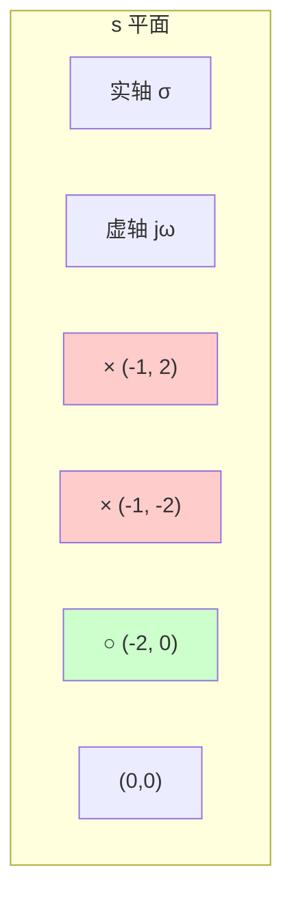
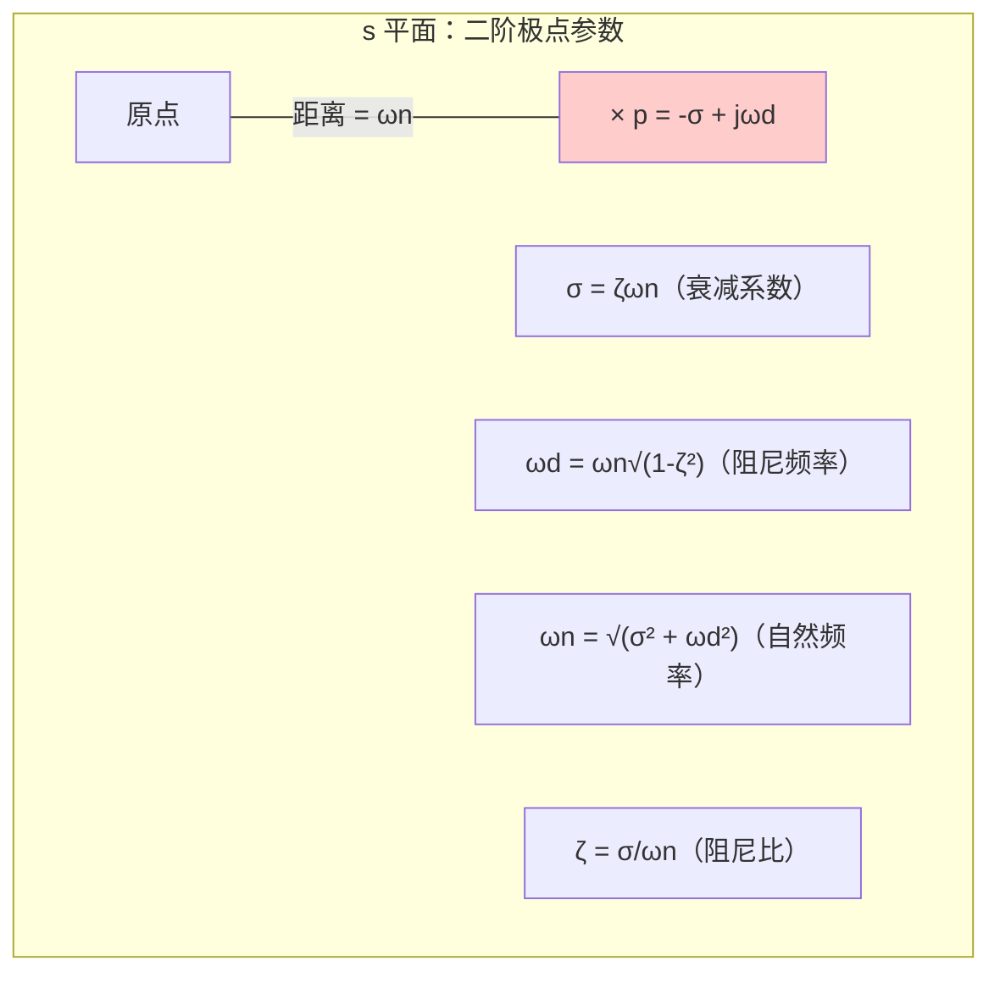
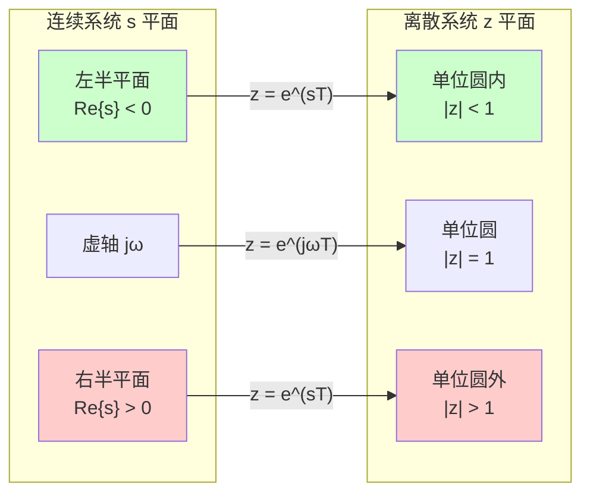
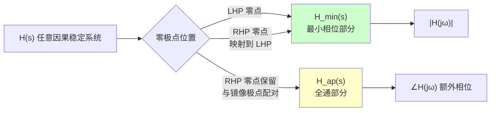
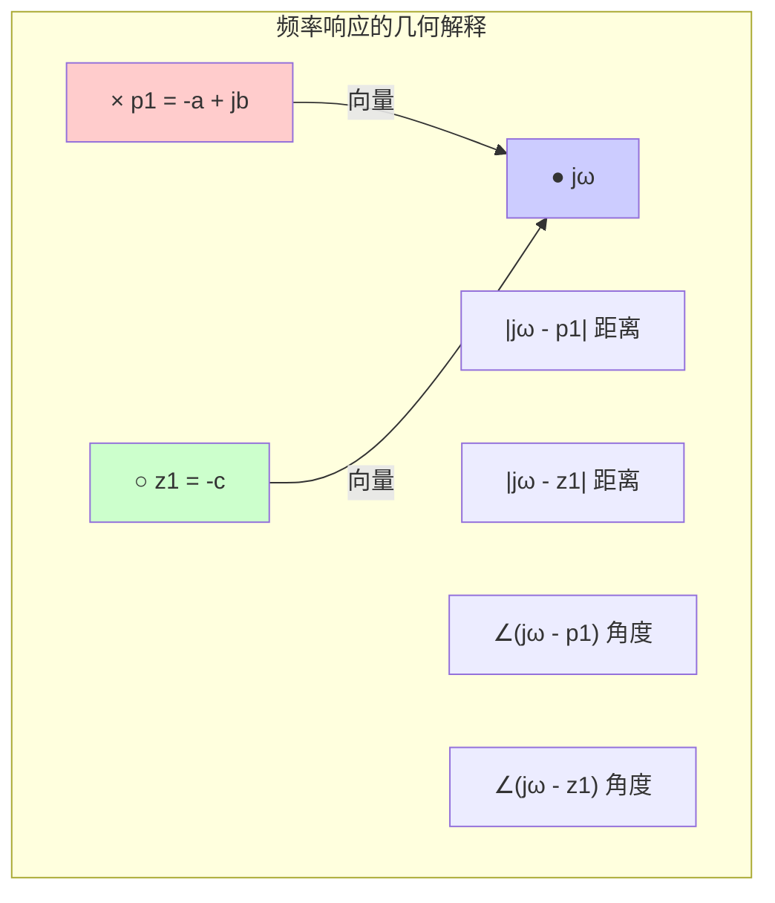
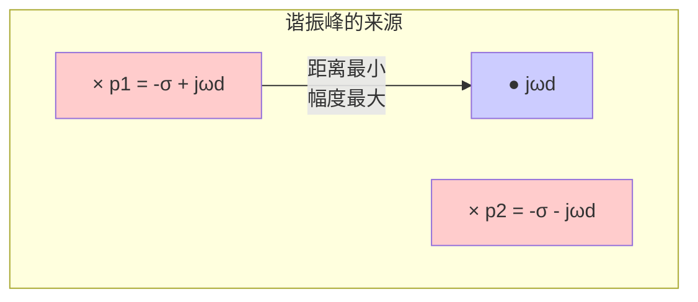

# 008-极点零点与系统稳定性

> [!abstract] 本章定位
> **前置知识**：[[007-拉普拉斯变换与系统函数]] 中的 $H(s)$、ROC 和部分分式展开。
>
> **本章回答**：极点为什么对应响应模式？因果性、ROC 与 BIBO 稳定有什么关系？零点如何改变输入到输出的传递？
>
> **本章边界**：本章从零极点解释动态和稳定性，不重复 Bode 图绘制规则。
>
> **下一步**：沿 $s=j\omega$ 进入 [[009-频率响应与Bode图]]。

---

## 1. 零极点图包含哪些系统信息

### 1.1 从系统函数到零极点

对于 LTI 系统，传递函数 $H(s)$ 是两个多项式之比：

$$
H(s) = \frac{B(s)}{A(s)} = \frac{b_m s^m + b_{m-1}s^{m-1} + \cdots + b_0}{a_n s^n + a_{n-1}s^{n-1} + \cdots + a_0}
$$

将分子和分母分别因式分解：

$$
H(s) = K \cdot \frac{(s - z_1)(s - z_2)\cdots(s - z_m)}{(s - p_1)(s - p_2)\cdots(s - p_n)}
$$

其中：
- $z_i$ 为**零点**（Zeros）：使 $H(s) = 0$ 的 $s$ 值，在图中用 $\circ$ 表示
- $p_i$ 为**极点**（Poles）：使 $H(s) \to \infty$ 的 $s$ 值，在图中用 $\times$ 表示
- $K = b_m / a_n$ 为增益系数

> **工程直觉**：零极点图能快速显示响应模式、衰减速度和频率选择趋势，但完整输出仍取决于增益、输入、初始条件、ROC 以及可能被对消的内部模式。

### 1.2 零极点图的基本绘制

将极点（$\times$）和零点（$\circ$）标记在 $s$ 平面上（横轴 $\sigma = \text{Re}\{s\}$，纵轴 $j\omega = \text{Im}\{s\}$）。

**示例**：$H(s) = \frac{s + 2}{s^2 + 2s + 5}$
- 零点：$z_1 = -2$（$s$ 平面左实轴上）
- 极点：$p_{1,2} = -1 \pm j2$（$s$ 平面左半平面，共轭复数对）

> **绘制规范**：
> - 实轴 $\sigma$ 向左为负，向右为正
> - 虚轴 $j\omega$ 向上为正，向下为负
> - 共轭复数极点/零点对称于实轴
> - 若 $m < n$（严格真分式），$s \to \infty$ 处有 $n-m$ 个隐含零点

---

## 2. 极点位置与系统响应模式

这是本章最核心的直觉：**每一个极点在时域对应一种"响应模式"**。系统的总响应是所有模式按留数加权的叠加。

### 2.1 一阶实极点：指数衰减/增长

| 极点位置 | 时域响应模式 | 示意图 | 特征 |
|---------|------------|--------|------|
| $p = -a, a > 0$（左半平面）| $e^{-at} u(t)$ | 指数衰减 | 稳定，时间常数 $\tau = 1/a$ |
| $p = 0$（原点）| $u(t)$（阶跃）| 常数模式 | 内部意义下临界稳定；作为 $1/s$ 系统时不满足 BIBO 稳定 |
| $p = +a, a > 0$（右半平面）| $e^{at} u(t)$ | 指数增长 | **不稳定** |

> **工程直觉**：RC 电路的极点 $p = -1/RC$，充电/放电的时间常数就是 $\tau = RC = -1/p$。极点越靠左（负得越多），衰减越快，系统"越皮实"——对扰动的记忆越短。

### 2.2 二阶共轭复极点：振荡衰减/增长

| 极点位置 | 时域响应模式 | 特征 |
|---------|------------|------|
| $p = -\sigma \pm j\omega_d, \sigma > 0$ | $e^{-\sigma t} \cos(\omega_d t + \phi)$ | 衰减振荡，稳定 |
| $p = \pm j\omega_d$（虚轴上）| $\cos(\omega_d t + \phi)$ | 等幅振荡；内部意义下临界稳定，不满足 BIBO 稳定 |
| $p = +\sigma \pm j\omega_d, \sigma > 0$ | $e^{+\sigma t} \cos(\omega_d t + \phi)$ | 增幅振荡，**不稳定** |

**关键参数的几何意义**：

- **自然频率** $\omega_n$：极点到原点的距离（无阻尼时的振荡频率）
- **阻尼比** $\zeta = \cos\theta$（$\theta$ 为极点到原点的连线与负实轴的夹角）：$\zeta = 0$ 无阻尼，$\zeta = 1$ 临界阻尼，$\zeta > 1$ 过阻尼（变成两个实极点）
- **阻尼频率** $\omega_d = \omega_n\sqrt{1 - \zeta^2}$：实际振荡频率

> **工程直觉**：
> - 阻尼比 $\zeta=1/\sqrt{2}$ 对应标准二阶低通的 Butterworth 最大平坦条件，但并非所有时域或控制设计的统一最优值
> - 极点离虚轴越近（$\sigma$ 越小），暂态拖得越长；离实轴越近（$\omega_d$ 越小），振荡越慢
> - 开关电源的 LC 输出滤波器、机械系统的弹簧-质量-阻尼模型，都是这个二阶结构

### 2.3 重极点（多重极点）

| 极点类型 | 时域响应模式 | 特征 |
|---------|------------|------|
| $p = -a$（二重）| $t e^{-at} u(t)$ | 衰减但乘了 $t$，初期衰减慢 |
| $p = 0$（二重）| $t u(t)$ | 斜坡，无界 |
| $p = -a$（$k$ 重）| $t^{k-1} e^{-at} u(t)$ | $k$ 重极点带来 $t^{k-1}$ 因子 |

> **工程直觉**：重极点会在响应中引入 $t^{k-1}$ 因子，使相同实部下的衰减形状发生变化。两个相互隔离且参数相同的 RC 级联可形成二重极点；没有缓冲时，级间加载通常会改变极点位置，不能直接按两个独立 RC 相乘。

### 2.4 零点的作用："抑制"与"反相"

零点不改变响应的**模式**（指数/振荡/多项式），但改变各模式的**相对权重**和**相位**。

- **零点靠近某个极点**：该极点对应的响应模式被大幅抑制（分子分母近似相消）
- **零点在右半平面（RHP Zero）**：带来非最小相位特性——初始响应方向与最终方向相反
- **零点在虚轴上**：在该频率处传输为零（陷波特性）

> **工程直觉**：RHP 零点可能造成逆响应，例如某些升压变换器的占空比到输出电压通道、非共点机械系统。它会限制可实现带宽，但不是所有电机电流环或逆变器模型的固有特性。

![[Assets/signals_systems/07_pole_response.png|1500]]

> s平面上不同位置的极点对应截然不同的时域响应模式：左半平面（LHP）产生指数衰减或阻尼振荡，虚轴上产生等幅振荡或阶跃，右半平面（RHP）产生指数增长或发散振荡。

---

## 3. 稳定性判据：极点在左半平面

### 3.1 BIBO 稳定性的定义

**有界输入-有界输出（BIBO）稳定**：对任何有界输入 $|x(t)| \leq M_x < \infty$，输出也有界 $|y(t)| \leq M_y < \infty$。

### 3.2 连续时间系统的稳定性判据

对于因果、有限维、最小实现的有理 LTI 系统，**BIBO 稳定 $\Leftrightarrow$ 系统函数极点严格位于 $s$ 平面左半平面（LHP）**。

$$
\text{稳定} \iff \text{Re}\{p_i\} < 0, \quad \forall i
$$

| 极点分布 | 稳定性 | 时域表现 |
|---------|--------|---------|
| 全部在 LHP | 渐近稳定且 BIBO 稳定 | 有理因果系统的冲激响应指数衰减 |
| 有简单虚轴极点且无 RHP 极点 | 零输入响应可为内部临界稳定，但不满足 BIBO 稳定 | $h(t)$ 有界但不绝对可积；积分器对阶跃输出无界 |
| 有 RHP 极点或虚轴重极点 | 内部不稳定且不满足 BIBO 稳定 | 存在增长或多项式增长模式 |

> **工程直觉**：极点在左半平面就像把球放在碗底——扰动后它会回来；虚轴上的极点像放在平面上——推一下它就一直走；右半平面的极点像放在碗顶——任何微小扰动都会让它滚远。

### 3.3 从特征方程看稳定性

系统的极点即特征方程 $A(s) = 0$ 的根：

$$
a_n s^n + a_{n-1}s^{n-1} + \cdots + a_1 s + a_0 = 0
$$

**必要条件（必要条件，非充分）**：
- 所有系数 $a_i$ 同号（无零系数）
- 若任何系数为零或异号，必不稳定或临界稳定

**充分条件**：需用 Routh-Hurwitz 判据（后续 [[15-双控（控制理论与控制工程）/00-README|15-双控（控制理论与控制工程）]] 中深入）。

### 3.4 离散时间系统的类比（预览）

在 [[011-Z变换与离散时间系统]] 中会详细展开：

- 离散系统稳定 $\Leftrightarrow$ 所有 $H(z)$ 的极点严格位于**单位圆内**（$|p_i| < 1$）
- 连续系统的左半平面对应离散系统的单位圆内部（通过 $z = e^{sT}$ 映射）

![[Assets/signals_systems/08_stability_regions.png|1500]]

> 对连续有限维系统，LHP 对应渐近稳定模式，虚轴对应不衰减模式，RHP 对应增长模式。通过 $z=e^{sT}$，LHP 映射到离散系统单位圆内部。

---

## 4. 因果性与 ROC 的关系

### 4.1 ROC 是什么

ROC（Region of Convergence，收敛域）是使拉普拉斯变换积分收敛的 $s$ 取值范围：

$$
\int_{-\infty}^{\infty} |x(t)| e^{-\sigma t} dt < \infty
$$

### 4.2 ROC 与因果性、稳定性

| 信号类型 | ROC 特征 | 极点位置关系 |
|---------|---------|------------|
| **右边信号**（因果） | ROC 是某条垂直线右侧的半平面 | 最右侧极点以右 |
| **左边信号**（反因果） | ROC 是某条垂直线左侧的半平面 | 最左侧极点以左 |
| **双边信号** | ROC 是两条垂直线之间的带状区域 | 两极点之间 |
| **有限时长信号** | ROC 是整个 $s$ 平面（可能除无穷远） | — |

**因果 + 稳定 的充要条件**：

$$
\text{因果且稳定} \iff \text{ROC 包含右半平面且包含虚轴} \iff \text{所有极点严格在 LHP}
$$

> **工程直觉**：ROC 就像信号/系统的"势力范围"。因果系统的 ROC 向右无限延伸——它只能"看过去"，不能"看未来"。如果虚轴（$j\omega$ 轴，即傅里叶变换的领地）落在 ROC 内，系统的频率响应存在，系统稳定。

### 4.3 一个经典例子：$H(s) = \frac{1}{s+2}$

- 极点：$p = -2$（LHP）
- **因果系统**：ROC 为 $\text{Re}\{s\} > -2$（包含虚轴），$h(t) = e^{-2t} u(t)$，稳定
- **反因果系统**：ROC 为 $\text{Re}\{s\} < -2$（不包含虚轴），$h(t) = -e^{-2t} u(-t)$，不稳定（因为不是绝对可积的）

**同一个 $H(s)$，不同的 ROC，不同的系统！** 这是拉普拉斯变换比傅里叶变换更强大之处：它区分了因果与非因果。

---

## 5. 最小相位系统与全通系统

### 5.1 最小相位系统（Minimum Phase）

**定义**：所有零点和极点都严格位于左半平面（LHP）的系统。

**关键特性**：
1. 在具有相同幅度响应 $|H(j\omega)|$ 的所有因果稳定系统中，最小相位系统的**相位滞后最小**
2. 冲激响应和阶跃响应的**能量集中在前段**（延迟最小）
3. 逆系统 $H^{-1}(s)$ 也是因果稳定的（因为零点变极点后仍在 LHP）

> **工程直觉**：最小相位系统像"听话的学生"——输入什么，输出延迟最小、相位扭曲最少。音频均衡器、通信信道若是最小相位，很容易用逆滤波器补偿。

### 5.2 全通系统（All-Pass）

**定义**：极点在 LHP，零点在 RHP，且每个零点与极点关于虚轴对称：

$$
H_{\text{ap}}(s) = \prod_{i} \frac{s - z_i}{s + z_i^*}, \quad \text{Re}\{z_i\} > 0
$$

**关键特性**：
- $|H_{\text{ap}}(j\omega)| = 1$ 对所有 $\omega$ 成立（"全通"）
- 只改变相位，不改变幅度
- 群延迟 $\tau_g(\omega) = -\frac{d\phi}{d\omega}$ 不为常数（引入相位/频率相关延迟）

> **工程直觉**：全通系统像"透明的相位调色板"。音频处理中用它做相位均衡；控制系统中用它做相位补偿（Phase Lead/Lag）。

### 5.3 任意系统的分解

任何因果稳定系统都可以分解为：

$$
H(s) = H_{\text{min}}(s) \cdot H_{\text{ap}}(s)
$$

即一个**最小相位系统**和一个**全通系统**的级联。这个分解在滤波器设计、信道均衡中有重要应用。

![[Assets/signals_systems/16_minphase_allpass.png|1500]]

> 最小相位系统（所有零极点在LHP）具有最小的相位滞后和群延迟；全通系统（零点在RHP、极点在LHP且镜像对称）幅度恒为1，仅用于相位整形与补偿。

---

## 6. 零极点对消与不可控/不可观模式

### 6.1 零极点对消的数学

若 $H(s)$ 中某个零点恰好等于某个极点，理论上它们可以"约掉"：

$$
H(s) = \frac{(s+2)(s+3)}{(s+1)(s+2)} = \frac{s+3}{s+1}, \quad s \neq -2
$$

### 6.2 对消的隐患：隐藏的不稳定模式

若被对消的极点在**右半平面**，外部输入输出端看不到它，但系统内部仍在**指数增长**！

**示例**：

$$
H(s) = \frac{s-1}{(s+2)(s-1)} = \frac{1}{s+2}
$$

- 外部传递函数：一阶稳定系统 $1/(s+2)$
- 内部真实状态：包含 $e^{t}$ 模式（因 $s=1$ 的极点被对消）
- 任何微小扰动或参数漂移，被对消的 RHP 极点会"复活"，系统内部发散

> **工程直觉**：零极点对消就像把故障发动机从仪表盘上隐藏——你看不到警告灯，但发动机仍在烧毁。这是控制理论中**可控性/可观性**的核心：不可观的模式（被零点对消）不会影响输出，但会影响系统内部安全。

### 6.3 与状态空间的联系（预览）

在 [[15-双控（控制理论与控制工程）/00-README|15-双控（控制理论与控制工程）]] 的状态空间分析中，会学到：
- 传递函数只反映**可控且可观**的子系统
- 被零极点对消的极点对应**不可观或不可控**的状态变量
- 即使传递函数稳定，完整系统可能因隐藏模式而不稳定

![[Assets/signals_systems/14_pole_zero_cancellation.png|1500]]

> 零极点对消可能掩盖右半平面（RHP）极点，使系统外部输入输出稳定，但内部状态仍包含隐藏的发散模式。任何微小扰动或参数漂移都会让被对消的极点"复活"。

---

## 7. 从零极点看频率响应（几何解释）

这是工程师最实用的直觉工具：**频率响应 $H(j\omega)$ 的幅值和相位，可以在零极点图上用尺子+量角器"量"出来**。

### 7.1 几何公式

对于频率响应 $H(j\omega)$（即 $s$ 沿虚轴从 $j0$ 到 $j\infty$）：

$$
|H(j\omega)| = |K| \cdot \frac{\prod_{i=1}^{m} |j\omega - z_i|}{\prod_{i=1}^{n} |j\omega - p_i|}
$$

$$
\angle H(j\omega) = \angle K + \sum_{i=1}^{m} \angle(j\omega - z_i) - \sum_{i=1}^{n} \angle(j\omega - p_i)
$$

### 7.2 几何意义

| 分量 | 几何量 | 含义 |
|------|--------|------|
| $\vertj\omega - z_i\vert$ | 零点 $z_i$ 到虚轴上点 $j\omega$ 的距离 | 距离越短，幅度越小（零点"吸"幅度） |
| $\vertj\omega - p_i\vert$ | 极点 $p_i$ 到虚轴上点 $j\omega$ 的距离 | 距离越短，幅度越大（极点"推"幅度） |
| $\angle(j\omega - z_i)$ | 从零点指向 $j\omega$ 的向量与正实轴的夹角 | 贡献正相位 |
| $\angle(j\omega - p_i)$ | 从极点指向 $j\omega$ 的向量与正实轴的夹角 | 贡献负相位 |

### 7.3 一阶低通滤波器的几何直觉

$H(s) = \frac{\omega_c}{s + \omega_c}$，极点 $p = -\omega_c$。

- **低频** $\omega \ll \omega_c$：$j\omega$ 离极点很远，$|j\omega - p| \approx \omega_c$，$|H| \approx 1$
- **截止频率** $\omega = \omega_c$：$j\omega$ 到极点的距离为 $\sqrt{2}\omega_c$，$|H| = 1/\sqrt{2}$（-3dB 点）
- **高频** $\omega \gg \omega_c$：$|j\omega - p| \approx \omega$，$|H| \approx \omega_c / \omega$（以 -20dB/十倍频衰减）

> **工程直觉**：极点就像频域中的"山丘"——当 $j\omega$ 靠近它时，幅度被"顶"起来；零点就像"山谷"——当 $j\omega$ 靠近它时，幅度被"压"下去。你可以通过在零极点图上移动手指（沿虚轴），直观感受频率响应的变化。

### 7.4 二阶谐振峰的几何来源

对于 $H(s) = \frac{\omega_n^2}{s^2 + 2\zeta\omega_n s + \omega_n^2}$，极点 $p_{1,2} = -\zeta\omega_n \pm j\omega_n\sqrt{1-\zeta^2}$。

- 当 $j\omega$ 靠近极点时（即 $\omega \approx \omega_d$），$|j\omega - p|$ 最小，幅度出现**峰值**（谐振）
- 阻尼比 $\zeta$ 越小，极点离虚轴越近，谐振峰越尖锐
- 阻尼比 $\zeta < 0.707$ 时，幅度响应出现明显过冲

> **与后续知识的关联**：LC 滤波器、石英晶振的谐振特性、机械结构的共振，都源于共轭复极点靠近虚轴。在 [[03-滤波器设计]] 中，会通过精心配置零极点位置来设计带通/陷波滤波器。

![[Assets/signals_systems/15_pole_zero_geometry.png|1500]]

> 频率响应的幅值等于各零点向量长度之积除以各极点向量长度之积，相位等于各零点角度之和减去各极点角度之和。沿虚轴移动即可"读取"整个频率响应。

---

## 8. 常见错误与易混淆点

### 错误 1：只看极点位置判断稳定性，忽略 ROC

- **错误**："极点在 LHP，所以系统稳定"——没有说明因果性
- **正确**：必须确认 ROC 包含虚轴。反因果系统即使极点在 LHP 也可能不稳定（ROC 不包含虚轴）
- **记忆口诀**："因果稳定左半面，ROC 含轴是关键"

### 错误 2：认为零点不影响稳定性

- **错误**："零点在哪里无所谓，稳定只看极点"
- **澄清**：对最小实现的传递函数，零点不直接决定 BIBO 稳定性；RHP 零点会带来非最小相位响应、逆响应和带宽限制，从而约束可达到的闭环性能

### 错误 3：零极点对消后"皆大欢喜"

- **错误**：对消 RHP 极点后，传递函数稳定，就认为系统稳定
- **正确**：被对消的 RHP 极点仍在系统内部，任何扰动都会激发它。零极点对消不是万能药

### 错误 4：混淆"临界稳定"与"稳定"

- **错误**："极点在虚轴上，系统稳定"
- **正确**：简单虚轴极点可对应内部意义下的临界稳定，但不满足 BIBO 稳定；积分器对有界阶跃输入产生无界斜坡正是反例。工程判断前必须说明采用哪一种稳定性定义

### 错误 5：将最小相位与"稳定"混为一谈

- **错误**："最小相位系统就是稳定系统"
- **澄清**：按连续时间有理系统的常用约定，最小相位要求系统稳定且其因果逆系统也稳定，因此有限零点位于 LHP。稳定系统仍可能含 RHP 零点，因而不是最小相位

### 错误 6：忽略增益 $K$ 对稳定性的影响

- **错误**：只分析零极点，不考虑环路增益
- **澄清**：闭环系统中，增益 $K$ 的变化会把根轨迹上的极点推过虚轴（[[15-双控（控制理论与控制工程）/00-README|15-双控（控制理论与控制工程）]] 中根轨迹法的核心）。开环稳定不等于闭环稳定

---

## 9. 自测习题

### 基础题

**Q1**. 系统 $H(s) = \frac{s+3}{s^2 + 3s + 2}$ 的零极点分别在哪里？绘制零极点图。

**Q2**. 下列系统的冲激响应分别呈现什么模式？（指数衰减/增长、振荡、等幅振荡）
- (a) $H(s) = \frac{1}{s+5}$
- (b) $H(s) = \frac{1}{s^2 + 4s + 13}$
- (c) $H(s) = \frac{1}{s^2 + 9}$
- (d) $H(s) = \frac{1}{s^2 - 4}$

**Q3**. 判断系统 $H(s) = \frac{s-2}{s^2 + 2s + 2}$ 的因果稳定性、是否为最小相位系统。

### 进阶题

**Q4**. 系统 $H(s) = \frac{(s-1)(s+3)}{(s+1)(s-2)(s+4)}$ 被零极点对消后得到 $H'(s) = \frac{s+3}{(s+1)(s+4)}$。请问原始系统是否稳定？为什么？

**Q5**. 用几何解释说明：为什么一阶低通滤波器 $H(s) = \frac{1}{s+1}$ 在 $\omega = 1$ rad/s 处的幅度约为 -3dB？

**Q6**. 某二阶系统极点在 $-2 \pm j3$。求自然频率 $\omega_n$、阻尼比 $\zeta$ 和阻尼频率 $\omega_d$。

### 思考题

**Q7**. 为什么控制系统设计中通常避免 RHP 零点？结合 FOC 电机控制的电流响应，想象 RHP 零点的物理影响。

**Q8**. 在数字控制系统中，连续域稳定的极点通过 $z = e^{sT}$ 映射到 $z$ 平面。若 $s = -1 + j2$、采样周期 $T = 0.1s$，映射后的 $z$ 极点在哪里？是否仍在单位圆内？

---

## 10. 工程应用

### 10.1 开关电源的环路稳定性

Buck/Boost 转换器的闭环传递函数包含 LC 滤波器的二阶极点：

$$
H(s) \propto \frac{1}{s^2 + \frac{1}{RC}s + \frac{1}{LC}}
$$

- 若 ESR 太小，阻尼比 $\zeta$ 过低，LC 极点靠近虚轴，产生大尖峰振荡
- 工程师通过增加输出电容 ESR 或引入有源阻尼，将极点推离虚轴，确保稳定裕度
- 电压模式控制中，误差放大器的零极点补偿网络直接决定闭环极点的最终位置

### 10.2 电机控制（FOC）中的电流环整定

[[14-FOC-电机控制/00-README|14-FOC-电机控制]] 中，电流环 PI 控制器的传递函数：

$$
H_{PI}(s) = K_p + \frac{K_i}{s} = K_p \frac{s + K_i/K_p}{s}

$$

- PI 的零点 $z = -K_i/K_p$ 被配置在电机电阻-电感极点 $p = -R/L$ 附近，实现对消，获得近似一阶响应
- 若电机参数变化导致零点未精确对消，二阶响应出现超调
- 采样延迟和 PWM 更新延迟在离散域引入额外极点，可能推向单位圆边界，需降低带宽保证稳定

> **与后续知识的关联**：电流环设计的目标，就是通过对零极点的主动配置，把闭环极点放在期望位置（如 $s = -\omega_{bw}$），获得快速且无超调的电流响应。这正是极点配置的工程实践。

### 10.3 有源滤波器设计

[[03-滤波器设计]] 中，Sallen-Key、多反馈（MFB）拓扑的传递函数：

- 低通滤波器：两个 LHP 共轭极点，控制截止频率和 Q 值
- 带通滤波器：一对 LHP 极点 + 原点零点 + 高频零点（$s=0$ 和 $s=\infty$）
- 陷波滤波器：一对虚轴零点（$s = \pm j\omega_0$）+ 一对 LHP 极点

通过选择电阻电容值，精确将零极点放在目标位置，实现所需的频率选择特性。

### 10.4 振荡器起振：小信号增长与非线性限幅

对纯 LTI 系统，RHP 极点仍表示不稳定。振荡器利用这一小信号增长趋势启动振荡，再依靠器件非线性、限幅或自动增益控制形成有限振幅的周期轨道：

- 在线性起振分析中，Barkhausen 条件要求目标频率处环路相位满足正反馈条件且环路增益达到 1；它通常是起振的必要条件，不足以决定稳态振幅
- 晶体振荡器：利用石英的高 Q 谐振极点，获得极稳定的时钟频率

> **工程直觉**：振荡器在小信号阶段让目标模式增长，再由器件非线性、限幅或自动增益控制稳定振幅。因此，纯 LTI 极点分析可以判断起振趋势，不能单独预测最终振幅。

### 10.5 示波器探头补偿

10x 无源探头包含 R-C 补偿网络：

- 探头的极点/零点配置必须精确匹配，使整体传递函数平坦
- 补偿不当（欠补偿/过补偿）相当于零极点位置错配，导致高频测量幅度误差或相位失真
- 调节补偿电容的过程，就是手动对齐零极点直到完全对消的直观操作

---

## 11. 章节衔接

- [[007-拉普拉斯变换与系统函数]] — 系统函数 $H(s)$ 的数学基础
- [[009-频率响应与Bode图]] — 从零极点到 Bode 图的完整工程工具链
- [[011-Z变换与离散时间系统]] — 离散域的零极点与稳定性判据（单位圆）
- [[15-双控（控制理论与控制工程）/00-README|15-双控（控制理论与控制工程）]] — 根轨迹法、Nyquist 判据、状态空间可控性/可观性
- [[03-滤波器设计]] — 零极点配置在滤波器设计中的实践
- [[14-FOC-电机控制/00-README|14-FOC-电机控制]] — 电流环、速度环的零极点补偿与观测器设计

---

> [!summary] 本章结论
> - 极点决定自然响应模式，零点改变输入到输出的权重；
> - 对因果有理连续系统，BIBO 稳定要求系统函数的极点严格位于左半平面；
> - 简单虚轴极点可对应内部意义下的临界稳定，但不满足 BIBO 稳定，必须先说明稳定性定义；
> - 频率响应的几何法来自测试点到零点、极点的距离与角度；
> - 零极点对消可能隐藏内部不稳定模式，ROC 同时约束因果性与稳定性。
>
> **上一章**：[[007-拉普拉斯变换与系统函数]]
>
> **下一章**：[[009-频率响应与Bode图]]
