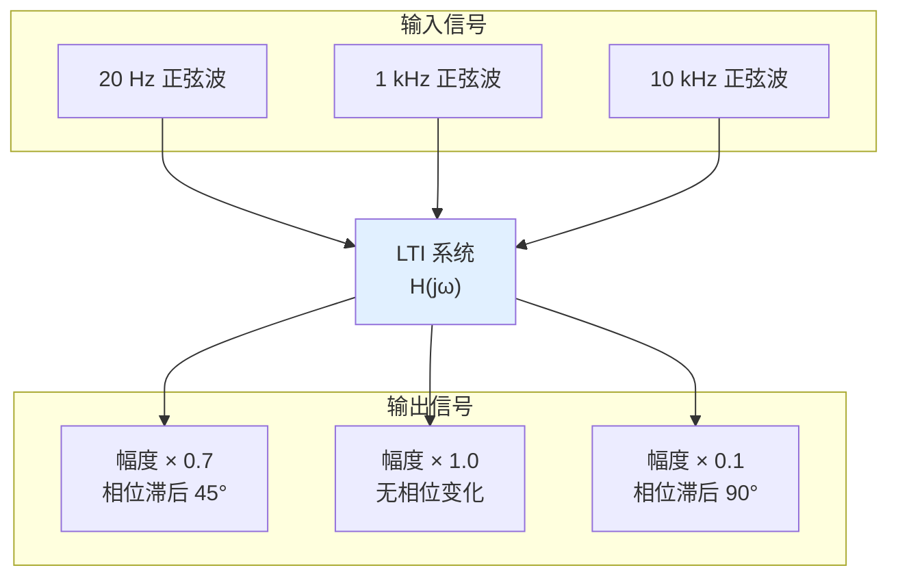
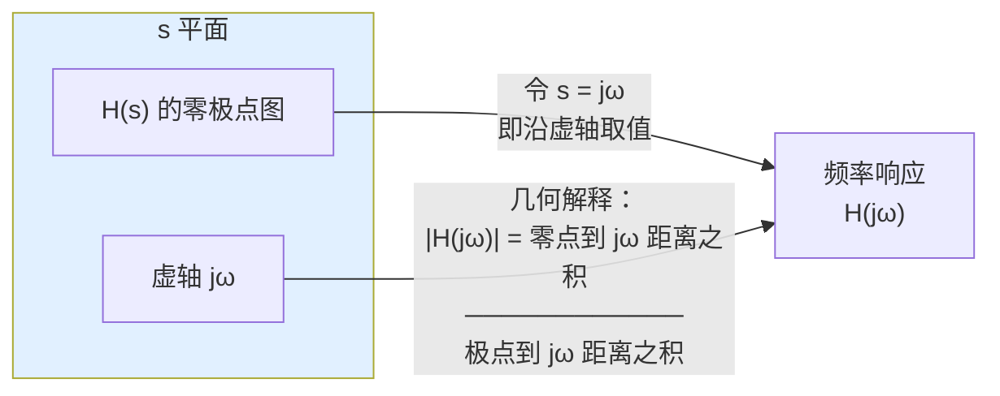
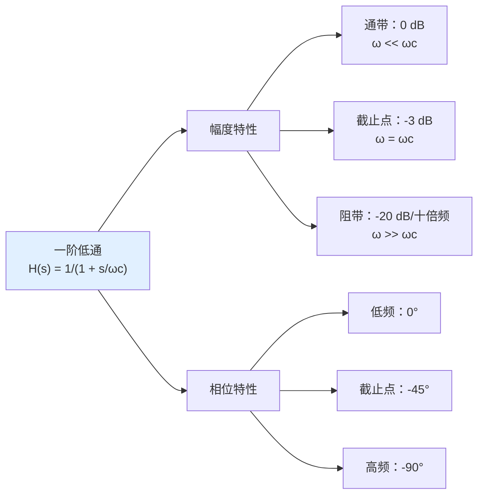
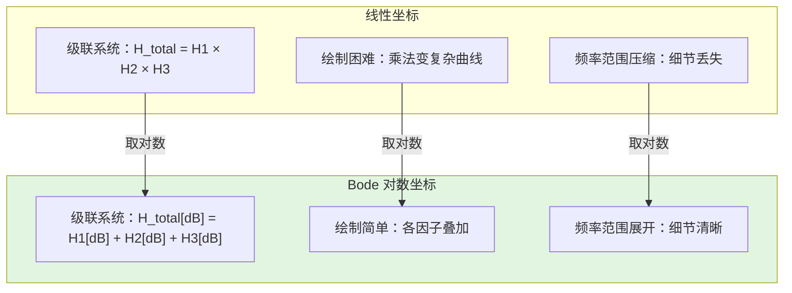

# 009-频率响应与 Bode 图

> [!abstract] 本章定位
> **前置知识**：[[006-傅里叶变换详解]]、[[007-拉普拉斯变换与系统函数]]、[[008-极点零点与系统稳定性]]。
>
> **本章回答**：系统对正弦输入如何改变幅值和相位？怎样由零极点快速画出 Bode 图？带宽和稳定裕度怎样连接到工程设计？
>
> **本章边界**：本章讨论连续系统的正弦稳态响应；采样造成的频谱周期化与混叠留到下一章。
>
> **下一步**：进入 [[010-采样、混叠与重建]]，从连续时间过渡到离散时间。

---

## 1. 从正弦测试理解频率响应

想象你正在调试一个音频放大器：
- 低音（20 Hz）被衰减了 → 听感发闷
- 高音（15 kHz）被放大了 → 刺耳尖锐
- 某些频率产生了 180° 相移 → 正反馈自激振荡

**频率响应就是系统的"频率指纹"**。它完整描述了系统如何对待不同频率的正弦输入。对嵌入式工程师而言，这是理解滤波器、振荡器、反馈控制和电机驱动器的核心工具。



> **工程直觉**：频率响应是 LTI 系统的"完全表征"——只要知道 $H(j\omega)$，你就知道了系统对**任何**信号（可分解为正弦波之和）的响应。这是傅里叶分析最强大的工程应用之一。

> **与后续知识的关联**：[[14-FOC-电机控制/00-README|14-FOC-电机控制]] 中的电流环 PI 控制器设计，依赖频率响应确定带宽；[[15-双控（控制理论与控制工程）/00-README|15-双控（控制理论与控制工程）]] 中的稳定性分析，直接基于开环频率响应的相位裕度和增益裕度。

---

## 2. 频率响应的物理意义

### 2.1 从正弦输入到正弦输出

LTI 系统有一个神奇的性质：**正弦输入产生同频率正弦输出**，只是幅度和相位可能改变。

若输入为：
$$x(t) = A \cos(\omega t + \phi)$$

则稳态输出为：
$$y(t) = A \cdot |H(j\omega)| \cos\bigl(\omega t + \phi + \angle H(j\omega)\bigr)$$

其中：
- $|H(j\omega)|$ = **幅度响应**（增益）：输出幅度与输入幅度之比
- $\angle H(j\omega)$ = **相位响应**（相移）：输出相位与输入相位之差

> **类比理解**：频率响应就像一个"调音台"——每个频率通道有自己的音量旋钮（幅度响应）和相位旋钮（相位响应）。LTI 系统的调音台设置是固定的，非线性系统则会随音量大小变化。

### 2.2 从传递函数到频率响应

若系统冲激响应的双边拉普拉斯 ROC 包含虚轴，令 $s = j\omega$（即复频率 $s$ 沿虚轴取值），即得频率响应：

$$H(j\omega) = H(s)\big|_{s=j\omega}$$

这有一个深刻的几何意义：频率响应就是**传递函数在虚轴上的取值**。



> **工程直觉**：$s = j\omega$ 的物理含义是——我们只关心**纯振荡、无衰减/增长**的稳态响应。$s = \sigma + j\omega$ 中的 $\sigma$ 描述瞬态衰减/增长，而 $j\omega$ 描述永恒的振荡。

![[Assets/signals_systems/15_pole_zero_geometry.png|1500]]

> s平面上的零极点几何法：每个零点"推"增益、每个极点"拉"增益。当测试点沿虚轴移动时，零极点向量的长度之比决定幅度响应，角度之和决定相位响应。

> **与后续知识的关联**：[[007-拉普拉斯变换与系统函数]] 中 $H(s)$ 的零极点分析，与频率响应通过 $s=j\omega$ 完美衔接。在 [[008-极点零点与系统稳定性]] 中，你会看到极点位置如何决定频率响应的形状。

---

## 3. 一阶系统的频率响应

### 3.1 RC 低通滤波器：经典的一阶系统

一阶 RC 低通滤波器的传递函数为：

$$H(s) = \frac{1}{1 + sRC} = \frac{1}{1 + \frac{s}{\omega_c}}$$

其中 **截止频率**（角频率）：
$$\omega_c = \frac{1}{RC} \quad \text{[rad/s]}$$

对应的频率响应：
$$H(j\omega) = \frac{1}{1 + j\frac{\omega}{\omega_c}}$$

### 3.2 幅度响应

$$|H(j\omega)| = \frac{1}{\sqrt{1 + \left(\frac{\omega}{\omega_c}\right)^2}}$$

| 频率 | 幅度响应 | 分贝值 | 物理意义 |
|------|----------|--------|----------|
| $\omega \ll \omega_c$ | $\approx 1$ | $0$ dB | 信号无衰减通过（"通带"） |
| $\omega = \omega_c$ | $= \frac{1}{\sqrt{2}} \approx 0.707$ | $-3$ dB | **半功率点**：功率衰减一半 |
| $\omega \gg \omega_c$ | $\approx \frac{\omega_c}{\omega}$ | 以 $-20$ dB/十倍频衰减 | 高频被抑制（"阻带"） |

### 3.3 相位响应

$$\angle H(j\omega) = -\arctan\left(\frac{\omega}{\omega_c}\right)$$

| 频率 | 相位响应 | 物理意义 |
|------|----------|----------|
| $\omega \ll \omega_c$ | $\approx 0°$ | 低频无相位延迟 |
| $\omega = \omega_c$ | $= -45°$ | 截止频率处相位恰好滞后 45° |
| $\omega \gg \omega_c$ | $\approx -90°$ | 高频相位滞后趋近 90° |
| $\omega = 0.1\omega_c$ | $\approx -5.7°$ | 工程近似：可忽略 |
| $\omega = 10\omega_c$ | $\approx -84.3°$ | 工程近似：接近 90° |

![[Assets/signals_systems/05_first_order_bode.png|1500]]

> 一阶RC低通Bode图：幅度曲线以-20 dB/十倍频滚降，在截止频率处精确值为-3 dB（渐近线交点）。相位从0°平滑过渡到-90°，在ωc处恰好为-45°。

### 3.4 一阶系统的特征总结



> **工程直觉**：$-3$ dB 点称为"半功率点"是因为功率正比于幅度平方。$20\log_{10}(0.707) \approx -3$ dB，而 $10\log_{10}(0.5) = -3$ dB。记住：**幅度用 20 log，功率用 10 log**。

> **与后续知识的关联**：[[14-FOC-电机控制/00-README|14-FOC-电机控制]] 中电流采样滤波器通常是一阶 RC 或数字等效一阶 IIR，其带宽设计直接取决于这里的截止频率概念。

---

## 4. 二阶系统的频率响应

### 4.1 标准二阶系统传递函数

典型二阶系统（如 RLC 串联谐振电路）：

$$H(s) = \frac{\omega_n^2}{s^2 + 2\zeta\omega_n s + \omega_n^2}$$

频率响应：
$$H(j\omega) = \frac{1}{1 - \left(\frac{\omega}{\omega_n}\right)^2 + j\cdot 2\zeta\frac{\omega}{\omega_n}}$$

### 4.2 幅度响应与谐振现象

$$|H(j\omega)| = \frac{1}{\sqrt{\left[1 - \left(\frac{\omega}{\omega_n}\right)^2\right]^2 + \left(2\zeta\frac{\omega}{\omega_n}\right)^2}}$$

二阶系统的核心特性是**谐振**（Resonance），其表现取决于阻尼比 $\zeta$：

| 阻尼比 | 幅度响应特征 | 物理意义 |
|--------|-------------|----------|
| $\zeta > \frac{1}{\sqrt{2}} \approx 0.707$ | 无谐振峰，单调下降 | 过阻尼或临界阻尼偏上，无频率选择性 |
| $\zeta = \frac{1}{\sqrt{2}} \approx 0.707$ | **最大平坦响应**（Butterworth 条件） | 通带最平坦，无谐振峰，是滤波器设计的最优折中 |
| $0 < \zeta < 0.707$ | 存在谐振峰，$\omega_r < \omega_n$ | 欠阻尼，系统有频率选择性 |
| $\zeta \to 0$ | 谐振峰趋于无穷大 | 无阻尼，理论上共振幅值无限 |

**谐振频率**（存在峰值时）：
$$\omega_r = \omega_n \sqrt{1 - 2\zeta^2} \quad \text{（仅当 } \zeta < \frac{1}{\sqrt{2}} \text{）}$$

![[Assets/signals_systems/06_second_order_freqresp.png|1500]]

> 不同阻尼比ζ下的二阶系统频率响应：ζ=0.707时响应最平坦（Butterworth条件），ζ<0.3时出现明显谐振峰，ζ>1时无谐振且响应缓慢。这直接决定了滤波器和振荡器的频率特性。

### 4.3 相位响应

$$\angle H(j\omega) = -\arctan\left(\frac{2\zeta\frac{\omega}{\omega_n}}{1 - \left(\frac{\omega}{\omega_n}\right)^2}\right)$$

| 频率 | 相位响应 |
|------|----------|
| $\omega \ll \omega_n$ | $\approx 0°$ |
| $\omega = \omega_n$ | $= -90°$（无论 $\zeta$ 为何值） |
| $\omega \gg \omega_n$ | $\approx -180°$ |

> **工程直觉**：二阶系统的 $-90°$ 相移点**固定**在 $\omega_n$（与阻尼比无关），这是工程上确定自然频率的常用方法。而一阶系统的 $-45°$ 点固定在 $\omega_c$。

> **与后续知识的关联**：[[02-Analog-Electronics/03-滤波器设计/001-滤波器类型|滤波器设计]] 中二阶 Butterworth 低通对应 $\zeta=1/\sqrt{2}$ 的最大平坦条件；二阶阶跃响应的归一化形状主要由 $\zeta$ 决定，而实际时间尺度还取决于 $\omega_n$。

### 4.4 品质因数 Q

**品质因数**（Quality Factor）是描述二阶系统频率选择性的参数：

$$Q = \frac{1}{2\zeta}$$

| Q 值 | 阻尼比 | 应用场景 |
|------|--------|----------|
| $Q < 0.5$ ($\zeta > 1$) | 过阻尼 | 无谐振，一般滤波 |
| $Q = 0.5$ ($\zeta = 1$) | 临界阻尼 | 最快无超调响应 |
| $Q = \frac{1}{\sqrt{2}} \approx 0.707$ ($\zeta = 0.707$) | 最大平坦 | Butterworth 滤波器 |
| $Q = 1$ ($\zeta = 0.5$) | 欠阻尼 | 适度的频率选择性 |
| $Q \gg 1$ ($\zeta \ll 1$) | 轻阻尼 | 高 Q 振荡器、晶体滤波器 |

**带宽与 Q 的关系**（对于谐振电路）：
$$BW = \frac{\omega_n}{Q} = 2\zeta\omega_n \quad \text{[rad/s]}$$

或
$$BW = \frac{f_n}{Q} \quad \text{[Hz]}$$

> **工程直觉**：Q 就像谐振电路的"锐度"——高 Q 意味着谐振峰很窄很尖（频率选择性好），低 Q 意味着峰很宽很钝。收音机调谐回路需要高 Q 来区分邻近电台，而音频均衡器需要低 Q 来平滑调整频响。

---

## 5. Bode 图：为什么使用对数坐标

### 5.1 为什么用对数坐标？

直接绘制 $|H(j\omega)|$ 与 $\omega$ 的关系会遇到一个大问题：
- 频率范围可能跨越 $10^6$ 倍（从 1 Hz 到 1 MHz）
- 幅度范围可能从 1 到 $10^{-6}$，压缩了细节

**Bode 图**采用三个巧妙变换：
1. **横轴**：$\log_{10}(\omega)$——压缩大频率范围
2. **幅度纵轴**：$20\log_{10}|H(j\omega)|$（分贝 dB）——把乘除变加减
3. **相位纵轴**：线性角度（度或弧度）

> **类比理解**：Bode 图就像把一张世界地图的墨卡托投影——它扭曲了距离比例，但让导航计算变得简单。在对数坐标上，级联系统的总响应就是各子系统响应的**简单相加**，而不是复杂的乘法。

### 5.2 Bode 图的核心优势



**核心优势总结**：
- **级联系统 = 曲线叠加**：多个系统级联时，Bode 图只需把各子系统的幅度/相位曲线相加
- **渐近线近似**：每个因子有简单的直线渐近线，手绘草图就能分析
- **误差可控**：渐近线近似的最大误差已知（如 $-3$ dB 在截止点）
- **补偿器设计直观**：在 Bode 图上"加"一个补偿器（如超前/滞后），就是调整某些频段的增益和相位

> **与后续知识的关联**：[[15-双控（控制理论与控制工程）/00-README|15-双控（控制理论与控制工程）]] 中的**环路整形**（Loop Shaping）直接在 Bode 图上操作：工程师通过调整增益、添加极点/零点来塑造开环频率响应，以满足稳定性与性能指标。

---

## 6. Bode 图绘制规则：基本因子

任何有理传递函数都可分解为以下四种基本因子的乘积。掌握它们的 Bode 图，就能绘制任意系统的 Bode 图。

### 6.1 常数增益因子 $K$

$$H(j\omega) = K$$

| 特性 | 表达式 |
|------|--------|
| 幅度 | $20\log_{10}\vertK\vert$ dB（水平直线） |
| 相位 | $0°$（若 $K>0$）或 $180°$（若 $K<0$） |

> **注意**：$K < 0$ 时，虽然幅度仍是正值，但相位贡献 $180°$。这在负反馈系统分析中至关重要。

### 6.2 积分/微分因子 $(j\omega)^{\pm 1}$

**积分器** $H(j\omega) = \frac{1}{j\omega}$：

| 特性 | 表达式 |
|------|--------|
| 幅度 | $-20\log_{10}\omega$ dB（斜率 $-20$ dB/十倍频的直线） |
| 相位 | 恒为 $-90°$ |

**微分器** $H(j\omega) = j\omega$：

| 特性 | 表达式 |
|------|--------|
| 幅度 | $+20\log_{10}\omega$ dB（斜率 $+20$ dB/十倍频的直线） |
| 相位 | 恒为 $+90°$ |

> **工程直觉**：每个积分器（$1/s$）贡献 $-20$ dB/十倍频 的斜率和 $-90°$ 的相位。系统型别（Type I, Type II 等）就是指积分器的个数，直接影响稳态误差和相位裕度。

### 6.3 一阶因子 $(1 + j\frac{\omega}{\omega_c})^{\pm 1}$

**一阶极点** $H(j\omega) = \frac{1}{1 + j\frac{\omega}{\omega_c}}$：

| 频率范围 | 幅度渐近线 | 相位 |
|----------|------------|------|
| $\omega \ll \omega_c$ | $0$ dB（水平） | $0°$ |
| $\omega \gg \omega_c$ | $-20$ dB/十倍频（斜线） | $-90°$ |
| $\omega = \omega_c$ | 实际值 $-3$ dB（渐近线交点） | $-45°$ |

**关键误差**：在 $\omega = \omega_c$ 处，渐近线预测 $0$ dB，实际为 $-3$ dB；在 $\omega = 0.5\omega_c$ 和 $\omega = 2\omega_c$ 处，误差约 $-1$ dB。

**一阶零点** $H(j\omega) = 1 + j\frac{\omega}{\omega_c}$：与极点相反，斜率 $+20$ dB/十倍频，相位 $+90°$。

### 6.4 二阶因子 $\left[1 + 2j\zeta\frac{\omega}{\omega_n} + (j\frac{\omega}{\omega_n})^2\right]^{\pm 1}$

**二阶极点**（标准形式）：

| 频率范围 | 幅度渐近线 | 相位 |
|----------|------------|------|
| $\omega \ll \omega_n$ | $0$ dB（水平） | $0°$ |
| $\omega \gg \omega_n$ | $-40$ dB/十倍频（斜线） | $-180°$ |
| $\omega = \omega_n$ | 实际值取决于 $\zeta$（见下） | $-90°$ |

**在 $\omega = \omega_n$ 处的实际幅度**：
$$|H(j\omega_n)| = \frac{1}{2\zeta} = Q$$

用 dB 表示：
$$|H(j\omega_n)|_{dB} = -20\log_{10}(2\zeta) = 20\log_{10}(Q)$$

| 阻尼比 $\zeta$ | $\omega=\omega_n$ 处幅度 | dB 值 | 渐近线误差 |
|----------------|----------|-------|------------|
| 0.5 | 1.0 | 0 dB | 无误差 |
| 0.707 | 0.707 | -3 dB | 约 -3 dB |
| 0.3 | 1.67 | +4.4 dB | +4.4 dB |
| 0.1 | 5.0 | +14 dB | +14 dB |
| 0.01 | 50 | +34 dB | +34 dB |

> **重要警告**：二阶因子的渐近线误差**非常大**且**强烈依赖于 $\zeta$**。对于 $\zeta < 0.3$ 的欠阻尼系统，渐近线近似完全失效，必须计算实际曲线。这在谐振器、晶体滤波器和高 Q 机械系统中尤为常见。

> **与后续知识的关联**：[[02-Analog-Electronics/03-滤波器设计/001-滤波器类型|滤波器设计]] 中，滤波器阶数越高，阻带衰减越陡峭（每增加一阶，斜率增加 $\pm 20$ dB/十倍频）。一个四阶 Butterworth 低通滤波器在截止频率后的斜率为 $-80$ dB/十倍频。

---

## 7. Bode 图绘制步骤

### 7.1 步骤 1：标准化分解

将传递函数写成标准 Bode 形式：

$$H(s) = K \cdot \frac{1}{s^N} \cdot \prod_i \left(1 + \frac{s}{\omega_{zi}}\right) \cdot \prod_k \left[1 + 2\zeta_k\frac{s}{\omega_{nk}} + \left(\frac{s}{\omega_{nk}}\right)^2\right]^{-1}$$

其中每个因子都是**常数项为 1** 的标准形式。

### 7.2 步骤 2：确定各转角频率

- 一阶零点/极点：转角频率 = $\omega_c$
- 二阶零点/极点：转角频率 = $\omega_n$
- 在 $\omega$ 轴上标出所有转角频率（按从小到大排列）

### 7.3 步骤 3：从低频开始叠加

1. **低频起点**：$\omega \to 0$ 时，所有 $(1 + \dots)$ 因子 $\approx 1$，只保留 $K/s^N$ 部分
2. **计算起始斜率**：每有一个积分器 $1/s$，斜率 $-20$ dB/十倍频；每有一个微分器 $s$，斜率 $+20$ dB/十倍频
3. **逐个穿越转角频率**：每遇到一个极点，斜率减 $20$ dB/十倍频；每遇到一个零点，斜率加 $20$ dB/十倍频；二阶因子变化 $\pm 40$ dB/十倍频

### 7.4 步骤 4：相位叠加

相位曲线的绘制与幅度类似，但更为平滑：
- 每个极点贡献 $0° \to -90°$ 的过渡（中心在 $\omega_c$）
- 每个零点贡献 $0° \to +90°$ 的过渡
- 每个二阶极点贡献 $0° \to -180°$ 的过渡（中心在 $\omega_n$）
- 过渡带大约从 $0.1\omega_c$ 到 $10\omega_c$（一阶）或 $0.1\omega_n$ 到 $10\omega_n$（二阶）

### 7.5 完整示例

**例**：绘制 $H(s) = \frac{100(s+2)}{s(s+10)(s+50)}$ 的 Bode 图。

**步骤 1：标准化**

$$H(s) = \frac{100 \cdot 2 \cdot (1 + \frac{s}{2})}{s \cdot 10 \cdot (1 + \frac{s}{10}) \cdot 50 \cdot (1 + \frac{s}{50})} = \frac{0.4(1 + \frac{s}{2})}{s(1 + \frac{s}{10})(1 + \frac{s}{50})}$$

- 增益：$K = 0.4$，即 $20\log_{10}(0.4) \approx -7.96$ dB
- 积分器：1 个（$1/s$）
- 一阶零点：$\omega_z = 2$ rad/s
- 一阶极点：$\omega_{p1} = 10$ rad/s, $\omega_{p2} = 50$ rad/s

**步骤 2：转角频率排序**

$\omega_z = 2 < \omega_{p1} = 10 < \omega_{p2} = 50$

**步骤 3：幅度渐近线**

| 频率区间 | 活跃因子 | 斜率 | 说明 |
|----------|----------|------|------|
| $\omega < 2$ | $0.4/s$ | $-20$ dB/十倍频 | 起始斜率 |
| $2 < \omega < 10$ | 零点加入 | $0$ dB/十倍频 | $-20 + 20 = 0$ |
| $10 < \omega < 50$ | 第一极点加入 | $-20$ dB/十倍频 | $0 - 20 = -20$ |
| $\omega > 50$ | 第二极点加入 | $-40$ dB/十倍频 | $-20 - 20 = -40$ |

**低频参考点**：在 $\omega = 1$ rad/s 处，$|H(j1)| \approx 0.4$，即 $-7.96$ dB。

**步骤 4：相位**

- $1/s$：恒为 $-90°$
- 零点在 2：$0° \to +90°$（过渡带 0.2 ~ 20）
- 极点在 10：$0° \to -90°$（过渡带 1 ~ 100）
- 极点在 50：$0° \to -90°$（过渡带 5 ~ 500）

总相位 = $-90°$ + （零点相位） + （极点1 相位） + （极点2 相位）

- 低频（$\omega < 0.2$）：$\approx -90°$
- 中频（$2 < \omega < 5$）：约 $-90° + 45° - 45° - 0° = -90°$
- 高频（$\omega > 500$）：$-90° + 90° - 90° - 90° = -180°$

> **工程直觉**：在 $\omega = 2$ 和 $\omega = 10$ 之间，零点刚好"抵消"了第一个极点的相位影响，使相位暂时回到约 $-90°$。这种"零极对消"是补偿器设计的核心技巧——在 [[15-双控（控制理论与控制工程）/00-README|15-双控（控制理论与控制工程）]] 的 PID/超前滞后补偿器中会反复使用。

![[Assets/signals_systems/14_pole_zero_cancellation.png|1500]]

> 零极点对消的隐藏危险：虽然外部输入输出看起来稳定，但内部状态可能由于隐藏的不稳定极点而持续发散。这就是为什么现代控制理论强调"可控性"与"可观性"的原因。

---

## 8. 截止频率、带宽与滚降特性

### 8.1 截止频率的定义

**截止频率** $\omega_c$ 是幅度响应下降到通带最大值（通常为 $0$ dB）的 $\frac{1}{\sqrt{2}}$（即 $-3$ dB）时的频率。

对于低通滤波器：
- 通带：$\omega < \omega_c$（幅度 $\approx 1$ 或 $0$ dB）
- 阻带：$\omega > \omega_c$（幅度衰减）
- 过渡带：$\omega_c$ 附近

对于高通滤波器，定义相反：通带在 $\omega > \omega_c$。

### 8.2 带宽（Bandwidth）

**带宽**定义了系统能有效通过的频率范围：

| 滤波器类型 | 带宽定义 |
|-----------|----------|
| **低通**（LPF） | $BW = \omega_c$（从 0 到 $-3$ dB 点） |
| **高通**（HPF） | 从 $\omega_c$ 到 $\infty$ |
| **带通**（BPF） | $BW = \omega_{c2} - \omega_{c1}$（上下 $-3$ dB 点之差） |
| **带阻**（BEF） | 阻带宽度（同上） |

> **工程直觉**：带宽不是"能力上限"，而是"有效范围"。一个 1 MHz 带宽的放大器可以放大 2 MHz 的信号，但增益会大幅下降。这里的 −3 dB 带宽是系统增益指标，不是信号频谱支持的上限。一阶低通在截止频率以上仍有输出，不能据其 −3 dB 带宽直接取两倍采样率。

> [!warning] 采样条件中的“带宽”
> 对严格带限于 $|f|\le B$ 的一般基带信号，采用 $f_s>2B$ 可避开带边退化；实际信号须根据带外干扰幅度、抗混叠滤波器的过渡带和阻带衰减、允许混叠误差选择 $f_s$。带通信号欠采样还须单独分析频带位置与谱副本重叠，不能仅凭带宽数字判断。见 [[010-采样、混叠与重建]]。

### 8.3 滚降速率（Roll-off Rate）

滚降速率描述阻带衰减的快慢：

| 系统阶数 | 一阶低通 | 二阶低通 | n 阶低通 |
|----------|----------|----------|----------|
| 渐近斜率 | $-20$ dB/十倍频 | $-40$ dB/十倍频 | $-20n$ dB/十倍频 |
| 每倍频程 | $-6$ dB/倍频程 | $-12$ dB/倍频程 | $-6n$ dB/倍频程 |

> **注意**：$20$ dB/十倍频 $\approx 6$ dB/倍频程（因为 $\log_{10}(2) \approx 0.301$，$20 \times 0.301 \approx 6.02$）。这两个单位经常混用，不要混淆。

> **与后续知识的关联**：[[02-Analog-Electronics/03-滤波器设计/001-滤波器类型|滤波器设计]] 中，阶数越高，过渡带越窄，但代价是相位非线性增加、电路复杂度增加。在 [[14-FOC-电机控制/00-README|14-FOC-电机控制]] 中，电流环的带宽决定了电流跟踪的速度，但过高会引入噪声和不稳定。

---

## 9. 相位裕度与增益裕度（控制方向拓展）

### 9.1 为什么需要裕度？

在负反馈系统中，环路增益 $L(s) = H(s)G(s)$ 决定稳定性。Bode 图提供了两个直观指标：

先区分对象传递函数、环路传递函数 $L(s)=C(s)P(s)$ 和单位负反馈闭环传递函数 $T(s)=L(s)/(1+L(s))$。闭环特征方程是 $1+L(s)=0$，开环极点不能直接当闭环极点。

> [!warning] 裕度判读的边界
> 正相位裕度或正增益裕度不能单独作为一般系统稳定的充分条件。常见简单环路的经验读法需结合开环不稳定极点数、穿越次数与相位走向；复杂情况用 Nyquist 判据或闭环极点核验。裕度与超调的关系也只是特定模型下的近似。

参照：[MathWorks 正相位裕度但闭环不稳定的示例](https://www.mathworks.com/help/control/ref/dynamicsystem.allmargin.html)。


### 9.2 相位裕度（Phase Margin, PM）

**定义**：在增益穿越频率 $\omega_{gc}$（$|L(j\omega_{gc})| = 1$ 即 $0$ dB）处，相位与 $-180°$ 的"距离"：

$$PM = 180° + \angle L(j\omega_{gc})$$

| 相位裕度 | 系统特性 | 工程建议 |
|----------|----------|----------|
| PM < 30° | 严重欠阻尼，大超调 | 避免 |
| 30° < PM < 60° | 中等阻尼，适度超调 | 一般控制可用 |
| PM > 60° | 良好阻尼，小超调 | 推荐 |
| PM > 90° | 不能仅据此断言过阻尼 | 结合闭环极点与阶跃响应检查 |

> **工程直觉**：相位裕度是"距离振荡的边缘有多远"。当环路相移达到 $-180°$ 时，负反馈变成正反馈。PM 就是告诉你"在增益还为 1 的时候，相位离 $-180°$ 还有多远"。

### 9.3 增益裕度（Gain Margin, GM）

**定义**：在相位穿越频率 $\omega_{pc}$（$\angle L(j\omega_{pc}) = -180°$）处，增益低于 $0$ dB 的量：

$$GM = -|L(j\omega_{pc})|_{dB} = -20\log_{10}|L(j\omega_{pc})|$$

或在线性尺度上：
$$GM = \frac{1}{|L(j\omega_{pc})|}$$

| 增益裕度 | 系统特性 | 工程建议 |
|----------|----------|----------|
| GM < 6 dB | 增益变化敏感，可能不稳定 | 避免 |
| 6 dB < GM < 12 dB | 适度稳定 | 一般可用 |
| GM > 12 dB | 鲁棒稳定 | 推荐 |

> **与后续知识的关联**：这是 [[15-双控（控制理论与控制工程）/00-README|15-双控（控制理论与控制工程）]] 的核心内容。在 FOC 电机控制中，电流环的 PM 通常设计为 60°~90°，速度环为 45°~60°。增益裕度和相位裕度共同定义了系统的**鲁棒性**——对参数变化、负载扰动的容忍能力。

![[Assets/signals_systems/17_stability_margins.png|1500]]

> Bode图上的增益裕度（GM）和相位裕度（PM）：在增益穿越频率处读取相位，在相位穿越频率处读取增益。这两个裕度是判断闭环稳定性的直观指标。

---

## 10. 频率响应与系统辨识

### 10.1 从测量到模型

频率响应不仅是分析工具，更是**实验建模**的强大手段：


### 10.2 频率响应测量方法

**方法 1：正弦扫频法（Sine Sweep）**
- 输入：逐步改变频率的正弦波
- 输出：测量每个频率的稳态幅度比和相位差
- 优点：精度高、信噪比好
- 缺点：测量时间长

**方法 2：FFT 法（宽带激励）**
- 输入：白噪声、Chirp 信号、或伪随机二进制序列（PRBS）
- 输出：对输入/输出做 FFT，$H(j\omega) = \frac{Y(j\omega)}{X(j\omega)}$
- 优点：一次测量全频段
- 缺点：需要信号处理、非线性影响

**方法 3：网络分析仪**
- 专用仪器自动扫频、测量、绘制 Bode 图
- 是射频/模拟电路设计的标准工具

### 10.3 从实测数据拟合模型

通过实测的 $|H(j\omega)|$ 和 $\angle H(j\omega)$，可以逆向确定：
- 低频增益 → $K$
- 斜率变化点 → 转角频率
- 斜率变化量 → 极点/零点的阶数
- 谐振峰 → 二阶系统的 $\omega_n$ 和 $\zeta$

> **工程直觉**：许多实际系统（电机、机械臂、电源转换器）的精确数学模型难以从第一性原理推导，但通过频率响应测量，你可以"问"系统本身——"你在这个频率如何响应？"——然后让它告诉你它的模型。

> **与后续知识的关联**：[[14-FOC-电机控制/00-README|14-FOC-电机控制]] 中，电机参数（电感 $L$、电阻 $R$、反电势常数 $K_e$）可以通过注入不同频率的电流并测量电压响应来辨识。这称为"频率响应辨识"或"阻抗谱测量"。

---

## 11. 实际系统的频率响应测量

### 11.1 测量注意事项

**非线性问题**：
- 实际系统总有非线性（饱和、死区、磁滞）
- 输入幅度过大：进入饱和，增益压缩
- 输入幅度过小：被噪声淹没
- **解决**：选择适当的输入幅度，在"线性区"内测量

**频率范围选择**：
- 低频下限：由测量时间决定（如 0.1 Hz 需要 10 秒以上周期）
- 高频上限：由系统带宽和噪声决定
- 一般覆盖从 $0.1\omega_c$ 到 $10\omega_c$ 的范围

**稳态等待**：
- 必须等待瞬态响应衰减后才能测量
- 等待时间 $\approx 5\tau$（一阶系统）或 $\approx 5/\zeta\omega_n$（二阶系统）

### 11.2 嵌入式系统中的实现

在嵌入式 MCU 上实现频率响应测量：

```python
# 伪代码：嵌入式频率响应测量
import numpy as np

frequencies = np.logspace(1, 4, 50)  # 10 Hz ~ 10 kHz，50 个点
results = []

for f in frequencies:
    # 1. 生成并输出正弦波
    amplitude_in = 1.0
    generate_sine_wave(f, amplitude_in)

    # 2. 等待稳态（至少 5 个时间常数）
    wait_for_settling(5 * tau)

    # 3. ADC 采集多个周期
    samples = adc_collect(duration=10/f, fs=100000)

    # 4. 提取输出幅度和相位
    amplitude_out, phase_out = extract_amplitude_phase(samples, f)

    # 5. 计算频率响应
    gain_db = 20 * np.log10(amplitude_out / amplitude_in)
    phase_deg = phase_out - phase_in  # 相对于输入的相位差

    results.append((f, gain_db, phase_deg))

# 6. 绘制 Bode 图
plot_bode(results)
```

> **工程直觉**：现代 MCU（如 STM32）的 ADC 和 DAC 配合 DMA，可以实现自动化的频率响应测量。这对于电机参数在线辨识、自适应控制、故障诊断非常有价值。

---

## 12. 工程应用

### 12.1 滤波器设计中的频率响应

频率响应是滤波器设计的核心指标：

| 滤波器类型 | 设计目标 | 关键参数 |
|-----------|----------|----------|
| **低通** | 通过低频，抑制高频 | 截止频率、滚降速率、通带波纹 |
| **高通** | 通过高频，抑制低频 | 截止频率、低频衰减 |
| **带通** | 通过特定频带 | 中心频率、带宽、Q 值 |
| **陷波**（Notch） | 消除特定频率（如 50 Hz 工频） | 陷波频率、陷波深度、Q 值 |

> **与后续知识的关联**：[[02-Analog-Electronics/03-滤波器设计/001-滤波器类型|滤波器设计]] 详细讨论 Butterworth、Chebyshev、Bessel 和 Elliptic 滤波器的频率响应设计，以及如何在 MCU 中实现数字滤波器。

### 12.2 控制系统中的频率响应

| 应用 | 频率响应的作用 | 关键概念 |
|------|--------------|----------|
| **稳定性分析** | 通过 Bode 图判断闭环稳定性 | 增益裕度、相位裕度、Nyquist 判据 |
| **控制器设计** | 环路整形：调整增益和相位 | 超前/滞后补偿器、PID 参数整定 |
| **性能评估** | 阶跃响应与频率响应的关系 | 带宽、谐振峰、超调量 |
| **鲁棒性分析** | 参数变化对稳定性的影响 | 灵敏度函数、补灵敏度函数 |

> **与后续知识的关联**：[[15-双控（控制理论与控制工程）/00-README|15-双控（控制理论与控制工程）]] 中，频率响应法（Bode/Nyquist）与根轨迹法、状态空间法并列为三大控制分析方法。对于 SISO 系统，Bode 图是最直观的设计工具。

### 12.3 电机控制中的频率响应

在 FOC 电机控制中，频率响应用于以下环节：

| 环节 | 频率响应分析 | 设计要点 |
|------|-------------|----------|
| **电流采样滤波器** | 一阶或二阶低通，带宽设计 | 带宽足够高以跟踪电流，足够低以抑制开关噪声 |
| **电流环 PI** | 开环频率响应的相位裕度 | 典型带宽 1~10 kHz，PM 60°~90° |
| **速度环 PI** | 考虑电流环闭环后的速度环响应 | 典型带宽 10~100 Hz，PM 45°~60° |
| **观测器**（如 Luenberger） | 观测器极点决定估计带宽 | 观测器带宽通常 2~5 倍于控制器带宽 |
| **位置环** | 最低带宽，决定跟踪性能 | 带宽受速度环和机械谐振限制 |

> **工程直觉**：在电机控制中，"带宽"是核心设计参数。电流环带宽决定了你能多快改变电机电流（即转矩响应速度）；速度环带宽决定了系统对负载扰动的抑制速度；位置环带宽决定了跟踪精度。但带宽不是越高越好——过高的带宽会放大噪声、激发机械谐振、甚至导致不稳定。

> **与后续知识的关联**：[[14-FOC-电机控制/00-README|14-FOC-电机控制]] 中的电流环设计将详细讨论如何根据电机参数（$R$, $L$, $K_e$）计算 PI 增益，使电流环频率响应达到目标带宽和相位裕度。

### 12.4 通信与音频系统

| 应用 | 频率响应的作用 | 实例 |
|------|--------------|------|
| **均衡器**（EQ） | 调整特定频段的增益 | 音频均衡、通信信道补偿 |
| **分频器** | 将信号按频率分配给不同扬声器 | 低音→大喇叭，高音→小喇叭 |
| **调制/解调** | 频谱搬移需要明确的频率范围 | AM/FM 载波频率、边带分析 |
| **EMC/EMI** | 分析系统辐射/传导的频谱 | 滤波器抑制高频谐波 |

---

## 13. 常见错误与注意事项

### 13.1 常见错误清单

| 错误 | 描述 | 正确做法 |
|------|------|----------|
| **混淆角频率与频率** | $\omega$ [rad/s] vs $f$ [Hz] | $\omega = 2\pi f$，Bode 图标注时需明确单位 |
| **20 dB vs 10 dB 混淆** | 幅度用 $20\log_{10}$，功率用 $10\log_{10}$ | 电压/电流/幅度：20 log；功率/能量：10 log |
| **渐近线当精确值** | 二阶系统在 $\omega_n$ 处的误差可达数十 dB | 欠阻尼系统（$\zeta < 0.3$）必须计算精确曲线 |
| **忽略相位死区** | 只看幅度不看相位 | 稳定性由相位裕度决定，幅度平坦不保证稳定 |
| **单位圆与虚轴混淆** | Z 变换的稳定边界是单位圆，拉普拉斯是左半平面 | 连续系统：$Re(s) < 0$；离散系统：$\lvert z\rvert < 1$ |
| **增益穿越 ≠ 相位穿越** | 把 $\omega_{gc}$ 和 $\omega_{pc}$ 搞混 | $\omega_{gc}$：$\vertL\vert = 0$ dB；$\omega_{pc}$：$\angle L = -180°$ |
| **线性叠加对数坐标** | 两个系统级联，把幅度响应直接相加 | 幅度响应是**相乘**，但 dB 图上是**相加**（这才是 Bode 图的优点！） |
| **忽略非线性效应** | 大信号下测量，用线性模型拟合 | 确保在小信号线性区测量，或建立非线性模型 |

### 13.2 快速自检

- $\omega = 2\omega_c$ 时，一阶低通的幅度是多少 dB？
- 二阶系统的 $-90°$ 相移点在哪里？
- 为什么 $\zeta = 0.707$ 被称为"最大平坦"？
- 相位裕度 $PM = 30°$ 的系统有什么特征？
- 积分器在 Bode 图上的幅度斜率是多少？

---

## 14. 自测习题

### 14.1 基础题

**1.** 一个一阶低通滤波器，$R = 10$ k$\Omega$，$C = 0.1$ $\mu$F。计算：
- (a) 截止频率 $f_c$（Hz）
- (b) 在 $f = 2f_c$ 处的幅度响应（dB）和相位响应
- (c) 从 $f = 0.1f_c$ 到 $f = 10f_c$ 的滚降速率（dB/十倍频）

**2.** 一个二阶系统的传递函数为 $H(s) = \frac{100}{s^2 + 2s + 100}$。计算：
- (a) 自然频率 $\omega_n$ 和阻尼比 $\zeta$
- (b) 若 $\zeta < 0.707$，计算谐振频率 $\omega_r$ 和谐振峰值幅度
- (c) 在 $\omega = \omega_n$ 处的相位响应

**3.** 绘制 $H(s) = \frac{10(s+5)}{s(s+50)}$ 的 Bode 幅度渐近线：
- (a) 确定增益、积分器个数、零点和极点位置
- (b) 标出转角频率和各区间的斜率
- (c) 计算在 $\omega = 1$ rad/s 和 $\omega = 100$ rad/s 处的渐近线幅度

### 14.2 进阶题

**4.** 一个系统的实测频率响应显示：低频增益 $20$ dB，在 $100$ Hz 处斜率从 $-20$ dB/十倍频变为 $-40$ dB/十倍频，在 $1$ kHz 处变回 $-20$ dB/十倍频。推测该系统的传递函数形式。

**5.** 在负反馈系统中，开环传递函数为 $L(s) = \frac{K}{s(1+0.1s)(1+0.01s)}$。用 Bode 图分析：
- (a) 当 $K = 10$ 时，系统是否稳定？相位裕度大约是多少？
- (b) $K$ 增大到多少时系统会变得临界稳定？

**6.** 设计一个带通滤波器，要求中心频率 $f_0 = 1$ kHz，$Q = 10$。计算：
- (a) 上、下载止频率
- (b) 若用 RLC 电路实现，给定 $C = 0.1$ $\mu$F，求 $L$ 和 $R$

### 14.3 思考题

**7.** 为什么采样系统中的抗混叠滤波器通常是模拟滤波器（在 ADC 之前），而不是数字滤波器（在 ADC 之后）？这与频率响应有什么关系？

**8.** 在 FOC 电机控制中，电流环带宽通常设计为开关频率的 $1/10$ 到 $1/20$。如果开关频率是 $20$ kHz，为什么电流环带宽不能设计为 $15$ kHz？从频率响应和数字控制的角度解释。

**9.** 比较一阶系统和二阶系统的 Bode 图渐近线。为什么二阶系统在实际工程中（尤其是 $Q > 1$ 时）不能用渐近线近似？这对滤波器设计有什么启示？

---

## 15. 快速参考卡片

### 15.1 一阶系统

$$H(s) = \frac{1}{1 + s/\omega_c}$$

| 参数 | 公式 |
|------|------|
| 截止频率 | $\omega_c = 1/\tau$ |
| 幅度 @ $\omega_c$ | $-3$ dB |
| 相位 @ $\omega_c$ | $-45°$ |
| 高频斜率 | $-20$ dB/十倍频 |
| 高频相位 | $-90°$ |

### 15.2 二阶系统

$$H(s) = \frac{\omega_n^2}{s^2 + 2\zeta\omega_n s + \omega_n^2}$$

| 参数 | 公式 |
|------|------|
| 自然频率 | $\omega_n$ |
| 阻尼比 | $\zeta$ |
| 品质因数 | $Q = 1/(2\zeta)$ |
| 谐振频率 | $\omega_r = \omega_n\sqrt{1-2\zeta^2}$（当 $\zeta < 1/\sqrt{2}$） |
| 峰值幅度 | $M_r = 1/(2\zeta\sqrt{1-\zeta^2})$（当 $\zeta < 1/\sqrt{2}$） |
| 相位 @ $\omega_n$ | $-90°$ |
| 高频斜率 | $-40$ dB/十倍频 |
| 高频相位 | $-180°$ |

### 15.3 Bode 图绘制速查

| 因子 | 幅度贡献 | 相位贡献 |
|------|----------|----------|
| 常数 $K$ | $20\log_{10}\vertK\vert$ 水平线 | $0°$ 或 $180°$ |
| 积分器 $1/s$ | $-20$ dB/十倍频 过 $\omega=1$ | $-90°$ |
| 微分器 $s$ | $+20$ dB/十倍频 过 $\omega=1$ | $+90°$ |
| 一阶极点 $1/(1+s/\omega_c)$ | 低于 $\omega_c$：0 dB；高于：$-20$ dB/十倍频 | $0° \to -90°$（中心在 $\omega_c$） |
| 一阶零点 $1+s/\omega_c$ | 低于 $\omega_c$：0 dB；高于：$+20$ dB/十倍频 | $0° \to +90°$（中心在 $\omega_c$） |
| 二阶极点（标准） | 低于 $\omega_n$：0 dB；高于：$-40$ dB/十倍频 | $0° \to -180°$（中心在 $\omega_n$） |
| 二阶零点（标准） | 低于 $\omega_n$：0 dB；高于：$+40$ dB/十倍频 | $0° \to +180°$（中心在 $\omega_n$） |

---

## 16. 章节衔接

- [[001-信号、系统与LTI基础]] — 信号与系统的基础概念框架
- [[005-频域表示与傅里叶级数]] — 频域分析的基础概念
- [[007-拉普拉斯变换与系统函数]] — 从 $H(s)$ 到 $H(j\omega)$ 的数学桥梁
- [[008-极点零点与系统稳定性]] — 零极点如何决定频率响应形状
- [[02-Analog-Electronics/03-滤波器设计/001-滤波器类型|滤波器设计]] — 频率响应在滤波器设计中的直接应用
- [[14-FOC-电机控制/00-README|14-FOC-电机控制]] — 电流环、速度环的带宽设计与频率响应
- [[15-双控（控制理论与控制工程）/00-README|15-双控（控制理论与控制工程）]] — Bode 图在控制系统稳定性分析中的核心作用
- [[004-为什么需要变换域]] — 变换的共性与选择指南

---

> **学习检查清单**：
> - [ ] 我理解了频率响应的物理意义（正弦稳态响应）
> - [ ] 我能从 $H(s)$ 推导 $H(j\omega)$
> - [ ] 我能手绘一阶系统的 Bode 图（含渐近线和精确修正）
> - [ ] 我能手绘二阶系统的 Bode 图（了解阻尼比的影响）
> - [ ] 我理解相位裕度和增益裕度的概念
> - [ ] 我能通过 Bode 图分析简单反馈系统的稳定性
> - [ ] 我了解频率响应在滤波器、控制、电机驱动中的应用
> - [ ] 我完成了至少 3 道自测习题
>
> **上一章**：[[008-极点零点与系统稳定性]]
>
> **下一章**：[[010-采样、混叠与重建]]
