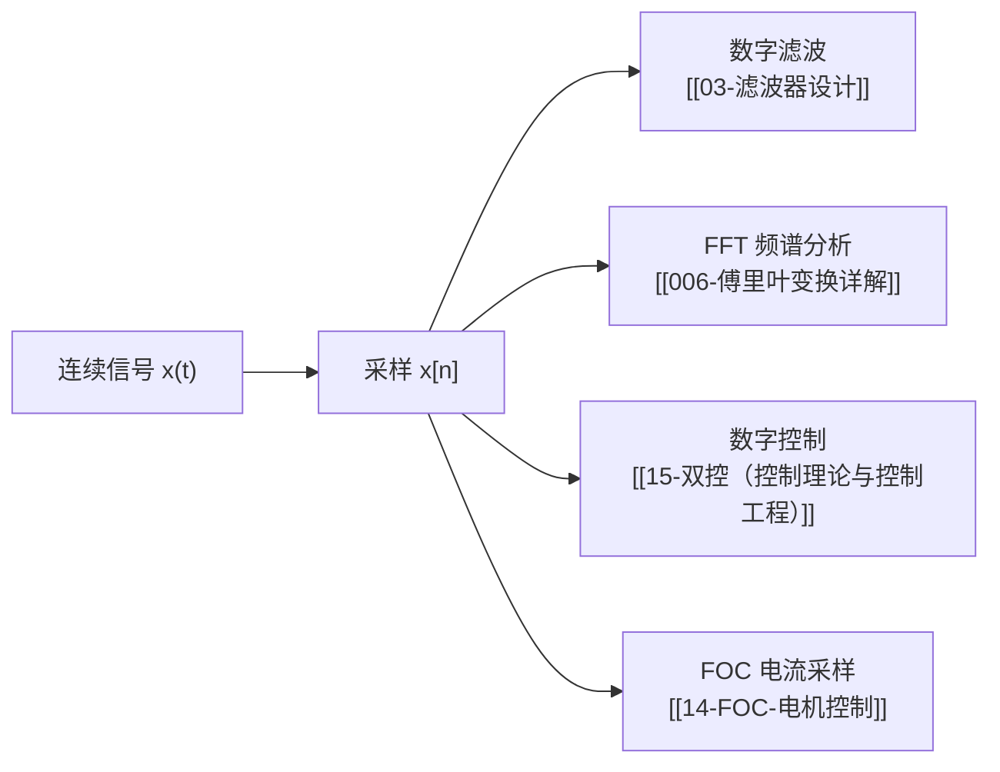
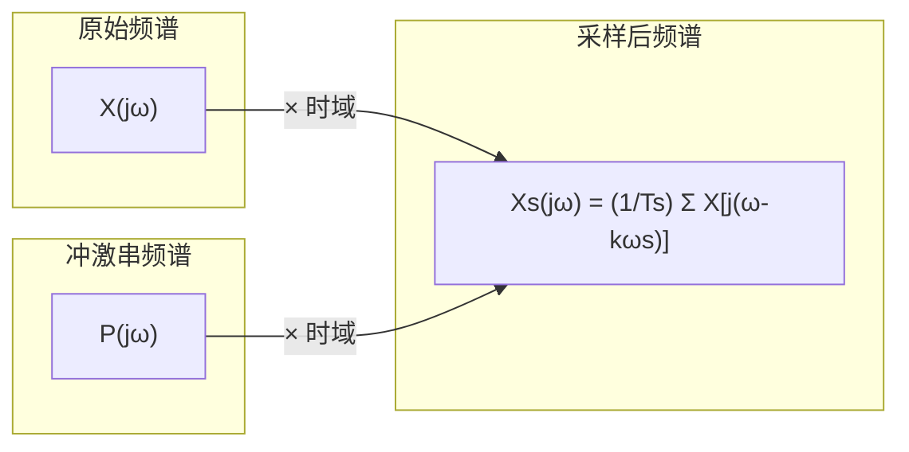
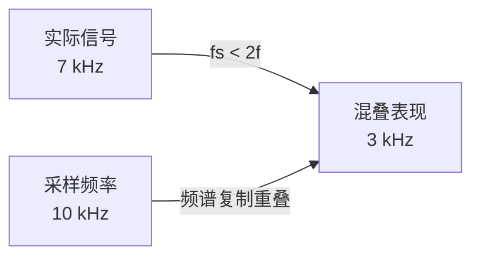
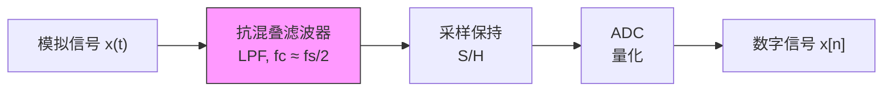
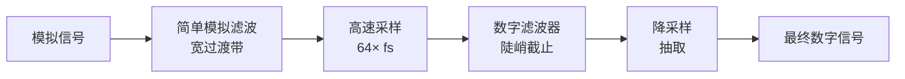
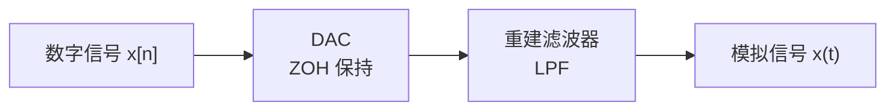
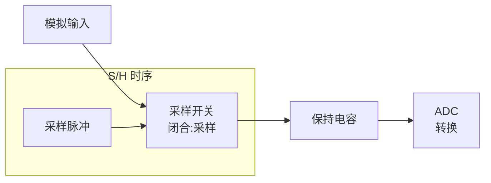
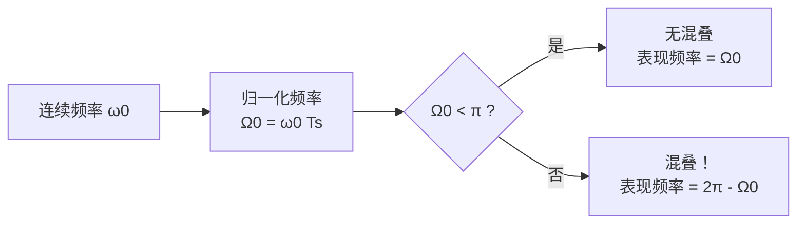
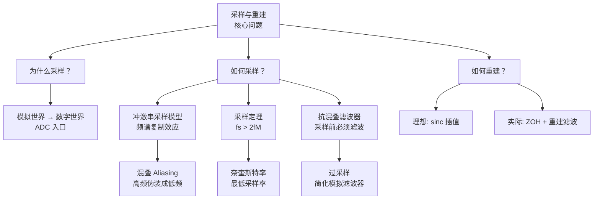

# 010-采样、混叠与重建

> [!abstract] 本章定位
> **前置知识**：[[006-傅里叶变换详解]] 中的频谱与卷积性质；理解 [[009-频率响应与Bode图]] 有助于设计抗混叠滤波器。
>
> **本章回答**：采样为什么复制频谱？奈奎斯特条件的严格含义是什么？混叠为何不可逆？实际 ADC 的采样率怎样留出滤波器过渡带？
>
> **本章边界**：本章完成连续信号到离散序列的接口，不展开离散系统函数。
>
> **下一步**：使用 [[011-Z变换与离散时间系统]] 分析采样后的差分方程和数字滤波器。

---

## 1. 为什么需要采样：从模拟世界到数字世界

### 1.1 现实世界的信号都是连续的

温度随时间变化、麦克风采集的声音、光电传感器检测的光强——这些物理量本质上是**连续时间、连续幅度**的模拟信号。但现代电子系统（MCU、DSP、FPGA）只能处理数字量：离散时间、离散幅度。

**采样的本质**：在两个维度上"切割"连续信号
- **时间维度**：每隔 $T_s$ 秒取一个样本 → **离散时间**
- **幅度维度**：用有限位数量化 → **离散幅度**（见7.2节）

```
连续信号 x(t)         采样后 x[n] = x(nT_s)         量化后 x_Q[n]
    │                        │                              │
    │   ╱╲                   │    ●                         │    ●
    │  ╱  ╲                  │       ●    ●                 │       ■    ■
    │ ╱    ╲                 │             ●                │             ■
    │╱      ╲                │    ●             ●          │    ■             ■
    └─────────── t           └─────────────── n           └─────────────── n
   时间连续                  时间离散，幅度连续             时间离散，幅度离散
```

> **工程直觉**：采样就像电影摄影机——每秒拍摄24帧静态画面，大脑将其"重建"为连续运动。如果帧率太低（比如拍直升机螺旋桨），你会看到"倒转"或"静止"的假象，这就是混叠。

### 1.2 与后续知识的关联



---

## 2. 理想采样模型：冲激串采样

### 2.1 从直观到数学

采样的最简模型：用一个**周期冲激串** $p(t)$ 与连续信号 $x(t)$ 相乘，只在离散时刻 $nT_s$ 保留信号值。

$$p(t) = \sum_{n=-\infty}^{\infty} \delta(t - nT_s)$$

采样后的信号：

$$x_s(t) = x(t) \cdot p(t) = \sum_{n=-\infty}^{\infty} x(nT_s) \delta(t - nT_s)$$

> **物理直觉**：冲激串是一个"理想开关"，在 $t = nT_s$ 瞬间闭合，提取信号在该时刻的"瞬时值"。现实中不存在理想冲激，但数学模型极其简洁，是理解频谱效应的最佳工具。

### 2.2 采样频率与采样周期

| 参数 | 符号 | 定义 | 关系 |
|------|------|------|------|
| 采样周期 | $T_s$ | 相邻样本的时间间隔 | — |
| 采样频率 | $f_s$ | 每秒采样次数 | $f_s = 1/T_s$ |
| 采样角频率 | $\omega_s$ | $\omega_s = 2\pi f_s$ | $\omega_s = 2\pi/T_s$ |
| 奈奎斯特频率 | $f_N$ | 可无失真恢复的最高频率 | $f_N = f_s/2$ |

### 2.3 采样在频域中的效应（核心推导）

这是本章**最重要的推导**，它解释了为什么采样频率有下限。

**已知**：周期冲激串 $p(t)$ 的傅里叶变换仍是冲激串（见[[006-傅里叶变换详解]]）

$$P(j\omega) = \omega_s \sum_{k=-\infty}^{\infty} \delta(\omega - k\omega_s)$$

**时域乘积 = 频域卷积**：

$$X_s(j\omega) = \frac{1}{2\pi} X(j\omega) * P(j\omega) = \frac{1}{T_s} \sum_{k=-\infty}^{\infty} X\left[j(\omega - k\omega_s)\right]$$

**关键结论**：

> **采样在频域中的效应**：将原始频谱 $X(j\omega)$ 以 $\omega_s$ 为周期**无限复制**（称为"频谱搬移"或"频谱重复"），每个复制分量幅度缩放 $1/T_s$。

![[Assets/signals_systems/12_periodic_impulse_spectrum.png|1500]]

> 周期冲激串的傅里叶变换仍是周期冲激串，这是频谱复制现象的数学根源——时域的离散化导致频域的周期化。



### 2.4 频谱复制的直观图示

假设原始信号 $x(t)$ 是**带限信号**，最高频率为 $\omega_M$（即 $|\omega| > \omega_M$ 时 $X(j\omega) = 0$）。

```
原始频谱 X(jω):                      采样后频谱 Xs(jω): 
                                      (频谱以 ωs 为周期复制)
   │                                     │     │     │
   │  ╱╲                                 │  ╱╲│  ╱╲│  ╱╲
   │ ╱  ╲                                │ ╱  ╲│ ╱  ╲│ ╱  ╲
───┼/────╲───→ ω                     ───┼/────╲/────╲/────╲───→ ω
  -ωM    ωM                          -ωs-ωM -ωM  0  ωM ωs+ωM
                                      ↑<───ωs───>↑
```

**三种情况**（这是理解采样定理的关键）：

| 条件 | 频谱关系 | 效果 | 可否恢复？ |
|------|----------|------|------------|
| $\omega_s > 2\omega_M$ | 复制频谱之间**有间隙** | 频谱不重叠 | ✅ 可以 |
| $\omega_s = 2\omega_M$ | 复制频谱**刚好相接** | 临界状态 | ⚠️ 理论上可以，实际需理想滤波器 |
| $\omega_s < 2\omega_M$ | 复制频谱**重叠** | **混叠（Aliasing）** | ❌ 不可恢复 |

![[Assets/signals_systems/01_sampling_aliasing.png|1500]]

> 上图直观展示了三种频谱复制情形：无混叠时各复制分量清晰分离；临界时刚好相接；混叠时高频与低频重叠不可区分。

> **工程直觉**：想象频谱是复印机打印的图案。如果每次复印间隔足够大（$\omega_s > 2\omega_M$），图案不会重叠；如果间隔太小（$\omega_s < 2\omega_M$），图案就重叠在一起，无法分开了。

---

## 3. 奈奎斯特-香农采样定理

### 3.1 定理陈述

> **奈奎斯特-香农采样定理**：设 $x(t)$ 是**带限信号**（band-limited），即存在有限频率 $\omega_M$ 使得 $X(j\omega) = 0$ 当 $|\omega| > \omega_M$。则当采样频率满足：
> 
> $$\omega_s > 2\omega_M \quad \text{或等价地} \quad f_s > 2f_M$$
> 
> 时，$x(t)$ 可以从其采样值 $x[n] = x(nT_s)$ **完全重建**。

其中 $2f_M$ 称为**奈奎斯特率（Nyquist Rate）**，$f_s/2$ 称为**奈奎斯特频率（Nyquist Frequency）**。

> **与后续知识的关联**：在数字控制中（[[15-双控（控制理论与控制工程）/00-README|15-双控（控制理论与控制工程）]]），电流环采样频率通常是开关频率的 1~2 倍；在 FOC 电机控制（[[14-FOC-电机控制/00-README|14-FOC-电机控制]]）中，电流采样率需远高于电机基波频率（通常 10~20 倍）才能精确捕获电流波形。

### 3.2 混叠（Aliasing）的直观理解

#### 经典例子：车轮效应

电影中汽车轮子看起来**倒转**或**静止**：车轮实际转速（比如 25 Hz）高于摄影机帧率的一半（24 fps / 2 = 12 Hz），高频率"冒充"了低频率。

#### 频域解释

当 $\omega_s < 2\omega_M$ 时，高频成分的复制版"落入"基带（$-\omega_M$ 到 $\omega_M$），与低频成分**不可区分**。

混叠频率的计算：

如果一个频率为 $f$ 的正弦波以 $f_s$ 采样（且 $f > f_s/2$），混叠后的**表现频率**为：

$$f_{alias} = |f - k \cdot f_s| \quad \text{其中 } k \text{ 为使 } f_{alias} < f_s/2 \text{ 的整数}$$

**例**：$f = 7\text{ kHz}$，$f_s = 10\text{ kHz}$（$f_s/2 = 5\text{ kHz}$）
$$f_{alias} = |7 - 1 \times 10| = 3\text{ kHz}$$
7 kHz 的信号会被"误认"为 3 kHz！

![[Assets/signals_systems/02_aliasing_timedomain.png|1500]]

> 时域混叠的直观演示：7 kHz 正弦波在 10 kHz 采样下，采样点恰好与 3 kHz 正弦波重合——两个不同频率在离散采样后变得不可区分。



> **工程直觉**：混叠是信号处理中的"身份盗窃"——一个高频信号伪装成另一个低频信号，一旦采样完成，你**无法区分**谁是谁。唯一的防御是在采样前用模拟滤波器将高于 $f_s/2$ 的频率全部滤除。

---

## 4. 抗混叠滤波器（Anti-Aliasing Filter）

### 4.1 为什么必须模拟滤波

采样完成后，如果已经混叠，**数字域无法去除混叠**——因为混叠频率已经"混进"了有效频带，与真实信号无法区分。

因此必须在**ADC 之前**进行模拟低通滤波，将高于 $f_s/2$ 的频率成分衰减到可接受水平。



### 4.2 理想 vs 实际抗混叠滤波器

| 特性 | 理想滤波器 | 实际滤波器（如 Butterworth） |
|------|------------|------------------------------|
| 通带 | $\vert\omega\vert < \omega_s/2$ 完全通过 | 通带内有微小衰减（纹波） |
| 过渡带 | 不存在（垂直截止） | 存在过渡带，需要 $f_s$ 留有裕量 |
| 阻带 | $\vert\omega\vert > \omega_s/2$ 完全衰减 | 阻带内有有限衰减 |
| 可实现性 | 不可实现（非因果、无限长冲激响应） | 可用有源/无源电路实现 |

**工程实践中的采样率选择**：

由于实际滤波器有过渡带，通常选择：

$$f_s = (2.5 \sim 5) \times f_{max}$$

而不是理论最小值 $2f_{max}$。多出的部分称为**防护带（Guard Band）**，让滤波器过渡带有足够空间。

> **工程直觉**：不要把采样率刚好压在奈奎斯特极限上。就像高速公路上不把车距刚好保持到安全极限——给点余量，滤波器设计会轻松很多。

### 4.3 过采样与数字抗混叠

现代 Σ-Δ ADC 采用**过采样**（Oversampling）技术：

- 采样率远高于信号带宽（比如 64× 或 128× 过采样）
- 用简单的模拟滤波器 + 数字滤波器实现抗混叠
- 数字滤波器可以做得非常陡峭，且无元件漂移问题



> **与后续知识的关联**：Σ-Δ 调制器在电机控制电流采样中很常见（如 TI C2000 系列的 ADC 模块），理解过采样原理对设计高精度电流检测至关重要。

---

## 5. 信号重建：从离散回到连续

### 5.1 理想重建：sinc 插值

如果满足采样定理（$\omega_s > 2\omega_M$），采样后频谱 $X_s(j\omega)$ 中各复制分量**不重叠**。此时用一个**理想低通滤波器**从 $X_s(j\omega)$ 中提取中心分量（$k=0$），即可完全恢复 $X(j\omega)$。

理想低通滤波器频响：

$$H(j\omega) = \begin{cases} T_s & |\omega| < \omega_s/2 \\ 0 & |\omega| > \omega_s/2 \end{cases}$$

其冲激响应（逆傅里叶变换）：

$$h(t) = \text{sinc}\left(\frac{t}{T_s}\right) = \frac{\sin(\pi t / T_s)}{\pi t / T_s}$$

> **记号约定**：本节采用归一化定义 $\operatorname{sinc}(x)=\sin(\pi x)/(\pi x)$；[[006-傅里叶变换详解]] 采用 $\sin x/x$。使用公式前应先检查定义。

重建信号为采样值与 sinc 函数的加权叠加：

$$x(t) = \sum_{n=-\infty}^{\infty} x[n] \cdot \text{sinc}\left(\frac{t - nT_s}{T_s}\right)$$

> **物理直觉**：每个采样点 $x[n]$ "发射"一个 sinc 波形，sinc 函数的特殊性在于——它在自己的采样点值为 1，在其他所有采样点值为 0。因此所有 sinc 波形叠加时，在其他采样点恰好不会互相干扰，只在每个采样点贡献正确的值。这是一种"无串扰"的完美插值。

### 5.2 实际重建方法

理想 sinc 插值不可实现（无限长、非因果），工程中采用近似方法：

#### 零阶保持（Zero-Order Hold, ZOH）

每个采样值保持到下一个采样时刻：

$$x_{ZOH}(t) = x[n], \quad nT_s \leq t < (n+1)T_s$$

频域特性：ZOH 相当于一个宽度为 $T_s$ 的矩形脉冲与冲激采样信号卷积。

$$H_{ZOH}(j\omega) = T_s \cdot \frac{\sin(\omega T_s/2)}{\omega T_s/2} \cdot e^{-j\omega T_s/2}$$

**幅度响应**：

$$|H_{ZOH}(j\omega)| = T_s \left| \text{sinc}\left(\frac{\omega T_s}{2\pi}\right) \right| = T_s \left| \frac{\sin(\omega T_s/2)}{\omega T_s/2} \right|$$

```
|HZOH(jω)|
   │
Ts │╲╱╲╱╲
   │  ╲  ╲
   │   ╲  ╲
   │    ╲  ╲
───┼─────╲──╲────→ ω
   0    ωs  2ωs
```

![[Assets/signals_systems/09_zoh_response.png|1500]]

> ZOH 的频域特性呈现 sinc 包络：主瓣从直流延伸至 $f_s$，零点位于采样频率的非零整数倍处。在奈奎斯特频率 $f_s/2$，相对直流增益约下降 3.92 dB；实际信号通带若远低于 $f_s/2$，通带下垂会更小。

**问题**：ZOH 在 $\omega = \omega_s$ 处为零，但通带内有衰减（-3.9 dB 在奈奎斯特频率），并且会引入高频"台阶"镜像。

> **工程直觉**：ZOH 就像"阶梯状"近似——用台阶逼近光滑曲线。简单但粗糙，需要后级模拟低通滤波器平滑。

#### 一阶保持（First-Order Hold, FOH）

用直线连接相邻采样点：

$$x_{FOH}(t) = x[n] + \frac{x[n+1] - x[n]}{T_s}(t - nT_s), \quad nT_s \leq t < (n+1)T_s$$

比 ZOH 平滑，但仍不够理想。频域中高频衰减更快，但引入了相位失真。

#### 实际 DAC 输出

DAC 本质上就是 ZOH：每个数字码在 $T_s$ 内保持恒定电压。因此 DAC 输出后通常需要**重建滤波器（Reconstruction Filter）**——一个模拟低通滤波器，去除高频镜像。



### 5.3 重建方法对比

| 方法 | 时域表现 | 频域特性 | 实现复杂度 | 应用场景 |
|------|----------|----------|------------|----------|
| 理想 sinc 插值 | 光滑曲线 | 完美矩形，无失真 | 不可实现 | 理论基准 |
| 零阶保持 (ZOH) | 阶梯状 | sinc 衰减，有镜像 | 最简单（DAC 天然实现） | 通用 DAC |
| 一阶保持 (FOH) | 折线 | 比 ZOH 衰减快 | 简单 | 低端图形显示 |
| 高阶插值 | 更光滑曲线 | 更好衰减 | 需要 DSP 计算 | 音频上采样 |

> **与后续知识的关联**：在 FOC 电机控制（[[14-FOC-电机控制/00-README|14-FOC-电机控制]]）中，PWM 输出的也是 ZOH 形式的电压，理解 ZOH 的频域特性有助于分析逆变器输出谐波。

---

## 6. 实际 ADC 中的采样问题

### 6.1 采样保持电路（Sample-and-Hold, S/H）

ADC 不能真正在"瞬间"完成转换，需要输入在转换期间**保持不变**。S/H 电路在采样时刻捕获电压，并在转换期间保持。



### 6.2 孔径时间（Aperture Time）

- **孔径时间**：采样开关从闭合到完全断开的时间（极短，ns 级）
- **孔径抖动**：孔径时间的随机变化，是高速 ADC 噪声的主要来源之一

如果信号在孔径时间内变化 $\Delta V = (dV/dt) \cdot t_{aperture}$，则引入等效噪声。

> **工程直觉**：就像拍照时的快门速度——如果拍摄对象在运动，快门速度太慢会模糊。孔径时间相当于快门速度，信号变化率越高，对孔径时间要求越严格。

### 6.3 量化（Quantization）

采样解决了"时间离散"，但幅度仍然是连续的。**量化**将幅度映射到有限个电平：

$$x_Q[n] = Q\left\{x[n]\right\} = \Delta \cdot \text{round}\left(\frac{x[n]}{\Delta}\right)$$

其中 $\Delta = \frac{V_{FS}}{2^N}$ 是量化步长，$V_{FS}$ 是满量程，$N$ 是 ADC 位数。

**量化误差**：

$$e[n] = x_Q[n] - x[n]$$

假设输入信号在满量程内均匀分布，量化误差可建模为均匀分布噪声：

- 均值：$E[e] = 0$
- 功率：$\sigma_e^2 = \frac{\Delta^2}{12}$（著名的 $1/12$ 公式）

**信噪比（SNR）**（正弦波输入时）：

$$\text{SNR} = 6.02N + 1.76 \text{ dB}$$

| 位数 $N$ | 理论 SNR | 典型应用 |
|----------|----------|----------|
| 8 | 49.9 dB | 简单传感器、音频电平 |
| 12 | 74.0 dB | 通用 MCU ADC、温度/压力 |
| 16 | 98.1 dB | 音频、精密测量 |
| 24 | 146.2 dB | 专业音频、Σ-Δ 转换 |

![[Assets/signals_systems/10_quantization.png|1500]]

> 量化效应的三重视角：原始光滑信号被映射到离散量化电平（中），形成阶梯状波形；量化误差（下）在 [-Δ/2, Δ/2] 范围内呈锯齿状，可建模为均匀分布白噪声。

> **工程直觉**：每增加 1 位分辨率，SNR 提高约 6 dB。就像把尺子刻度分得更细，测量误差大约减半。

### 6.4 其他非理想效应

| 效应 | 描述 | 影响 |
|------|------|------|
| 积分非线性（INL） | 实际转换曲线与理想直线的偏差 | 谐波失真 |
| 微分非线性（DNL） | 相邻码的步长不一致 | 丢码、噪声 |
| 偏移误差 | 零点不准确 | 直流测量偏差 |
| 增益误差 | 满量程点不准确 | 比例误差 |
| 热噪声 | 电阻和半导体噪声 | 信噪比底限 |

---

## 7. 频谱混叠的更多直观例子

### 7.1 正弦波的采样

对 $x(t) = \cos(\omega_0 t)$ 以 $\omega_s$ 采样：

$$x[n] = \cos(\omega_0 n T_s) = \cos(\Omega_0 n)$$

其中 $\Omega_0 = \omega_0 T_s = \frac{\omega_0}{\omega_s} \cdot 2\pi$ 是**归一化数字频率**（单位：弧度/样本）。

**关键观察**：由于 $\cos(\cdot)$ 的周期性，数字频率 $\Omega_0$ 和 $2\pi - \Omega_0$ 产生完全相同的采样值！



**例**：
- 10 kHz 正弦波，采样率 16 kHz：$\Omega_0 = 10/16 \times 2\pi = 1.25\pi > \pi$ → 混叠
- 表现频率：$2\pi - 1.25\pi = 0.75\pi$ → 对应 $0.75\pi / (2\pi) \times 16 = 6$ kHz
- 10 kHz 被"伪装"成 6 kHz！

### 7.2 频域混叠图示

```
情况1: ωs > 2ωM (无混叠)          情况2: ωs < 2ωM (混叠)

   │    原始   复制1                 │   原始    复制1
   │    ╱╲    ╱╲                     │   ╱╲╱╲   (重叠!)
   │   ╱  ╲  ╱  ╲                    │  ╱╱╲╲╲╱╲
───┼──/────╲/────╲──→ ω           ───┼─/╱╲╲╱╲╲╱╲──→ ω
  -ωM  ωM  ωs-ωM ωs+ωM            -ωM  ωM
  ←─原始带宽─→                      混叠区: 阴影部分不可分离
```

---

## 8. 工程应用

### 8.1 音频系统：CD 音质

CD 标准：采样率 44.1 kHz，16 位量化。
- 奈奎斯特频率：22.05 kHz
- 人耳可听上限约 20 kHz，留有 2.05 kHz 防护带
- 44.1 kHz 而非 40 kHz 的历史原因：与早期视频设备兼容

> **与后续知识的关联**：在音频 DSP 中（[[03-滤波器设计]]），过采样 + 数字滤波是实现高保真音频的关键技术。

### 8.2 电机控制：电流采样

FOC 系统（[[14-FOC-电机控制/00-README|14-FOC-电机控制]]）中：
- PWM 开关频率通常 10~20 kHz
- 电流采样在 PWM 周期的特定时刻（如下桥臂导通中点）进行
- 采样率 = 开关频率（或倍频），需远高于电机基波频率（通常 < 1 kHz）
- 抗混叠：RC 低通滤波器去除高频开关噪声

### 8.3 通信系统：软件无线电

SDR 接收机：
- RF 信号直接高速采样（过采样），然后用数字下变频（DDC）提取基带
- 采样率可达数百 MHz 到 GHz
- 抗混叠由模拟前端滤波器 + 数字滤波器联合完成

### 8.4 传感器系统：数据采集

工业传感器（温度、压力、振动）：
- 信号带宽通常很低（Hz 到 kHz 级）
- 但环境噪声可能包含高频成分（电源 50/60 Hz、电磁干扰）
- 必须加模拟抗混叠滤波器，否则高频噪声会混叠到信号频带内

---

## 9. 常见错误与注意事项

### ❌ 错误 1：认为采样率刚好等于 $2f_{max}$ 就可以

**正确**：采样定理要求频谱副本不重叠；对基带带限信号通常写作 $f_s>2f_M$。工程裕量不能固定成某个百分比，应由模拟滤波器阶数、过渡带、阻带衰减、时钟误差和输入非理想共同决定。

### ❌ 错误 2：以为数字滤波可以去除混叠

**正确**：一旦混叠发生，混叠频率与真实频率**不可区分**，数字滤波无法挽救。必须在采样前用模拟滤波器解决。

### ❌ 错误 3：忽略抗混叠滤波器的过渡带要求

**正确**：实际滤波器有过渡带，需要 $f_s$ 留出裕量。如果信号最高频率接近 $f_s/2$，滤波器必须非常陡峭（高阶），成本高、相位失真大。

### ❌ 错误 4：混淆奈奎斯特率与奈奎斯特频率

| 术语 | 含义 | 数值 |
|------|------|------|
| 奈奎斯特率（Nyquist Rate） | 最低采样率要求 | $2f_M$ |
| 奈奎斯特频率（Nyquist Frequency） | 可分辨的最高频率 | $f_s/2$ |

### ❌ 错误 5：认为 ZOH 重建就是理想重建

**正确**：ZOH 会引入 sinc 形失真和相位延迟，精密系统需要额外的重建滤波器或数字预补偿。

### ❌ 错误 6：将 ADC 位数与分辨率混为一谈

**正确**：分辨率取决于位数（$\Delta = V_{FS}/2^N$），但有效位数（ENOB）受噪声、INL、DNL 等影响，通常低于标称位数。

---

## 10. 自测习题

### 基础题

**1.** 一个信号最高频率分量为 3.4 kHz。
- (a) 根据采样定理，最低采样率是多少？
- (b) 如果实际使用 8 kHz 采样率，奈奎斯特频率是多少？
- (c) 如果信号中混入了一个 5 kHz 的噪声，采样后会混叠成什么频率？

**2.** 解释为什么电影（24 fps）中快速旋转的螺旋桨有时看起来会"倒转"。

**3.** 零阶保持（ZOH）的频响为什么是 sinc 形状？这对 DAC 输出有什么影响？

### 进阶题

**4.** 证明：当 $\omega_s = 2\omega_M$ 时，如果信号在 $\omega_M$ 处恰好有非零频谱，理想低通滤波器仍可以恢复原始信号（提示：利用采样点无穷多的性质）。

**5.** 一个 12 位 ADC 的满量程为 3.3 V，输入信号为正弦波。
- (a) 量化步长 $\Delta$ 是多少？
- (b) 理论 SNR 是多少 dB？
- (c) 如果实际测得 SNR 为 65 dB，有效位数（ENOB）是多少？

**6.** 设计一个采样系统采集音频信号（最高频率 20 kHz）。讨论：
- 采样率选择（考虑实际滤波器过渡带）
- 抗混叠滤波器阶数与采样率的关系
- 量化位数选择（目标动态范围 90 dB）

### 答案与解析（部分）

**1(c) 解析**：$f_{alias} = |5 - 8| = 3$ kHz。5 kHz 的噪声会混叠到 3 kHz，恰好落入语音信号的主要频带内，造成干扰。这就是抗混叠滤波器的重要性。

**5(c) 解析**：由 $SNR = 6.02 \times ENOB + 1.76 = 65$ dB，解得 $ENOB = (65 - 1.76)/6.02 \approx 10.5$ 位。这意味着在 12 位 ADC 中，实际只有约 10.5 位的有效精度，其余被噪声和失真"吃掉"了。

---

## 11. 本章总结



**核心公式速查**：

| 公式 | 含义 |
|------|------|
| $x_s(t) = x(t) \sum \delta(t - nT_s)$ | 理想采样 |
| $X_s(j\omega) = \frac{1}{T_s} \sum X[j(\omega - k\omega_s)]$ | 频谱复制 |
| $f_s > 2f_M$ | 采样定理（无混叠条件） |
| $f_{alias} = \vertf - k f_s\vert$ | 混叠频率计算 |
| $x(t) = \sum x[n] \text{sinc}(\frac{t - nT_s}{T_s})$ | 理想重建 |
| $SNR = 6.02N + 1.76$ dB | 理想量化 SNR（正弦波） |

**关键概念**：
- **采样定理**：带限信号 $f_s > 2f_M$ 可无失真恢复
- **频谱复制**：采样的频域效应是原始频谱的周期复制
- **混叠**：$f_s < 2f_M$ 时频谱重叠，高频伪装成低频
- **抗混叠**：必须在采样前模拟滤波，数字域无法修复混叠
- **重建**：理想 sinc 插值，实际用 ZOH + 低通滤波器
- **量化**：幅度离散化，$\Delta^2/12$ 噪声功率，每比特约 6 dB SNR

---

**与后续知识的关联**：
- [[005-频域表示与傅里叶级数]]：提供基波、谐波和线谱的读取语言
- [[006-傅里叶变换详解]]：冲激串的傅里叶变换、卷积定理是推导核心
- [[011-Z变换与离散时间系统]]：从采样到离散系统分析的桥梁
- [[03-滤波器设计]]：抗混叠滤波器、重建滤波器的实际设计
- [[14-FOC-电机控制/00-README|14-FOC-电机控制]]：电流采样、PWM 更新、ZOH 效应
- [[15-双控（控制理论与控制工程）/00-README|15-双控（控制理论与控制工程）]]：数字控制器中的采样周期选择、离散传递函数

> **上一章**：[[009-频率响应与Bode图]]
>
> **下一章**：[[011-Z变换与离散时间系统]]
