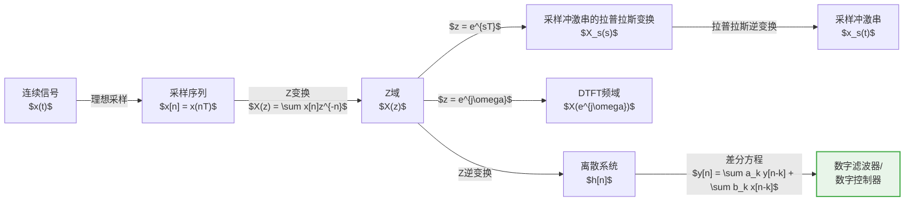
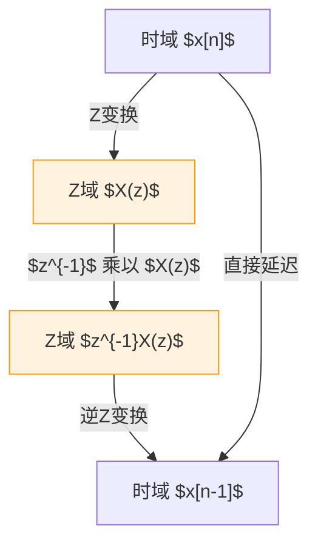
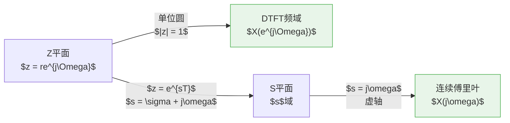
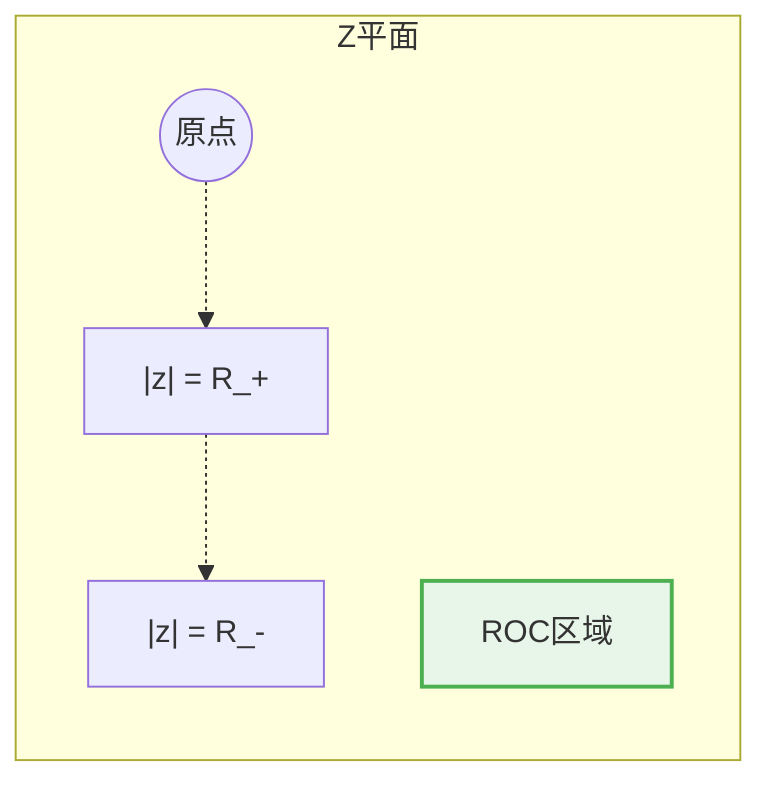
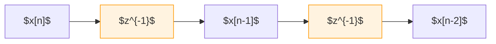
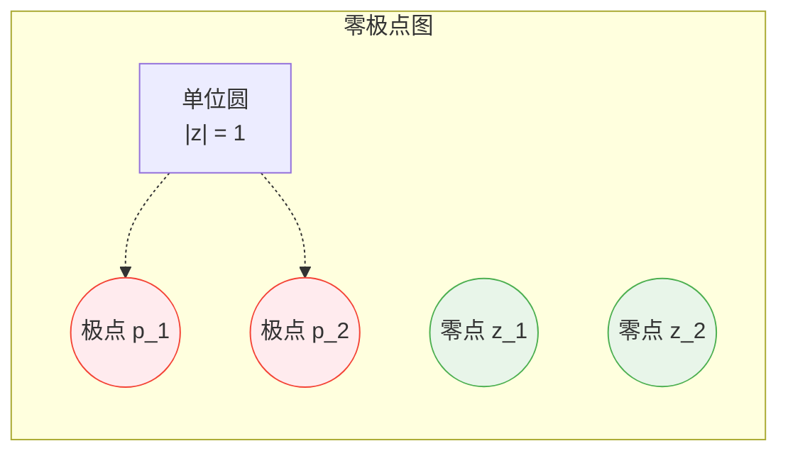
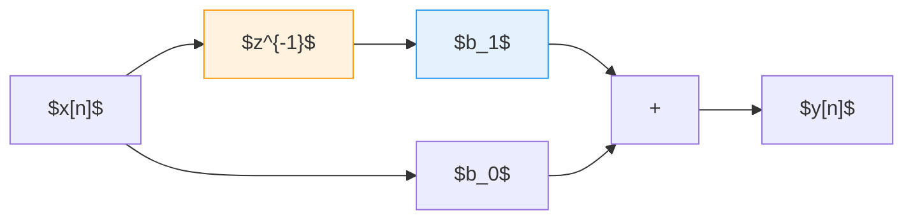
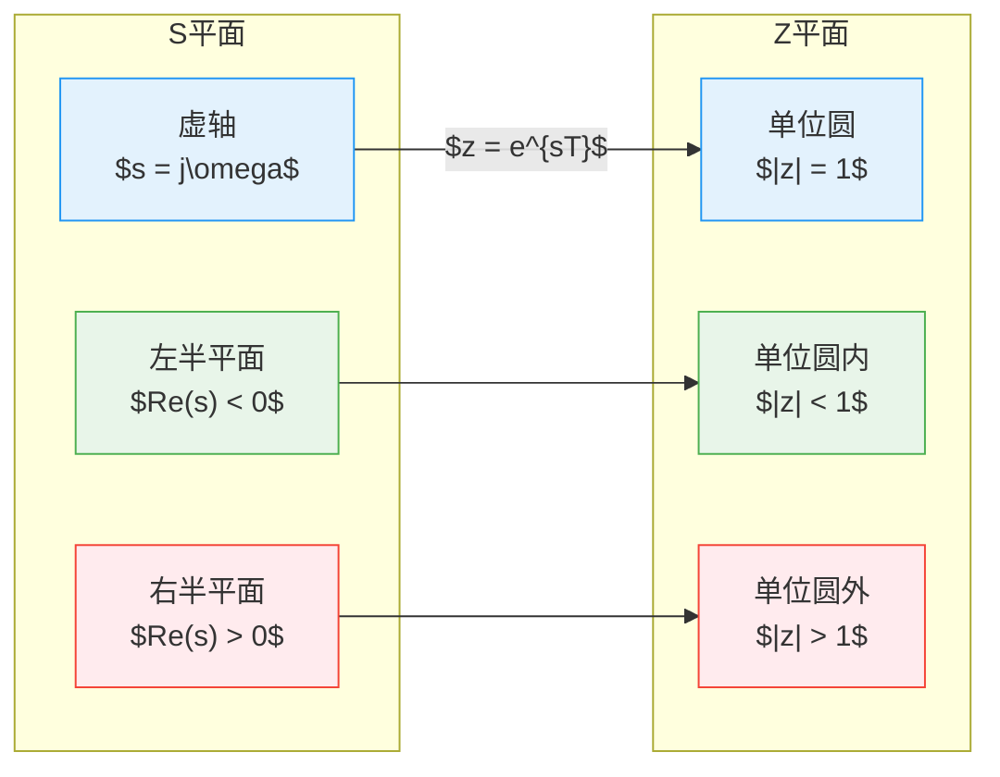
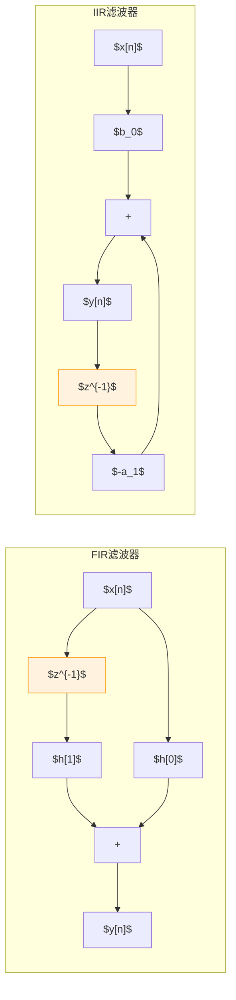
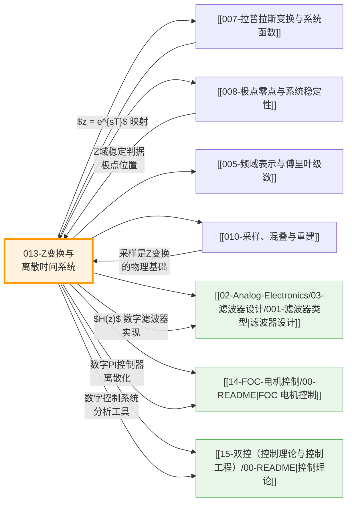

# 013-Z 变换与离散时间系统

> [!abstract] 本章定位
> **前置知识**：[[011-离散时间信号与系统]]、[[012-DTFT与离散频率响应]]，并类比 [[007-拉普拉斯变换与系统函数]] 和 [[008-极点零点与系统稳定性]]。
>
> **本章回答**：怎样把差分方程转为 $H(z)$？ROC、单位圆和极点位置怎样决定离散系统的因果性与稳定性？连续控制器怎样映射到离散实现？
>
> **本章边界**：本章建立离散系统分析框架；具体滤波器或控制器的指标设计由相应专题展开。
>
> **下一步**：进入 [[014-DFT与FFT频谱分析]]，连接无限序列表示和有限记录计算。



---

## MIT 课程讲解

**MIT RES.6-007 第 22 讲：Z 变换**

同一代数式换一个 ROC，重新判断因果性和稳定性。

<iframe src="https://www.youtube.com/embed/0Gat_aSzi5Y" title="MIT RES.6-007 第 22 讲：Z 变换" width="100%" height="360" loading="lazy" referrerpolicy="strict-origin-when-cross-origin" allow="encrypted-media; picture-in-picture; fullscreen" allowfullscreen></iframe>

[打开原页](https://ocw.mit.edu/courses/res-6-007-signals-and-systems-spring-2011/resources/lecture-22-the-z-transform/)

## 1. 从采样到Z变换的推导

### 1.1 为什么需要Z变换？

先回顾一下我们在连续时间系统中学到的工具链：

| 问题 | 连续时间工具 | 离散时间工具 |
|------|------------|------------|
| 描述系统 | 微分方程 | **差分方程** |
| 时域分析 | 卷积积分 $x(t)*h(t)$ | **卷积和** $x[n]*h[n]$ |
| 变换域分析 | 拉普拉斯变换 $X(s)$ | **Z变换** $X(z)$ |
| 频域分析 | 傅里叶变换 $X(j\omega)$ | **DTFT** $X(e^{j\omega})$ |

> **工程直觉**：嵌入式系统中，信号来自ADC采样，控制器运行在离散节拍。差分方程天然适合代码实现（`y[n] = a*y[n-1] + b*x[n]`），但直接在时域分析多个延迟的系统会非常复杂。Z变换的作用，就是将"延迟"这个操作转化为"乘以 $z^{-1}$"，让差分方程变成多项式方程。

### 1.2 从采样序列到Z变换

连续信号 $x(t)$ 经过理想采样（采样周期 $T$，采样频率 $f_s = 1/T$）后，得到采样序列：

$$x[n] = x(nT), \quad n = 0, 1, 2, ...$$

**关键观察**：采样序列可以表示为加权冲激串：

$$x_s(t) = \sum_{n=-\infty}^{\infty} x[n] \cdot \delta(t - nT)$$

对其做拉普拉斯变换：

$$X_s(s) = \mathcal{L}\{x_s(t)\} = \sum_{n=-\infty}^{\infty} x[n] \cdot e^{-snT}$$

令 $z = e^{sT}$（即 $s = \frac{1}{T}\ln z$），则：

$$\boxed{X(z) = \sum_{n=-\infty}^{\infty} x[n] \cdot z^{-n}}$$

这就是**双边Z变换**的定义。

对于右边序列（$n<0$ 时 $x[n]=0$），双边变换与下式**单边 Z 变换**数值相同。因果性是系统性质，不要求任意输入都在负时刻为零；单边变换求初值问题还须保留移位产生的边界项：

$$X(z) = \sum_{n=0}^{\infty} x[n] \cdot z^{-n}$$

> **工程直觉**：$z^{-1}$ 就是"单位延迟算子"。$z^{-1}X(z)$ 意味着在时域中将序列右移一个采样点。代码里写 `y[n] = x[n-1]`，在Z域就是 $Y(z) = z^{-1}X(z)$。这种"延迟变乘法"的对应，正是Z变换的魔力所在。



---

## 2. Z变换与DTFT的关系

### 2.1 单位圆上的Z变换

回顾我们令 $z = e^{sT}$。若令 $s = j\omega$（即考虑纯虚频率），则：

$$z = e^{j\omega T}$$

这意味着 $z$ 在复平面上位于**单位圆**上！令 $\Omega = \omega T$（数字频率，单位为弧度），则：

$$X(z)\big|_{z=e^{j\Omega}} = \sum_{n=-\infty}^{\infty} x[n] e^{-j\Omega n} = X(e^{j\Omega})$$

这就是**离散时间傅里叶变换（DTFT）**。

> **核心结论**：当 Z 变换的 ROC 包含单位圆时，DTFT 是 Z 变换在单位圆上的取值。若单位圆不在 ROC 内，不能只把 $z=e^{j\Omega}$ 代入代数式就断言 DTFT 存在。



### 2.2 连续傅里叶 vs DTFT vs Z变换

| 特性 | 连续傅里叶变换 | DTFT | Z变换 |
|------|-------------|------|------|
| 适用信号 | 连续信号 $x(t)$ | 离散序列 $x[n]$ | 离散序列 $x[n]$ |
| 变换结果 | $X(j\omega)$ | $X(e^{j\Omega})$ | $X(z)$ |
| 频率变量 | $\omega$ (rad/s) | $\Omega = \omega T$ (rad) | $z$ (复数) |
| 周期性 | 非周期 | **周期 $2\pi$** | 非周期 |
| 常用充分条件 | 绝对可积 | 绝对可和 | 给出非空 ROC |
| 物理意义 | 频谱密度 | 数字频谱 | 广义频域表示 |

> **工程直觉**：DTFT的周期性来源于采样的频谱复制效应——离散序列的频谱天然以 $2\pi$（或 $f_s$）为周期。Z变换通过引入模 $|z|$（对应衰减/增长因子），扩展了DTFT的适用范围，让原本不收敛的序列（如 $a^n u[n]$ 当 $|a|>1$ 时）也能被分析。

---

## 3. ROC（收敛域）在Z域的意义

### 3.1 为什么ROC如此重要？

在连续时间系统中，拉普拉斯变换的ROC决定了一个信号是右边信号、左边信号还是双边信号。Z变换同理，且ROC的地位更加关键——**不同的序列可以有完全相同的 $X(z)$ 表达式，但不同的ROC**。

**ROC定义**：使Z变换级数收敛的 $z$ 的集合：

$$\text{ROC} = \{z : \sum_{n=-\infty}^{\infty} |x[n]||z|^{-n} < \infty\}$$

### 3.2 ROC的几何形状

ROC在Z平面上是**以原点为中心的圆环**（或圆的内部/外部/整个平面）：

| 序列类型 | ROC形状 | 典型示例 |
|---------|--------|---------|
| 右边序列 | 某个圆外 $\lvert z\rvert > R_+$ | $a^n u[n]$ |
| 左边序列 | 某个圆内 $\lvert z\rvert < R_-$ | $-a^n u[-n-1]$ |
| 双边序列 | 圆环 $R_+ < \lvert z\rvert < R_-$ | $a^{\vertn\vert}$ |
| 有限长序列 | 全平面（可能除 $z=0$ 或 $\infty$） | 矩形窗 $R_N[n]$ |



### 3.3 ROC与系统性质的关系

| 系统性质 | ROC要求 | 说明 |
|---------|--------|------|
| **因果性** | ROC在最外层极点之外 | 右边序列 → 因果系统 |
| **稳定性** | ROC包含单位圆 $\lvert z\rvert = 1$ | 绝对可和 ↔ BIBO稳定 |
| **因果+稳定** | $\lvert z\rvert > R_{\max}$ 且 $R_{\max} < 1$ | 所有极点在单位圆内 |

> **工程直觉**：ROC是Z变换的"身份证"。两个系统可以有相同的 $H(z)$ 分子分母，但ROC不同就意味着一个是因果的、另一个是非因果的；一个稳定、另一个不稳定。设计数字滤波器时，选定ROC就是选定系统的因果性和稳定性。

> **与后续知识的关联**：在[[14-FOC-电机控制/00-README|14-FOC-电机控制]]的数字电流环中，控制器的离散化必须保证变换后的极点仍在单位圆内，否则电流控制会发散。ROC分析是验证这一点的理论工具。

---

## 4. Z变换的性质

### 4.1 核心性质表

下表首先使用双边 Z 变换。单边变换的移位通常有边界项；初值与终值两行仅按注明的单边/右边序列条件使用。

| 性质 | 时域 | Z域 | 条件与 ROC |
|------|------|-----|--------|
| **线性** | $ax[n]+by[n]$ | $aX(z)+bY(z)$ | 至少包含公共 ROC；消去可能扩大 ROC |
| **时移** | $x[n-k]$ | $z^{-k}X(z)$ | 除零点和无穷远端点外，ROC 不变 |
| **指数加权** | $a^nx[n]$ | $X(z/a)$ | $a\ne0$；ROC 半径乘 $\lvert a\rvert$ |
| **线性加权** | $nx[n]$ | $-z\,dX/dz$ | 普通收敛环域内部保持；零点、无穷远及边界另查 |
| **时域反转** | $x[-n]$ | $X(1/z)$ | 半径取倒数，零点与无穷远交换 |
| **卷积** | $x*h$ | $X(z)H(z)$ | 至少包含非空公共 ROC；极零消去可能扩大 ROC |
| **初值定理** | $x[0]$ | $\lim_{z\to\infty}X_+(z)$ | 单边变换；或 $n<0$ 为零的双边变换 |
| **终值定理** | $\lim_{n\to\infty}x[n]$ | $\lim_{z\to1}(1-z^{-1})X_+(z)$ | 对有理单边变换，约简后 $(1-z^{-1})X_+(z)$ 的全部极点严格位于单位圆内 |

**ROC 反例**：$x[n]=(1/2)^nu[n]$ 与 $-x[n]$ 的 ROC 都为 $|z|>1/2$，相加却得到零序列，其变换在全平面成立。因此 ROC 不能机械写成“恰为交集”。

**终值反例**：$x[n]=nu[n]$ 的 $X(z)=z/(z-1)^2$ 在 $z=1$ 有二重极点；乘 $(1-z^{-1})$ 后仍留单位圆极点，不能使用终值定理断言有限终值。$X(z)$ 在 $z=1$ 至多允许一个可被该因子消去的单极点。

参考：[IIT Bombay：Z 变换性质与 ROC](https://www.ee.iitb.ac.in/~akumar/courses/ee603-2020/transforms.html)。

> **工程直觉**：**时移性质**是数字系统中最常用的——代码里的 `z^{-1}`（延迟一拍）直接对应Z域的 $z^{-1}$ 乘法。整个数字滤波器的结构图（直接型、级联型、并联型）都是基于这个性质的图形化表示。

### 4.2 时移性质的直观理解

$$\mathcal{Z}\{x[n-1]\} = z^{-1}X(z)$$

- 时域右移1步（延迟） $\Leftrightarrow$ Z域乘以 $z^{-1}$
- 时域左移1步（超前） $\Leftrightarrow$ Z域乘以 $z$

这正是数字信号处理中**$z^{-1}$ 延迟单元**的数学基础：



### 4.3 卷积定理

$$y[n] = x[n] * h[n] = \sum_{k=-\infty}^{\infty} x[k]h[n-k]$$

$$Y(z) = X(z) \cdot H(z)$$

> **工程直觉**：和连续时间一样，卷积和变成乘法——这是Z变换最大的工程价值。一个复杂的差分方程，在Z域变成代数方程，求解后再逆变换即可。

---

## 5. 常见信号的Z变换对

### 5.1 基础变换对

| 信号 $x[n]$ | Z变换 $X(z)$ | ROC |
|------------|------------|-----|
| $\delta[n]$ | $1$ | 全平面 |
| $u[n]$ | $\frac{1}{1-z^{-1}} = \frac{z}{z-1}$ | $\lvert z\rvert > 1$ |
| $a^n u[n]$ | $\frac{1}{1-az^{-1}} = \frac{z}{z-a}$ | $\lvert z\rvert > \lvert a\rvert$ |
| $-a^n u[-n-1]$ | $\frac{1}{1-az^{-1}} = \frac{z}{z-a}$ | $\lvert z\rvert < \lvert a\rvert$ |
| $n a^n u[n]$ | $\frac{az^{-1}}{(1-az^{-1})^2} = \frac{az}{(z-a)^2}$ | $\lvert z\rvert > \lvert a\rvert$ |
| $\cos(\Omega_0 n) u[n]$ | $\frac{1 - z^{-1}\cos\Omega_0}{1 - 2z^{-1}\cos\Omega_0 + z^{-2}}$ | $\lvert z\rvert > 1$ |
| $\sin(\Omega_0 n) u[n]$ | $\frac{z^{-1}\sin\Omega_0}{1 - 2z^{-1}\cos\Omega_0 + z^{-2}}$ | $\lvert z\rvert > 1$ |
| $a^n \cos(\Omega_0 n) u[n]$ | $\frac{1 - az^{-1}\cos\Omega_0}{1 - 2az^{-1}\cos\Omega_0 + a^2z^{-2}}$ | $\lvert z\rvert > \lvert a\rvert$ |

> **工程直觉**：注意 $a^n u[n]$ 和 $-a^n u[-n-1]$ 的Z变换表达式**完全相同**，但ROC不同。这再次说明了ROC的重要性。若只看到 $X(z) = z/(z-a)$ 而不指定ROC，无法确定是因果序列还是非因果序列。

### 5.2 从拉普拉斯到Z变换的对比

| 连续信号 | $X(s)$ | 离散序列 | $X(z)$ |
|---------|--------|---------|--------|
| $\delta(t)$ | $1$ | $\delta[n]$ | $1$ |
| $u(t)$ | $\frac{1}{s}$ | $u[n]$ | $\frac{z}{z-1}$ |
| $e^{-at}u(t)$ | $\frac{1}{s+a}$ | $a^n u[n]$ | $\frac{z}{z-a}$ |
| $t e^{-at}u(t)$ | $\frac{1}{(s+a)^2}$ | $n a^n u[n]$ | $\frac{az}{(z-a)^2}$ |
| $\cos(\omega_0 t)u(t)$ | $\frac{s}{s^2+\omega_0^2}$ | $\cos(\Omega_0 n)u[n]$ | $\frac{z(z-\cos\Omega_0)}{z^2-2z\cos\Omega_0+1}$ |

> **工程直觉**：观察对应关系：$s$ 域的极点 $s = -a$ 对应 $z$ 域的极点 $z = a$（即 $z = e^{sT}$ 的映射）。连续时间中的指数衰减 $e^{-at}$ 对应离散时间中的几何衰减 $a^n$（其中 $a = e^{-aT}$）。

---

## 6. 离散系统函数 $H(z)$

### 6.1 从差分方程到 $H(z)$

一个线性时不变离散系统由常系数差分方程描述：

$$\sum_{k=0}^{N} a_k y[n-k] = \sum_{k=0}^{M} b_k x[n-k]$$

对两边取Z变换，利用时移性质（假设初始条件为零）：

$$\sum_{k=0}^{N} a_k z^{-k} Y(z) = \sum_{k=0}^{M} b_k z^{-k} X(z)$$

定义**系统函数（传递函数）**：

$$\boxed{H(z) = \frac{Y(z)}{X(z)} = \frac{\sum_{k=0}^{M} b_k z^{-k}}{\sum_{k=0}^{N} a_k z^{-k}} = \frac{b_0 + b_1 z^{-1} + ... + b_M z^{-M}}{a_0 + a_1 z^{-1} + ... + a_N z^{-N}}}$$

通常取 $a_0 = 1$，写成：

$$H(z) = \frac{b_0 + b_1 z^{-1} + ... + b_M z^{-M}}{1 + a_1 z^{-1} + ... + a_N z^{-N}}$$

> **工程直觉**：$H(z)$ 的分子系数 $b_k$ 决定系统的"零点"（输入中的某些频率分量被衰减），分母系数 $a_k$ 决定系统的"极点"（系统内部的谐振模式）。与连续系统中的 $H(s)$ 完全平行。

### 6.2 零极点形式

$$H(z) = G \cdot \frac{\prod_{k=1}^{M}(1 - z_k z^{-1})}{\prod_{k=1}^{N}(1 - p_k z^{-1})} = G \cdot z^{N-M} \cdot \frac{\prod_{k=1}^{M}(z - z_k)}{\prod_{k=1}^{N}(z - p_k)}$$

- $z_k$：零点，使 $H(z_k) = 0$
- $p_k$：极点，使 $H(p_k) \to \infty$
- $G$：系统增益



### 6.3 从 $H(z)$ 看系统结构

$H(z)$ 可以直接翻译为**数字滤波器的结构**：

**直接型I**：



实际实现为两种标准形式：

- **直接型I**：先实现零点（FIR部分），再实现极点（IIR反馈部分）
- **直接型II（规范型）**：共享延迟单元，节省内存

> **工程直觉**：直接型II是嵌入式中最常用的实现——每个 $z^{-1}$ 对应一个内存变量（状态变量）。一个二阶IIR滤波器（双二次节，Biquad）只需要2个状态变量。这正是CMSIS-DSP库中 `arm_biquad_cascade_df1_f32` 函数的理论基础。

> **与后续知识的关联**：在[[02-Analog-Electronics/03-滤波器设计/001-滤波器类型|滤波器设计]]中，数字滤波器的级联/并联实现就是基于 $H(z)$ 的零极点分解。在[[14-FOC-电机控制/00-README|14-FOC-电机控制]]中，电流环PI控制器的离散化最终也是得到一个有极点的 $H(z)$。

---

## 7. 离散系统的稳定性

### 7.1 BIBO稳定性判据

**定理**：一个离散LTI系统BIBO稳定的充要条件是：

$$\sum_{n=-\infty}^{\infty} |h[n]| < \infty$$

在Z域中，这等价于：**ROC包含单位圆 $|z| = 1$**。

对于因果系统，ROC是最外层极点之外，因此：

> **因果稳定判据**：因果离散LTI系统稳定的充要条件是**所有极点都在单位圆内**（$|p_k| < 1$），这里限定为约简后的有理因果系统。

### 7.2 极点位置与响应模式

| 极点位置 | 时域响应 | 稳定性 | 振荡特性 |
|---------|---------|--------|---------|
| 实轴上，$0 < p < 1$ | $p^n u[n]$，指数衰减 | 稳定 | 无振荡 |
| 实轴上，$-1 < p < 0$ | $p^n u[n]$，交替衰减 | 稳定 | 振荡（周期2） |
| 实轴上，$p > 1$ | 指数增长 | **不稳定** | 无振荡 |
| 共轭复数，$\lvert p\rvert < 1$ | 衰减包络正弦 | 稳定 | 有振荡 |
| 简单共轭复极点，$\lvert p\rvert = 1$ | 等幅自然模式 | 内部可临界稳定，但非 BIBO 稳定 | 持续振荡 |
| 共轭复数，$\lvert p\rvert > 1$ | 增幅振荡 | **不稳定** | 发散振荡 |

```mermaid
graph TD
    subgraph Z平面极点分布
        A((0.5,0))
        B((-0.5,0))
        C((0,0.6))
        D((0,-0.6))
        E((1.2,0))
        F((0.8,0.6))
        G((1,0.8))
        H["单位圆"]
    end
    A -.-> H
    B -.-> H
    C -.-> H
    D -.-> H
    E -.-> H
    F -.-> H
    G -.-> H
    style A fill:#4caf50,stroke:#2e7d32
    style B fill:#4caf50,stroke:#2e7d32
    style C fill:#4caf50,stroke:#2e7d32
    style D fill:#4caf50,stroke:#2e7d32
    style E fill:#f44336,stroke:#c62828
    style F fill:#4caf50,stroke:#2e7d32
    style G fill:#ff9800,stroke:#ef6c00
```

![[Assets/signals_systems/20_zplane_unit_circle.png|1500]]
> 对因果、有限维、最小实现的有理离散系统，BIBO 稳定要求系统函数极点严格位于单位圆内。简单单位圆极点可产生不衰减的零输入模式，但不满足 BIBO 稳定。

> **工程直觉**：极点离单位圆越近，响应衰减越慢（时间常数越大）。极点角度决定振荡频率：$\Omega = \arg(p)$。若极点在正实轴，响应是单调的；在负实轴，每拍交替一次符号；在复平面上，形成振荡。

### 7.3 与连续系统稳定性的对比

| 特性 | 连续系统（S域） | 离散系统（Z域） |
|------|---------------|---------------|
| 稳定区域 | 左半平面 $\text{Re}(s) < 0$ | 单位圆内 $\lvert z\rvert < 1$ |
| 内部临界稳定模式 | 简单虚轴极点 | 简单单位圆极点 |
| 不稳定区域 | 右半平面 | 单位圆外 |
| 时间常数 | $\tau = -1/\text{Re}(p)$ | $\tau \approx -T/\ln\lvert p\rvert$ |

> **与后续知识的关联**：在[[15-双控（控制理论与控制工程）/00-README|15-双控（控制理论与控制工程）]]中，Nyquist稳定性判据和根轨迹法在Z域中有完全平行的版本。连续系统的根轨迹在左半平面分析，离散系统的根轨迹在单位圆内分析。设计数字控制器时，必须确保闭环极点在"Z域稳定区域"内。

![[Assets/signals_systems/08_stability_regions.png|1500]]
> 指数模态映射 $z=e^{sT}$ 将左半平面映入单位圆内，但它是多对一映射：$s$ 与 $s+j2\pi k/T$ 具有相同的 $z$（整数 $k$）。有限 $s$ 不会映到 $z=0$；这与 Tustin 的双线性映射是不同关系。

---

## 8. 从 $H(s)$ 到 $H(z)$ 的映射（工程拓展）

### 8.1 $z = e^{sT}$ 的映射关系

从连续到离散的核心映射是：

$$z = e^{sT} = e^{(\sigma + j\omega)T} = e^{\sigma T} \cdot e^{j\omega T}$$

这意味着：

| S域特性 | Z域映射 | 说明 |
|--------|--------|------|
| $\sigma = 0$（虚轴） | $\lvert z\rvert = 1$（单位圆） | 频率轴映射到单位圆 |
| $\sigma < 0$（左半平面） | $\lvert z\rvert < 1$（单位圆内） | 稳定区域映射 |
| $\sigma > 0$（右半平面） | $\lvert z\rvert > 1$（单位圆外） | 不稳定区域映射 |
| $s = 0$ | $z = 1$ | 直流对应 |
| $s = j\pi/T$ | $z = -1$ | 奈奎斯特频率对应 |
| $s = j\omega$，$\omega$ 从 $-\infty$ 到 $+\infty$ | 单位圆绕无限多圈 | **多对一映射** |



> **工程直觉**：这个映射不是一对一的！S域中宽度为 $2\pi/T$ 的横条映射到整个Z平面。这就是**频谱混叠**在变换域的体现。如果连续系统的极点在 $j\omega$ 轴上方超过 $\pi/T$ 处，映射到Z域后会被"折叠"回来，看起来像是低频率的极点。

### 8.2 常用离散化方法

实际工程中，将连续控制器 $H(s)$ 转换为离散控制器 $H(z)$ 可采用以下方法：

| 方法 | 映射公式 | 特性 | 适用场景 |
|------|---------|------|---------|
| **零阶保持等效** | $H_d(z)=(1-z^{-1})\mathcal Z\{\mathcal L^{-1}[H(s)/s]_{t=nT}\}$（因果、零状态） | 保持输入下匹配采样输出 | 被控对象的采样模型 |
| **前向欧拉** | $s \approx \frac{z-1}{T}$ | 可能将S域稳定极点映射到Z域不稳定区域 | 简单但少用 |
| **后向欧拉** | $s \approx \frac{1-z^{-1}}{T} = \frac{z-1}{Tz}$ | 稳定区域完全映射到稳定区域 | 数值稳定性好，但频率畸变 |
| **双线性变换（Tustin）** | $s = \frac{2}{T}\frac{z-1}{z+1}$ | 全S域虚轴映射到单位圆，频率非线性压缩 | **最常用**，无混叠 |
| **冲激响应不变法** | $h[n] = T \cdot h_c(nT)$ | 时域响应精确匹配，但可能有混叠 | 需要精确时域响应 |
| **零极点匹配** | $z_{d,k}=e^{z_{c,k}T}$，$p_{d,k}=e^{p_{c,k}T}$ | 逐个映射有限零极点，再选增益；整体映射非一一对应 | 还须规定相对阶次及无穷远零点的处理 |

#### 双线性变换详解（最常用）

$$s = \frac{2}{T} \cdot \frac{z-1}{z+1}$$

逆变换：

$$z = \frac{1 + sT/2}{1 - sT/2} = \frac{2/T + s}{2/T - s}$$

**关键特性**：
1. **稳定性保持**：S域左半平面 $\to$ Z域单位圆内
2. **频率轴映射**：$s = j\omega$ 映射到 $z = e^{j\Omega}$，其中：

$$\omega = \frac{2}{T} \tan\left(\frac{\Omega}{2}\right)$$

3. **频率畸变（Warping）**：模拟频率 $\omega$ 和数字频率 $\Omega$ 之间存在非线性关系。高频处被压缩。设计时可通过**预畸变**（pre-warping）补偿：

$$\omega_a = \frac{2}{T} \tan\left(\frac{\omega_d T}{2}\right)$$

> **工程直觉**：双线性变换是嵌入式数字控制中最常用的离散化方法。你在MATLAB的 `c2d` 函数中选择 `'tustin'` 就是这个。在[[14-FOC-电机控制/00-README|14-FOC-电机控制]]中，PI控制器从连续到离散的转换通常使用双线性变换，保持被映射传递函数的稳定极点区域；整个电流环仍须加入采样、保持、计算和 PWM 延迟后重新验证闭环稳定性。但要注意频率畸变——如果截止频率接近 $f_s/10$ 以上，预畸变补偿很重要。

> **与后续知识的关联**：[[15-双控（控制理论与控制工程）/00-README|15-双控（控制理论与控制工程）]]中数字控制器设计的完整流程就是：先设计连续控制器 $G_c(s)$，再用双线性变换得到 $G_c(z)$，最后检查闭环极点是否都在单位圆内。

![[Assets/signals_systems/21_bilinear_transform.png|1500]]
> 双线性变换（Tustin）将s平面左半平面稳定区域一对一映射到z平面单位圆内，保持系统稳定性不变。

---

## 9. 逆Z变换

### 9.1 常用方法

| 方法 | 适用场景 | 步骤 |
|------|---------|------|
| **部分分式展开** | 有理函数 $X(z)$ | 分解为简单分式，查表 |
| **幂级数展开** | 需要数值解 | 长除法，得到 $x[n]$ 的数值 |
| **留数法** | 理论分析 | 围线积分，计算极点留数 |
| **查表法** | 标准形式 | 直接对照变换对表 |

### 9.2 部分分式展开示例

求 $X(z) = \frac{z}{(z-1)(z-0.5)}$，ROC: $|z| > 1$ 的逆Z变换。

**步骤1**：将 $X(z)/z$ 展开：

$$\frac{X(z)}{z} = \frac{1}{(z-1)(z-0.5)} = \frac{A}{z-1} + \frac{B}{z-0.5}$$

$$A = \left.\frac{1}{z-0.5}\right|_{z=1} = 2, \quad B = \left.\frac{1}{z-1}\right|_{z=0.5} = -2$$

**步骤2**：还原 $X(z)$：

$$X(z) = \frac{2z}{z-1} - \frac{2z}{z-0.5}$$

**步骤3**：查表并考虑ROC：

由于ROC是 $|z| > 1$（最外层极点之外），对应因果序列：

$$x[n] = 2u[n] - 2(0.5)^n u[n] = 2(1 - 0.5^n)u[n]$$

> **工程直觉**：ROC $|z| > 1$ 告诉我们这是因果序列。若ROC是 $0.5 < |z| < 1$，则 $z/(z-1)$ 项对应非因果（左边序列），$z/(z-0.5)$ 项仍是因果。同一表达式，不同ROC，完全不同的时间序列！

---

## 10. 工程应用：Z变换在嵌入式系统中的实践

### 10.1 数字控制中的Z变换

数字控制器（如PI、PID）的离散化设计流程：


**数字PI控制器示例**：

连续PI控制器：

$$G_c(s) = K_p + \frac{K_i}{s} = \frac{K_p s + K_i}{s}$$

用双线性变换（$s = \frac{2}{T}\frac{z-1}{z+1}$）：

$$G_c(z) = K_p + K_i \cdot \frac{T}{2} \cdot \frac{z+1}{z-1} = \frac{(K_p + K_i T/2)z - (K_p - K_i T/2)}{z-1}$$

令 $a = K_p + K_i T/2$，$b = K_p - K_i T/2$：

$$\frac{U(z)}{E(z)} = \frac{az - b}{z-1} = \frac{a - bz^{-1}}{1 - z^{-1}}$$

得到差分方程：

$$u[n] = u[n-1] + a \cdot e[n] - b \cdot e[n-1]$$

> **工程直觉**：这就是FOC电流环中PI控制器的代码原型！每一拍（采样周期）计算一次，只需要保存上一拍的控制量 $u[n-1]$ 和误差 $e[n-1]$。双线性变换自动处理了积分项的离散化，无需手动写梯形积分。

对应的最小代码实现为（$T$ 为固定采样周期）：

```c
/* Kp、Ki、T 已给定；状态在启动时初始化。 */
float a = Kp + 0.5f * Ki * T;
float b = Kp - 0.5f * Ki * T;
float u_q = u_q_prev + a * err_q - b * err_q_prev;
u_q_prev = u_q;
err_q_prev = err_q;
```

不能写成 `u_q_prev + Kp * err_q + Ki * T * err_q`：那会把比例项逐拍累加，也不等于梯形积分。

**核对例题**：取 $K_p=2$、$K_i=1$、$T=0.1$，初始 $u[-1]=e[-1]=0$，从 $n=0$ 起恒定误差为 1，前三拍输出应为 $2.05,2.15,2.25$。误差不变后每拍只增加 $K_iT=0.1$。

以上是未饱和的线性 PI。实际电流环还须设计限幅和抗积分饱和，明确保存的是未限幅状态还是经过抗饱和修正的状态，并验证闭环稳定性。

参考：[MathWorks：离散 PI/PID 的梯形积分形式](https://www.mathworks.com/help/control/ug/discrete-time-proportional-integral-derivative-pid-controller.html)。

### 10.2 数字滤波中的Z变换

**FIR滤波器**：$H(z) = \sum_{k=0}^{M-1} h[k] z^{-k}$
- 只有零点，没有极点（除 $z=0$ 外）
- 总是稳定
- 线性相位可实现
- 需要较多阶数

**IIR滤波器**：$H(z) = \frac{\sum b_k z^{-k}}{1 + \sum a_k z^{-k}}$
- 有零点和极点
- 需要检查极点稳定性
- 可用较少阶数达到陡峭截止
- 可能存在相位非线性



> **工程直觉**：因果 FIR 是有限个当前与历史输入的加权和，系数可以为负、和也未必为 1；移动平均只是其中一类。FIR 同样可以有记忆，例如 $y[n]=x[n]-x[n-1]$。IIR 的冲激响应无限长，常用反馈递推高效实现；是否 FIR/IIR 应由冲激响应判断，不能仅看实现中有没有反馈。与 [[011-离散时间信号与系统]] 的定义保持一致。

### 10.3 与有限数据频谱的连接

FFT 是 DFT 的快速算法。对长度 $N$ 的有限序列，DFT 是其 DTFT 在 $\Omega_k=2\pi k/N$ 的取样。对无限序列先截断再计算时，计算对象已经改变。完整定义、加窗、补零和幅值标定见 [[014-DFT与FFT频谱分析]]。

---

## 11. 常见错误与自测习题

### 11.1 常见错误

| 错误 | 错误描述 | 正确理解 |
|------|---------|---------|
| **ROC遗漏** | 只写 $X(z) = z/(z-a)$，不指定ROC | 必须标注ROC才能确定因果性和稳定性 |
| **稳定判据混淆** | 将S域的左半平面判据套用到Z域 | Z域稳定是**单位圆内**，不是左半平面 |
| **频率概念混淆** | 将模拟频率 $\omega$ 和数字频率 $\Omega$ 混淆 | $\Omega = \omega T$（rad），$f_d = f_a / f_s$（归一化） |
| **双线性变换误用** | 在高频处不预畸变 | 当 $f > f_s/10$ 时，频率畸变显著，需预畸变补偿 |
| **初值/终值定理条件** | 不验证定理适用条件 | 对有理序列，检查 $(1-z^{-1})X(z)$ 的极点严格位于单位圆内；$X(z)$ 在 $z=1$ 至多允许被该因子消去的单极点 |
| **零极点对消** | 认为相消的零极点不影响系统 | 对消可能掩盖不可观/不可控模式，导致数值问题 |
| **延迟符号错误** | $x[n-1]$ 对应 $z^{-1}X(z)$ 还是 $zX(z)$ | $x[n-k]$ 对应 $z^{-k}X(z)$（右移/延迟用负幂） |

### 11.2 自测习题

**习题1：基本概念**

1. Z变换与DTFT的关系是什么？为什么DTFT是周期的？
2. 一个因果离散系统稳定的充要条件是什么？
3. 解释为什么ROC是Z变换的"身份证"。

**习题2：计算**

4. 求 $x[n] = (0.5)^n u[n] + (0.25)^n u[n]$ 的Z变换，并标注ROC。
5. 求 $X(z) = \frac{2z^2}{(z-1)(z-0.5)}$（ROC: $|z| > 1$）的逆Z变换。
6. 用双线性变换（$T=0.1$ s）将 $H(s) = \frac{10}{s+10}$ 转换为 $H(z)$。

**习题3：系统分析**

7. 系统 $H(z) = \frac{z}{z^2 - 1.5z + 0.5}$，判断因果性和稳定性。
8. 系统 $H(z) = \frac{z-0.5}{z^2 - 0.8z + 0.16}$，求零极点，判断稳定性。

**习题4：工程应用**

9. 为什么数字PI控制器的离散化优先使用双线性变换而不是前向欧拉？
10. 设计一个采样频率为10kHz的数字低通滤波器，若希望截止频率为2kHz，双线性变换后对应的数字截止频率是多少？（考虑预畸变）

---

## 12. 知识地图与关联索引



---

> **本章小结**：Z变换是离散时间系统的拉普拉斯等价物。通过 $z = e^{sT}$ 的映射，它连接了连续与离散世界。关键要点：
>
> 1. **定义**：$X(z) = \sum x[n]z^{-n}$，$z^{-1}$ 是延迟算子
> 2. **DTFT**：Z变换在单位圆上的取值，$X(e^{j\Omega})$
> 3. **ROC**：决定因果性和稳定性，必须明确标注
> 4. **系统函数**：$H(z) = Y(z)/X(z)$，将差分方程转化为代数方程
> 5. **稳定性**：因果系统所有极点在单位圆内（$|p_k| < 1$）
> 6. **离散化**：双线性变换最常用，保持稳定性但引入频率畸变
> 7. **工程应用**：数字PI控制器、数字滤波器、FFT频谱分析的理论基础
>
> 掌握 Z 变换后，应能从差分方程建立 $H(z)$，结合 ROC 判断因果性，并由单位圆与极点位置判断离散系统稳定性。
>
> **上一章**：[[012-DTFT与离散频率响应]]
>
> **下一章**：[[014-DFT与FFT频谱分析]]
