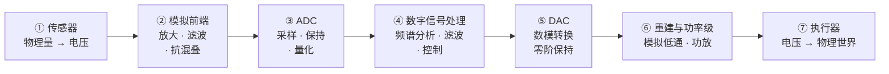
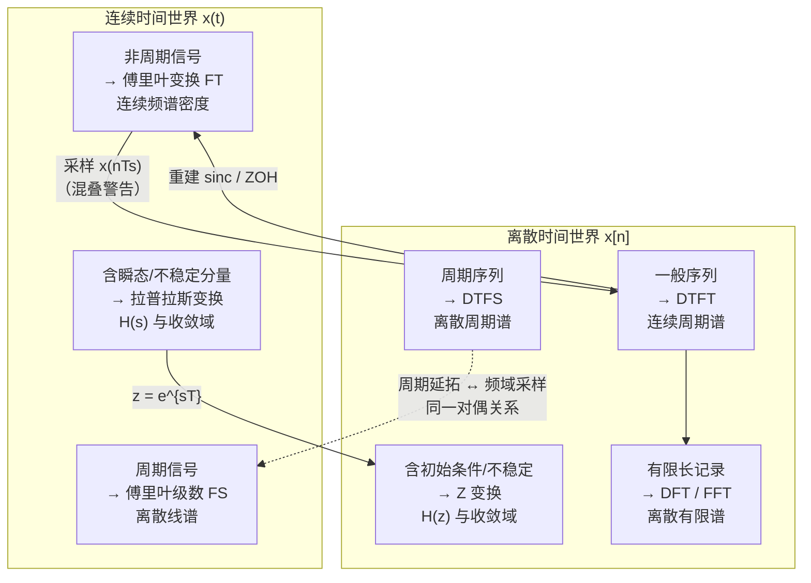

# 016 信号与系统全景大图谱

> [!abstract] 本篇定位
> [[000-信号与系统]] 给出的是**时间主线**（按 001—015 的顺序学什么）；本篇给出的是**空间全景**——把全章知识钉在两张图上：一张端到端工程总链（概念长在哪里），一张四个世界的变换地图（工具之间什么关系）。首次学习不必读本篇；学完一遍后回读，或工程遇到问题时按图定位。
>
> 第三层（按症状/工具/目标的三张索引表）与第四层（与其他章节的接口表）规划中，后续补充。

---

## 第一层：端到端工程总链

任何"物理世界 → 数字世界 → 物理世界"的信号系统，骨架都是同一条链。本库的两条实例都挂在上面：[[001-信号、系统与LTI基础|001]] 的麦克风 EQ 音频链（Stage 1–5 全程配图），和 [[015-信号与系统综合工程案例|015]] 案例一的传感器采集链。

| 环节 | 物理任务 | 核心概念（本篇笔记） | 信号形态变化 | 本库素材 |
|---|---|---|---|---|
| ① 传感器 | 物理量变为电压；同时拾取环境噪声与干扰 | 信号分类、能量/功率、基本信号（[[001-信号、系统与LTI基础\|001]]） | 连续时间 · 幅值连续 | 001 Stage 1 麦克风输出（含 40kHz 超声干扰） |
| ② 模拟前端 | 放大到 ADC 满量程；限制带宽，压制带外干扰 | 微分方程建模、零输入/零状态（[[002-时域响应与微分方程\|002]]）；频率响应、一阶/二阶系统、Bode（[[009-频率响应与Bode图\|009]]）；抗混叠滤波器（[[010-采样、混叠与重建\|010]] §4） | 连续 · 连续（频谱被整形） | 001 Stage 2 抗混叠滤波；Pioneer XD-J110 均衡器主板实物照 |
| ③ ADC | 按 $f_s$ 取值冻结；量化为有限电平 | 采样定理、混叠、S/H 与孔径时间、量化（[[010-采样、混叠与重建\|010]] §2–§6） | **时间离散 · 幅值连续** → 量化后幅值也离散 | 001 Stage 3 采样与 ZOH |
| ④ 数字信号处理 | 频谱分析、数字滤波、控制算法 | 卷积（[[003-卷积：从冲激响应到输出\|003]]）；离散系统与 DTFT（[[011-离散时间信号与系统\|011]]、[[012-DTFT与离散频率响应\|012]]）；Z 变换与离散化（[[013-Z变换与离散时间系统\|013]]）；DFT/FFT 实测（[[014-DFT与FFT频谱分析\|014]]） | 数字序列（时间离散 · 幅值离散） | 001 Stage 4 EQ 均衡；015 案例二（FOC 电流环离散化）、案例三（PWM 频谱定位） |
| ⑤ DAC | 数字码变回阶梯电压 | 零阶保持的频域效应（[[010-采样、混叠与重建\|010]] §5） | 时间连续（阶梯）· 幅值离散 | 001 Stage 5 上半图 |
| ⑥ 重建与功率级 | 滤除 $f_s/2$ 以上的镜像；功率放大 | 重建滤波器、镜像与 sinc 插值（010 §5）；重建与抗混叠的对偶关系 | 连续 · 连续 | 001 Stage 5 下半图 |
| ⑦ 执行器 | 电压回到物理世界（声音、转矩、光） | —（系统级指标见 [[015-信号与系统综合工程案例\|015]]） | — | 015 案例一的验证清单 |

**读这张链的三条要点：**

1. **模拟世界只做两件事**：放大（让信号撑满 ADC 量程）和限带（让带外干扰在采样前衰减）。限带不足的后果不会在②暴露，而是在③以混叠的形式回马枪——001 Stage 3 里 40kHz 残余折回 8kHz 啸叫就是演示。
2. **"离散"发生在③且只发生在③之后**。②→③ 的边界是全章最重要的一条线：线左边用微分方程/拉普拉斯，线右边用差分方程/Z 变换。跨线必须过采样定理这一关（010）。
3. **④里所有操作都是"乘"**：频域里滤波是乘 $H(e^{j\omega})$、均衡是乘增益、控制是乘补偿器——时域里对应的卷积全部由 FFT 加速（014）。这条链的两头（②⑥）才是"卷积物理发生的地方"。

---

## 第二层：四个世界的变换地图

同一个信号，按"时间是否离散"分行、按"频率是否离散"分列，就住进四个世界。六种变换 + 两种推广，全在这张图里：

> 桥与隧道的细节：连续↔离散之间的采样与重建在 [[010-采样、混叠与重建|010]]；s 平面到 z 平面的映射 $z=e^{sT}$ 在 [[013-Z变换与离散时间系统|013]] §8；DFT 是"DTFT + 有限记录 + 频域采样"的合成，在 [[014-DFT与FFT频谱分析|014]]。

| 变换 | 对象 | 频率轴 | 回答的问题 | 本篇 |
|---|---|---|---|---|
| 傅里叶级数 FS | 连续周期信号 | 离散（基波整数倍） | 这个周期波形由哪些谐波组成 | [[005-频域表示与傅里叶级数\|005]] |
| 傅里叶变换 FT | 连续非周期信号 | 连续 | 信号的能量按频率怎样分布 | [[006-傅里叶变换详解\|006]] |
| 拉普拉斯变换 | 连续信号（含瞬态/不稳定） | 复频率 s 平面 | 含初始条件的全响应；系统函数 H(s) | [[007-拉普拉斯变换与系统函数\|007]]、[[008-极点零点与系统稳定性\|008]] |
| DTFS | 离散周期序列 | 离散且周期 | 周期序列的谐波成分 | [[012-DTFT与离散频率响应\|012]] §5 |
| DTFT | 离散时间序列 | 连续且周期（周期 2π） | 数字滤波器的幅相响应 | [[012-DTFT与离散频率响应\|012]] |
| Z 变换 | 离散序列（含瞬态/不稳定） | 复频率 z 平面 | 差分方程→H(z)；离散系统稳定性 | [[013-Z变换与离散时间系统\|013]] |
| DFT / FFT | 有限长离散记录 | 离散且有限 | 实测频谱：仪器屏幕上那条曲线 | [[014-DFT与FFT频谱分析\|014]] |

**读这张图的三句话：**

1. **行由"时间是否离散"决定，列由"频率是否离散"决定。** 上连续、下离散；左非周期（无限）、右周期（有限）。时域的周期性对应频域谱线的离散性——周期延拓和频域采样是同一对偶关系的两面（006 §6.2 泊松求和、012 §5）。
2. **每行右侧的"推广"是为了驯服不收敛的信号。** 傅里叶变换要求信号足够"良态"（绝对可积/可和）；遇到阶跃、冲击、不稳定模态这些"发散发信号"，拉普拉斯和 Z 用实部 $\sigma$ / 半径 $r$ 的增长因子把它们压回收敛区——收敛域 ROC 就是它们的"使用说明书"（007 §2、013 §3）。**判断稳定性、因果性必须同时看函数形式和 ROC，缺一不可。**
3. **DFT 不在四个世界中，它是通往仪器的出口。** DFT = DTFT + 时域截断（窗）+ 频域采样；因此它附带三件工程行李：泄漏（选窗）、栅栏（补零只插值不增信息）、幅值标定（014 §2–§4）。频谱仪、示波器 FFT、仿真里的 `fft()` 跑的都是它。

**工具选择的执行入口**：面对具体问题先问三句——信号连续还是离散？关心稳态还是瞬态？要解析结果还是实测数值？决策流程见 [[004-为什么需要变换域|004]] §4；按控制/DSP 目标分流的阅读路径见 [[000-信号与系统|000]] §3。

### 视角家族：时域与频域只是入口

上面的"四个世界"回答的是**变换怎么选**；还有另一个维度是**从哪个角度观察系统**。同一系统至少有八个常用视角，时域和频域只是入门的两兄弟：

| 视角 | 横轴/对象 | 回答的问题 | 什么时候换到它 | 本篇位置 |
|------|----------|-----------|---------------|---------|
| 时域 | 时间 $t$ / $n$ | 波形什么样、事件何时发生 | 调试、瞬态、因果分析 | 001–003、011 |
| 频域 | 频率 $\omega$ | 含哪些成分、各占多少 | 稳态、滤波、失真 | 005、006、009、012 |
| 复频域 | 复频率 $s$ / $z$ | 瞬态+稳态全貌、稳定性 | 含冲击/不稳定、初值问题 | 007、008、013（地图中的"推广"列） |
| 几何视角 | 复平面的位置 | 极点/零点如何塑造响应 | 稳定性直觉、形状设计 | 008 |
| 时频域 | 时间 × 频率 | 频率成分何时出现 | 非平稳信号 | 006 §8（选读） |
| 状态空间 | 内部状态 $\mathbf{x}$ | 系统内部如何演化 | MIMO、控制与估计 | 002 §2.5（选读）；15-双控深入 |
| 相关域 | 滞后 $\tau$ | 周期、延迟、相似程度 | 检测、对齐 | 003 §7 |
| 倒谱域 | 倒频率 | 频谱的结构分层 | 语音、回声、故障诊断 | 进阶，暂无专篇 |

**与四个世界地图的关系**：复频域已在地图右侧的"推广"列；几何视角就是 s/z 平面本身的读法；时频域是从 DTFT 出发加窗滑动的产物；状态空间、相关域、倒谱域是同一"换坐标系"思想伸向控制论和随机信号方向的延伸——**地图管变换，本表管视角，二者合起来才是完整的导航**。

---

## 与其他篇的关系

- 向后看（依赖谁）：本篇所有工具的地基是 LTI 性质与特征函数思想（[[001-信号、系统与LTI基础|001]] §6、[[004-为什么需要变换域|004]] §2.3）。
- 向前看（谁消费）：滤波器设计消费 009 的幅频指标；ADC/DAC 参数消费 010；控制与 FOC 消费 007–009 + 013 §8 的离散化；通信调制消费 005/006 的频谱搬移。接口总表在第四层（规划中）。
- 综合应用：[[015-信号与系统综合工程案例|015]] 的三个案例是这条总链在三条支流（采集、控制、测量）上的实例化，可作为本图的"使用示范"。
