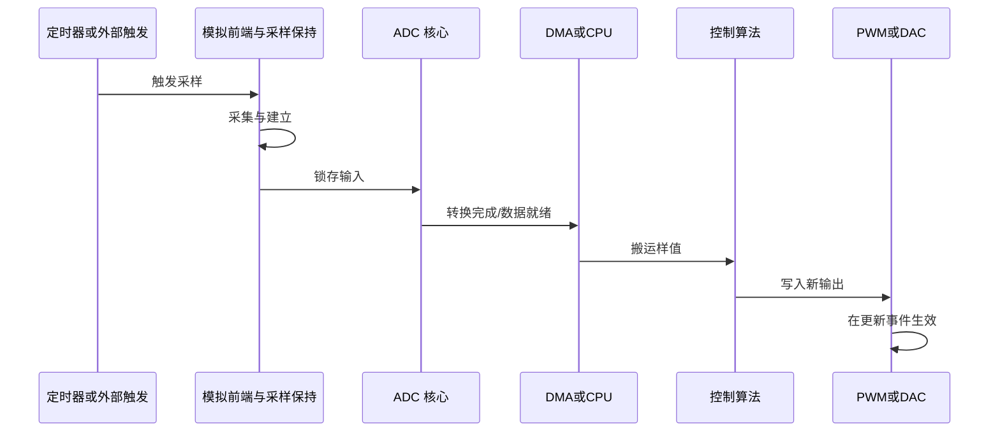

# 时钟、触发与实时采样时序

实时系统需要区分触发、采样、转换完成、数据可读、算法完成和输出更新。只用中断入口或输出数据率表示采样时刻，会漏掉模拟建立和数字滤波延迟。

## 1. 一次采样经过的时刻

控制延迟应从物理采样时刻算到新控制量实际作用于被控对象的时刻。

## 2. 采集时间和转换时间

对 SAR ADC：

$$
T_{sample}=T_{acq}+T_{conv}.
$$

采集时间用于给内部采样电容建立，转换时间用于逐次比较。提高 ADC 时钟可能缩短两者，但器件通常规定最大时钟、最小采集周期和不同分辨率下的转换周期。

ΔΣ ADC 的模拟输入连续进入调制器，输出样值由数字滤波器形成。此时“采样时刻”可能对应滤波器对一段历史输入的加权中心，必须结合群延迟解释。

## 3. 延迟与吞吐率

流水线系统可以每周期输出一个样值，但当前输出对应若干周期前的输入。需要分别记录：

- 首样延迟；
- 稳态吞吐率；
- 通道切换后的滤波器建立；
- 数字接口和缓存延迟；
- 延迟是否固定、是否随配置变化。

固定延迟可进入离散控制模型；不确定抖动会增加相位噪声和调度裕量需求。

## 4. 多通道同步

模拟 MUX 轮询的通道并非同时采样。若通道间隔为 $\Delta t$，对变化信号会形成相位和幅值误差。同步采样 ADC 使用每通道独立采样保持，在共同触发边沿锁存输入，再依次或并行转换。

需要检查：

- 通道间孔径偏差；
- 触发分配偏差；
- 各通道前端群延迟匹配；
- 数字滤波器相位和抽取同步；
- 数据帧中通道顺序和时间戳。

## 5. PWM 同步电流采样

电机控制中，电流采样应避开开关节点跳变、二极管反向恢复、放大器过载恢复和分流器无有效电流的区间。分析至少包含：

1. PWM 状态切换后模拟前端何时恢复；
2. 有效分流器导通窗口有多宽；
3. 触发到真正采样之间有多少硬件延迟；
4. ADC 采集时间是否落在有效窗口内；
5. 转换、DMA 和计算能否在 PWM 更新截止点前完成；
6. 新占空比在本周期还是下一周期生效。

在单分流器或低侧分流器拓扑中，可采样窗口随占空比变化，可能需要采样点重排、脉冲移位或观测器补偿。

## 6. 时钟树

采样时钟可能经过晶振、PLL、分频器、门控和分配缓冲。需要确认：

- 平均频率误差；
- 周期抖动和长期漂移；
- 与 PWM、DAC 或通信系统的同步关系；
- PLL 相位噪声积分范围；
- 不同时钟域之间的数据跨域方式；
- 启停、低功耗和时钟切换时的异常样值。

动态性能中的总抖动预算见 [[004-动态指标、噪声与时钟抖动]]。

## 7. 数字接口吞吐率

串行 ADC 的接口速率必须覆盖数据位、状态位、命令、片选间隔和多通道开销。粗略下限为

$$
f_{serial}\ge f_s\,N_{frame},
$$

其中 $N_{frame}$ 是每个样值实际占用的串行时钟数，不只是 ADC 分辨率。还应留出软件调度、总线仲裁和器件规定的时序裕量。

高速 ADC 可能使用并行 CMOS、LVDS 或 JESD204。此时还要处理数据对齐、帧时钟、确定性延迟和信号完整性。

## 8. DMA、缓存与时间戳

DMA 可以降低 CPU 搬运负担，但不会自动保证数据没有丢失。需要设计：

- 单缓冲、双缓冲或环形缓冲；
- 半满和全满事件的处理上限；
- 缓冲区所有权和缓存一致性；
- 溢出、欠载和丢帧计数；
- 多通道帧边界；
- 采样触发时间戳，而不是只记录处理时间。

## 9. DAC 与 PWM 更新时刻

DAC 可能在写寄存器后立即更新，也可能等待 LDAC 或同步事件。PWM 通常有影子寄存器，在计数器更新事件才装载新比较值。控制软件应明确写入时刻和实际生效时刻，避免一周期延迟被遗漏。

## 10. 时序预算模板

| 环节 | 最小值 | 典型值 | 最大值 | 是否确定 |
|---|---:|---:|---:|---|
| 模拟前端恢复 |  |  |  |  |
| 触发分配 |  |  |  |  |
| ADC 采集 |  |  |  |  |
| ADC 转换/数字滤波 |  |  |  |  |
| 接口或 DMA |  |  |  |  |
| 算法执行 |  |  |  |  |
| PWM/DAC 等待更新 |  |  |  |  |
| 总采样到执行延迟 |  |  |  |  |

将最大延迟和抖动带入控制模型，比只验证平均执行时间更可靠。
