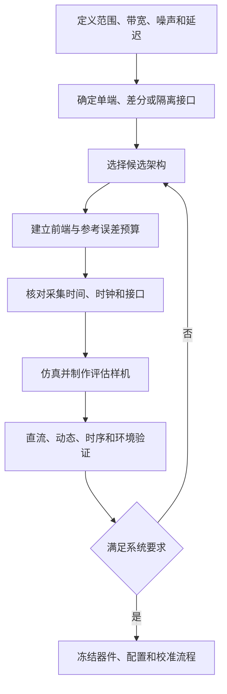

# 转换器选型与信号链验证

选型从系统需求和误差预算开始，验证则要覆盖直流、动态、时序、温度、电源和故障条件。评估板上的最佳指标不能直接代表产品板上的整条信号链。

## 1. 把需求写成数字

| 项目 | 需要明确的量 |
|---|---|
| 输入或输出范围 | 最小、最大、共模、过载 |
| 信号带宽 | 通带、阻带干扰、允许相位延迟 |
| 静态性能 | 偏置、增益、INL、温漂 |
| 动态性能 | RMS 噪声、SNR、THD、SFDR |
| 时间性能 | 采样率、延迟、通道偏差、建立时间 |
| 环境 | 温度、电源、EMI、隔离、共模瞬变 |
| 系统资源 | 功耗、接口、存储、计算和校准时间 |
| 安全 | 输入故障、输出短路、诊断覆盖率 |

“需要 16 位 ADC”无法指导选型。应改写成目标带宽内允许多少输入参考噪声、多少直流误差和多少延迟。

## 2. ADC 选型流程

## 3. DAC 选型流程

DAC 需要额外确认：

- 输出是电压还是电流；
- 单极性还是双极性；
- 负载电阻、电容和电缆；
- 更新率、建立时间和毛刺；
- 单调性、INL 和温漂；
- 输出缓冲、短路能力和顺从范围；
- 重建滤波和镜像要求；
- 上电、复位和通信失效时的输出状态。

## 4. 修正后的场景起点

| 应用 | 常见候选 | 不能忽略的指标 |
|---|---|---|
| 温度、压力等慢速电压传感器 | SAR 或 ΔΣ | 源阻抗、漂移、数据率、工频干扰 |
| 电阻桥和称重 | 带 PGA 的 ΔΣ | 输入噪声、比例参考、建立时间 |
| 电池监测 | MCU SAR 或监测专用 ADC | 输入分压漏电、校准、低功耗 |
| 音频采集与播放 | 音频 ΔΣ ADC/DAC | 动态范围、失真、群延迟、I²S 时钟 |
| 电机电流控制 | SAR 或隔离式 ΔΣ | PWM 同步、总延迟、共模瞬变 |
| 示波器与通信接收 | Pipeline/交织 ADC | 模拟带宽、抖动、SFDR、接口吞吐 |
| 精密控制电压 | 单调电压 DAC | INL、温漂、建立、输出缓冲 |
| 高频波形生成 | 电流舵 DAC | 更新率、SFDR、毛刺、重建滤波 |

## 5. 直流测试

### 5.1 零点和增益

施加可追溯的零点和接近满量程输入，记录平均码、标准差和温度。两点可以分离线性偏置与增益，但不能评价 INL。

### 5.2 码密度和直方图

固定直流输入可观察短期噪声和码分布。用慢速高线性斜坡或正弦输入做码密度测试，可估计 ADC DNL 和失码。测试源线性度、采样数量和端点处理会影响结果。

### 5.3 INL

用高精度源扫描输入，按数据手册采用的端点或最佳拟合方法计算转换阈值偏差。测试系统的不确定度应明显小于目标 INL。

## 6. 动态测试

低失真正弦源经过合适带通或低通滤波后送入 ADC，使用相干采样或窗函数做 FFT。计算：

- SNR；
- SINAD 与 ENOB；
- THD；
- SFDR；
- 噪声底和已知杂散。

分别改变输入频率和幅度，能区分量化/热噪声、前端失真和抖动限制。完整口径见 [[004-动态指标、噪声与时钟抖动]]。

## 7. 时序和瞬态测试

- 示波器同时观察触发、模拟输入、数据就绪和 PWM/DAC 更新；
- 测量采样到结果可用的延迟和抖动；
- 对多通道施加相同信号，测通道间幅相偏差；
- 做最大通道跳变，检查采集建立与串扰；
- 对 DAC 做主进位跳变和满量程阶跃；
- 验证启动、休眠唤醒、时钟切换和配置变化后的首批样值。

## 8. 电源、参考和数字活动测试

分别改变模拟电源、数字电源和参考电压，观察零点、增益、噪声和杂散。让 SPI、DMA、无线和高边沿 GPIO 处于最坏活动状态，检查数字耦合。

参考端可用高带宽探头观察瞬态，但探头电容和接地方式可能改变参考网络，测量前应评估探测负载。

## 9. 温度与长期稳定性

至少在低温、室温和高温重复：

- 零点与增益；
- RMS 噪声；
- 参考电压；
- 采样率与时钟；
- DAC 输出和负载能力；
- 校准残差。

若产品需要长期精度，还要考虑参考老化、电阻漂移、封装应力和重新校准周期。

## 10. ADC-DAC 环回的局限

DAC 输出接 ADC 输入可以快速验证数据通路、线性趋势和时序，但测得误差是 DAC、缓冲、滤波、ADC 和参考共同作用。若两者共用参考，部分增益误差还可能相互抵消。

环回不能替代独立精密源和测量仪器，只适合系统自检或初步诊断。

## 11. 评审清单

- [ ] 标称位数已转换为噪声和误差需求；
- [ ] 输入差分范围、共模和故障范围都满足；
- [ ] 抗混叠滤波器有明确的阻带衰减依据；
- [ ] SAR 采集时间或 ΔΣ 建立延迟已经验证；
- [ ] 参考噪声、温漂和动态负载进入预算；
- [ ] 接口吞吐率包含帧开销和调度裕量；
- [ ] 控制延迟从物理采样算到输出实际生效；
- [ ] 软件保留原始码、状态和溢出诊断；
- [ ] 校准源、温度和系数版本可追溯；
- [ ] 直流、动态、时序、温度和故障测试均有判定标准。
