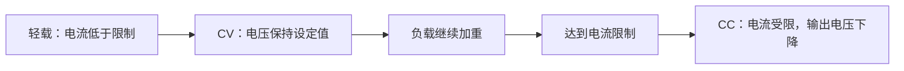

# 直流电源、电子负载与源测量单元

可编程直流电源负责向被测对象提供受控电压或电流，电子负载负责吸收能量，源测量单元把激励和精密测量组合在一起。三者的象限能力、动态响应和保护方式不同，不能仅按电压、电流和功率数字互相替代。

## 1. CV 与 CC 描述两种调节状态

电源在恒压模式（CV）下调节输出电压，负载决定电流；达到电流限制后进入恒流模式（CC），电源降低输出电压以限制电流。两种模式的分界近似为：

$$
R_{\text{load}}=\frac{V_{\text{set}}}{I_{\text{limit}}}
$$

电源进入 CC 不一定表示故障，可能是启动浪涌、负载过重、接线压降或限流值设置过低。判断时应同时观察输出端电压、电流和模式指示。

## 2. 上电前设置限压与限流

建议顺序为：

1. 输出关闭，设定电压和保守的电流限制；
2. 在电源端确认极性、输出浮地状态和通道关联方式；
3. 连接被测对象，检查线径、接头和保护地；
4. 需要时先在电源端验证设定，再接入敏感负载；
5. 打开输出，观察启动电流、模式切换和被测板温升；
6. 功能稳定后逐步提高电流限制，不把限流长期设为仪器最大值。

限流不能保证所有器件安全。电源输出电容、线缆电感和被测对象上的储能会在保护环路响应前释放能量。低压大电流系统仍可能烧毁走线、连接器和半导体。

## 3. 线缆压降与远端感测

大电流时，输出线和接触电阻造成：

$$
V_{\text{DUT}}=V_{\text{supply}}-I(R_{+}+R_{-})
$$

远端感测用独立细线读取负载端电压，由电源补偿动力线压降。感测线应直接接到希望调节的端点，避免与大电流线共享接触点。需要核对：

- 最大允许补偿电压；
- 感测线断开时的保护行为；
- 输出线电感和负载电容造成的稳定性；
- 是否要求感测线绞合、屏蔽或串联保护电阻。

远端感测提高的是负载端调节能力，不会消除动力线发热和连接器损耗。

## 4. 输出浮地、串并联和反向能量

实验室电源的输出是否浮地、能承受多大对地电压，要看具体型号。绿色接地端通常连接机壳保护地，不等同于所有负端都与地相连。

通道串联或并联前要检查说明书中的通道隔离、对地额定值、均流方式和主从设置。随意串联可能超过某个输出端对地绝缘额定值，并联则可能造成通道之间反灌电流。

普通单象限电源善于输出能量，未必能够吸收被测对象回灌的能量。电机减速、母线电容放电、其他电源并联和感性负载断开都可能抬高电源端电压。可根据系统使用：

- 能吸收功率的双向电源；
- 电子负载或制动电阻；
- 阻断二极管与独立泄放路径；
- 满足能量额定值的浪涌钳位。

## 5. 电子负载的模式和稳定性

| 模式 | 控制关系 | 常见用途 | 主要风险 |
|---|---|---|---|
| CC | 保持电流 | 电源负载调整率、放电测试 | 与某些电源控制环相互作用 |
| CV | 保持端电压 | 电流源、充电器和限流特性 | 设定点附近可能跳变 |
| CR | 近似 $I=V/R$ | 电阻性负载模拟 | 低电压下能力受限 |
| CP | 近似 $I=P/V$ | 变换器输入和恒功率负载 | 电压降低时电流增加，呈负增量阻抗 |

电子负载的最小工作电压、最大功率和瞬态能力会限制低压大电流测试。动态负载的上升时间也受线缆电感和夹具限制。电源与负载控制环可能发生振荡，看到电压摆动时要同时检查接线、模式和环路交互。

## 6. 动态负载测试要定义边沿和测量点

负载阶跃不能只写“0 A 到 5 A”。还要给出上升时间、持续时间、重复频率、静态工作点和电流回路位置。电源端与负载端的波形可能因线缆电感明显不同。

测量负载端电压时，探头应直接跨在负载供电与返回端，避免把大电流回路上的压降算进电源芯片的局部响应。示波器带宽、探头接地和电流监测延迟也要记录。

## 7. 源测量单元适合小信号和宽动态范围

源测量单元（SMU）可以源出电压并测电流，或源出电流并测电压。部分型号支持四象限工作，可输出或吸收电压与电流。常见用途包括：

- 二极管、MOSFET 和传感器的 I-V 扫描；
- 漏电流、绝缘电阻和休眠电流测量；
- 电池充放电与器件参数测试；
- 四线电阻测量。

SMU 的合规限制用于约束另一个量。例如源电压时设置电流合规值。达到合规限制后，实际激励不再等于设定值，数据中应保留合规状态，不能只导出电压电流两列。

## 8. 开关电源与线性电源不能只按噪声标签选择

线性电源通常有较低开关纹波，开关电源通常效率更高，但实际输出噪声还受拓扑、控制模式、负载、接地和测量带宽影响。电源数据手册中的纹波规格只有在规定带宽、探头连接和输出电容条件下才可比较。

低频漂移、工频分量、开关纹波和尖峰应分别测量。用长探头地线测得的尖峰常受测量环路影响，方法见 [[004-示波器、探头与接地]]。

## 9. FOC 控制器台架的供电边界

逆变器和电机会让供电系统具备双向能量流。台架上电前应明确：

- 直流母线最大电压、电流和电容储能；
- 电机减速或外力拖动时的再生能量去向；
- 预充、主接触器、泄放和急停路径；
- 电源是否允许反向电流，过压后如何处理；
- 控制电源与功率电源的上电顺序；
- 编码器异常或软件失控时如何停止机械运动。

普通台式电源不能自动充当制动负载。没有吸收路径时，降低电源设定值也不能迫使母线快速下降。

## 10. 检查表

- [ ] 电压、电流、功率、对地和反向能量额定值均满足；
- [ ] 输出关闭时完成接线，极性和线径正确；
- [ ] 电流限制从保守值开始设置；
- [ ] 远端感测接在实际调节点，并考虑断线保护；
- [ ] 串联、并联和浮地方式得到制造商允许；
- [ ] 感性负载、母线电容和电机再生能量有释放路径；
- [ ] 动态测试写明负载边沿、测量点和带宽；
- [ ] 测试结束后确认输出关闭且储能已释放。
