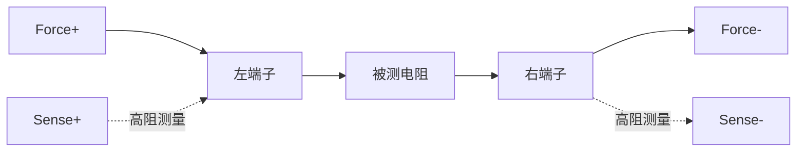

# LCR表、阻抗与四线测量

真实器件的阻抗随频率、测试电平、直流偏置、温度和安装方式变化。LCR 表给出的电容、电感、ESR 或 Q 值，都是在某个测试条件和等效模型下由复阻抗换算得到的结果。

## 1. 阻抗包含幅度和相位

正弦稳态下：

$$
Z=R+jX
$$

其中 $R$ 为实部，$X$ 为电抗。理想电容和电感分别为：

$$
Z_C=\frac{1}{j\omega C},\qquad Z_L=j\omega L
$$

实际器件还包含引线电阻、介质损耗、绕组电容、磁芯损耗和安装寄生。超过自谐振频率后，器件呈现的容性或感性可能反转，此时继续用单一 C 或 L 数值描述会失去意义。

## 2. 串联和并联模型适用范围不同

LCR 表常把同一个测得阻抗换算成串联模型或并联模型：

- 串联模型适合低阻抗器件或损耗以串联电阻表示的场景；
- 并联模型适合高阻抗器件或泄漏以并联电阻表示的场景。

两种模型可能给出不同的 C、L 和 R 数值，但都能在当前测试频率重建同一个复阻抗。记录结果时要同时写明测试频率和模型，不能只写“电容为 9.8 µF”。

在串联等效模型中，常见派生量包括：

$$
Q=\frac{|X|}{R_s},\qquad D=\frac{1}{Q}
$$

具体定义随串并联模型和仪器算法变化，应以仪器手册为准。

## 3. 测试频率、电平和偏置都是结果的一部分

| 器件 | 需要控制的条件 | 原因 |
|---|---|---|
| 陶瓷电容 | 频率、交流电平、直流偏置、温度 | 高介电常数材料的电容量会随偏置和温度变化 |
| 电解电容 | 频率、极性、偏置、温度 | ESR 和容量随频率温度明显变化 |
| 电感 | 频率、交流电流、直流偏置 | 磁芯损耗、增量电感和饱和受工作点影响 |
| 变压器 | 频率、端口状态、绕组连接 | 漏感、励磁电感和分布电容依赖测试方式 |
| 电阻 | 测试电流、温度、频率 | 自热、温度系数和寄生电感电容影响结果 |

台式 LCR 表的小信号测试不能自动代表器件在变换器实际纹波电流和直流偏置下的参数。功率磁性元件需要使用带偏置能力的夹具或在实际工作点附近采用其他方法测量。

## 4. 两线法包含引线和接触电阻

两线测量中，同一对导线既提供测试电流又测量电压：

$$
R_{2W}=R_{DUT}+R_{lead+}+R_{lead-}+R_{contact}
$$

被测电阻远大于引线电阻时，这个误差可以忽略。测量分流器、连接器、铜排、绕组或接触电阻时，引线与接触电阻可能与目标量同量级。

## 5. 四线开尔文法分离激励和感测

Force 线提供测试电流，Sense 线直接接在被测端点并以高输入阻抗测量压降。Sense 线电流很小，因此其引线压降对结果影响较小：

$$
R_{DUT}=\frac{V_{sense}}{I_{force}}
$$

四根线并不自动形成开尔文连接。Sense 接点必须位于 Force 接点内侧并落在要定义的器件端子上，否则仍会把焊盘、铜箔或接触电阻算入结果。

## 6. 热电势和自热限制低阻测量

不同金属接点和温度梯度会产生微伏级热电势。测量微欧至毫欧电阻时，可用正反向电流测量：

$$
R=\frac{V_{+I}-V_{-I}}{2I}
$$

这样可以消除近似不随电流方向变化的热电势。反转速度不能快到系统尚未建立，也不能慢到温度漂移已经明显变化。

测试电流产生功耗：

$$
P=I^2R
$$

提高电流能增大测量电压，却也会引起自热和阻值变化。测试电流应在信噪比与温升之间取舍。

## 7. 开路、短路和负载补偿修正夹具寄生

- 开路补偿估计夹具并联电容和漏电；
- 短路补偿估计串联电阻与电感；
- 负载补偿使用已知标准修正更复杂的残余误差。

补偿应在与实际测量相同的频率、电平、量程、线缆位置和夹具状态下完成。补偿后移动线缆、改变夹具间距或更换转接头，都可能使补偿失效。

零点按钮只能对当前连接作数值修正，不能消除夹具重复性差、屏蔽不足或器件安装位置不一致。

## 8. 电容测量要先安全放电

电容接入仪器前应通过合适电阻放电，并用独立仪表确认端电压降到安全范围。直接短接大电容会产生高峰值电流、电弧和端子损伤。

电解电容还要注意极性和允许反向电压。LCR 表是否提供直流偏置、测试端是否允许带电接入，应查阅说明书。未知带电电容不能直接接入普通 LCR 输入端。

## 9. 分流器和电机绕组测量

### 电流分流器

分流器的标称电阻、温度系数、功率系数和寄生电感都会影响电流测量。开尔文端要避开大电流焊盘压降。动态测量还需建立：

$$
V_{shunt}=I R+L\frac{dI}{dt}
$$

快速边沿下，寄生电感产生的电压可能高于电阻压降。差分放大器输入滤波、共模瞬态和布局同样要进入测量链。

### 电机相电阻

电机相电阻通常很低，并随绕组温度变化。测量时应记录端子组合、转子状态、测试电流和绕组温度。三相星形连接从两个端子测得的是两相绕组串联值，不能直接当作单相电阻。

电感还随转子位置、测试频率、幅度和磁饱和变化。用于 FOC 参数辨识时，要说明测得的是小信号增量电感、静态电感还是控制模型中的等效参数。

## 10. 选择方法

| 目标 | 推荐方法 | 关键控制量 |
|---|---|---|
| 普通电阻 | 万用表两线法 | 量程、接触、断电 |
| 毫欧级电阻 | 四线电阻表或 SMU | 测试电流、热电势、自热 |
| 电容与 ESR | LCR 表 | 频率、电平、偏置、模型 |
| 电感与 Q | LCR 表或阻抗分析仪 | 频率、直流偏置、夹具 |
| 高频阻抗 | 阻抗分析仪或 VNA | 校准面、夹具、去嵌入 |
| 动态分流电流 | 分流器与差分放大器/探头 | 带宽、寄生电感、共模 |

## 检查表

- [ ] 测试频率、电平、直流偏置和温度已记录；
- [ ] 串联或并联等效模型与器件工作区一致；
- [ ] 低阻测量采用真正的四端连接；
- [ ] 热电势、自热和接触重复性得到控制；
- [ ] 开路、短路或负载补偿在当前夹具状态下完成；
- [ ] 电容已安全放电并确认极性；
- [ ] 结果没有越过器件自谐振或仪器有效范围后仍按单一参数解释。
