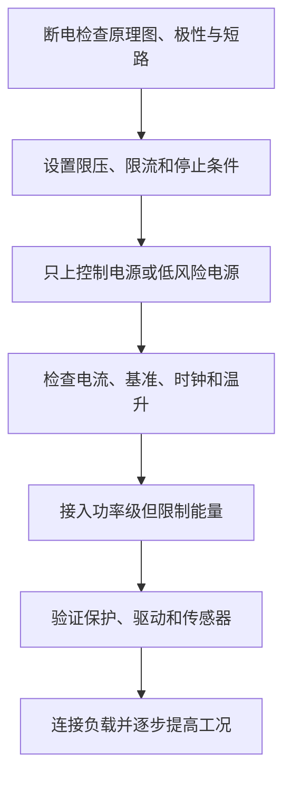

# 实验安全、ESD与上电流程

电子实验的危险不只来自高电压。低压大电流、储能电容、旋转机械、发热器件、电池、激光和错误接地都可能造成伤害或设备损坏。安全措施应根据能量、故障电流、接地和可接近性确定，不能只按直流电压数字判断。

## 1. 先识别能量和故障路径

上电前标出：

- 所有电源及其最大电压、电流和反向能量能力；
- 大电容、电池、电感、马达和可能保持能量的节点；
- 保护地、信号地、机壳地和隔离边界；
- 保险丝、限流、预充、泄放、急停和机械防护；
- 人可能接触的导体、转轴、风扇、散热器和高温表面；
- 单点故障后电流会经过哪里。

电容储能为：

$$
E=\frac{1}{2}CV^2
$$

电压翻倍时，储能增加到四倍。断开电源后，电容电压不会立即消失；电机惯量和感性负载也可能把能量送回母线。

## 2. 断电不等于无电

修改接线前应：

1. 停止激励和机械运动；
2. 关闭并隔离所有能量源；
3. 按规定执行锁定挂牌；
4. 通过设计好的泄放路径等待储能释放；
5. 用额定仪表执行 live-dead-live 检查；
6. 确认所有相关导体和电容端电压处于安全范围；
7. 需要时采取防止重新充电或感应电压的措施。

用螺丝刀直接短接电容既不能控制峰值电流，也不能证明后续不会重新充电。泄放电阻要核对阻值、脉冲能量、功率和绝缘额定值。

## 3. 保护地不能为了测量方便而移除

保护地用于在绝缘故障时提供低阻故障路径。台式示波器和信号源的 BNC 外壳通常与保护地相连，错误接地可能短接被测节点。

不得用拆除保护地、两脚转接头或悬浮金属机壳的方法测量高侧节点。应使用额定差分探头、隔离探头、隔离输入仪器或经过风险评估的隔离测量架构。具体分析见 [[004-示波器、探头与接地#8. 台式示波器的地夹通常连接保护地|示波器接地]]。

隔离变压器改变的是某部分电路相对地的关系，不能消除导体之间的触电和储能危险，也不能自动让所有仪器连接都安全。

## 4. CAT 等级、额定值和附件按最低项使用

市电和配电测量需要按位置选择 CAT 等级及额定电压。仪表、表笔、探针、夹具和转接器组成一条安全链，最低额定项决定整套能力。

额定值还可能随频率、脉冲宽度、占空比、海拔和污染等级下降。高压差分探头的差模额定值、每端对地额定值和共模抑制是不同指标，不能互相替代。

万用表安全细节见 [[003-万用表测量原理与安全]]。

## 5. ESD 防护与触电防护要分开

ESD 防护通过受控电阻把人体、工作台、工具和器件保持在接近电位，常用于未上电的静电敏感器件。典型措施包括：

- 经过验证的防静电腕带和接地点；
- 防静电台垫、包装和接地工具；
- 控制环境湿度与绝缘材料；
- 在防静电保护区内运输和拆封敏感器件；
- 定期测试腕带、台垫和接地系统。

防静电腕带不是触电保护用品。接触危险带电电路时，腕带可能增加人体对地通路。带电调试应按电气安全评估决定是否移除腕带、使用隔离工具或调整工作方式，不能机械套用未上电装配区的 ESD 规则。

## 6. 首次上电按阶段增加能量

### 断电检查

- 核对器件方向、连接器定义、电源极性和装配缺陷；
- 测电源轨对地电阻，理解电容充电造成的读数变化；
- 检查功率器件栅极、隔离区和关键焊点；
- 确认测试点不会被探头或夹子短接；
- 准备急停、灭火和机械防护。

### 受限能量上电

- 从保守电流限制和较低母线电压开始；
- 先验证辅助电源、复位、时钟和基准；
- 监测输入电流、关键电源和异常温升；
- 功率级可先不接电机，或使用受控的低能量负载；
- 在提高能量前验证过流、欠压、过压和关断路径。

串联灯泡、限流电阻和实验室电源限流只适用于特定电压与功率范围，不能当作通用保护。它们对快速半导体故障的响应可能太慢。

## 7. 停止条件要在上电前写明

出现以下现象时应立即去能量化并排查：

- 输入电流超过计划值或电源进入意外限流；
- 母线、电源轨或基准超出安全范围；
- 器件快速升温、冒烟、异味、异常声音或电弧；
- 栅极驱动重叠、功率器件误导通或保护失效；
- 电机运动方向、速度或转矩不受控；
- 仪器、探头或线缆接近额定上限；
- 保护地、隔离或急停状态不确定。

停止后先隔离能量并验证无电，再移动探头、触摸器件或重新接线。

## 8. FOC 台架还包含机械和再生风险

电机控制实验要额外处理：

- 电机、联轴器和负载的固定及防护罩；
- 超速、反转和扭矩阶跃；
- 编码器接线错误导致的位置反馈失控；
- 电机减速、外部拖动和负载回馈产生的母线过压；
- 功率模块、制动电阻和电机表面的高温；
- 长电机线缆的共模电压、反射和 EMI；
- 急停是否真正切断功率，而不只是向软件发送命令。

首次闭环运行前可先验证电流采样极性、相序、转子位置方向和 PWM 关断逻辑。低母线电压和受限电流能减少损坏范围，但仍要保留硬件保护。

## 9. 测量过程中控制接线变化

- 输出关闭且确认无电后再换量程插孔、探头或接线；
- 高能量测量优先使用固定夹具，避免手持探针滑脱；
- 探头线、通信线和电源线远离旋转部件；
- 示波器、信号源、电脑和被测对象接入前先画出地路径；
- 高低压区域保持间距，线缆和标签清晰；
- 一次只改变一个条件，并记录改变前后的状态。

单手操作可以降低某些触电路径的概率，但不能替代断电、绝缘、额定附件、安全距离和个人防护装备。

## 10. 实验结束也要验证安全状态

1. 停止控制输出和机械运动；
2. 关闭负载、信号源和各路电源；
3. 隔离电池、母线和外部驱动源；
4. 等待并验证电容和感性储能释放；
5. 取下探头和夹具，恢复保护盖与原接线；
6. 保存原始数据、仪器状态和异常记录；
7. 对过载、跌落或疑似损伤的附件停止使用并隔离标记。

## 11. 上电与测量检查表

- [ ] 危险电压、故障电流、储能和机械运动已经识别；
- [ ] 保护地、信号地、机壳地和隔离边界已经画清；
- [ ] 仪器及附件额定值覆盖正常和故障状态；
- [ ] 电流限制、保险丝、预充、泄放和急停可用；
- [ ] ESD 措施没有引入危险的人体对地通路；
- [ ] 首次上电按阶段增加能量，并有明确停止条件；
- [ ] 功率电子系统有吸收再生能量的路径；
- [ ] 断电后通过额定仪表验证无危险电压；
- [ ] 异常附件已停止使用，没有继续带病测试。

## 参考资料

- [Fluke：万用表测量类别与安全选择](https://www.fluke.com/en-gb/learn/blog/safety/multimeter-guide)
- [Tektronix：接地参考式示波器的安全要求](https://www.tek.com/en/manual/oscilloscope/2-series-mso-specification-and-performance-verification-manual-2-series-mso)
- 仪器、探头、电源和被测设备各自的安全说明及额定值表
