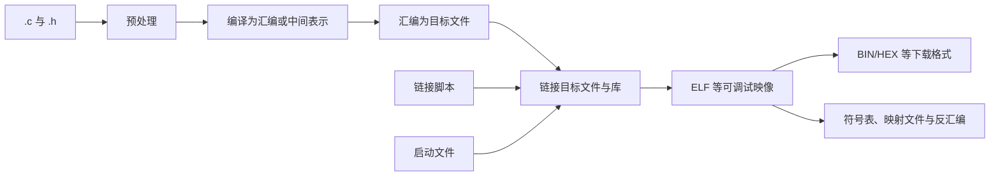
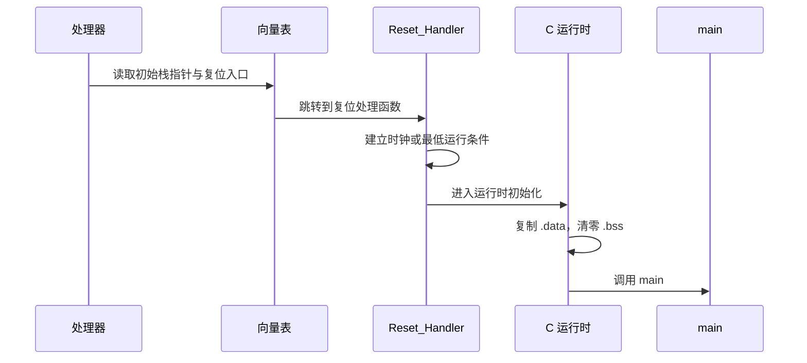

# 从复位到 main：执行环境与构建过程

固件不是从源文件第一行开始运行。处理器复位后先取得初始状态和复位入口，启动代码建立 C 运行环境，随后才调用 `main`。理解这条链路，才能解释全局变量为什么有初值、未初始化变量为什么为零，以及代码和数据最终放在哪里。

## 独立式环境与宿主环境

桌面程序通常运行在宿主环境中，操作系统提供进程、文件、终端和完整标准库。多数 MCU 固件运行在独立式环境中，C 实现只保证一部分标准能力，程序入口、启动过程和可用库由工具链与平台决定。

这带来几项直接影响：

- `main` 之前有平台启动代码，不能假设复位后立刻执行用户函数。
- `printf`、文件 I/O、时钟和堆分配可能不存在，也可能由工程自行重定向。
- 编译器扩展、ABI、启动文件和链接脚本会参与程序行为。
- 语言标准没有定义外设寄存器、关中断和缓存维护，这些能力来自平台接口。

## 源代码怎样成为固件映像

预处理阶段展开宏和条件编译；编译阶段检查类型并生成目标代码；链接阶段解析跨文件符号，并按链接脚本放置各段。下载文件通常只保留烧写所需内容，ELF 映像还包含符号、段信息和调试数据，排查问题时不要只留下 BIN 或 HEX。

## 从复位到 main

以常见 Cortex-M 工程为例，具体顺序由器件和工具链决定：

有些工程在 C 运行时前调用 `SystemInit`，有些由厂商启动库完成更多处理。构造函数、C++ 运行时、安全扩展和多核启动还会增加步骤。判断当前工程的真实顺序，应查看启动文件、链接脚本和最终反汇编。

## 常见内存段

| 段 | 常见内容 | 上电映像与运行位置 |
|---|---|---|
| `.text` | 机器指令 | 通常存于 Flash，也可能复制到 RAM 执行 |
| `.rodata` | 只读常量、字符串 | 通常位于 Flash |
| `.data` | 有非零初值的静态存储期对象 | 初值在 Flash，运行对象在 RAM |
| `.bss` | 零初始化或未显式初始化的静态存储期对象 | 启动时在 RAM 清零 |
| `.noinit` | 按工程约定不初始化的数据 | 可能跨复位保留，不能假设首次上电值有效 |
| 栈 | 调用帧、局部对象、保存的上下文 | RAM，由链接和运行约定决定 |
| 堆 | 动态分配区域 | 可选，大小和分配器由工程决定 |

段名和布局不是 C 语言统一规定。多个 RAM 区、紧耦合存储器、外部存储器、DMA 专用区和引导程序都会改变布局。

## 用映射文件验证资源预算

只看 IDE 显示的总 Flash、RAM 占用不够。映射文件至少要检查：

- 哪些目标文件和符号占用最多空间；
- 大数组是否进入预期的 RAM 区；
- 中断向量表和启动段是否位于正确地址；
- 栈、堆、DMA 缓冲区之间是否留出足够空间；
- 未使用函数是否因链接选项被保留；
- 调试版与发布版的布局是否发生意外变化。

栈不能用固定的“典型大小”代替分析。调用深度、局部数组、递归、中断嵌套、FPU 上下文和库函数都会改变最坏占用。可结合编译器栈使用报告、静态调用图、栈填充测量和压力测试估算，并给估算误差留下余量。

## 优化改变可观察结果

未定义行为、未初始化读取、越界和数据竞争常在 `-O0` 下暂时不暴露，开启优化后才出现。调试版能运行不能证明代码符合语言规则。发布配置至少保留编译告警、符号化映像、映射文件和可重现的构建参数，并对关键路径查看反汇编与时序测量。

## 检查清单

- 能从向量表追踪到 `main`，知道运行时在中间做了什么。
- 能在映射文件中找到关键函数、全局对象、栈和堆。
- 区分加载地址与运行地址，不把段名当作跨工具链保证。
- 知道当前工程使用的语言版本、编译器版本、ABI、链接脚本和启动文件。
- 发布配置也经过测试，不依赖调试器或半主机环境才能运行。

## 继续学习

- [[002-整数、位运算与定点数值]]
- [[011-交叉编译工具链的组成]]：驱动这些构建阶段的工具链由什么组成
- [[012-工具链的获取与版本管理]]：从哪获取、如何多版本共存
- [[04-Microcontrollers/07-MCU启动与链接脚本/001-上电启动流程|MCU 上电启动流程]]
- [[04-Microcontrollers/07-MCU启动与链接脚本/003-链接脚本LinkerScript|链接脚本]]
- [[04-Microcontrollers/07-MCU启动与链接脚本/004-启动文件中的C初始化|启动文件中的 C 初始化]]
