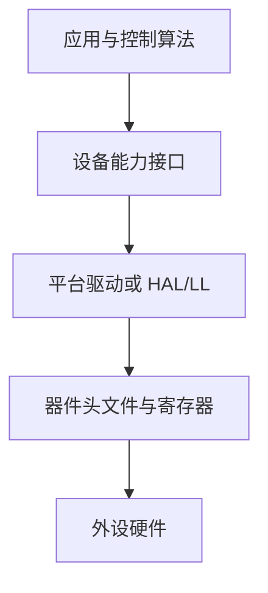

# 寄存器访问、volatile 与硬件抽象

内存映射 I/O 把外设寄存器放进处理器地址空间，但寄存器不是普通 RAM。一次读取可能清除标志，一次写入可能启动转换，某些位写 1 才清除，保留位还要求保持复位值。C 表达式必须服从参考手册定义的访问语义。

## `volatile` 保证什么

`volatile` 告诉实现，对该对象的访问具有外部可观察性，不能按普通对象那样随意消除或合并。它常用于内存映射寄存器，以及由平台定义的异步环境会改变的对象。

它不提供以下保证：

- 复合表达式原子执行；
- 多个执行上下文互斥；
- 非 `volatile` 内存与该访问之间的顺序；
- CPU、总线、缓存和外设已经完成同步；
- 代码没有数据竞争。

因此，`volatile` 不能替代原子操作、临界区、锁、编译器屏障或处理器内存屏障。需要哪一种机制，要从数据共享关系和处理器内存模型推导。

## 优先使用器件头文件

厂商头文件或 CMSIS 设备头文件通常已经定义寄存器结构、基地址、访问限定符和字段掩码：

```c
typedef struct {
    __IOM uint32_t CTRL;
    __IM  uint32_t STATUS;
    __OM  uint32_t COMMAND;
    uint32_t RESERVED0;
} peripheral_regs_t;
```

`__IM`、`__OM`、`__IOM` 分别表达只读、只写和读写意图，具体宏定义由 CMSIS 与编译器适配层提供。保留成员用于保证偏移，不能随意删除。正式工程应使用与芯片型号、修订版和软件包版本匹配的设备头文件，不要在业务模块重复维护裸地址结构体。

若平台没有设备头文件，手工定义映射前至少验证：

- 基地址与每个成员偏移；
- 寄存器访问宽度和对齐；
- 只读、只写和读写属性；
- 复位值、保留位和字段含义；
- 编译器的布局规则与静态偏移断言。

## 读改写并不总是安全

```c
REG |= MASK;
```

这行代码通常会生成“读寄存器、修改副本、写回寄存器”三个动作。以下情况不应直接使用：

- 寄存器含有 W1C、W0C 或读清除标志；
- 寄存器只写，读取结果未定义；
- 硬件可能在读写之间改变其他位；
- 中断或另一个执行单元也会修改同一寄存器；
- 芯片提供了专用的置位、清位或原子访问寄存器。

清除 W1C 标志通常直接写入要清除的掩码：

```c
/* 仅在参考手册明确 STATUS 位为 W1C 时成立。 */
timer->STATUS = TIMER_STATUS_UPDATE_Msk;
```

不能把这段代码迁移到 W0C、读清除或“写入完整状态值”的寄存器。寄存器语义属于接口契约，注释应写明依据的器件与手册章节。

## 位域不适合作为通用寄存器映射

C 位域的分配顺序、存储单元和若干布局细节由实现决定；对 `volatile` 位域的访问宽度也受编译器选项和 ABI 影响。厂商头文件若使用位域，应按该工具链的规定使用。自建跨平台驱动时，位置常量和掩码更容易审查：

```c
#define CTRL_ENABLE_Pos  3U
#define CTRL_ENABLE_Msk  (UINT32_C(1) << CTRL_ENABLE_Pos)
```

通信帧和持久化格式也不应依赖位域布局。

## 初始化顺序属于硬件协议

外设配置不是一组可以任意重排的寄存器赋值。常见顺序包括：

1. 打开外设与总线时钟；
2. 解除复位并等待平台要求的周期；
3. 在外设关闭或空闲状态配置字段；
4. 清理旧标志并配置中断或 DMA；
5. 按规定顺序使能数据通路；
6. 读取状态或使用平台屏障确认操作生效。

编译器屏障只约束编译器重排，处理器屏障约束处理器或总线观察到的顺序，两者不能互相替代。Cortex-M 上的 `__DMB`、`__DSB`、`__ISB` 语义也不同，应按 Arm 与器件文档指定的场景使用，不要把每次寄存器访问都包进屏障。

## 抽象层按变化原因分开



控制算法需要的是“在指定时刻提交三相占空比”或“取得带时间戳的电流样本”，不应直接依赖某个定时器实例。驱动层负责把能力映射到具体寄存器。性能关键路径可以下沉到更低层，但仍要保留可替换的接口和测试边界。

HAL、低层库和直接寄存器访问没有固定的优劣排序。选择取决于时序预算、可移植性、代码审查能力、器件支持质量和认证要求。混合使用时要明确每个寄存器由哪一层拥有，避免 HAL 状态与手工写寄存器互相覆盖。

## 检查清单

- 每次特殊寄存器写入都能在参考手册中找到访问语义。
- 不把 `volatile` 描述成原子、互斥或内存屏障。
- 不对 W1C、只写或读清除寄存器做无依据的读改写。
- 优先使用匹配器件版本的头文件和字段掩码。
- 驱动接口表达设备能力，控制算法不持有寄存器地址。
- 同一外设的寄存器所有权和初始化顺序只有一个权威实现。

## 继续学习

- [[005-中断、并发、原子性与内存顺序]]
- [[04-Microcontrollers/02-STM32系列/010-HAL、LL、寄存器与驱动分层|STM32 驱动分层]]
- [Arm CMSIS-Core：外设访问](https://arm-software.github.io/CMSIS_6/latest/Core/group__peripheral__gr.html)
- [GCC：volatile 对象访问](https://gcc.gnu.org/onlinedocs/gcc/Volatiles.html)
