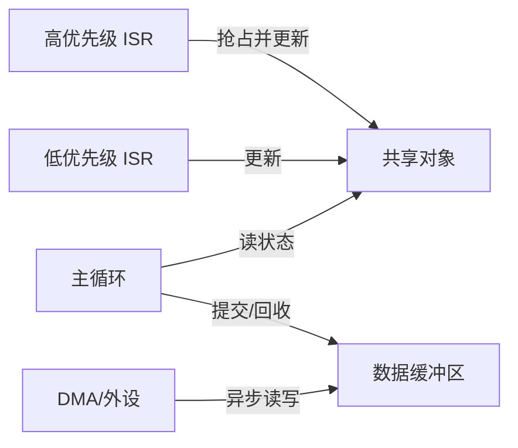

# 中断、并发、原子性与内存顺序

裸机系统也有并发。主循环可能被中断抢占，高优先级中断可以打断低优先级中断，DMA 和外设还会独立读写内存或寄存器。没有 RTOS 只代表没有任务调度器，不代表执行过程不存在竞争。

## 先画出执行者和共享对象



对每个共享对象记录：谁读、谁写、能否抢占、单次访问是否原子、何时交接所有权，以及一致性由什么机制保证。只在变量前添加 `volatile`，没有回答这些问题。

## 原子访问不等于原子操作

目标处理器可能能用一条指令读写对齐的 32 位对象，但 `counter++` 仍然包含读、加和写。中断在中间插入就可能丢失更新。结构体复制、多字宽时间戳和 64 位计数器更容易出现撕裂读取。

可选方法包括：

- 单写者协议，让一个上下文拥有写权限，其他上下文只读取稳定快照；
- 在很短的范围内屏蔽能访问该对象的中断；
- 使用平台验证为无锁的 C 原子类型或处理器原子原语；
- 通过事件队列、邮箱或双缓冲转移所有权；
- 在 RTOS 中使用适合中断上下文的同步 API。

选择机制前要确认最坏阻塞时间。全局关中断虽然简单，却会增加所有可屏蔽中断的延迟；只屏蔽相关中断或使用优先级阈值通常影响更小，但平台依赖也更强。

## 用短临界区读取一致快照

```c
typedef struct {
    int32_t position;
    int32_t velocity;
} motion_sample_t;

motion_sample_t motion_snapshot(void)
{
    irq_state_t state = irq_lock();
    motion_sample_t copy = g_motion_sample;
    irq_unlock(state);
    return copy;
}
```

`irq_lock` 和 `irq_unlock` 是平台抽象，必须保存并恢复先前状态，支持项目允许的嵌套方式，并约束编译器重排。临界区内不做日志、等待、复杂计算或可能调用未知回调的操作。

对于高频数据，可以使用序列计数、双缓冲或无锁单生产者单消费者队列，代价是契约更复杂。只有在测量表明短临界区无法满足期限时，才值得引入复杂协议。

## C 原子类型要确认平台实现

`<stdatomic.h>` 能表达原子对象和内存顺序，但独立式实现可能不完整，某些宽度会调用库函数而不是生成无锁指令。ISR 中使用前要确认：

- 工具链支持所选 C 标准和原子接口；
- 目标类型在该平台无锁；
- 生成代码不会进入不可重入的运行库；
- 所选内存顺序满足生产者与消费者协议；
- 与 DMA 或非一致缓存交互时还执行平台要求的维护操作。

原子操作解决 CPU 执行上下文之间的同步，不自动解决外设总线顺序和缓存一致性。

## ISR 只承担有期限的工作

中断服务函数通常完成以下动作：

1. 读取能确定中断来源的状态；
2. 按参考手册规定清除或确认中断；
3. 捕获有时效的数据和时间戳；
4. 更新短小、契约明确的状态；
5. 通知主循环或任务继续处理。

避免在 ISR 中执行无界循环、阻塞式 I/O、动态分配、长格式化输出和不确定耗时的回调。控制中断可以包含固定长度算法，但必须测量最坏执行时间，并把同优先级和更高优先级的干扰计入端到端期限。

Cortex-M 的中断入口通常由向量表与工具链启动文件约定，普通 C 函数定义配合规定名称即可。是否需要编译器中断属性取决于架构、编译器和 ABI，不能统一填写 `__attribute__((interrupt))`。

## 优先级与共享协议一起设计

高优先级并不自动等于低延迟。长时间屏蔽中断、总线争用、Flash 等待、缓存失效和更高优先级 ISR 都会增加响应时间。优先级设置还必须符合 RTOS 对“可调用内核 API 的中断”的限制。

每条重要中断链路都应记录：

- 触发源和清标志顺序；
- 最晚开始时间和最晚完成时间；
- 允许抢占它的中断；
- 共享对象与同步方式；
- 超时、重入和中断风暴的处理；
- 测量引脚、追踪事件或周期计数器的验证方法。

## 继续学习

- [[006-超级循环、状态机与事件驱动]]
- [[007-DMA、缓冲区与外设数据通路]]
- [[04-Microcontrollers/06-中断与DMA深入/001-中断系统|中断系统]]
- [[10-RTOS与系统/01-RTOS基础/002-RTOS核心概念|RTOS 核心概念]]
