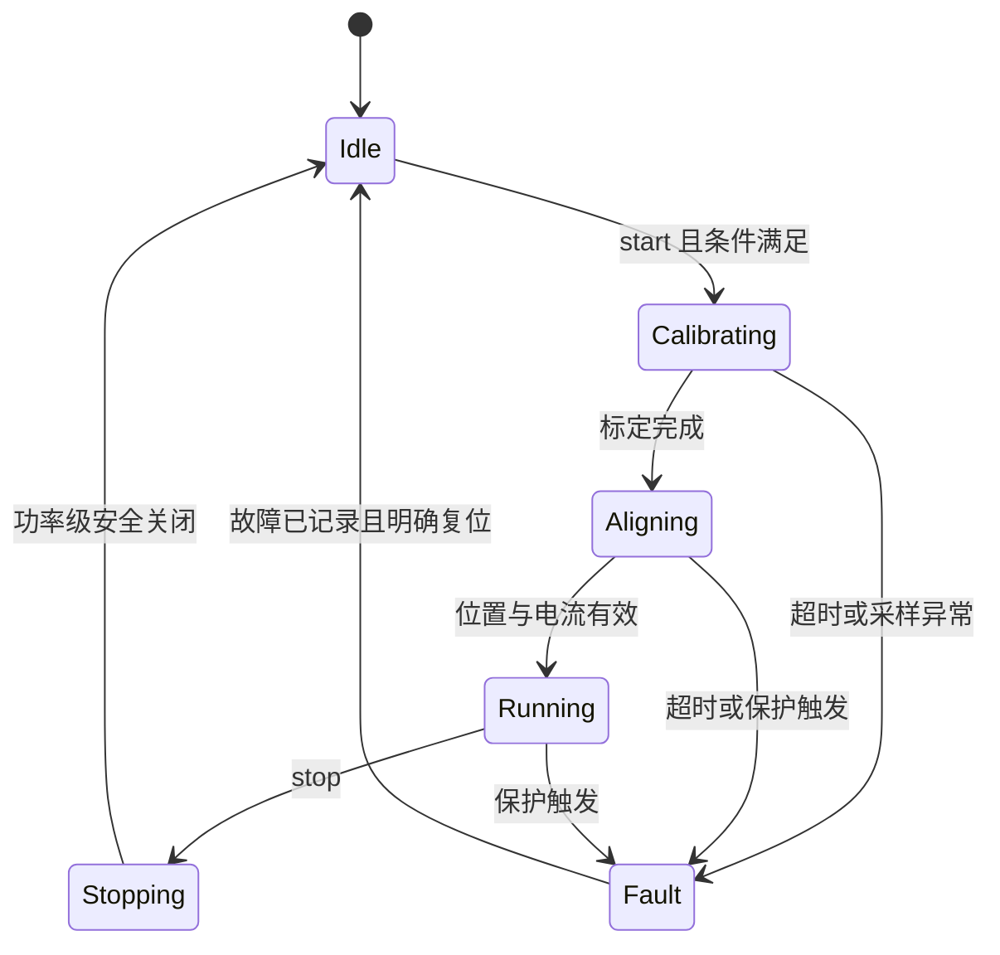

# 超级循环、状态机与事件驱动

超级循环适合职责较少、实时关系清楚的固件。它的关键约束是每一步都能在有限时间内返回。主循环中一个 `delay_ms(100)`、轮询等待或无界解析循环，会推迟所有其他工作，也可能让看门狗掩盖真实故障。

## 超级循环是协作式调度

```c
int main(void)
{
    platform_init();
    app_init();

    for (;;) {
        uint32_t now = clock_now_ms();
        input_poll(now);
        control_step(now);
        protocol_step(now);
        diagnostics_step(now);
        watchdog_service_if_healthy(now);
    }
}
```

每个 `*_step` 函数应有明确的最长执行时间，不等待未来事件。函数发现条件尚未满足时保存状态并返回，下一轮再继续。中断仍可在任何允许的时刻抢占主循环，共享数据按 [[005-中断、并发、原子性与内存顺序]] 处理。

## 用经过时间处理回绕

无符号计数器的减法按模运算，适合判断经过时间：

```c
bool interval_elapsed(uint32_t now, uint32_t start, uint32_t interval)
{
    return (uint32_t)(now - start) >= interval;
}
```

这个写法要求时间戳宽度固定，并限制单次比较的有效间隔，通常不能覆盖整个计数器周期。项目应统一时间基准和比较函数，避免各模块混用绝对截止时间、不同单位和有符号转换。

## 状态机把历史依赖写出来

以电机启动为例，状态不只表示当前动作，还限制允许的事件和退出条件：



每个状态应定义：

- 进入动作和退出动作；
- 接受的事件与守卫条件；
- 最长停留时间；
- 对外设和输出的所有权；
- 非法事件、超时和故障的处理；
- 复位后是否允许自动恢复。

状态枚举本身不会形成状态机。把转移散落在多个中断和回调中，会让相同状态出现互相冲突的写入。通常由一个上下文拥有状态转移，其他上下文只提交事件。

## 事件队列也需要过载策略

事件至少包含类型，必要时携带时间戳、序号和小型数据。队列满时不能默认静默丢弃，应按事件等级选择：

- 合并可覆盖的状态更新，如“最新转速”；
- 丢弃允许丢失的低优先级遥测并累计计数；
- 为关键故障保留独立锁存位；
- 触发受控降级或安全停机；
- 对上游施加流控或降低采样率。

队列容量来自突发长度、消费者最坏停顿和处理速率分析，不应只选择一个看起来方便的二次幂。

## 状态机与 RTOS 的关系

引入 RTOS 后，任务内部仍常使用状态机。RTOS 适合管理多个独立阻塞活动、优先级和同步对象；它不会自动修复共享数据、无界执行、死锁和错误恢复。系统从超级循环迁移到 RTOS 时，可以保留设备状态机和事件契约，只替换调度与等待机制。

需要考虑 RTOS 的信号包括：

- 多个活动有清晰且不同的阻塞等待；
- 优先级和响应期限无法由简单轮询满足；
- 通信栈或文件系统已依赖任务模型；
- 超级循环的最坏响应时间难以界定；
- 团队能承担栈、同步、调度和分析成本。

## 看门狗只在系统健康时喂

固定在定时中断中喂看门狗，会让主循环死锁后系统仍不复位。更稳妥的方式是收集关键活动的健康证据，在一个受控位置判断所有期限都满足后再喂狗。复位后还要保留复位原因和故障快照，避免只看到“看门狗复位”这一条结果。

## 检查清单

- 主循环中的每个步骤都有有限执行时间，不使用忙等延迟作为正常流程。
- 时间比较支持计数器回绕，单位和最大有效间隔已定义。
- 状态转移只有一个所有者，ISR 通过事件或快照交互。
- 状态和事件都有超时、非法输入与队列满处理。
- 喂看门狗前检查关键活动是否按期完成。
- 选择 RTOS 基于并发和期限需求，不用任务掩盖阻塞代码。

## 继续学习

- [[007-DMA、缓冲区与外设数据通路]]
- [[008-错误处理、断言与故障诊断]]
- [[10-RTOS与系统/01-RTOS基础/001-为什么需要RTOS|为什么需要 RTOS]]
