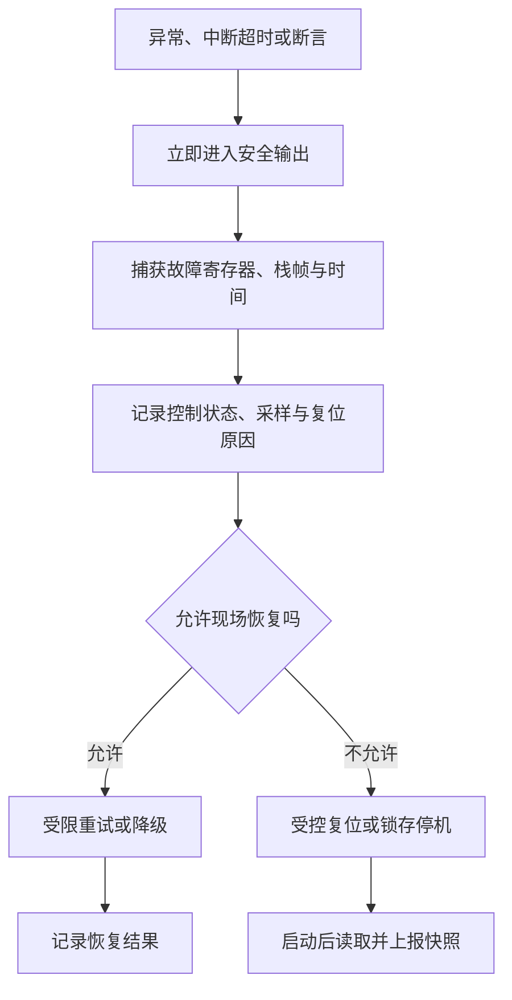

# 错误处理、断言与故障诊断

固件发生错误后往往不能显示堆栈并退出进程。它可能继续控制功率级、等待通信，或在无人值守的设备中反复复位。错误处理需要同时决定当前输出怎样进入安全状态、哪些证据必须保留，以及系统在什么条件下允许恢复。

## 先区分错误来源

| 类型 | 例子 | 常见处理 |
|---|---|---|
| 调用方可预期错误 | 参数超范围、资源暂时忙、校验失败 | 返回状态，让调用方选择重试、拒绝或降级 |
| 外设与环境异常 | 超时、传感器断线、总线错误、欠压 | 记录上下文，执行恢复或进入安全状态 |
| 资源耗尽 | 队列满、缓冲池耗尽、栈余量不足 | 限流、降级、停止接收或触发故障 |
| 程序缺陷 | 不变量破坏、非法状态、空指针 | 断言或故障处理，保留证据并阻止危险输出 |
| 处理器故障 | 非法指令、总线错误、未对齐访问 | 故障入口捕获寄存器和栈帧，执行受控复位 |

把所有情况都压成 `bool` 会丢失原因；为每个函数返回庞大枚举又会让接口难用。状态码应覆盖调用方真正需要区分的决策，并把详细硬件原因保存在诊断记录中。

## 返回值必须有单一解释

```c
typedef enum {
    ADC_READ_OK = 0,
    ADC_READ_BUSY,
    ADC_READ_TIMEOUT,
    ADC_READ_HW_FAULT
} adc_read_status_t;

adc_read_status_t adc_read(adc_sample_t *sample);
```

接口要说明：失败时输出参数是否保持不变，超时是否已经取消底层操作，函数能否在 ISR 中调用，以及哪些错误允许重试。不要用数据域中的合法值兼任错误码，例如以返回 `0` 表示“没有字节”。

错误应在能做出决策的层处理。驱动报告超时和状态寄存器，上层根据系统模式决定重试、关闭通道还是停机。底层驱动不应擅自无限重试，也不应在不知道系统安全要求时直接复位整机。

## 断言检查程序不变量

断言适合检查按设计不应被外部输入触发的条件，例如状态枚举有效、内部索引未越界、初始化顺序成立。外部输入、通信错误和资源忙属于运行期情况，应走正常错误路径。

嵌入式断言处理函数通常需要：

- 阻止功率输出或执行项目定义的安全动作；
- 记录文件标识、行号、错误码和当前状态；
- 避免动态分配、阻塞日志和再次触发断言；
- 根据产品策略停机等待调试器，或在记录完成后复位。

发布版不能简单删除影响控制流的断言。如果系统依赖断言表达必要检查，关闭后行为会改变。可将开发期诊断断言与运行期安全检查分开设计。

## 故障快照要在证据丢失前保存



Cortex-M 故障处理可捕获堆叠的通用寄存器、异常返回值以及 SCB 故障状态寄存器。具体汇编入口和栈选择依赖内核与工具链，应放在平台层。应用层更关心故障时的模式、控制指令、传感器有效性、最近若干采样和保护状态。

`.noinit`、备份 RAM 或非易失存储可保存跨复位记录，但要添加魔数、版本、长度和完整性校验。首次上电、掉电中断写入和结构版本变化都可能留下无效内容。

## 日志不能破坏被观察的系统

阻塞式 UART `printf` 可能让实时路径延长数毫秒，ISR 内调用还可能死锁。半主机调试常依赖调试器，未连接时可能阻塞或触发异常。日志通道应说明：

- 能否在中断或故障上下文调用；
- 队列满时怎样丢弃、覆盖或降级；
- 时间戳来自什么时钟，发生回绕时怎样解释；
- 格式化在哪个上下文执行；
- 发布版保留哪些事件，敏感数据如何处理。

实时路径更适合写入固定大小的二进制事件或环形追踪缓冲区，由低优先级上下文异步导出。工具的具体配置见 [[09-Debugging-Tools/04-串口与日志调试/04-串口与日志调试|串口与日志调试]]。

## 看门狗和复位策略

看门狗只能证明健康检查没有按期完成，不能说明根因。启动后应读取硬件复位原因，并与软件保存的故障记录、启动计数和运行阶段关联。连续复位时可进入安全模式，限制功率输出和自动重试次数，避免设备陷入复位循环。

喂狗条件应覆盖关键期限，例如控制周期更新、通信监护、传感器有效性和后台状态机进展。若某项失败，先保存最小故障快照，再让看门狗或软件复位执行恢复策略。

## 检查清单

- 状态码与调用方决策对应，失败时输出参数行为明确。
- 外部错误走正常路径，程序不变量由断言或内部故障处理检查。
- 故障处理不依赖堆、阻塞日志或复杂驱动。
- 安全输出早于耗时诊断，并验证故障处理本身不会二次失败。
- 日志和追踪有容量、丢弃、上下文与时间戳约定。
- 看门狗只在关键活动健康时喂，复位后能解释原因。
- 跨复位记录带版本和完整性检查。

## 继续学习

- [[009-编码规范、静态分析与测试]]
- [[09-Debugging-Tools/05-JTAG与SWD调试/004-调试功能|JTAG 与 SWD 调试功能]]
- [[04-Microcontrollers/06-中断与DMA深入/005-常见陷阱|中断与 DMA 常见陷阱]]
