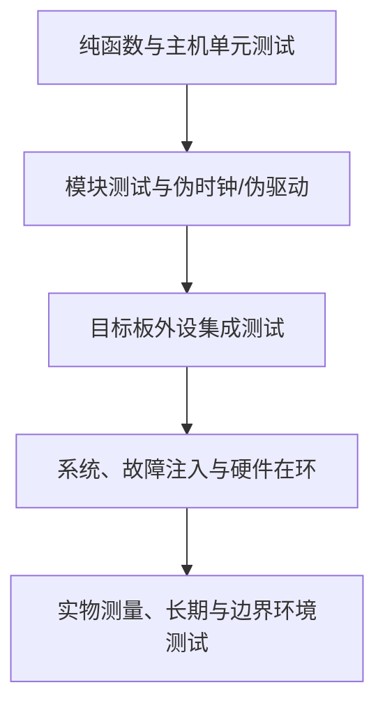

# 编码规范、静态分析与测试

固件质量不能由一种工具证明。编译器检查语言与类型问题，静态分析寻找跨路径缺陷，单元测试验证局部行为，目标板测量检查外设和时序。每种证据都有盲区，项目需要把它们放进同一构建与评审流程。

## 先固定工程使用的 C 方言

工程配置应明确：

- C 标准版本和允许的编译器扩展；
- 编译器、链接器、标准库和设备包版本；
- 警告等级以及哪些警告按错误处理；
- 整数宽度、端序、对齐、ABI 和浮点选项；
- 优化、链接时优化、调试信息和未定义行为相关选项；
- 开发版、测试版与发布版之间允许存在的差异。

常用严格告警可以发现隐式转换、遮蔽、缺失原型、格式字符串和不可达代码，但选项名称与含义依赖编译器。不要复制一串告警参数后长期不维护；升级工具链时要比较新增、删除和语义变化。

## 项目规范要能执行

一份可执行的编码规则至少回答：

- 哪些语言特性禁止、限制或需要评审；
- 命名、模块接口、头文件和可见性怎样组织；
- 错误码、断言、日志、时间和单位怎样表达；
- 中断、共享数据和动态内存遵守什么约定；
- 偏离规则时怎样记录理由、风险和批准人；
- 哪些检查由编译器、静态分析或评审自动执行。

MISRA C 面向关键系统提供了完整的指南、指令、规则分类和合规流程。项目应声明采用的具体版本及修订，并使用授权文本和工具映射，不要从二手列表抄几条规则就声称符合 MISRA。规则等级、措辞和适用范围可能随版本变化，偏离也需要可追踪的工程理由。

## 模块边界比文件长度更重要

一个模块应围绕一种变化原因组织。比如 ADC 平台驱动负责触发和取样，电流采样模块负责偏置与缩放，控制器只接收有单位的样本。不要让单个 `utils.c` 同时放 CRC、环形缓冲区、延时和寄存器助手。

头文件公开最小接口，内部对象留在 `.c` 文件并标记 `static`。依赖由调用方注入或通过窄接口提供，测试时才能替换时钟、外设和故障源。只有一个调用点且没有独立语义的包装层不必保留，避免为了抽象而抽象。

## 静态分析结果需要分类

分析器报告不是缺陷数量排行榜。每条问题应落到以下结果之一：

- 修复了真实缺陷；
- 调整代码，让意图能被工具证明；
- 记录受控偏离及其前提；
- 确认为工具误报，并保留版本化抑制依据；
- 发现规则或工具配置不适用于当前模块，调整检查范围。

抑制应尽量靠近具体位置并带理由，不能在全局关闭一类高价值告警。工具升级后重新审查抑制项，因为分析能力和规则映射会变化。

## 测试按依赖逐层增加

主机测试运行快，适合定点运算、状态机、协议解析和控制算法。地址消毒器、未定义行为消毒器和模糊测试也更容易在主机启用，但主机的整数实现、端序和浮点行为可能与目标不同。目标板测试负责补上 ABI、寄存器、DMA、缓存和真实时序。

### 纯逻辑测试

- 等价类、边界值和非法输入；
- 有符号最小值、最大值、回绕、饱和和舍入；
- 状态机每条合法与非法转移；
- 协议截断、重叠帧头、错误长度和校验失败；
- 故障恢复与重复调用。

### 目标板与系统测试

- 中断优先级、最大延迟和最坏执行时间；
- DMA 缓冲交接、缓存维护和长时间满负载；
- 掉电、欠压、时钟异常和外设无响应；
- 看门狗、复位原因和故障快照；
- 发布优化配置以及无调试器启动；
- 温度、电压、器件差异和噪声边界。

## 覆盖率只是观察指标

语句覆盖率高不代表边界条件正确，也不代表并发和时序安全。覆盖数据适合发现“哪些代码从未执行”，测试设计仍要来自需求、接口契约、风险和故障模型。关键判断应覆盖真、假分支和边界输入，无法触发的防御代码需要故障注入或分析证据。

## 构建结果要可追溯

每个可交付映像应能关联到：

- 源代码版本和配置；
- 编译器、库、设备包与生成器版本；
- 构建命令、链接脚本和特性开关；
- 测试结果、静态分析结果和已批准偏离；
- ELF、映射文件、哈希值和烧写格式；
- 适用硬件版本与标定数据版本。

日期、随机路径或未固定的生成步骤会让二进制难以复现。追求逐字节可重现时，还要控制时间戳、归档顺序和调试路径映射。

## 交付检查清单

- 编译器无未处理告警，发布配置参与完整测试。
- 规则版本、偏离和静态分析抑制都有依据。
- 纯逻辑能在主机快速测试，平台依赖留在窄接口后面。
- 外部输入经过边界、超时、模糊和故障注入测试。
- 中断、DMA、缓存和实时期限在目标板测量。
- 覆盖率用于找空白，不替代需求和风险分析。
- 映像、符号、映射文件、配置和工具版本可追溯。

## 继续学习

- [[010-实时控制固件的架构、时序与验证]]
- [[11-Projects/07-项目文档与Git规范/07-项目文档与Git规范|项目文档与 Git 规范]]
- [MISRA C:2023 Addendum 2](https://misra.org.uk/app/uploads/2024/10/MISRA-C-2023-ADD2.pdf)
