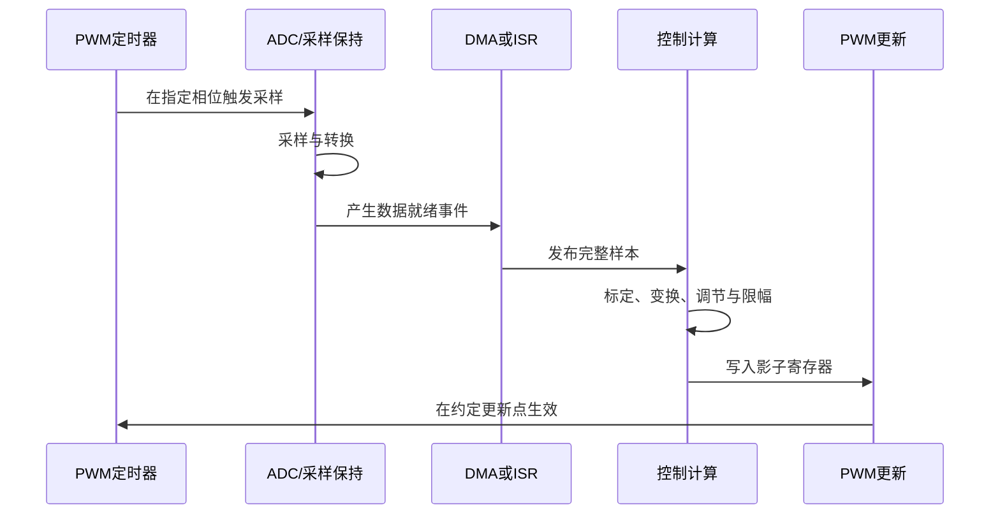
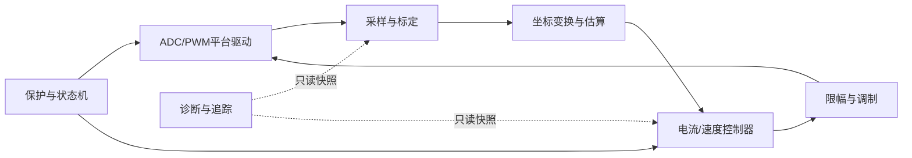

# 实时控制固件的架构、时序与验证

实时控制代码要在截止时间前使用有效样本算出新输出。平均执行时间、单个函数的正确结果或示波器上偶尔稳定的波形，都不足以证明整条链路可靠。需要把触发、采样、计算、输出更新、保护和诊断放在同一时序模型中。

## 从端到端控制周期开始



端到端期限从物理采样时刻开始，到新占空比真正作用于功率级结束。ADC 转换、总线传输、中断等待、计算、寄存器更新窗口和 PWM 影子寄存器生效都消耗预算。错过更新窗口可能多延迟一个 PWM 周期，即使控制函数本身运行很快。

## 时序预算要包含干扰

可以把单周期上界写成：

$$
T_{end} = T_{sample} + T_{convert} + T_{dispatch} + T_{compute} + T_{commit} + T_{interference}
$$

其中干扰项包括更高优先级中断、Flash 或缓存等待、总线争用、DMA 竞争和临界区阻塞。测量时应记录最小值、最大值、分布和测试条件，并在发布优化、最差时钟配置、最高通信负载及预期温度电压范围内复测。

常用验证手段包括 GPIO 脉冲、周期计数器、硬件追踪和定时器捕获。日志时间戳适合功能顺序分析，不一定能提供足够的微秒级精度，而且日志本身会扰动时序。

## 模块按物理责任分开



- 平台驱动拥有寄存器、触发关系和 DMA 配置。
- 采样层把 ADC 码转换成带单位、带有效性的物理量。
- 算法层只依赖数值与配置接口，不直接读写外设。
- 调制层处理电压限制、占空比边界和更新时刻。
- 状态机决定校准、对齐、运行、停机和故障转移。
- 保护链能绕过普通业务流程，快速关闭危险输出。

这样的边界允许算法在主机上测试，也能让平台时序在目标板单独测量。为每个一行寄存器访问再增加一层接口并不会提高可测性，应围绕稳定的设备能力和物理责任划分模块。

## 数据契约包含单位、时刻和有效性

```c
typedef struct {
    int32_t ia_ma;
    int32_t ib_ma;
    int32_t bus_mv;
    uint32_t sequence;
    uint32_t sample_tick;
    uint32_t valid_mask;
} current_sample_t;
```

样本结构应能检测丢失、重复和过期。控制器配置还要声明：

- 机械角与电角的换算和极对数；
- 电流、电压、速度与角度单位；
- 浮点或 Q 格式以及饱和边界；
- Clarke/Park 变换和 SVPWM 的归一化约定；
- 参数生效时刻和版本；
- 标定数据的来源、范围和完整性。

配置更新不能在控制周期中途留下新旧参数混合的快照。可在后台验证完整配置，再通过双缓冲或短临界区在周期边界一次性交接。

## 快路径保持固定，慢路径处理管理工作

控制快路径适合放置固定长度、无阻塞、无动态分配的运算。通信解码、参数持久化、格式化日志和复杂诊断留在慢路径。两条路径通过版本化快照和事件交互，避免控制中断直接调用通信栈或 Flash 驱动。

快路径中也要定义错误结果。采样无效、角度估算失锁、母线电压异常或计算结果超范围时，不能继续使用旧数据而不记录。处理策略可以是保持有限周期、降额、切换估算方式或立即停机，选择取决于系统危险分析。

## 保护链不依赖正常控制完成

过流、栅极驱动故障等快速保护通常需要硬件直接关闭 PWM，软件随后读取锁存原因。软件保护负责较慢的温度、传感器一致性、通信监护和控制偏差。两类保护都应进入统一故障状态和诊断记录，但不能让软件日志延迟硬件关断。

故障恢复需要明确：

- 哪些故障自动恢复，最大重试次数和冷却时间；
- 哪些故障必须由外部命令复位；
- 重新使能前要重新执行哪些标定和自检；
- 故障期间 PWM、栅极驱动和接触器处于什么状态；
- 复位后如何保留首次故障而不被后续错误覆盖。

## 验证从纯算法延伸到功率级

| 层级 | 主要检查 |
|---|---|
| 主机单元测试 | 变换、PI、限幅、定点边界、状态机和故障逻辑 |
| 离线回放 | 用记录波形重放采样，比较版本和参数变化 |
| 目标板闭环替身 | 用模拟输入或外设仿真验证触发、DMA 和时序 |
| 处理器在环/硬件在环 | 注入速度、负载、传感器和故障场景 |
| 低压实机 | 检查采样极性、相序、角度方向和保护动作 |
| 额定与边界测试 | 温度、电压、转速、负载、通信压力和长期运行 |

离线浮点参考模型适合判断算法误差，不能证明 ADC 采样点、死区、延迟和功率级保护正确。实机测试应从受限电压、电流和机械条件开始，并保留紧急停机与独立保护。

## 发布前检查清单

- 端到端期限覆盖采样到 PWM 实际生效，并包含最坏干扰。
- 快路径无阻塞、无无界循环、无动态分配和格式化日志。
- 样本与参数快照带单位、有效性、序号和版本。
- 控制算法与寄存器访问隔离，平台层拥有触发和外设配置。
- 配置只在安全边界原子切换，不出现新旧参数混用。
- 硬件快速保护不依赖软件，软件能记录首次故障并安全恢复。
- 主机、目标板、硬件在环和受控实机测试覆盖各自风险。
- 发布映像在无调试器、最高负载和故障注入条件下验证。

## 继续学习

- [[14-FOC-电机控制/00-README|FOC 电机控制]]
- [[14-FOC-电机控制/08-仿真与验证/004-硬件在环HIL测试|硬件在环测试]]
- [[14-FOC-电机控制/07-调试与优化/005-典型故障排查手册|FOC 典型故障排查]]
- [[01-Foundations/13-嵌入式C编程测验题|嵌入式 C 编程测验题]]
