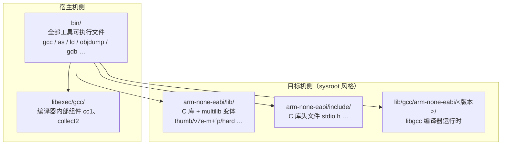

# 交叉编译工具链的组成

编译器不是单个程序，而是一组工具加一套目标库。看到一个名为 `arm-none-eabi-gcc` 的可执行文件，只是拿到了入口；它背后还依赖汇编器、链接器、编译器运行时、C 库和几十个变体库。理解这些组成，才能解释链接错误、选对 multilib 变体、判断两个"都是 GCC 12"的工具链为什么不能互换。

## 为什么需要交叉工具链

桌面开发中编译器把代码编译成**宿主机自己的指令**即可。嵌入式目标完全不同：

| 维度 | 宿主机（如 x86-64 PC） | 目标机（如 Cortex-M4） |
|---|---|---|
| CPU 指令集 | x86-64 | Thumb-2 |
| 操作系统 | Windows/Linux | 裸机、RTOS 或嵌入式 Linux |
| 系统调用约定 | glibc / Win32 ABI | 无系统调用，或 musl/glibc ABI |
| 运行环境 | 完整 OS | 可能连 C 库初始化都要自己接管 |

在开发板上直接运行编译器不现实（资源、速度、且编译出的仍是目标自身指令，无法"自举"到无 OS 的裸机）。因此在 PC 上装一套"为别的架构生成代码"的工具链，这就是交叉工具链。

## 命名规则：arch-vendor-os 三元组

工具链的每个工具都以三元组为前缀，读三元组就知道它为谁生成代码：

```
arm - none - eabi            裸机/RTOS 的 32 位 Arm
 │      │      └─ OS/ABI：eabi（裸机）、linux-gnu、elf……
 │      └──────── vendor：谁做的（none = 通用，厂商可填自己名字）
 └─────────────── arch：目标指令集
```

常见组合：

| 前缀 | 目标 | 典型场景 |
|---|---|---|
| `arm-none-eabi` | 32 位 Arm，无 OS（EABI） | Cortex-M 裸机、FreeRTOS、Zephyr |
| `arm-linux-gnueabihf` | 32 位 Arm + Linux，硬浮点 | Cortex-A 嵌入式 Linux（armhf 发行版） |
| `arm-linux-gnueabi` | 32 位 Arm + Linux，软浮点 | 无 FPU 或 ABI 兼容老系统 |
| `aarch64-linux-gnu` | 64 位 Arm + Linux | RK3588、树莓派 64 位系统 |
| `aarch64-none-elf` | 64 位 Arm，无 OS | ARMv8-A 裸机、ARM  Trusted Firmware |
| `arm-rockchip830-linux-uclibcgnueabihf` | 32 位 Arm + Rockchip 定制 uClibc | 瑞芯微 SDK 专用（vendor 字段为厂商名） |
| `riscv64-unknown-elf` | 64 位 RISC-V 裸机 | 国产 RISC-V MCU |
| `x86_64-linux-gnu` | 64 位 x86 Linux | PC 自身，即"非交叉" |

两个容易混淆的字段：

- **`hf`（hard float）**：ABI 规定浮点参数用 FPU 寄存器（s0–s31/d0–d15）传递。目标有 FPU 就用 `gnueabihf`，没有就只能用软浮点 `gnueabi`。两者 ABI 不兼容，混链会链接错误或运行崩溃。
- **`eabi` vs `linux`**：`eabi` 表示无操作系统的裸机环境，C 库（newlib/picolibc）的 `printf`、`malloc` 底层没有 OS 可调用，要么裁剪（nano）、要么由工程重定向到 UART，要么借助 semihosting。

## 目录解剖：一个工具链里到底有什么

以 Arm 官方 GNU Toolchain（xPack 版）的安装目录为例，四个区域各有职责：



### bin/：对外可见的工具集

所有可执行文件都带三元组前缀，防止与宿主机自身工具混淆。按职责分三组：

| 组 | 工具 | 职责 |
|---|---|---|
| 编译器驱动 | `gcc` `g++` `cpp` | 命令行入口；gcc 是驱动程序，真正干活的是 `cc1`/`cc1plus`，它再调 `as` 和 `collect2`→`ld` |
| binutils（二进制工具） | `as` `ld` `objcopy` `objdump` `nm` `readelf` `size` `ar` `ranlib` `strip` `addr2line` `strings` | 汇编、链接、格式转换与映像检查。烧录用的 BIN/HEX 就是 `objcopy` 从 ELF 转出来的 |
| 调试与辅助 | `gdb` `gcov` `gprof` `lto-dump` | 源码级调试、覆盖率和性能分析 |

固件排查时最常用的四个：`objdump -d`（反汇编核对优化结果）、`nm`/`size`（符号与占用）、`readelf -h/-S`（确认架构、入口、段布局）。

### lib/gcc/：编译器运行时

`libgcc.a` 在这里——编译器为当前目标架构生成的代码并不自给自足。64 位除法在 Cortex-M 上没有单条指令，soft-float 浮点运算整个都是软件实现，这些代码由 GCC 自己提供，链接时自动从 `libgcc` 补上。换 `-mcpu` 换架构时，驱动会选对应的 libgcc 变体。

### arm-none-eabi/lib + include：C 库与 multilib

这是目录体积的大头。C 库（裸机工具链默认 newlib）要对每个"架构 × FPU × ABI"组合各存一份：

```bash
arm-none-eabi-gcc -print-multi-lib
# thumb/v7-m;@mthumb@march=armv7-m
# thumb/v7e-m+fp/hard;@mthumb@march=armv7e-m+fp@mfloat-abi=hard
# thumb/v8-m.main+dp/softfp;@mthumb@march=armv8-m.main+fp.dp@mfloat-abi=softfp
# ……几十个变体
```

**multilib** 的含义：驱动根据命令行上的 `-mcpu=cortex-m4 -mfloat-abi=hard` 自动挑选匹配的库目录，不需要你手工指定路径。所以"同一个工具链能编所有 Cortex-M"是靠这一堆预编译变体实现的。查看实际选中哪个变体：

```bash
arm-none-eabi-gcc -mcpu=cortex-m4 -mfloat-abi=hard -print-multi-directory
# → thumb/v7e-m+fp/hard
```

如果目标组合没有对应变体（如某个小众 FPU 配置），链接时就会报"找不到 `-lc`"之类的错——这时要换工具链版本或用 `--specs=nano.specs` 这类变体规格。

## bare-metal 与 Linux 工具链的核心差异

| 维度 | bare-metal（`arm-none-eabi`） | Linux（`aarch64-linux-gnu`） |
|---|---|---|
| C 库 | newlib / newlib-nano / picolibc | glibc / musl / uClibc |
| 库形态 | 静态链接为主（`.a`） | 动态链接为主，依赖目标系统已有库 |
| 程序入口 | 复位向量 → 启动文件 → `main` | 动态链接器 → `_start` → `main` |
| 系统调用 | 无 OS；`printf` 需重定向到 UART 或 semihosting | 由 glibc 包装 `svc` 系统调用 |
| sysroot | 库就在工具链内 | 通常指向目标文件系统根（可用 `-sysroot=` 指定） |

`--specs=nano.specs` 是裸机 GCC 的常用开关：把默认 newlib 换成裁剪过的 newlib-nano，`printf` 去掉浮点格式化等重型功能，固件体积可缩小一个数量级，代价是部分格式化能力缺失。

## semihosting：裸机里的"借用宿主机"

裸机没有终端，newlib 的 `printf`/`fopen` 需要一个"宿主代理"。semihosting 让目标通过调试器（或 semihosting trap 指令）把 I/O 请求转发到 PC 上运行 `gdb` 的一侧。它方便（不用配 UART），但有两个硬限制：**只能运行在调试器下**，且会打断实时性，量产固件必须移除。链接时使用 `-lrdimon`/specs 文件启用，与 `-lnosys`（空实现桩）二选一。

## 检查清单

- 看到一个工具链前缀，能拆出 arch / vendor / os 三段并判断它面向什么目标；
- 能区分 `eabi` 与 `linux`、`gnueabi` 与 `gnueabihf`；
- 知道 `gcc` 是驱动程序，背后是 `cc1` + binutils + libgcc + C 库；
- 会用 `-print-multi-lib` / `-print-multi-directory` 查 multilib 变体；
- 看到链接错误时，能判断是缺 libgcc 变体还是缺 C 库变体。

## 继续学习

- [[012-工具链的获取与版本管理]]：这些组件从哪下载、如何多版本共存
- [[013-GCC与LLVM双工具链]]：同一目标配两套编译器的方法
- [[001-从复位到main：执行环境与构建过程]]：这些组件如何串联成固件映像
- [[../13-嵌入式C编程测验题|嵌入式 C 编程测验题]]
