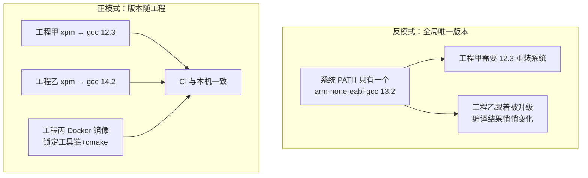

# 工具链的获取与版本管理

知道工具链由什么组成之后，下一个问题是：从哪拿、拿哪个版本、多个版本如何共存。选错获取渠道是"本机能编、同事的机器编不过"和"去年能编、升级系统后编不过"的常见根源。

## 获取渠道对比

| 渠道 | 代表 | 优点 | 风险/局限 | 适用 |
|---|---|---|---|---|
| **Arm 官方** | [Arm GNU Toolchain](https://developer.arm.com/downloads/-/arm-gnu-toolchain-downloads) | 版本最新（当前 15.3.rel1），Windows/macOS/Linux 全平台 | 解压即用但不进包管理器，升级需手动 | 想要官方最新版，多平台统一 |
| **xPack** | `xpack-dev-tools/arm-none-eabi-gcc-xpack` | 与 Arm 版同步发布，**项目级安装、可复现构建** | 需要 Node.js + xpm | 团队/CI 要求版本锁定 |
| **发行版包管理器** | Ubuntu：`gcc-arm-none-eabi`、`gdb-multiarch`、`gcc-aarch64-linux-gnu` | 一条 apt 装好，随系统升级 | 版本滞后（Ubuntu 仓库通常落后官方一年以上）；`gcc-arm-none-eabi` 包巨大且不能选版本 | 快速体验、Linux 宿主日常 |
| **Homebrew (macOS)** | `brew install --cask gcc-arm-embedded` | 与官方同步、升级方便 | 仅 macOS（新发行仅 Apple Silicon 构建） | macOS 宿主 |
| **厂商渠道** | ST CubeIDE 内置、NXP MCUXpresso、TI、瑞芯微 SDK | 与厂商 BSP/驱动版本已对齐，开箱即用 | 锁定在厂商版本，跨项目混用易出 ABI 问题 | 用厂商 SDK 做产品 |
| **芯片厂商 IDE 附带** | Keil MDK 的 armclang、IAR | 商业支持、优化认证 | 收费、闭源 | 有合规/认证要求 |

### xPack：把工具链变成项目依赖

xPack 的核心思路是让工具链版本进入 `package.json`，像管理 npm 依赖一样管理编译器：

```bash
npm install --location=global xpm@latest          # 装一次 xpm
cd my-firmware
xpm init
xpm install @xpack-dev-tools/arm-none-eabi-gcc@latest   # 装进本项目
```

工具链被解到全局 store，项目里生成 `xpacks/.bin` 转发器和 `package.json` 中的 devDependency。任何一台机器 `xpm install` 后得到**完全相同**的编译器版本——这就是 CI 和团队构建可复现的标准做法。

### 从源码构建

预编译包不满足需求时（定制 C 库、加补丁、特殊 CPU 变体、裁剪体积），三个成熟路径：

| 工具 | 定位 | 一句话说明 |
|---|---|---|
| **crosstool-NG** | 独立交叉工具链 | 像编译内核一样 `menuconfig` 选 arch/lib/gcc/binutils 版本，产出独立工具链目录。适合 bare-metal 工具链的完全定制 |
| **Buildroot** | 根文件系统 + 工具链 | 构建完整嵌入式 Linux 系统的同时生成匹配的交叉工具链，"系统与编译器同源" |
| **Yocto/SDK** | 发行版级构建 | `bitbake` 构建镜像，`populate_sdk` 生成包含工具链 + sysroot 的 SDK 安装包，适合产品化团队 |

选择原则：只要一个 bare-metal 编译器选 crosstool-NG；要 Linux 系统选 Buildroot；要做产品线软件基线选 Yocto SDK。

## 版本管理：不要污染全局 PATH

交叉工具链几乎不需要"装在系统里"——它是纯目录包，正确姿势是**每个工程自己声明用哪个**：



四种正模式的载体，按团队规模从小到大：

1. **CMake 工具链文件**：在工程内写 `cmake/arm-gcc.cmake`，用 `ARM_TOOLCHAIN_PATH` 缓存变量指向工具链位置，不写死绝对路径进仓库；
2. **xpm 项目级安装**：版本写进 `package.json`，适合 Node.js 生态的 CI；
3. **容器镜像**：把工具链 + CMake + Ninja 打进 Docker 镜像，镜像 tag 即版本——最彻底的可复现，缺点是本机也要有 Docker；
4. **厂商 SDK 自带的工具链**：用 SDK 自带目录里的那份，别自己换——见瑞芯微 SDK 的 [[12-Resources/06-瑞芯微Rockchip-SDK获取指南|获取指南]]。

## 装好之后先验证什么

不要上来就编工程，先回答四个问题：

```bash
arm-none-eabi-gcc --version            # ① 哪个版本（小版本号影响优化行为）
arm-none-eabi-gcc -dumpmachine         # ② 目标三元组（确认拿对了工具链）
arm-none-eabi-gcc -print-sysroot       # ③ 库/头文件根（查 C 库从哪来）
arm-none-eabi-gcc -print-multi-lib | head -5   # ④ 有哪些 multilib 变体
```

再加一个最小端到端测试：编一个空 `main` 返回 0，确认 `as`、`ld`、C 库三个环节都通，然后 `objdump -d` 看一眼产物确实是目标指令（Thumb 应该是两字节定长指令）。这一步能过滤掉八成"工具链装坏了"的问题。

## 版本对齐的三条红线

1. **内核模块 ↔ 内核**：编译 `hello.ko` 的工具链版本要与编译内核的一致（GCC 大版本 ABI/内联假设不同会加载失败或运行崩溃）。详见 [[16-Linux设备驱动开发/009-工程实战能力|驱动的版本对齐]]。
2. **库 ↔ 应用**：静态库与最终链接用同一工具链同一 `-mfloat-abi`；动态库要求宽松些但仍需同一大版本 libstdc++/glibc。
3. **团队 ↔ CI**：CI 镜像与本机的工具链版本必须同一个小版本（13.2 vs 13.3 都可能产生不同警告与优化结果），写进构建脚本而非文档。

## 检查清单

- 说得出至少三种获取渠道及各自适用场景，能给新项目选对渠道；
- 新装工具链后先跑四个 `-print-*` 验证命令再开工；
- 工具链版本随工程管理（工具链文件/xpm/容器），不依赖个人全局 PATH；
- 知道什么时候必须自己编工具链（crosstool-NG/Buildroot/Yocto SDK 的取舍）；
- 能说出内核模块编译的版本对齐红线。

## 继续学习

- [[011-交叉编译工具链的组成]]：下载下来这一包东西里有什么
- [[013-GCC与LLVM双工具链]]：给同一目标配两套编译器
- [[04-Microcontrollers/01-微控制器概述/003-开发环境|开发环境]]：工具链如何接入 IDE 与 CMake
