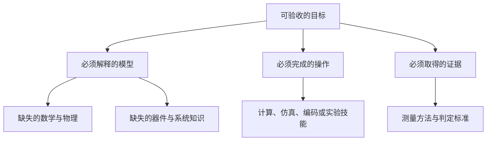

# 把目标改写成可验证的学习任务

“学习 FOC”“看完运放”“掌握 STM32”都没有给出停止条件。目标缺少产出和验收方式时，阅读时间、视频数量和笔记篇数很容易被当成进度，却无法说明能否解决问题。

## 1. 一份学习任务需要七个字段

| 字段 | 要回答的问题 | FOC 电流采样示例 |
|---|---|---|
| 任务 | 要解决什么问题 | 设计并验证低侧三分流电流采样链路 |
| 起点 | 已经会什么，缺什么 | 会运放基础，未分析共模、建立和采样窗口 |
| 产出 | 完成后留下什么 | 原理图、误差预算、仿真、固件配置和测试波形 |
| 约束 | 哪些条件不能违反 | 母线电压、ADC 范围、采样时刻、成本和安全 |
| 验收 | 哪些结果算通过 | 全温度范围误差满足预算，过流与饱和可诊断 |
| 证据 | 用什么支持结论 | 数据手册、计算、仿真、示波器和标定数据 |
| 时间盒 | 何时检查范围是否合适 | 到检查点仍无可测产出时缩小任务 |

时间盒用于控制探索范围，不表示到了日期就自动掌握。延期前先检查任务是否过大、前置知识是否缺失，以及验收标准是否超出当前工具能力。

## 2. 完成标准写成动作和条件

以下表述可以直接检查：

- 不看资料画出 Clarke 与 Park 变换的输入、输出和角度方向；
- 给定电机参数与采样周期，独立计算电流环 PI 的初始值并说明假设；
- 修改母线电压和 PWM 频率后，判断采样窗口是否仍然可用；
- 在仿真和实物中注入同一种角度偏差，比较 $i_d$、$i_q$ 的变化；
- 根据波形区分采样极性错误、相序错误和控制器饱和。

“理解”“熟悉”“深入掌握”可以保留为方向说明，但不能单独充当验收标准。

## 3. 用依赖图拆任务



拆分的最小单位不是某个章节，而是可以产生反馈的动作。比如“学习 ADC”范围过大，可以拆成输入范围与参考、采样建立、量化噪声、触发时序和数据处理，每项都配一段计算或实验。

## 4. 前置知识分成必须、可补和可查

- **必须先会**：缺少后无法理解当前模型，比如复数与相量对于交流稳态分析；
- **遇到时补**：可以边做边学，比如某个运放稳定性指标；
- **工作中查**：没有必要长期记忆的型号、寄存器位和命令参数。

把所有前置知识都学完再开始项目，会让任务无限向前展开。完全忽略前置知识则容易停留在照抄。依赖图用于找到阻塞当前产出的那一项，不用于建立一份永远学不完的清单。

## 5. 能力层级决定练习方式

| 当前表现 | 下一步练习 |
|---|---|
| 看到答案觉得熟悉，独立写不出 | 空白纸回忆，随后核对并纠错 |
| 能复述公式，不会选用 | 混合多种题型，先判断方法再计算 |
| 会做标准例题，参数一变就失效 | 做变式题，改变约束、边界和表示方式 |
| 能完成设计，无法解释异常 | 故障注入、反例、误差预算和测量复核 |
| 能解决一次，隔一段时间忘记 | 延迟复测并拉长复习间隔 |
| 可以完成，但过程依赖大量提示 | 逐步撤掉提示、模板和自动补全 |

练习难度应跟着证据调整。一直做成功率接近 100% 的同类题，往往只是在重复熟练步骤；完全没有起点的难题又会把时间耗在无方向搜索上。

## 6. 限制同时进行的主题

学习任务会争用同一批注意力、实验设备和项目上下文。可以保留一条主线和少量维护任务：

- 主线任务产生本阶段的主要工程产出；
- 基础补强只解决主线暴露出的依赖；
- 间隔复习维护已经学过的内容；
- 兴趣材料进入候选列表，不立即启动。

并行数量没有适合所有人的固定值。当每个任务都几天没有可见产出、切换后需要重新回忆大量上下文时，并行已经过多。

## 7. 任务卡模板

```markdown
# 学习任务

## 问题与场景

## 已知条件和前置知识

## 预期产出

## 约束与安全边界

## 验收标准

## 证据来源

## 当前阻塞

## 检查日期与范围调整
```

任务卡引用已有知识笔记和项目文件，不复制整段资料。产出进入对应技术目录或项目目录，任务卡只保留范围、进展和验收关系。

## 8. 什么时候结束或缩小任务

满足验收标准后，可以记录仍未解决的问题并结束当前任务，不必把相关领域全部学完。出现以下情况时应缩小范围：

- 连续多个检查点只有阅读记录，没有计算、实现或测试产出；
- 一个任务同时跨越过多新领域，无法定位失败原因；
- 验收需要当前没有的仪器、样品或数据；
- 目标来自工具或课程目录，实际项目并不需要；
- 资料之间的差异无法通过现有证据判断。

长期路线由 [[00-Index/01-学习路线图|学习路线图]] 管理，任务执行和维护方式见 [[010-学习计划、进度评估与知识维护]]。
