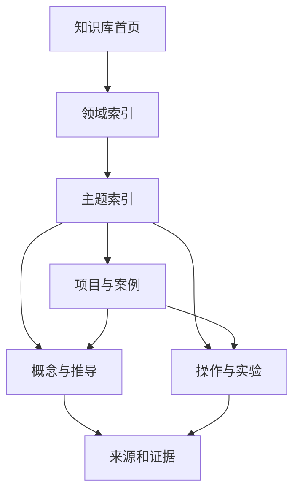

# 知识笔记、双向链接与可检索结构

知识库的任务是让结论、推导和证据在需要时能够找到、理解和复核。笔记数量、链接数量和关系图密度只能描述库的形态，不能说明知识是否可靠。每类笔记承担清楚职责，检索和维护才不会依赖记住文件放在哪里。

## 1. 按用途区分笔记

| 类型 | 保存什么 | 不适合保存什么 |
|---|---|---|
| 索引笔记 | 学习顺序、主题边界和关键入口 | 大段重复正文 |
| 概念笔记 | 定义、模型、条件、反例和相关关系 | 某次项目的临时状态 |
| 推导笔记 | 假设、步骤、单位、极限和结果 | 只有最终公式的摘抄 |
| 操作笔记 | 可复现步骤、输入、输出和异常处理 | 缺少版本的通用命令清单 |
| 实验笔记 | 对象、工况、仪器、原始数据和结论 | 脱离项目版本的稳定知识 |
| 决策笔记 | 候选方案、证据、取舍和后果 | 没有上下文的偏好 |
| 故障笔记 | 现象、复现、根因、修复和回归测试 | 未验证的原因列表 |
| 来源笔记 | 文献元数据、摘要、页码和引用位置 | 假装已经消化的全文复制 |

同一信息可以在不同笔记中出现链接，正文只保留最适合它的那一份。项目实验得到稳定结论后，把结论写入主题笔记，并从主题笔记链接回实验依据。

## 2. 索引说明依赖和边界



索引不需要列出目录中每个文件。它要告诉读者从哪里开始、哪些笔记是主干、当前目录不负责什么，以及下一层入口在哪里。完整文件列表可以由搜索或 Dataview 生成。

## 3. 一篇笔记保持一个稳定问题

“原子化”不表示每篇只能写一个定义或一屏文字。拆分标准是：

- 这部分是否有独立标题和检索价值；
- 是否有自己的前置知识、证据和更新节奏；
- 是否会被多个主题重复引用；
- 拆开后是否仍保留理解所需上下文；
- 合在一起是否造成标题无法说明内容。

公式、假设、推导和示例关系紧密时，应放在同一篇。把每一步拆成孤立短笔记，会让阅读依赖大量跳转。

## 4. 文件名要能稳定定位

建议遵循当前知识库约定：

- `000` 保留为目录入口；
- 主干笔记按依赖顺序编号；
- 文件名使用稳定主题，不写“最终版”“最新整理”等状态词；
- 标题变化较大时用 aliases 保留旧名称；
- 跨目录链接写完整路径，避免同名歧义；
- 图片和附件放入约定资源目录，文件名能对应来源笔记。

编号用于表达目录内顺序，主题之间的真实依赖仍应由正文和链接说明。

## 5. 链接写清关系

单独放一个链接会让后来者不知道为什么相关。可以写成：

- 本节公式的数学基础见……
- 当前模型忽略的测量负载见……
- 该参数的实测方法见……
- 这个结论来自项目中的哪次实验……
- 当前方法在什么条件下由另一方法替代……

反向链接适合发现已有关系，不能代替正文中的方向说明。一个链接是否有用，取决于跳转后能否回答当前问题。

## 6. 元数据只保留会被使用的字段

基础字段可以包括：

```yaml
---
tags: [domain, topic]
date-created: YYYY-MM-DD
date-updated: YYYY-MM-DD
aliases: [旧标题, 常用简称]
---
```

还可以按需要增加器件型号、项目版本、验证状态和来源。没有查询、筛选或维护用途的字段只会增加录入成本。标签适合表示跨目录属性，目录和链接已经表达的层级不必再用大量标签重复。

## 7. 给技术结论标记证据状态

| 状态 | 含义 | 记录要求 |
|---|---|---|
| 待核对 | 来自记忆、讨论或二手资料 | 不用于关键决策 |
| 来源支持 | 已定位到资料的版本和具体位置 | 保留适用条件 |
| 已推导 | 由明确假设和步骤得到 | 能复算并通过量纲检查 |
| 已仿真 | 在记录的模型与参数下成立 | 保存工程和求解设置 |
| 已测量 | 在记录的样品与工况下观察到 | 保存不确定度和原始数据 |
| 已交叉验证 | 由独立方法或来源支持 | 说明独立性与共同误差 |

这些状态描述证据，不等于永久真值。数据手册修订、硬件版本变化和新实验都可能要求重新评估。

## 8. 来源笔记和主题笔记分开

来源笔记回答“这份资料说了什么”，主题笔记回答“结合多份资料和验证，当前怎样理解这个问题”。建议来源笔记包含：

- 标题、作者、版本、年份和稳定链接；
- 阅读目的；
- 关键页码、图表和术语；
- 原文支持的结论与限制；
- 被哪些主题或项目使用。

主题笔记引用来源并处理冲突，不把来源摘要逐段拼接成正文。阅读方法见 [[005-如何阅读教材、论文和数据手册]]。

## 9. 闪卡从稳定知识生成

Anki 或间隔复习插件适合训练提取，不适合作为唯一知识存储。卡片应链接到解释完整的主题笔记，并在来源或结论变化后同步更新。

适合制卡的内容包括关键条件、易混概念、诊断线索和短公式。不适合制卡的内容包括完整项目流程、长代码和仍未核验的数字。具体写法见 [[002-检索练习、间隔复习与交错学习#7. 闪卡怎样写才有用|闪卡设计]]。

## 10. 搜索比维护完美分类更重要

可以定期测试真实检索任务：

- 能否从“母线纹波”找到测量方法、频域解释和相关项目；
- 能否从某个器件型号找到数据手册、原理图和替代记录；
- 能否从故障现象找到历史复现和回归测试；
- 能否从公式找到推导、变量定义和使用案例。

找不到时再补 aliases、关键词、索引入口或关系说明。为了让关系图更密而大量添加弱链接，会增加维护负担。

## 11. Git 管版本，笔记写变化原因

Git 可以查看何时改了哪些行，却不会自动解释为什么改变结论。重要修改应在正文或决策记录中说明：

- 旧结论是什么；
- 哪项新证据使它需要修订；
- 哪些笔记、项目或参数受影响；
- 是否需要重新仿真或测试。

自动生成文件、工作区布局和个人临时状态是否纳入版本控制，应由仓库约定决定，避免与知识内容混在同一次提交。

## 12. 维护检查表

- [ ] 目录入口说明学习顺序和内容边界；
- [ ] 每篇笔记对应一个稳定问题；
- [ ] 跨目录链接使用明确路径和关系说明；
- [ ] 结论能追溯到来源、推导、仿真或实验；
- [ ] 项目临时状态没有混入稳定概念笔记；
- [ ] 旧标题通过 aliases 或迁移链接保留；
- [ ] 标签和元数据都有实际检索用途；
- [ ] 闪卡引用稳定主题笔记；
- [ ] 修改结论时同步检查受影响的链接和项目。
