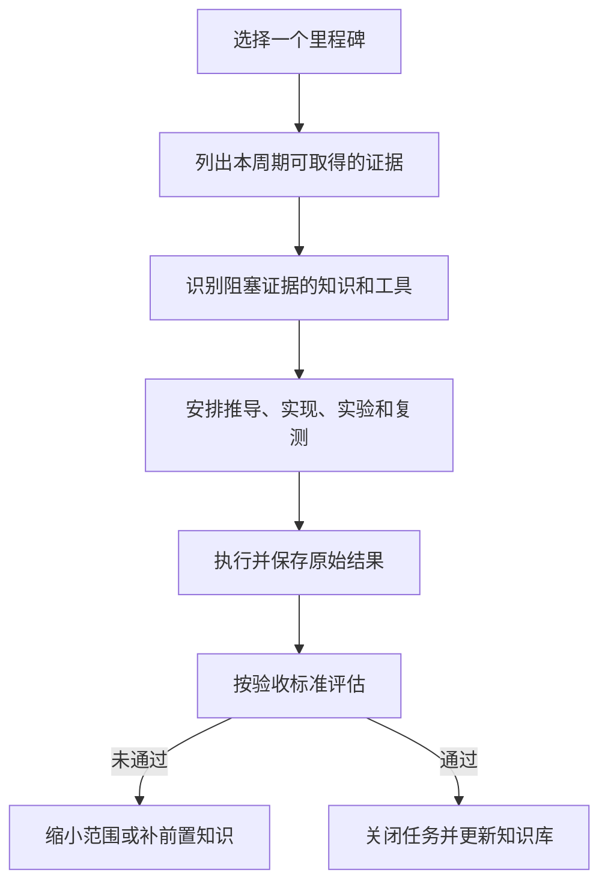

# 学习计划、进度评估与知识维护

计划需要连接长期方向和本周能完成的产出。按小时、章节和视频数量统计投入，可以帮助安排日程，却不能单独判断能力变化。进度应更多依赖延迟复测、独立解决、项目验收和错误是否减少。

## 1. 路线、里程碑和任务分层管理

| 层级 | 回答的问题 | 维护位置 |
|---|---|---|
| 路线 | 最终能力需要哪些领域和依赖 | [[00-Index/01-学习路线图|学习路线图]] |
| 里程碑 | 哪个系统能力将被演示和验收 | 阶段计划或项目总览 |
| 学习任务 | 当前要补哪项知识或技能 | [[001-把目标改写成可验证的学习任务|学习任务卡]] |
| 日常动作 | 今天完成哪次推导、实验或复测 | 当日记录或任务管理器 |
| 证据 | 什么结果说明达到标准 | 主题笔记、项目、测试和原始数据 |

路线图不应直接堆满日常事项。日常动作变化频繁，稳定依赖和里程碑变化较慢，分开维护可以减少反复改写。

## 2. 里程碑用演示定义

FOC 学习里程碑可以写成：

- 用数值脚本验证坐标变换的幅值、方向和逆变换；
- 在示波器上对齐 PWM 更新、ADC 触发和控制中断；
- 在受限能量下完成电流采样标定与开环旋转；
- 闭合电流环并用阶跃或频率响应验证设计；
- 注入传感器与通信故障，验证硬件关断和软件状态机。

每个里程碑都能演示、测量和复测。学习内容根据里程碑暴露的缺口展开，而不是按目录数量平均分配。

## 3. 控制在制任务数量

任务列表可以分为：

- **进行中**：本周期承诺产生验收证据；
- **等待**：缺设备、资料、器件或外部决定；
- **候选**：有价值但尚未进入当前范围；
- **维护**：间隔复习、回归测试和旧笔记更新；
- **结束**：达到标准或明确取消。

进行中任务过多时，常见信号是每项都只有阅读记录、实验台长期保持多个未恢复状态、重复搭环境，以及重新开始时无法说明上次停在哪里。此时先结束或冻结任务，不靠增加计划细节解决切换成本。

## 4. 周期计划从验收反推



日程要为实验失败、器件等待和复测留出余量。计划排满时，任何异常都会挤掉复盘和文档，项目表面上继续向前，证据却越来越少。

## 5. 进度指标看能力和证据

| 指标 | 能说明什么 | 不能说明什么 |
|---|---|---|
| 延迟检索成功率 | 一段时间后能否提取 | 能否处理新场景 |
| 混合题方法选择 | 能否区分相似模型 | 能否完成真实实现 |
| 独立推导与实现 | 对提示的依赖是否下降 | 设计是否覆盖边界 |
| 项目验收通过项 | 当前版本满足哪些要求 | 未测试工况是否可靠 |
| 重复故障数量 | 复盘是否转成长期改进 | 新领域是否没有风险 |
| 可复现记录比例 | 结果能否由版本和步骤重建 | 结论本身是否正确 |
| 阅读时间和笔记数量 | 投入和材料规模 | 掌握程度 |

指标用于发现问题，不适合变成追求数字的目标。为了提高正确率而只做熟悉题，或为了增加笔记数而过度拆分，都会让指标脱离学习目的。

## 6. 周期复盘模板

```markdown
# 周期复盘

## 计划验收的里程碑

## 已取得的证据

## 未通过的验收项

## 暴露出的前置知识缺口

## 重复出现的错误

## 范围、方法或工具调整

## 需要维护的笔记、测试和项目记录

## 下一周期只保留的进行中任务
```

复盘围绕证据和变化展开，不要求每个周期都输出完整总结。没有新信息的固定栏目可以留空。

## 7. 给笔记设置维护触发器

知识不会因为写入 Obsidian 自动保持有效。以下事件会触发维护：

- 数据手册、标准、SDK 或硬件版本更新；
- 项目实验与笔记结论冲突；
- 同一错误再次出现；
- 链接目标改名或目录重构；
- 复习题长期失败或已经失去用途；
- 新资料改变原有适用边界；
- 笔记无法支持当前设计或测试任务。

可以维护 `date-updated` 和证据状态，但不必按固定日历重读所有笔记。由真实使用和风险触发的维护更容易发现有影响的问题。

## 8. 旧结论保留修订关系

修订技术结论时记录：

```markdown
原结论：
原适用条件：
新证据：
修订后的结论：
受影响的项目和笔记：
需要重新执行的计算、仿真或测试：
```

直接覆盖会丢失项目当时为什么采用某个方案。Git 保存文本历史，正文中的修订说明保存工程含义。

## 9. 清理候选列表

收藏的课程、论文、工具和项目可以定期按以下条件筛选：

- 是否服务当前路线或已知缺口；
- 是否有更接近原始事实的资料；
- 是否仍对应当前版本；
- 是否能转成明确产出或检索题；
- 阅读成本是否高于可能影响；
- 是否只是与已有资料重复。

删除候选项不会删除已经掌握的知识。长期没有进入任务、没有独特价值的材料可以移除或归档，让入口保持可用。

## 10. 学习停滞时检查反馈链

| 现象 | 可能缺口 | 调整方式 |
|---|---|---|
| 阅读很多，无法回忆 | 缺主动检索和反馈 | 关闭材料重建，再核对纠错 |
| 会做例题，遇到新题卡住 | 提示撤得太慢，题型过于成组 | 补全题、变式题和交错练习 |
| 仿真正常，实物异常 | 模型、参数或测量链不完整 | 保存残差，设计区分测试 |
| 项目长期无结果 | 范围和未知量过多 | 缩到一个可测问题和单一基线 |
| 反复犯同类错误 | 复盘没有转成动作 | 增加检查表、测试或检索题 |
| 笔记很多但找不到 | 类型、索引和命名不稳定 | 用真实检索任务修正入口 |
| AI 使用很多，独立能力下降 | 提示介入过早 | 先独立尝试，关闭 AI 后复测 |

## 11. 阶段结束条件

- [ ] 里程碑有可演示、可测量的结果；
- [ ] 延迟后能独立重建关键模型和步骤；
- [ ] 能在混合或变式场景中选择方法；
- [ ] 项目验收记录包含版本、条件和未覆盖边界；
- [ ] 重复错误已经转成检查、测试或练习；
- [ ] 稳定知识进入主题笔记并链接证据；
- [ ] 候选材料和进行中任务已经清理；
- [ ] 下一阶段依赖由当前结果决定，而不是由课程目录自动决定。
