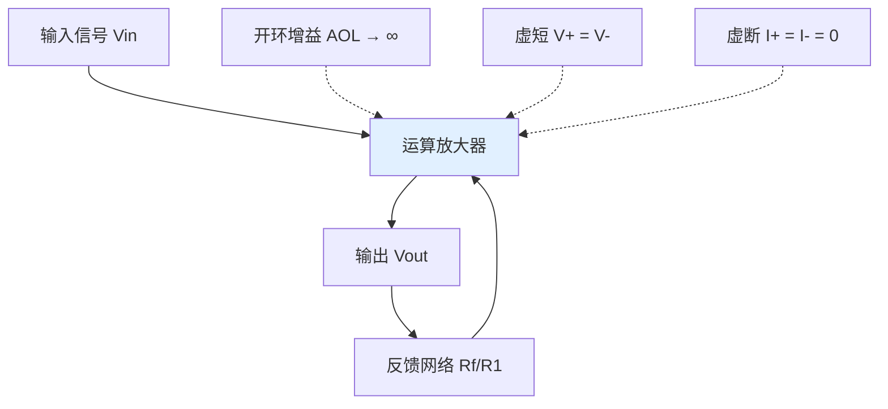

# 可视化：运放电路拓扑

## 负反馈分析框架



### 常见拓扑分类

```mermaid
graph LR
    OP["运算放大器"] --> INV["反相放大<br/>Vout = -Rf/R1·Vin"]
    OP --> NON["同相放大<br/>Vout = (1+Rf/R1)·Vin"]
    OP --> BUF["电压跟随<br/>Vout = Vin"]
    OP --> DIFF["差分放大<br/>Vout ∝ (V2-V1)"]
    OP --> INT["积分器<br/>Vout ∝ ∫Vin"]
    OP --> DER["微分器<br/>Vout ∝ dVin/dt"]
    OP --> FIL["有源滤波器<br/>详见 [[03-滤波器设计]]"]"]
    OP --> CMP["比较器<br/>无负反馈"]
    
    style OP fill:#e1f0ff
    style FIL fill:#fff4e1
    style CMP fill:#ffe1e1
```

### 选型参数雷达图（文字版）

| 应用场景 | 首要参数 | 次要参数 | 推荐型号 |
|----------|----------|----------|----------|
| 高精度直流 | 失调电压、温漂 | 偏置电流、噪声 | OPAx189, AD620 |
| 低噪声音频 | 电压噪声密度 | THD+N、带宽 | OPA2134, NE5532 |
| 高速视频 | 压摆率、带宽 | 建立时间、失真 | ADA4891, OPA690 |
| 电池供电 | 静态电流 | 轨到轨、封装 | MCP6001, TLV9001 |

---

