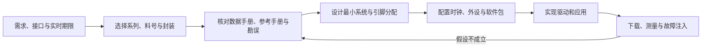

# STM32 系列

STM32 不是一颗芯片，也不是一套完全一致的外设。不同系列采用不同 Cortex-M 内核、总线结构、时钟树、模拟外设、DMA、缓存和安全机制。可迁移的部分主要来自 Cortex-M、CMSIS (Cortex Microcontroller Software Interface Standard) 和 STM32Cube 生态，寄存器行为与硬件限制仍要回到具体料号的官方文档。

## 从需求到可验证固件

## 学习顺序

1. [[001-产品族、型号命名与选型方法]]：按算力、存储、模拟、定时器、连接、安全和生命周期选型。
2. [[002-数据手册、参考手册与勘误表]]：建立文档层级和版本证据链。
3. [[003-Cube工具链、软件包与工程结构]]：管理 `.ioc`、生成代码、固件包和可复现构建。
4. [[004-最小系统、启动模式与调试接口]]：让供电、复位、启动和 SWD 先可靠工作。
5. [[005-时钟树、复位、供电与低功耗]]：从时钟源追到内核、总线和外设内核时钟。
6. [[006-GPIO、EXTI与引脚复用]]：处理复用矩阵、电气限制和外部中断。
7. [[007-定时器、触发网络与PWM]]：建立计数、更新、捕获、互补 PWM 和同步触发模型。
8. [[008-ADC、DAC与片上模拟外设]]：把源阻抗、采样时间、参考电压和触发时刻连起来。
9. [[009-通信外设、DMA与缓存一致性]]：配置平台外设，并明确异步传输和缓冲区边界。
10. [[010-HAL、LL、寄存器与驱动分层]]：选择抽象层并隔离生成代码和应用逻辑。
11. [[011-板级初次上电、调试与验证]]：用分阶段检查缩小硬件、配置和软件问题范围。
12. [[012-Blue Pill与STM32F103C8T6核对清单]]：保留经典板卡的学习价值，同时说明克隆板和旧系列边界。

工具链与定时器的跟做视频见 [[003-Cube工具链、软件包与工程结构|Cube 工具链]] 和 [[007-定时器、触发网络与PWM|定时器与 PWM]]。

## 学 STM32 时需要保留的四层上下文

| 层级          | 主要问题                           | 权威依据             |
| ----------- | ------------------------------ | ---------------- |
| Cortex-M 内核 | 异常、NVIC、SysTick、MPU、缓存和指令集怎样工作 | Arm 架构文档、ST 编程手册 |
| STM32 系列    | 时钟、总线、DMA 和外设实例怎样组织            | 系列参考手册           |
| 具体料号与封装     | 引脚、电气参数、存储容量和外设数量              | 数据手册、勘误表         |
| 开发板与产品 PCB  | 晶振、LED、调试器、电源和连接器接到哪里          | 板卡用户手册、原理图和 BOM  |

## 与其他目录的边界

| 内容                       | 主要位置                                           |
| ------------------------ | ---------------------------------------------- |
| C 类型、指针、寄存器访问和并发契约       | [[01-Foundations/08-嵌入式C编程/000-嵌入式C编程          | 嵌入式 C 编程]]    |
| MCU 通用组成和架构比较            | [[04-Microcontrollers/01-微控制器概述/001-MCU核心组成    | MCU 核心组成]]    |
| NVIC、DMA、缓存和性能深入分析       | [[04-Microcontrollers/06-中断与DMA深入/001-中断系统     | 中断与 DMA 深入]]  |
| 向量表、启动文件、链接脚本和引导程序       | [[04-Microcontrollers/07-MCU启动与链接脚本/001-上电启动流程 | MCU 启动与链接脚本]] |
| UART、SPI、I²C、CAN、USB 等协议 | [[05-Communication/00-README                   | 通信协议]]        |
| JTAG、SWD、示波器和逻辑分析仪操作     | [[09-Debugging-Tools/00-README                 | 调试工具]]        |
| FreeRTOS、任务和同步原语         | [[10-RTOS与系统/00-README                         | RTOS 与系统]]    |
| FOC 算法、采样拓扑和控制周期         | [[14-FOC-电机控制/00-README                        | FOC 电机控制]]    |

## 官方入口

- [STM32 MCU 产品组合](https://www.st.com/en/microcontrollers-microprocessors/STM32-32-bit-arm-cortex-mcus.html)
- [STM32 产品选择器](https://www.st.com/en/microcontrollers-microprocessors/stm32-32-bit-arm-cortex-mcus/products.html)
- [STM32 软件开发工具](https://www.st.com/en/development-tools/STM32-software-development-tools.html)
- [STM32CubeMX](https://www.st.com/en/development-tools/stm32cubemx)
- [STM32 Nucleo 与评估板](https://www.st.com/en/evaluation-tools/stm32-mcu-mpu-eval-tools.html)
