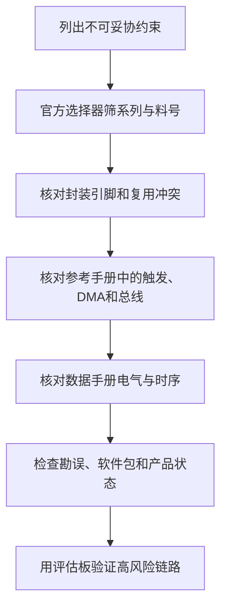

# 产品族、型号命名与选型方法

**内核和最高主频只能做初筛**。工程中更容易卡住的是引脚冲突、定时器通道、ADC 触发关系、DMA 可达性、RAM 分区、封装散热和器件生命周期。选型表应从需求反推，不能把产品族排成一条简单的性能阶梯。

## 产品族按设计目标分组

ST 会持续增加产品线，下面只用于建立方向，具体状态和参数以官方选择器为准。

| 方向 | 常见系列 | 适合先检查的能力 |
|---|---|---|
| 成本与通用控制 | C0、G0、C5、F0、F1 | 封装、基础定时器、ADC、通信和成本 |
| 混合信号与实时控制 | F3、G4 | 高级/HRTIM、快速 ADC、比较器、运放、CORDIC/FMAC |
| 高性能 | F2、F4、F7、H5、H7、N6 | 内核、缓存、多 RAM 域、外部存储、图形或加速器 |
| 低功耗 | L0、L4/L4+、L5、U0、U3、U5 | 低功耗模式、唤醒源、静态电流、安全和模拟能力 |
| 无线 | WB0、WB、WBA、WL | 协议栈、射频、双核边界、认证和天线设计 |

F1、F4 等成熟系列有大量教程和存量项目，仍适合维护与学习；新设计是否继续采用，要结合供货、功耗、安全、外设和软件生态判断。STM32MP 属于带 Cortex-A 的微处理器系列，应在嵌入式 Linux 语境中单独评估。

## 选型输入应先量化

| 维度   | 需要写出的约束                              |
| ---- | ------------------------------------ |
| 计算   | 控制周期、最坏执行时间、FPU/DSP/加速器需求            |
| 存储   | Flash、RAM、非易失数据、外部存储接口和增长余量          |
| 模拟   | ADC 分辨率与速率、源阻抗、同步采样、DAC、比较器、运放       |
| 定时器  | PWM 路数、互补输出、死区、编码器、捕获和内部触发           |
| 通信   | 实例数量、速率、引脚位置、CAN FD、USB、Ethernet 或无线 |
| 封装   | 可用 GPIO、模拟引脚、散热、爬电距离和生产焊接能力          |
| 安全   | 安全启动、加密、隔离、TrustZone、生命周期和密钥配置       |
| 电源   | 电压范围、峰值电流、低功耗模式、唤醒时间和电池目标            |
| 生命周期 | 产品状态、供货风险、替代路线、认证和软件维护周期             |

## 从系列缩小到具体料号

料号字符的含义随系列而变。可以用 `STM32G474RET6` 这类名称识别系列、产品线、封装和存储档位，但正式解码应查看对应数据手册中的订购信息，不能把一个系列的命名规则机械套到另一系列。

## FOC 与数字电源选型

这类应用通常先看：

- 高级定时器或 HRTIM 是否提供所需互补输出、死区、刹车和更新机制；
- ADC 能否由定时器在正确相位触发，转换时间能否进入控制期限；
- 比较器能否直接连接定时器保护输入；
- DMA、CORDIC、FMAC 和内存布局是否减少关键路径负担；
- 功率板接口、隔离、调试和硬件保护是否已有评估资源。

STM32G4 是常见候选，但最终选择仍由功率级、采样拓扑、控制频率和安全要求决定。[ST STM32 电机控制生态](https://www.st.com/content/st_com/en/ecosystems/stm32-motor-control-ecosystem.html)提供了系列、板卡和软件入口。

## 开发板怎样选

学习和原型阶段优先选择带板载 ST-LINK、原理图完整且能暴露目标外设的官方 Nucleo 或 Discovery 板。可按目标选代表性平台：

- 通用外设与成熟生态：NUCLEO-F446RE 一类 Nucleo-64；
- 电机控制和混合信号：NUCLEO-G431KB、NUCLEO-G474RE 或相应控制板；
- 高性能、缓存与多 RAM 域：H5/H7 Nucleo；
- 低功耗与安全：U5 Nucleo；
- 无线：带对应射频布局和认证资源的 WB/WBA/WL 板。

板卡是否在售、板载调试器版本和连接器布局会变化，购买前查看官方产品页、用户手册和原理图。Blue Pill 的限制见 [[012-Blue Pill与STM32F103C8T6核对清单]]。

## 选型交付物

- 一份带单位和上下限的需求表；
- 两到三个候选料号及淘汰理由；
- 引脚复用表和时钟、触发、DMA 草图；
- Flash、RAM、栈和数据缓冲预算；
- 数据手册、参考手册、勘误表和软件包版本；
- 评估板验证结果及仍未关闭的风险。

## 继续学习

- [[002-数据手册、参考手册与勘误表]]
- [STM32 MCU 产品组合](https://www.st.com/en/microcontrollers-microprocessors/STM32-32-bit-arm-cortex-mcus.html)
- [STM32 Nucleo 与评估板](https://www.st.com/en/evaluation-tools/stm32-mcu-mpu-eval-tools.html)
