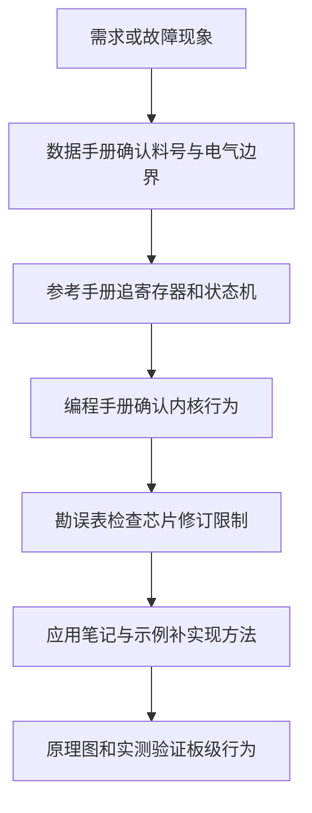

# 数据手册、参考手册与勘误表

STM32 的一个功能常分散在多份文档里。数据手册说明具体料号有什么和电气边界是多少，参考手册说明系列外设怎样工作，编程手册说明 Cortex-M 实现，勘误表说明哪些行为不能按正常描述使用。

## 文档层级

| 文档 | 主要回答 | 不负责回答 |
|---|---|---|
| 数据手册 | 引脚、封装、电气、存储、外设数量和时序极限 | 寄存器完整工作流程 |
| 参考手册 | 时钟、总线、寄存器、外设状态机和触发关系 | 某个封装是否引出该引脚 |
| 编程手册 | 内核、异常、NVIC、MPU、缓存和系统控制块 | 芯片外设细节 |
| 勘误表 | 特定芯片修订版的已知限制和规避方法 | 通用功能教程 |
| 应用笔记 | 某类问题的设计方法和实测建议 | 代替料号电气规格 |
| 板卡用户手册与原理图 | 板载器件、跳线、电源、调试器和连接器 | 芯片所有能力 |
| Cube 固件包文档 | HAL/LL、例程、中间件和版本变化 | 芯片物理极限 |

## 从引脚追到功能

查一个外设信号时，至少完成四次核对：

1. 数据手册的引脚表确认当前封装是否引出该信号；
2. 复用功能表确认 AF 编号和可选引脚；
3. 参考手册确认外设时钟、寄存器与内部触发；
4. 板卡原理图确认该引脚有没有接到 LED、晶振、调试器或其他器件。

CubeMX 能发现许多冲突，但它不能判断外部电平、走线质量、源阻抗和板级占用是否满足设计。

## 文档版本也是工程配置

项目记录中应保留：

- 完整料号、封装和芯片修订标识；
- 数据手册、参考手册和勘误表的编号与修订版；
- Cube 固件包、HAL/LL 和 CMSIS 版本；
- IDE、编译器、链接器和生成器版本；
- 开发板硬件版本与原理图版本。

只保存网页链接不够，官网更新后内容可能变化。关键结论可记录文档编号、章节、表格或寄存器名称，便于后续复核。

## 用寄存器描述验证代码

遇到清标志、启动转换或切换时钟时，不从相似芯片示例猜写法。按下面的问题逐项确认：

- 位是只读、读写、只写、W1C、W0C 还是读清除；
- 写入时是否必须保持保留位；
- 配置能否在外设使能状态修改；
- 状态位代表请求已接受，还是物理动作已完成；
- 需要等待几个时钟域同步周期；
- 勘误表是否修改了正常流程。

## 文档阅读产出

一项外设功能进入代码前，最好形成简短设计记录：输入时钟、引脚、DMA/中断、初始化顺序、正常状态机、超时和恢复方法，以及对应文档章节。这样能区分“教程这么写”和“当前芯片确实要求这样写”。

## 继续学习

- [[003-Cube工具链、软件包与工程结构]]
- [[004-最小系统、启动模式与调试接口]]
