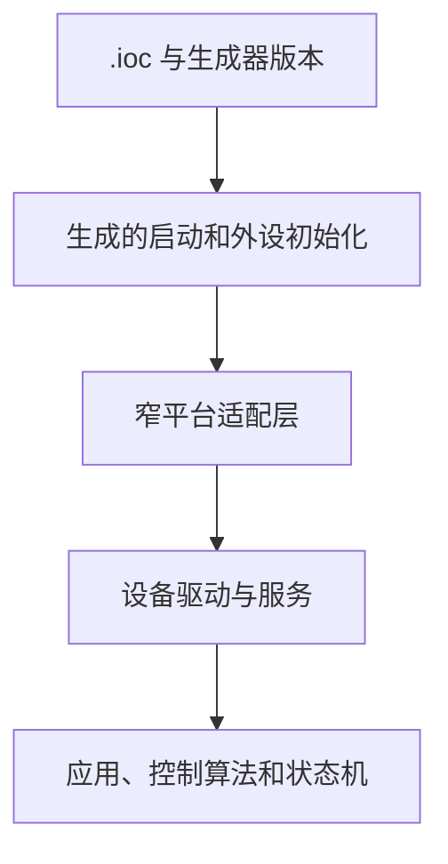

# Cube 工具链、软件包与工程结构

STM32CubeMX 负责引脚、时钟、外设和中间件配置并生成初始化代码。编译、调试、下载、监控和持续集成由其他工具完成。把这些工具的版本与职责分开，工程才容易复现和升级。

## 工具怎样分工

| 工具 | 主要用途 |
|---|---|
| STM32CubeMX / CubeMX2 | 选型、引脚、时钟、外设、中间件和初始化代码生成 |
| STM32CubeIDE | 编辑、构建、GDB 调试并集成 Cube 配置能力 |
| STM32CubeIDE for VS Code | 在 VS Code 中使用 ST 提供的 STM32 开发工作流 |
| STM32CubeCLT | 命令行编译器、构建和调试组件，适合脚本与 CI |
| STM32CubeProgrammer | 通过 SWD/JTAG 或系统引导接口读写、验证和配置器件 |
| STM32CubeMonitor | 运行期变量采集、可视化和诊断 |
| Keil MDK / IAR | 商业编译、调试、分析和功能安全工具链 |

## 固件包属于依赖

`STM32CubeG4`、`STM32CubeH7` 等系列固件包通常包含 CMSIS 设备文件、HAL、LL、板级支持、例程和中间件。两个工程都使用 HAL，不代表行为和接口完全相同；系列、固件包版本和 HAL 代际都会带来差异。

依赖记录至少包括：

- 固件包名称和版本；
- 使用的 HAL、LL、CMSIS 与中间件组件；
- 组件是复制进仓库、由包管理器取得还是外部引用；
- 本地补丁及其上游依据；
- 许可证和发布时需要附带的文件。

## 生成代码与手写代码的边界



生成器负责机械配置，应用逻辑应放在独立源文件。`USER CODE` 区域能降低重新生成时被覆盖的风险，但不适合承载大型模块。重新生成后需要审查时钟、NVIC、DMA、链接脚本、中间件和文件增删，不能默认差异都正确。

`.ioc` 文件应进入版本控制。它描述了很多配置，但仍不能替代原理图、设计记录和生成结果，因为部分手工修改、链接配置和构建选项不在 `.ioc` 中。

## 一个可维护的工程结构

```text
Core/或生成目录        启动文件、main 和 Cube 初始化
Platform/              时钟、时间、临界区和板级适配
Drivers/               面向设备能力的驱动
Services/              通信、诊断、配置和状态机
Application/           产品逻辑或控制算法
Tests/                 主机测试、目标板测试和桩件
Config/                板型、功能开关和版本化参数
```

目录名可以不同，职责边界比名称重要。应用代码不应直接依赖 `MX_*_Init`、全局 HAL 句柄和固定 GPIO 端口，否则换料号或做主机测试时会扩散修改。

## 构建和发布需要保留什么

- 编译器、链接器、生成器和固件包版本；
- 完整构建命令、宏、优化与浮点 ABI；
- 链接脚本、启动文件、ELF、映射文件和下载格式；
- `.ioc`、引脚表和硬件版本；
- 静态分析、测试和目标板测量结果。

## 继续学习

- [[004-最小系统、启动模式与调试接口]]
- [[010-HAL、LL、寄存器与驱动分层]]
- [STM32CubeMX](https://www.st.com/en/development-tools/stm32cubemx)
- [STM32 软件开发工具](https://www.st.com/en/development-tools/STM32-software-development-tools.html)
