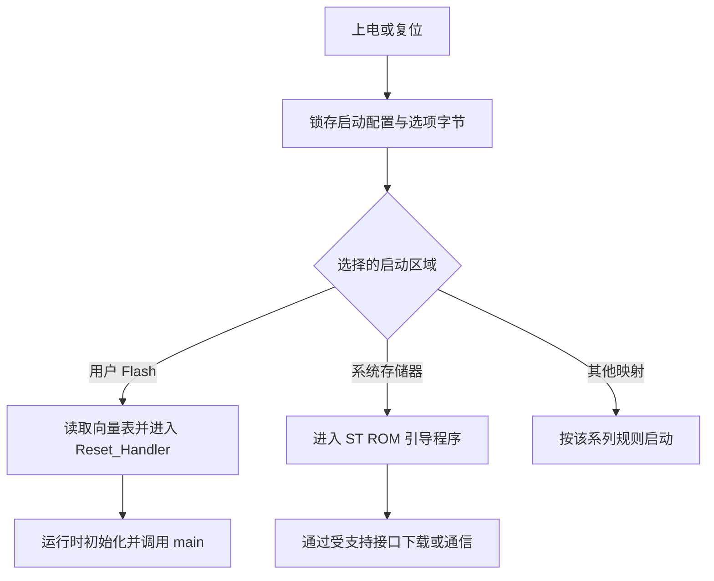

# 最小系统、启动模式与调试接口

一块新板能否稳定连接调试器，主要由供电、复位、启动配置、时钟和 SWD 布线决定。应用代码尚未运行时，这些条件已经决定处理器从哪里取指、调试端口是否可用以及模拟外设能否工作。

## 最小系统检查对象

| 对象 | 需要核对的内容 |
|---|---|
| 数字电源 | 所有 VDD/VSS 引脚、电压范围、去耦和上电斜率 |
| 模拟电源 | VDDA/VSSA、参考电压、滤波和与数字电源的关系 |
| 内核稳压 | VCAP 等专用引脚及数据手册要求的电容，取决于系列 |
| 复位 | NRST 上拉、滤波、外部驱动和调试器连接 |
| 启动 | BOOT0、选项字节、系统存储器和用户 Flash 条件 |
| 时钟 | HSI 等内部时钟是否足够，HSE/LSE 的器件与负载是否匹配 |
| 调试 | SWDIO、SWCLK、NRST、参考电压、地和可选 SWO |

不要把其他 STM32 板的电容值、BOOT 电阻和晶振参数直接复制过来。系列硬件设计指南、具体数据手册和晶体参数共同决定取值。

## 启动路径

系统存储器引导程序支持哪些 UART、USB、CAN、I²C 或 SPI 接口，取决于具体料号和 ROM 版本。应查看对应应用笔记，不要只凭“STM32 支持串口下载”确定板级接口。

启动文件、向量表和 C 运行时细节见 [[04-Microcontrollers/07-MCU启动与链接脚本/001-上电启动流程|上电启动流程]]。

## SWD 接口要保留恢复能力

原型板至少引出 SWDIO、SWCLK、GND、目标参考电压和 NRST。固件可能重映射调试引脚、进入低功耗、切换到错误时钟或立刻触发看门狗，连接 NRST 能提高“复位下连接”的恢复成功率。

调试接口问题可按顺序排查：

1. 测量各电源轨和 NRST；
2. 降低 SWD 时钟并尝试复位下连接；
3. 检查 BOOT 配置，必要时进入系统存储器；
4. 读取器件 ID、选项字节和读保护状态；
5. 擦除错误固件并恢复最小时钟程序；
6. 检查焊接、引脚占用和调试器参考电压。

读保护、写保护和安全生命周期操作可能造成不可逆或需要全片擦除的影响，配置前应单独评审并保留恢复方案。

## 首次上电的安全顺序

- 限流供电，先确认静态电流和芯片温升；
- 不连接功率级和高能量负载；
- 先验证 SWD、复位原因和内部时钟；
- 再启用外部晶振、PLL 和单个 GPIO；
- 最后逐项加入外设、中断、DMA 和输出驱动。

## 继续学习

- [[005-时钟树、复位、供电与低功耗]]
- [[011-板级初次上电、调试与验证]]
- [[09-Debugging-Tools/05-JTAG与SWD调试/05-JTAG与SWD调试|JTAG 与 SWD 调试]]
