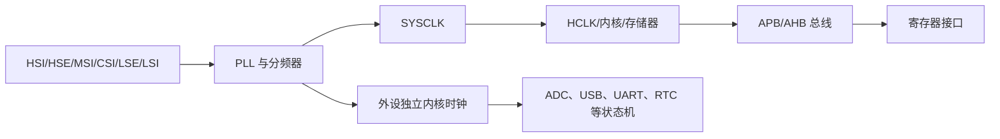

# 时钟树、复位、供电与低功耗

STM32 外设经常同时依赖总线时钟和外设内核时钟。寄存器能访问，只能证明总线接口可能已经有时钟；外设状态机、ADC、USB、RTC 或随机数发生器还可能使用另一条时钟源。

## 从时钟源追到使用者

系列之间的时钟源名称、PLL 数量和选择器差异很大。计算频率时应从参考手册的时钟树逐级记录，不凭 CubeMX 界面颜色或其他芯片的公式猜测。

## 定时器时钟需要单独确认

很多 STM32 在 APB 预分频不为 1 时，会给定时器提供经过倍频的时钟；部分系列还有 `TIMPRE` 或不同的内核时钟选择规则。定时器计数频率应从当前系列的 RCC 章节确定，再代入：

$$
f_{update}=\frac{f_{TIM}}{(PSC+1)(ARR+1)}
$$

这只是常见向上计数更新频率。中心对齐、重复计数器、级联和外部时钟会改变事件频率，PWM 的实际输出还受比较模式和影子寄存器更新点影响。

## 时钟切换是状态机

从内部时钟切到外部晶振和 PLL 时，典型步骤包括：

1. 保持当前安全时钟运行；
2. 配置电源电压范围、Flash 等待周期和缓存；
3. 启动目标振荡器并带超时等待就绪；
4. 配置并锁定 PLL；
5. 设置总线分频，切换系统时钟；
6. 读回状态并更新软件中的时钟值；
7. 失败时保留安全时钟并记录故障。

准确顺序由系列参考手册和 HAL 实现决定。时钟启动可能失败，量产产品不能用无限循环等待 HSE 就绪。

## 复位域不等于全芯片清零

上电复位、引脚复位、软件复位、看门狗复位、低功耗退出和外设局部复位覆盖范围不同。备份域、RTC、复位原因寄存器和某些 RAM 可能保留状态。启动代码应尽早读取并保存复位原因，再按手册规定清除标志。

外设初始化失败时，局部复位可以恢复其寄存器状态，但还要处理时钟、DMA 请求、NVIC 挂起位、GPIO 复用和上层状态，不能把一次 RCC 复位当成完整恢复协议。

## 低功耗由整条唤醒链决定

| 问题 | 需要验证 |
|---|---|
| 哪些时钟停止 | 内核、总线、外设和调试时钟 |
| 哪些 RAM 保留 | 数据区、备份域和缓存状态 |
| 谁能唤醒 | EXTI、RTC、UART、低功耗定时器等 |
| 唤醒后多久可用 | 振荡器、PLL、Flash、外设和应用恢复时间 |
| 调试器是否改变功耗 | 调试保持位、SWD 和追踪接口 |
| 引脚处于什么状态 | 上下拉、模拟开关、外部负载和漏电路径 |

数据手册给出的最低功耗通常对应严格测试条件。板卡稳压器、LED、上拉、传感器和调试器都会进入实测结果，应使用电流测量工具验证整板而非只引用芯片典型值。

## 检查清单

- 记录每个关键外设的总线时钟和内核时钟来源。
- Flash 等待周期、电压范围和系统频率匹配。
- 所有时钟等待都有超时和安全回退。
- 定时器频率使用实际 `f_TIM`，考虑计数模式和更新机制。
- 保存并解释复位原因，不在初始化中提前清掉证据。
- 低功耗测量断开调试影响，并覆盖整板外设和引脚状态。

## 继续学习

- [[006-GPIO、EXTI与引脚复用]]
- [[007-定时器、触发网络与PWM]]
